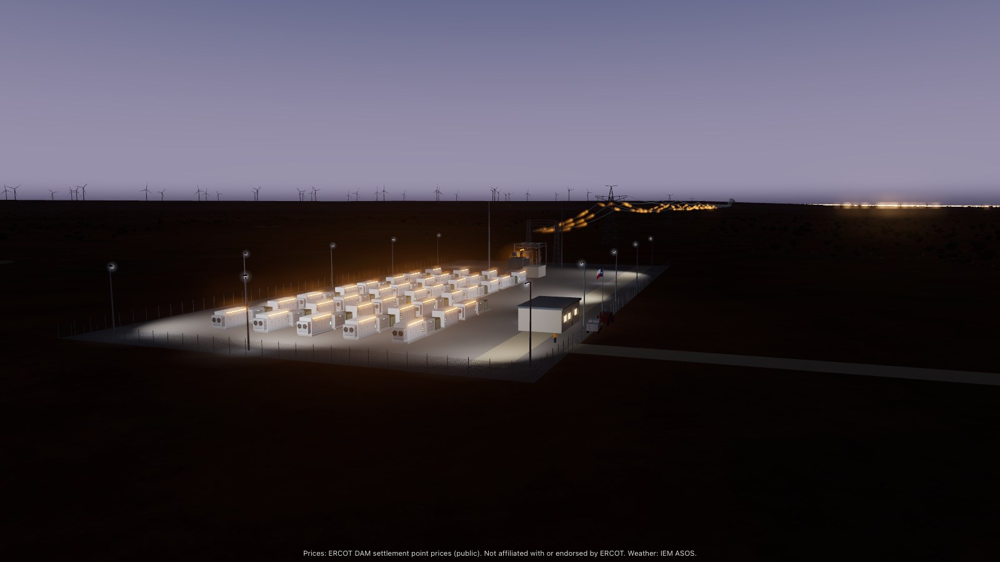

<div align="center">

<a href="https://earakely-scale-gridsimenv-agentenv.static.hf.space/index.html?episode=runs/dam-v1-2025-03-15-HB_WEST-1h-t-zgptiln6.json"></a>

<h1>GridSimEnv: run a battery on the real Texas grid</h1>

<h3>v1, The Battery Desk: one grid battery at an ERCOT hub for one day, on the real day-ahead prices, graded exactly against the optimum</h3>

<p>A trainable AgentEnv environment built from ERCOT's public market prices and EIA-860 battery records, with an exact dynamic-programming grader, 21,250 battery-days and a public train split.</p>

<a href="https://huggingface.co/datasets/earakely-scale/GridSimEnv-AgentEnv"></a>
<a href="https://huggingface.co/spaces/earakely-scale/GridSimEnv-AgentEnv"></a>
<a href="https://www.agentenvframework.com"></a>
<a href="NOTICE"></a>

</div>

---

An agent runs one battery in the ERCOT day-ahead market (DAM) for one operating day, at one of the 7 trading hubs or 8
load zones of the Texas grid. It reads the battery and the day's 24 hourly prices and submits 24 integers: how many
energy units to buy or sell each hour. The schedule settles at the real prices of that day and is graded exactly,
with no judge, against the best schedule a dynamic program finds for it in under a millisecond. The prices are ERCOT's
own, 2014 to 2026; the batteries are archetypes sized from the ERCOT fleet in EIA-860.

GridSimEnv is the third simulation environment for [FineEnvs](https://github.com/adithya-s-k/FineEnvs), after
PortSimEnv and AirOpsEnv, and the first built to **show training**: a small open model trained with GRPO on an AgentEnv
simulation, end to end on one GPU. v1 is a single tool call carrying 24 integers, with an exact optimum and a dense
reward, on tens of thousands of real days, with 2025 held out. The mistakes a model makes are visible and countable:
selling before charging, overfilling, ending the day short, and idling all day.

This repository is an environment plugin for the [AgentEnv Framework](https://www.agentenvframework.com), Scale AI's
open-source framework for building RL environments. One code path, `gridsim_core`, holds the physics, the optimum and
the grader; the env, its verifier and training all import it, so a policy is never trained against a drifted copy.

**Terms used below:**

- **Battery-day:** one task: one battery at one settlement point on one date.
- **Unit:** the battery moves energy in whole units of `unit_mwh` MWh; its state of charge (SoC) is counted in units.
- **HE01 to HE24:** the hours ending 01:00 to 24:00, Central Prevailing Time, ERCOT's convention.
- **P_opt, P_idle, P_anchor:** the day's best possible profit, the profit of doing nothing, and the reference profit
  a schedule is scored against.
- **Foresight, blind:** the two tiers: the agent sees the day's prices, or only the days before.
- **Bundle:** what `agent-env run` plays: a folder of tasks and their verifier, or one a plugin ships (`gridsim`).

**Contents:** [What's in it](#whats-in-it) · [The v1 game](#the-v1-game) · [Run it yourself](#run-it-yourself) ·
[The tools](#the-tools) · [Grading](#grading) · [The data](#the-data) · [Baselines](#baselines) ·
[The board](#the-board) · [Training](#training) · [Roadmap](#roadmap) · [On the Hugging Face Hub](#on-the-hugging-face-hub)
· [Repository layout](#repository-layout) · [Development](#development) · [Licence and attribution](#licence-and-attribution)

## What's in it

- **One environment,** `gridsim`, an MCP server env with three tools, `get_situation`, `check_schedule` and
  `submit_schedule` ([The tools](#the-tools)).
- **21,250 battery-days in four packs,** plus 761 display-only days of famous events: 20,000 train days of 2014 to
  2024, 500 held-out days of January to November 2025, 500 on reserved dates of 2014 to 2024, and 250 after ERCOT's
  real-time co-optimization went live on 5 December 2025 ([The data](#the-data)).
- **An exact grade, with no judge.** A schedule scores clip(0.2 + 0.8 (P − P_idle) / (P_anchor − P_idle), 0, 1):
  doing nothing scores 0.2, the optimum 1.0, and a run that submits nothing 0 ([Grading](#grading)).
- **Two tiers.** Foresight, on the day's prices, is the training headline. Blind decides from the previous day's and
  week's prices, against the better of two forecast-driven references a desk could build from the same inputs.
- **An agent,** `gridsim-llm`, which plays a battery-day with any model behind agent-env's LiteLLM endpoint.
- **Commands.** `agent-env gridsim setup` builds the env and the agent; `tasks generate`, `sweep run`, `sweep report`
  and `episodes` play models over a pack under a spend cap and write the board; `view` and `record` replay the runs.
- **A training path.** `gridsim_core.trl.reward_fn` grades completions for TRL's GRPO in under a millisecond, on
  exactly the prompt the env sends ([Training](#training)).
- **On the Hugging Face Hub.** The dataset
  [earakely-scale/GridSimEnv-AgentEnv](https://huggingface.co/datasets/earakely-scale/GridSimEnv-AgentEnv) holds every
  battery-day at each tier with its prompt, the references and the recorded runs; the
  [Space](https://huggingface.co/spaces/earakely-scale/GridSimEnv-AgentEnv) replays the runs as a 3D battery yard in the
  point's region, in that day's light and weather. The plugin installs agentenv-hf, so `agent-env hf run` plays a
  battery-day straight from the dataset.

## The v1 game

The battery moves energy in whole units and holds 0 to `soc_levels` of them. Each hour the agent chooses one integer
`a`: `a > 0` sells `a` units, `a < 0` buys `-a` units, `0` idles. The rules:

1. Each hour, `-k_ch <= a <= k_dis` (the power limits, in units an hour).
2. The state of charge stays between 0 and `soc_levels` after every hour.
3. The units discharged over the day sum to at most `cycle_cap_units`.
4. At the first hour that breaks rule 1, 2 or 3, that hour and every later hour execute as 0; the hours before still
   settle.
5. After HE24 the state of charge must be at least `s_end_min`. Each missing unit is bought back: `unit_mwh / eta`
   MWh at the day's highest price, or $50/MWh if that is higher.

Selling `a` units delivers `a × unit_mwh` MWh; buying `a` units draws `a × unit_mwh / eta` MWh, so the losses fall on
the buy side. Each hour's cash is the price times the MWh sold (bought MWh count negative), less `c_deg × unit_mwh`
per unit discharged for degradation. Profit is the day's cash less the end-of-day penalty. A negative price pays the
battery to buy.

A battery from the packs (`2h-o`): 150 MW / 300 MWh, `unit_mwh` 75, `soc_levels` 4, `k_dis` = `k_ch` = 2, `eta`
0.80, `c_deg` $4/MWh, `cycle_cap_units` 6, starting empty and free to end empty. On 25 February 2025 at the Austin
Energy load zone (`dam-v1-2025-02-25-LZ_AEN-2h-o`), the day has two peaks, $49.57 at HE07 and $49.59 at HE19, and its
cheapest hours are HE15 and HE16 ($12.61, $10.79). The optimum buys 2 units at HE01, sells them at HE07, buys 4 over
HE15 and HE16 and sells them over HE19 and HE20: $9,569.63, with the cycle cap used up. The greedy rule makes only the
evening round trip ($4,815.38, reward 0.603); the
[dataset card](https://huggingface.co/datasets/earakely-scale/GridSimEnv-AgentEnv#a-worked-day) works the day hour by
hour.

**Tiers.** At the foresight tier the situation carries the day's 24 prices. At the blind tier it carries the prices at
the same point for the previous day and for each of the previous 7 days (oldest first), and `check_schedule` never
shows a profit, which would reveal the day's prices; the schedule still settles on them. The tier is set when the task is
loaded and is not part of the task id.

**Harnesses.** `full` offers all three tools with 3 checks. `oneshot` offers only `submit_schedule`, on the path-B
prompt: the env sends exactly what training sees, so a trained model plays it as it trained.

## Run it yourself

You need [Docker](https://docs.docker.com/get-docker/), running and usable without `sudo`, with buildx,
[uv](https://docs.astral.sh/uv/) and git. The first check needs no model key.

```bash
uv tool install agentenv-framework \
    --with "agentenv-gridsim @ git+https://github.com/earakely-scale/agentenv-gridsim-plugin@v0.1.0"
agent-env gridsim setup --agent        # build the env and agent images; register the env "gridsim" and "gridsim-llm"
agent-env run gridsim --task smoke     # load a fixture day, submit its DP optimum, grade it: passed
```

`setup` builds for the Docker host's own platform (`linux/arm64` on Apple Silicon); `--platform linux/amd64` builds for
remote sandboxes. It builds the checkout an editable install runs from, the current directory if it is a checkout, or
the GitHub commit the plugin was installed from. The bundle `gridsim` that ships with the plugin also has
`wiring-infeasible` (scores exactly 0.050083, below idle) and `wiring-nosubmit` (scores 0), and `full` and `oneshot`,
which play the same fixture day with a model:

```bash
export LITELLM_BASE_URL=https://your-litellm-proxy/v1 LITELLM_API_KEY=...
agent-env run gridsim --task full --model openai/gpt-6.1-sol
```

**Play a pack.** `tasks generate` writes a pack as a bundle, one task per battery-day, at one tier and harness;
`--zone HB_WEST` keeps one settlement point's days:

```bash
agent-env gridsim tasks generate --pack ercot-dam-v1-eval --tier blind --bundle full
agent-env run results/bundles/ercot-dam-v1-eval-blind-full --task dam-v1-2025-01-06-HB_WEST-1h-f --model openai/gpt-6.1-sol
```

**Sweep and report.** A sweep plays models over a pack's battery-days under a spend cap, one `agent-env run` per
attempt, retried and resumable; the report writes the eval card and the board; `episodes` turns each scored run into
Episode JSON after replaying every recorded tool call on a fresh env and checking the reward against `gridsim_core`:

```bash
agent-env gridsim sweep run --name sol-full --models openai/gpt-6.1-sol --tasks all \
    --pack ercot-dam-v1-eval --tier foresight --bundle full --cap-usd 50 --episode-cap-usd 0.5
agent-env gridsim sweep report sol-full        # results/eval-v1.json and results/board.md
agent-env gridsim episodes sol-full            # results/runs/sol-full/*.json
```

`--tasks` takes `all`, a count (the pack's first N) or task ids; `--k` plays each task more than once; `--parallel`
sets the attempts at a time (default 4). Running the same sweep again resumes it. When some of a sweep's tasks are
re-run as another sweep under an amendment, `sweep report SWEEP --amend SWEEP=AMENDMENT` reports both: the headline
takes each run's score from either, and `prereg` the registered sweep alone. `scripts/board.py` writes the v1 board
this way, with its text around the tables.

**Watch.** `view` serves the viewer read-only on loopback over `results/runs`, with the list of episodes at its root;
`record` films one episode in headless Chrome from a checkout:

```bash
agent-env gridsim view                         # http://127.0.0.1:8239/
agent-env gridsim record results/runs/sol-full/<episode>.json
```

agent-env reads `.agentenv/config.toml` from the directory it runs in or the nearest one above it; without one it runs
on its local defaults (stores under `~/.local/state/agent-env/`, images in a registry at `localhost:5000`, the env as a
container on this machine's Docker). The model endpoint is `[model]` in that file, or `LITELLM_BASE_URL` and
`LITELLM_API_KEY`.

<details>
<summary>Troubleshooting</summary>

- **`agent-env: command not found`:** uv installed it in a directory that isn't on your PATH yet; run
  `uv tool update-shell` and open a new terminal.
- **A step fails because something holds port 5000:** agent-env keeps its images in a local registry on
  `127.0.0.1:5000`. On macOS, AirPlay Receiver often holds that port; turn it off in System Settings.
- **The run says there is no env `gridsim`:** run `agent-env gridsim setup` first, with the same config.
</details>

## The tools

| Tool | Returns | Limits |
|---|---|---|
| `get_situation()` | the situation JSON: the task id, tier, date, settlement point, the battery, the $50/MWh shortfall floor, the check budget, and the day's prices (foresight) or the previous day's and week's (blind) | free |
| `check_schedule(actions)` | `feasible`, `truncated_at` (the first broken hour, 0-based), `violation`, `soc_path` (25 values), `end_shortfall_units`, `profit_usd` (null at the blind tier), `checks_left` | 3 per episode; never a reward or a reference |
| `submit_schedule(actions)` | `submitted`, `feasible`, `truncated_at`, `violation`, `soc_path`, `profit_usd` | ends the episode; an unparseable schedule returns `submitted: false` with the error and uses a call |

`actions` is a JSON list of exactly 24 integers, HE01 first, or a string of 24 integers separated by commas or spaces;
anything else is not a submission. An integer out of range parses and then truncates the day at its hour. An episode
allows 24 tool calls and 4 turns, enforced by the env; calls after the submit return an error.

The harness drives the env through its extensions, which the agent never sees:

| Extension | What |
|---|---|
| `urn:gridsim:load-task/v1` `{task_id, tier, checks}` | starts an episode on a battery-day of the packs |
| `urn:gridsim:submit-schedule/v1` | submits a schedule as `submit_schedule` does (the wiring tasks) |
| `urn:agentenv:disable-tool/v1`, `urn:agentenv:enable-tool/v1` | hide or show tools (`oneshot` hides `get_situation` and `check_schedule`) |
| `data/get` | `{task_id, tier, checks_used, calls_used, done, end_reason, schedule, grade, reward}`; the grade and reward only once the episode is done |
| `data/reset` | clears the episode |

`gridsim-verifier` reads `data/get` after the run, grades the schedule again with `gridsim_core` (it must agree with
the env), and scores the reward, with the hindsight capture `r_opt` as a weight-0 row. A run that submitted nothing
scores 0, and an env that can't report fails the step.

## Grading

    R = clip(0.2 + 0.8 · (P − P_idle) / (P_anchor − P_idle), 0, 1), rounded to 6 decimals

- **P** is the schedule's profit as the rules settle it; **P_idle** the profit of 24 zeros, which is negative when the
  end obligation is above the starting charge (12 of the 78 battery designs).
- **Foresight:** P_anchor is **P_opt**, which a dynamic program finds exactly in under a millisecond, over the state
  of charge (0 to `soc_levels`), the units discharged so far (0 to `cycle_cap_units`) and every allowed action. Its
  end value charges the same shortfall penalty, and ties break toward smaller actions, then lexicographically. An LP
  relaxation bound, `p_lp`, is reported beside it: over every candidate day it exceeds P_opt by at most 4.2% of its
  margin over idle, and by nothing up to the 99th percentile.
- **Blind:** P_anchor is max(P_persist, P_ridge): the DP schedule on the previous day's prices (persistence) and on a
  lagged ridge regression's forecast of the day (`data/ridge-v1.json`, fit on the train split), each settled on the
  actual day. The blind headline is `r_opt`, the same formula against P_opt; `beats_anchor` reports whether the agent
  beat its reference.
- A run with no valid submit scores 0. There is no format credit, and no judge.
- The hindsight capture `r_opt` is reported on every run at weight 0, so an agent that beats its anchor shows without
  changing the scale.

The same `gridsim_core.grade` runs in the env, in the verifier and in training; the plugin's tests check that the env,
the verifier and `gridsim_core` agree to 1e-6 on the same 24 actions.

## The data

The prices are ERCOT's *Historical DAM Load Zone and Hub Prices* (report NP4-180-ER), the yearly files for 2014 to
2026: the hourly DAM settlement point price at the hubs HB_HOUSTON, HB_NORTH, HB_PAN (from 6 April 2019), HB_SOUTH,
HB_WEST, HB_HUBAVG and HB_BUSAVG, and the load zones LZ_AEN, LZ_CPS, LZ_HOUSTON, LZ_LCRA, LZ_NORTH, LZ_RAYBN,
LZ_SOUTH and LZ_WEST. `scripts/build_pack.py` turns them into the packs in one command, from the raw zips in
`cache/raw` (each pack's manifest records their SHA-256):

| Pack | Split on the Hub | Dates | Battery-days | Blind tier | 1 h / 2 h / 4 h |
|---|---|---|---:|---:|---|
| `ercot-dam-v1-train` | `train` | 2014-01-02 to 2024-12-31 | 20,000 | 6,000 | 7,038 / 9,268 / 3,694 |
| `ercot-dam-v1-eval` | `eval_2025` | 2025-01-06 to 2025-11-30 | 500 | 300 | 172 / 166 / 162 |
| `ercot-dam-v1-eval-iid` | `eval_iid` | 2014-01-30 to 2024-12-13 | 500 | 0 | 171 / 184 / 145 |
| `ercot-dam-v1-rtcb` | `rtcb` | 2025-12-05 to 2026-10-17 | 250 | 202 | 81 / 92 / 77 |
| `showcase` | `showcase` (display only) | 2021-02-10 to 2024-01-17 | 761 | 700 | 310 / 329 / 122 |
| `fixtures` | (CI only) | 2015-01-05 to 2026-05-28 | 20 | 4 | 4 / 11 / 5 |

How the battery-days were picked:

- **Clean days.** Days of the daylight-saving changes are dropped (364 point-days), and any day without exactly 24
  hourly prices (none); 67,810 point-days remain. Seven point-days of 17 February 2021 above the era's $9,000/MWh cap
  are kept for the showcase only.
- **Duplicates.** Within a date, a point whose prices match one already kept (correlation above 0.999 and no hour more
  than $1 apart) is dropped: 19,733 point-days.
- **Held out by date.** `eval` is 1 January to 30 November 2025; `rtcb` 5 December 2025 to 17 October 2026, after
  RTC+B went live; `eval-iid` every 10th calendar day from 10 January 2014 through 2024; `train` the rest of 2014 to
  2024. The showcase windows (Uri, 10 to 22 February 2021; Elliott, 22 to 24 December 2022; August 2023; 6 September
  2023; Heather, 13 to 17 January 2024) are kept out of every split, so famous days are never scored.
- **Batteries.** Each point-day gets one archetype, chosen by a stable hash: the duration class (1 h 40%, 2 h 45%,
  4 h 15%), then one of 26 designs in it, from 7.5 to 225 MW, efficiency 0.80 to 0.90, degradation $0 to $8/MWh,
  1 to 2 cycles a day and up to 16 charge levels. The sizes follow EIA-860 2025 (Schedule 3_4, the ERCO balancing
  authority's operable storage): 204 units, 13,115 MW, a power-weighted mean duration of 1.645 h, and 40% / 59% / 1%
  of the power in the 1 h / 2 h / 4 h classes; 4 h is over-weighted on purpose. The batteries are archetypes, not
  real sites.
- **Filters.** A battery-day with P_opt − P_idle under $22 per MW of discharge power is dropped as low-spread (14.6%
  of train candidates; $8, the first guess, dropped only 3%), and 80% of the days the greedy rule already solves (0.97
  or more) are dropped by hash. The tuning table is in [`data/stats.md`](data/stats.md). A day joins the blind tier
  only if its anchor clears the same margin.
- **Sampling.** `train` takes 20,000 of the 27,688 kept candidates by hash; the eval packs are drawn round-robin over
  (point, duration class, month).

[`data/stats.md`](data/stats.md) has every count: per point, class, season, curriculum and binding constraint, the
negative-price days and the LP gap. The dataset card's
[How the battery-days were picked](https://huggingface.co/datasets/earakely-scale/GridSimEnv-AgentEnv#how-the-battery-days-were-picked)
gives the tags and the curriculum.

**Simplifications**, labelled on the card: the battery is a price taker; the DAM award is the physical schedule;
hourly steps; losses on the buy side; linear degradation; archetype batteries, not real sites; no ancillary services,
no real-time prices and no congestion.

## Baselines

Mean foresight reward per pack ([`data/stats.md`](data/stats.md)); idle is 0.2 and the DP 1.0 by construction.

| Pack | Clock | Threshold | Greedy | Random feasible | Blind anchor `r_opt` | Persistence `r_opt` |
|---|---:|---:|---:|---:|---:|---:|
| `ercot-dam-v1-train` | 0.573 | 0.606 | 0.761 | 0.064 | 0.904 | 0.858 |
| `ercot-dam-v1-eval` | 0.485 | 0.642 | 0.761 | 0.072 | 0.920 | 0.882 |
| `ercot-dam-v1-eval-iid` | 0.555 | 0.607 | 0.751 | 0.067 | – | – |
| `ercot-dam-v1-rtcb` | 0.435 | 0.664 | 0.724 | 0.043 | 0.888 | 0.844 |
| `showcase` | 0.627 | 0.602 | 0.832 | 0.125 | 0.894 | 0.882 |

- **Clock:** charge at full rate HE02 to HE05, sell at full rate HE18 to HE21.
- **Threshold:** charge at or below the day's 25th-percentile price, sell at or above its 75th while the spread pays
  for the losses and degradation.
- **Greedy:** pair the cheapest hours with the dearest later ones at full rate while each pair pays.
- **Random feasible:** uniform over the actions that keep every rule and leave the end obligation reachable.

Each is clipped to the rules hour by hour and repaired to meet the end obligation.

## The board

GPT-6.1 Sol (`openai/gpt-6.1-sol`, reasoning effort high) played every battery-day once on 24 October 2026, under the
board registered before the first run in [`docs/prereg/v1-board.md`](docs/prereg/v1-board.md): column A is the `full`
harness at the foresight tier on the held-out `eval` pack (the primary), B the `oneshot` harness on the same days, C the
`full` harness at the blind tier, and the optional D the `full` harness at the foresight tier on the `rtcb` pack.
Intervals are 95% bootstrap intervals over battery-days (10,000 resamples); optimal means R ≥ 0.99, valid submitted and
feasible.

| Column | Model | Pack | Tier | Harness | Battery-days | Mean reward (95% CI) | r_opt | Optimal | Valid | Beats anchor | $ per episode |
|---|---|---|---|---|---:|---|---:|---:|---:|---:|---:|
| A | GPT-6.1 Sol | `ercot-dam-v1-eval` | foresight | full | 500 | **0.9999** (0.9997 to 1.0000) | 0.9999 | 99.6% | 100.0% | – | $0.0157 |
| B | GPT-6.1 Sol | `ercot-dam-v1-eval` | foresight | oneshot | 500 | **0.9999** (0.9998 to 1.0000) | 0.9999 | 99.6% | 100.0% | – | $0.0117 |
| C | GPT-6.1 Sol | `ercot-dam-v1-eval` | blind | full | 300 | **0.9721** (0.9624 to 0.9804) | 0.9165 | 72.3% | 100.0% | 40.3% | $0.0193 |
| D | GPT-6.1 Sol | `ercot-dam-v1-rtcb` | foresight | full | 250 | **1.0000** (0.9999 to 1.0000) | 1.0000 | 100.0% | 100.0% | – | $0.0161 |

Baselines graded on each column's battery-days (mean reward; r_opt in brackets at the blind tier):

- A: idle 0.200, random 0.072, clock 0.485, threshold 0.642, greedy 0.761, persistence-DP 0.882 on 300, ridge-DP 0.799 on 300, blind anchor 0.920 on 300; the DP optimum 1.000.
- B: idle 0.200, random 0.072, clock 0.485, threshold 0.642, greedy 0.761, persistence-DP 0.882 on 300, ridge-DP 0.799 on 300, blind anchor 0.920 on 300; the DP optimum 1.000.
- C: idle 0.200 (0.200), random 0.076 (0.076), clock 0.516 (0.487), threshold 0.698 (0.655), greedy 0.821 (0.783), persistence-DP 0.957 (0.882), ridge-DP 0.861 (0.799), blind anchor 1.000 (0.920); the DP optimum 1.000.
- D: idle 0.200, random 0.043, clock 0.435, threshold 0.664, greedy 0.724, persistence-DP 0.844 on 202, ridge-DP 0.764 on 202, blind anchor 0.888 on 202; the DP optimum 1.000.

The headline is the amended board. The pre-registered $0.10 episode cap stopped runs before they submitted (A 14, B 3, C 63, D 5): the agent's own pre-request cost guard, not the model. Those runs were re-run once at $0.40 and all scored. The pre-registered scoring, its scored runs only: A 0.9999 (486 of 500); B 0.9999 (497 of 500); C 0.9769 (237 of 300); D 1.0000 (245 of 250). Dropping the stopped runs would bias the blind column toward easy days, so the amended column is the headline.

- **Foresight is saturated.** With the day's 24 prices in view Sol finds the optimum: 0.9999 on A, 99.6% of days
  optimal, the same on B, 1.0000 on D, and no rule broken in any column (no overfill, sell-before-charge, rate or
  cycle-cap break, shortfall or all-idle day).
- **The blind tier separates.** Seeing only the days before, Sol captures r_opt 0.9165 of hindsight against the blind
  anchor's own 0.9204 on the same 300 days (persistence-DP 0.8820), and beats its anchor on 40.3% of them.
- **One check.** Sol used exactly one of its three checks on 499 of A's 500 runs, on the schedule it then submitted; B,
  with none, scores the same.

`results/board.md` has the rest: the amendment and what the run files show about it, the breakdowns by checks used,
battery class, binding constraint and day type, cost, tokens and time, the baselines and the LP bound on each column's
days, the hypotheses against what was measured, and the unscored runs. `results/eval-v1.json` is the eval card. Every
scored run replays: `agent-env gridsim episodes` played each recorded tool call again on a fresh env and every output
and reward matched. The board spent $25.88 on the model. More models play once v1 is final.

### What the decisions are worth

[`results/economics/`](results/economics/) puts dollars on every blind-tier result. Each recorded schedule is settled
again at ERCOT's prices, and its profit is put per MW of battery power.

| blind eval-2025, $k per MW-year | GPT-6.1 Sol | persistence-DP | trained Qwen3-4B (run 4) | hindsight optimum |
|---|---:|---:|---:|---:|
| day-ahead arbitrage profit | 32.1 | 30.5 | 27.1 | 37.0 |

- **Sol over persistence-DP** (the exact optimum on yesterday's prices): +$1.6k per MW-year [+0.8, +2.4], about $156k
  a year for a 100 MW battery. Its CI is above 0 on the fresh October 2026 days too (+$1.4k).
- **The trained 4B is below persistence-DP:** −$3.4k per MW-year [−5.6, −1.5].
- **Inference cost does not decide it.** Sol costs $5.77 per battery-year to run, whatever the battery's size.

It is day-ahead energy arbitrage only, with no real-time market or ancillary services, and a descriptive re-analysis
computed after the results.

## Training

GridSimEnv trains on **path B**: one prompt and one completion per battery-day, graded by the same code as the env.

- **Prompt.** `gridsim_core.prompt.messages(task, tier, checks=0)`: the `oneshot` harness's system prompt and the
  situation as the opening user message, with the `submit_schedule` function schema from
  `gridsim_core.prompt.tool_schemas`. The env sends exactly these, so the trained model plays the env's `oneshot`
  bundle as it trained (path A, the proof).
- **Reward.** `gridsim_core.trl.reward_fn` is a TRL `reward_funcs` entry: it reads the first `submit_schedule` call out
  of each completion (a structured tool call or a `<tool_call>` block; a bare list of 24 integers only when there is no
  call), grades it with `gridsim_core.grade` and returns the reward, with no format credit. It takes the `task`, `tier`
  or `task_id` columns TRL passes through.
- **Data.** The Hub's `v1_tasks` `train` split is a GRPO dataset as it stands: its `prompt` column is the
  conversational prompt, and `task` and `tier` feed the reward. The curriculum tags (`C0`, `C1`, `C2`) order it from
  days the greedy rule nearly solves to days where the cycle cap or end obligation binds or prices go negative.
- **Episodes.** Path-B evaluations write the same `gridsim.episode/v1` JSON as the env's runs, with `trained` and
  `checkpoint_step`, so checkpoints replay in the viewer and publish in `v1_episodes`.

```python
from datasets import load_dataset
from trl import GRPOConfig, GRPOTrainer
from gridsim_core.trl import reward_fn

train = load_dataset("earakely-scale/GridSimEnv-AgentEnv", "v1_tasks", split="train", revision="v0.1.0")
train = train.filter(lambda r: r["tier"] == "foresight")
trainer = GRPOTrainer(model="Qwen/Qwen3-1.7B", reward_funcs=reward_fn, train_dataset=train,
                      args=GRPOConfig(output_dir="gridsim-grpo"))
trainer.train()
```

**In progress:** the results land with the training lane.

<!-- TODO: the training lane's recipe (Qwen3-1.7B and 4B, LoRA, thinking off, the curriculum), its results on
eval_2025 with CIs, the published checkpoints, the Colab and `agent-env gridsim train` -->

The plan, pre-registered before any run: Qwen3-1.7B and Qwen3-4B with GRPO on one GPU, base against trained on the
held-out 2025 days with 95% intervals, the policy-parity column on the env's `oneshot` bundle, and the error rates over
training. The results, the LoRA checkpoints and a Colab, "Train a battery trader in an afternoon", land with the
training runs.

## Roadmap

v1 is the commitment; v2 to v5 are a dated roadmap to September 2027, not committed dates. Each version adds one kind of
realism and keeps everything below it, under the same reward contract: no valid action 0, idle 0.2, an anchor with
the agent's own information 1.0, hindsight at weight 0.

| Version | Env | Adds | The agent | 1.0 means | Window |
|---|---|---|---|---|---|
| v1 The Battery Desk | `gridsim` | exact battery physics on real DAM prices | writes 24 hourly actions in one call | the exact DP optimum (foresight); max(persistence-DP, ridge-DP) (blind) | launch December 2026 |
| v2 The Live Grid | `gridsim-live` | time: day-ahead against real-time, ERCOT notices on the virtual clock | commits a DA position, re-plans 15-minute dispatch each watch | a notice-blind rolling re-planner | January to February 2027 |
| v3 Sun, Storage and Reserves | `gridsim-hybrid` | solar behind one export limit, and RegUp, RegDn, RRS, ECRS and Non-Spin | books energy and reserves and keeps the charge to cover them | a rolling MILP (HiGHS) | March to April 2027 |
| v4 Weather Front | `gridsim-forecast` | forecasts as issued, over three days | bids each DAM at 10:00 and re-plans as the weather turns | a rolling re-planner on the price guide's median | April to June 2027 |
| v5 The Market Floor | `gridsim-market` | price impact and rival A2A agents with private costs | offers curves into a re-cleared DAM and hedges with a retailer | a disclosure best-responder | July to September 2027 |

v1 is the training showcase, v2 and v3 carry multi-turn training, and v4 and v5 are mainly evaluation rungs with a light
training tier each. A monthly fresh pack of about 100 point-days of the month before, published after it is scored,
keeps a live, uncontaminated board.

## On the Hugging Face Hub

The dataset [earakely-scale/GridSimEnv-AgentEnv](https://huggingface.co/datasets/earakely-scale/GridSimEnv-AgentEnv):

| Config | Splits | What |
|---|---|---|
| `v1_tasks` (default) | `train`, `eval_2025`, `eval_iid`, `rtcb` | each battery-day at each tier it plays: the battery, the prices, the blind inputs, the path-B prompt, the tags and the full task |
| `v1_showcase` | `showcase` | the display-only days, in the same shape |
| `v1_references` | the four splits and `showcase` | P_opt and its schedule, P_idle, the LP bound, the baselines' schedules, profits and rewards, the blind anchors |
| `v1_episodes` | the split of each run's day | every published run: the reward, the schedule, the tool calls and the transcript as chat messages |

`raw/packs/` holds the packs as JSON lines with their manifests, `runs/` the Episode JSON the
[Space](https://huggingface.co/spaces/earakely-scale/GridSimEnv-AgentEnv) replays, and `results/` the eval card and
the board. `scripts/hub_dataset.py` builds the folder from this checkout and a folder of Episode JSON, grades every
episode again, adds agentenv-hf's tables and bundle for each `--bundle`, and scans every file for keys before writing;
it never pushes:

```bash
uv run python scripts/hub_dataset.py --out build/hub/dataset --runs results/runs --results results
```

The plugin installs [agentenv-hf](https://github.com/earakely-scale/agentenv-hf-plugin), so a battery-day plays
straight from the dataset's bundle, which the card's `agentenv` table pins to this plugin's tag:

```bash
agent-env hf run earakely-scale/GridSimEnv-AgentEnv@v0.1.0 --bundle ercot-dam-v1-eval \
    --task dam-v1-2025-02-25-LZ_AEN-2h-o --model openai/gpt-6.1-sol
```

It downloads the card and `bundles/` at the tag's commit, checks the plugin is installed, shows what it will run and
asks first; `--dry-run` runs nothing. To publish the bundle with the dataset, write it first:

```bash
agent-env gridsim tasks generate --pack ercot-dam-v1-eval --out build/bundles/ercot-dam-v1-eval
uv run python scripts/hub_dataset.py --out build/hub/dataset --bundle build/bundles/ercot-dam-v1-eval
```

<!-- TODO: confirm which bundles (packs, tiers, harnesses) the release publishes -->

The Space is static: `scripts/hub_space.py` copies the viewer, every Episode JSON under `results/runs` (each settled
again through `gridsim_core`), the weather sidecars `scripts/weather.py` fetches from the IEM (one request a second,
cached in `cache/weather`) and a runs index into `build/hub/space`; `--thumbs` renders the featured days' pictures in
headless Chrome. It never uploads:

```bash
python3 scripts/weather.py --episodes results/runs
python3 scripts/hub_space.py --thumbs
python3 scripts/record.py --episode results/runs/v1-board-sol-full/<episode>.json --out results/films/hero-sol.mp4
```

## Repository layout

| Path | What |
|---|---|
| `src/gridsim_core/` | the only physics and grading code: `contract` (units, eras, the $50 floor), `task`, `parse`, `physics`, `dp` (the exact optimum), `lp` (the bound), `baselines`, `grade`, `prompt` (the exact text the agent sees), `trl` (the reward function), `episode` (tool outputs and Episode JSON) |
| `src/agentenv_gridsim/server.py` | the `gridsim` env: three tools, the caps, the extensions, `data/get` |
| `src/agentenv_gridsim/bundles/gridsim/` | the bundle that ships with the plugin, and `gridsim-verifier` |
| `src/agentenv_gridsim/{tasks,sweep,episodes}.py` | `tasks generate`, `sweep run` and `report`, Episode JSON from a sweep |
| `src/agentenv_gridsim/{view,record}.py`, `web/` | the viewer: a 3D battery yard in Three.js, with a plain-English card and expert charts |
| `agents/gridsim-llm/` | the agent: the harness loop on Anthropic Messages, OpenAI Responses or OpenAI-compatible chat |
| `data/` | the packs (`tasks.jsonl.gz` and `manifest.json` each), `stats.md`, `ridge-v1.json`, [`LICENSE`](data/LICENSE) |
| `scripts/build_pack.py` | the packs from `cache/raw` in one command |
| `scripts/board.py` | the v1 board: `sweep report` over the four sweeps and their amendment, with the board's text |
| `scripts/hub_dataset.py`, `scripts/hub_space.py`, `hub/` | the Hugging Face dataset and its card, and the Space (`build/hub/`) |
| `scripts/weather.py`, `scripts/record.py` | the IEM weather sidecars the viewer dresses each day with, and the films and stills |
| `results/` | the eval card, the board and the runs' Episode JSON (each sweep's `raw/` records stay local) |
| `assets/` | the README's hero still |
| `docs/CONTRACT.md`, `docs/prereg/` | the v1 build contract and the pre-registered board |
| `tests/core/`, `tests/plugin/` | offline tests on the committed fixtures |

## Development

```bash
git clone https://github.com/earakely-scale/agentenv-gridsim-plugin && cd agentenv-gridsim-plugin
uv venv && uv pip install -e ".[dev]"
pytest                                          # offline, on data/fixtures
ruff check .
python scripts/build_pack.py --workers 12       # rebuild every pack from cache/raw (the [build] extra)
```

`build_pack.py` needs the ERCOT yearly zips (`cache/raw/ercot/DAMLZHBSPP_<year>.zip`) and EIA-860 2025 in `cache/raw`;
a second build gives byte-identical packs. Contributions are welcome. Three rules keep the environment honest:

- **One grader.** Physics, the optimum and the reward live only in `gridsim_core`; the env, the verifier and training
  import it and never re-implement it. A change to the rules or the reward changes `CONTRACT_VERSION` and rebuilds the
  packs.
- **Held-out stays held out.** No day of 2025 or later, and no showcase day, enters `train`; claims rest on the eval
  packs.
- **Tests run offline** on the committed fixtures, and nothing skips at import. Pull request titles follow
  Conventional Commits.

## Licence and attribution

Code: Apache-2.0 ([LICENSE](LICENSE)). The data is not: [data/LICENSE](data/LICENSE) sets out its terms in full, and
[NOTICE](NOTICE) lists every source.

- **ERCOT prices, under ERCOT's terms.** The prices, and everything derived from them, come from ERCOT's public report
  NP4-180-ER, used under section 5 of ERCOT's [Website User Agreement](https://www.ercot.com/help/terms), which allows
  raw data from public portions of ercot.com to be used, reproduced and redistributed in compilations, charts and
  analyses; data/LICENSE quotes it in full, with ERCOT's Market Data Transparency Terms of Use v1.2. The ERCOT data is
  not relicensed under Apache-2.0 or CC BY. Source: ERCOT. GridSimEnv is not affiliated with or endorsed by ERCOT, and
  uses no ERCOT logo or trademark.
- **EIA-860, public domain.** The battery archetypes are sized from the U.S. Energy Information Administration's Form
  EIA-860, 2025, a work of the U.S. Government. Source: U.S. Energy Information Administration.
- **Weather, Iowa Environmental Mesonet.** The viewer shows each day's weather at the point's representative airport
  from ASOS observations archived by the IEM, Iowa State University; fetched into `cache/weather`, not distributed.
- **The viewer** vendors three.js 0.180.0 (MIT); its scene is procedural and CC0
  ([`web/ASSETS.md`](src/agentenv_gridsim/web/ASSETS.md)).

Neither ERCOT, the EIA nor the IEM is affiliated with this project or endorses it.
