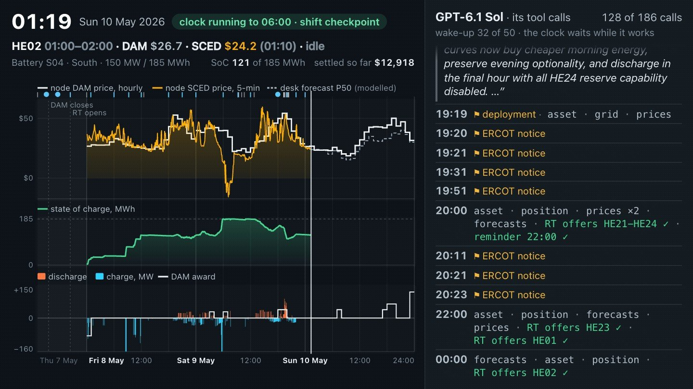

<div align="center">

<a href="https://earakely-scale-gridsimenv-agentenv.static.hf.space/index.html?v=v4&m=sol&task=desk-v4-2026-05-08-S04&t=2959"></a>

<h1>GridSimEnv: trade a real ERCOT battery</h1>

<h3>The desk: one real Texas grid battery from the day-ahead market through real time, on ERCOT's own market objects, graded in dollars against the hindsight optimum and the battery's real operator</h3>

<a href="https://huggingface.co/datasets/earakely-scale/GridSimEnv-AgentEnv"></a>
<a href="https://huggingface.co/spaces/earakely-scale/GridSimEnv"></a>
<a href="https://huggingface.co/spaces/earakely-scale/GridSimEnv-AgentEnv"></a>
<a href="https://www.agentenvframework.com"></a>
<a href="NOTICE"></a>

</div>

---

GridSimEnv is an environment plugin for the [AgentEnv Framework](https://www.agentenvframework.com), Scale AI's
open-source framework for building RL environments. Its desk seats a language-model agent at a real ERCOT battery's
trading desk:

- **A real battery, ERCOT's own objects.** The agent is the battery trader at a qualified scheduling entity (QSE) for
  one real ERCOT energy storage resource at its own node, from 06:00 the day before to midnight on the operating day
  (three operating days in v4). It never moves a megawatt itself: it bids energy curves into the day-ahead market (DAM)
  before the 10:00 close, sends real-time (RT) curves from 18:00 and keeps its Current Operating Plan (COP), all
  checked against ERCOT's rules; ERCOT's clearing decides what the battery does every 5 minutes.
- **Time moves on its own.** The clock is AgentEnv's virtual clock, frozen while the agent works. A post-turn hook
  moves it to the next wake-up: a market milestone, an ERCOT notice, an outage or reserve deployment at its real minute,
  or a reminder the agent set. Each price, forecast and report is visible only once ERCOT posted it.
- **Graded in dollars.** P is the battery's settled ERCOT statement. The headline is C, the share of the hindsight
  optimum's profit over idle that the desk captures; R, the environment's reward, is reported beside it.
- **Against the real operator.** ERCOT discloses every resource's bids, awards and metered output 60 days later; each
  task replays the real operator's own bids through the same clearing and settlement, and settles its actual awards
  and output the same way.

One code path, `gridsim_core.desk`, holds the clearing, the battery's physics, settlement and the grader; the env, its
post-turn hook and verifier, the in-process runner and the reports all import it.

**Contents:** [Quick start](#quick-start) · [Results](#results) · [The desk](#the-desk) ·
[Repository layout](#repository-layout) · [Development](#development) · [Licence and attribution](#licence-and-attribution)
· [v1](#v1)

## Quick start

In process, with no Docker and no model key, play the anchor policy on v2's two pilot battery-days:

```bash
git clone https://github.com/earakely-scale/agentenv-gridsim-plugin
cd agentenv-gridsim-plugin && uv sync --extra dev
uv run python scripts/desk_run.py --pack desk-v2-pilot --policy anchor --out runs/anchor
```

Each run writes every task's Episode JSON, its per-call log and a results row with its grade. `--policy model --model
NAME --base-url URL` plays any model behind an OpenAI-compatible endpoint the same way, with its key in
`DESK_API_KEY`; every version's packs are under `data/desk/`.

On AgentEnv, with Docker, register the desk envs once and play a task through the gateway env, its post-turn hook and
its verifier; the script checks every tool output and wake-up against the in-process run, byte for byte:

```bash
uv run agent-env gridsim setup
uv run python scripts/desk_e2e.py --pack desk-v2-pilot --task desk-v2-2026-04-27-S01 --policy anchor
```

The results, every run and every task are on the Hub:

```python
from datasets import load_dataset

repo = "earakely-scale/GridSimEnv-AgentEnv"
board = load_dataset(repo, "desk_leaderboard", split="v5")  # each model and reference, with CIs
runs = load_dataset(repo, "desk_runs", split="v5")          # each model's every task
tasks = load_dataset(repo, "desk_tasks", split="v5")        # every task, its site card and references
```

## Results

Hindsight capture C with its 95% CI, each model playing each task once under pre-registered settings:

| Desk | v2, The Live Grid | v3, Sun, Storage and Reserves | v4, Weather Front | v5, The Market Floor |
|---|---:|---:|---:|---:|
| GPT-6.1 Sol | 0.199 [0.033, 0.433] | 0.100 [−0.054, 0.266] | 0.346 [0.179, 0.592] | 0.081 [−0.058, 0.235] |
| GPT-6 Luna | 0.133 [0.097, 0.171] | 0.069 [0.028, 0.126] | 0.115 [0.073, 0.167] | 0.088 [0.045, 0.145] |
| Qwen3-4B (untrained) | 0.005 [−0.035, 0.044] | −0.013 [−0.044, 0.013] | −0.007 [−0.021, 0.001] | −0.004 [−0.021, 0.009] |
| *Anchor* | 0.191 | 0.026 | 0.250 | 0.026 |
| *The operator's bids, replayed* | 0.101 | 0.067 | 0.084 | 0.067 |

Paired by task, GPT-6.1 Sol and GPT-6 Luna differ in C with a CI that excludes zero only in v4, on 3-day weather fronts
(Sol ahead); in v2, v3 and v5 they are close. The untrained Qwen3-4B has the lowest C in every version. One day in
v2 (25 January 2026) and one front in v4 (winter storm Fern) carry more than half of GPT-6.1 Sol's, GPT-6 Luna's and
the anchor's total P; Sol and Luna made theirs from day-ahead sales bought back in real time, which the DAM allows
because it ignores state of charge and which ERCOT's credit screening, not modelled here, would limit. In v5 the
desk's own offers move the day-ahead price by cents.

Each version's numbers, with P in dollars, the paired gaps to the anchor and to the real operator, the statement lines
and how each model traded, are on the [dataset card](https://huggingface.co/datasets/earakely-scale/GridSimEnv-AgentEnv)
and in `results/desk-v<N>/`: its README, `summary.json`, `grades.jsonl.gz`, figures, raw runs and every Episode JSON.
The viewer's results pages, [v2](https://earakely-scale-gridsimenv-agentenv.static.hf.space/results.html?v=v2), [v3](https://earakely-scale-gridsimenv-agentenv.static.hf.space/results.html?v=v3),
[v4](https://earakely-scale-gridsimenv-agentenv.static.hf.space/results.html?v=v4) and [v5](https://earakely-scale-gridsimenv-agentenv.static.hf.space/results.html?v=v5), list every task with a replay of each model's run.
The results were committed under the tags `desk-v2-results`, `desk-v3-results`, `desk-v4-results` and
`desk-v5-results`.

## The desk

| Version | Adds | Pack | Pre-registration |
|---|---|---|---|
| v2, The Live Grid | energy only: the DAM and real time at a real battery's own node, with ERCOT notices, NWS alerts and the battery's outages at their real minutes | `desk-v2-eval`, 32 battery-days | [`docs/prereg/v2-desk.md`](docs/prereg/v2-desk.md) |
| v3, Sun, Storage and Reserves | ERCOT's five ancillary services in the DAM and real time, with state-of-charge duration rules, deployments and capacity-short charges; a co-located solar option (modelled) | `desk-v3-eval`, 24 battery-days | [`docs/prereg/v3-desk.md`](docs/prereg/v3-desk.md) |
| v4, Weather Front | three operating days across a weather front, on ERCOT's forecasts as each was issued | `desk-v4-eval`, 16 3-day windows | [`docs/prereg/v4-desk.md`](docs/prereg/v4-desk.md) |
| v5, The Market Floor | price impact: its DAM offers re-clear the day-ahead market against the day's real offers, disclosed 60 days later | `desk-v5-eval`, 24 battery-days | [`docs/prereg/v5-desk.md`](docs/prereg/v5-desk.md) |

**Eleven tools.** `get_prices`, `get_forecasts`, `get_grid_conditions` (ERCOT's public reports), `get_asset_status`
(plant telemetry), `get_position` (the desk's book), `submit_dam_offers`, `submit_rt_offers`, `update_cop` and
`check_submission` (ERCOT's market submission system and its dry-run validator), `optimize` (a co-optimiser on the
agent's own price view that never submits) and `set_reminder`. From v3, ancillary-service offers ride in the same
submissions.

**Grading.** C = (P − P_idle) / (P_hind − P_idle), against the hindsight optimum, which knows every price and may hold
DAM/RT spread positions. The reward is R = clip(0.2 + 0.8 (P − P_idle) / max(P_anchor − P_idle, 0.1 (P_hind_phys −
P_idle)), 0, 1): idle 0.2, the anchor 1.0, with a floor where the anchor barely beats idle. The anchor is the desk's
own optimiser re-planning at every wake on the same information, its setting chosen blind on `desk-v2-tune`.

**Methods.** Each version was pre-registered and its code frozen at a tag (`desk-v2-freeze` to `desk-v5-freeze`)
before its first scored episode, piloted, then run once per model per task; `scripts/desk_report.py` re-grades every
Episode JSON against frozen references, and deviations are logged in the pre-registration. The full rules are in
[`docs/CONTRACT-desk.md`](docs/CONTRACT-desk.md), the data pipeline in [`docs/desk-data.md`](docs/desk-data.md).

**Limitations.** DAM credit screening is not modelled; a known env defect (K1) in v3 to v5 gave an empty `as_offers`
list a spurious ASO-02 note, with the energy curves accepted; the co-located solar profile, degradation, warranty,
end-of-day energy and capacity-short lines are modelled; the packs are small, with one run per model per task.

## Repository layout

| Path | What |
|---|---|
| `src/gridsim_core/desk/` | the desk: the clock and wake-ups, the tools, ERCOT's validation rules, clearing, battery physics, settlement, the references and the grader |
| `src/agentenv_gridsim/desk.py`, `desk_tasks.py` | the `gridsim-desk-v2` to `v5` gateway envs (`-pre` for pre-RTC+B days) and desk packs as AgentEnv bundles |
| `src/agentenv_gridsim/bundles/gridsim-desk/` | the desk bundle, with the `gridsim-desk-hook` post-turn hook and `gridsim-desk-verifier` |
| `scripts/desk_run.py`, `desk_e2e.py`, `desk_report.py` | the in-process runner, the end-to-end check on AgentEnv, and each version's report |
| `scripts/desk_data_*.py` | the desk's packs, sites, calibration and forecasts from ERCOT's public reports |
| `data/desk/` | the desk's packs (`tasks.jsonl.gz`, `manifest.json` and the series), the site registry and the calibration |
| `results/desk-v2/` to `desk-v5/`, `results/desk-refs/` | each version's results and the frozen references they were graded against |
| `scripts/hub_desk.py`, `hub_desk_hero.py`, `hub_dataset.py`, `hub_article.py`, `hub/` | the Hugging Face dataset and card, the desk GIFs, the article, and the viewer Space's desk page |
| `docs/CONTRACT-desk.md`, `docs/desk-data.md`, `docs/prereg/` | the desk's contract, its data pipeline and the pre-registrations |
| `tests/desk/`, `tests/env_desk/` | the desk's offline tests and the AgentEnv parity tests |
| everything else | v1 and the pre-desk previews ([v1](#v1)) |

## Development

```bash
git clone https://github.com/earakely-scale/agentenv-gridsim-plugin && cd agentenv-gridsim-plugin
uv sync --extra dev
uv run pytest                                   # offline, on the committed packs and fixtures
uv run ruff check .
```

Contributions are welcome. Three rules keep the environment honest:

- **One grader.** Clearing, physics, settlement and the reward live only in `gridsim_core`; the env, the hook, the
  verifier and the reports import it and never re-implement it.
- **Pre-registered, then frozen.** A version's pack, settings and references are committed before its first scored
  episode, its code frozen at a tag, and nothing is rerun to improve a score.
- **Tests run offline** on the committed packs and fixtures, and nothing skips at import. Pull request titles follow
  Conventional Commits.

## Licence and attribution

Code: Apache-2.0 ([LICENSE](LICENSE)). The data is not: [data/LICENSE](data/LICENSE) sets out its terms in full, and
[NOTICE](NOTICE) lists every source.

- **ERCOT data, under ERCOT's terms.** The desk's prices, forecasts, system data, notices and 60-day disclosures come
  from ERCOT's public reports, used under section 5 of ERCOT's [Website User Agreement](https://www.ercot.com/help/terms),
  which allows raw data from public portions of ercot.com to be used, reproduced and redistributed in compilations,
  charts and analyses; data/LICENSE quotes it in full, with ERCOT's Market Data Transparency Terms of Use v1.2. On
  the Hub, the disclosures appear only as derived values under anonymous site cards (Battery S01 to S04), with no
  resource, node, QSE or operator name. The ERCOT data is not relicensed under Apache-2.0 or CC BY. Source: ERCOT. GridSimEnv is not
  affiliated with or endorsed by ERCOT, and uses no ERCOT logo or trademark.
- **NWS alerts, public domain.** Watches, warnings and advisories come from the Iowa Environmental Mesonet's archive of
  NWS VTEC products, Iowa State University.
- **EIA, public domain.** The solar capacity behind the modelled co-located PV comes from Form EIA-860M, and v1's
  battery archetypes from Form EIA-860: works of the U.S. Government. Source: U.S. Energy Information Administration.
- **The viewer** vendors three.js 0.180.0 (MIT); its scene is procedural and CC0
  ([`web/ASSETS.md`](src/agentenv_gridsim/web/ASSETS.md)).

Neither ERCOT, the EIA, NOAA nor the IEM is affiliated with this project or endorses it.

## v1

GridSimEnv v1, The Battery Desk, is the one-shot day-ahead game the desk grew from: one battery at an ERCOT hub or load
zone for one day, 24 hourly actions in one call, graded exactly against a dynamic-programming optimum on ERCOT's real
day-ahead prices of 2014 to 2026, with a 4B open model trained on it with GRPO. Its env (`gridsim`), packs, board,
training results and the pre-desk previews (`gridsim-live`, `-hybrid`, `-forecast` and `-market`) are still in this
repository and documented in [`docs/v1.md`](docs/v1.md). On the Hub, v1's dataset is archived at revision
[6ae10fcc](https://huggingface.co/datasets/earakely-scale/GridSimEnv-AgentEnv/tree/6ae10fcc7fea8037716a0ea7f4ef761786a34f87)
and its article at revision
[fcf2a721](https://huggingface.co/spaces/earakely-scale/GridSimEnv/tree/fcf2a721790ca530f222c5206ae7df2d7a4becd0).
