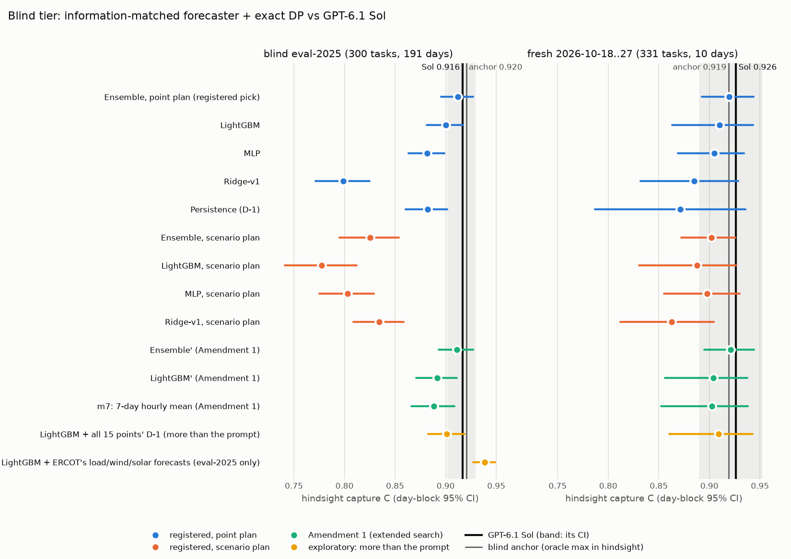

# Blind-tier ceiling check (FD-4420)

**A diagnostic, pre-registered.** The plan is [`docs/prereg/v1-blind-ceiling.md`](../../docs/prereg/v1-blind-ceiling.md),
pushed to `main` (2defb8c) before any forecaster was fitted, with Amendment 1 (b060dd1) pushed before the registered
scores were read. CPU only (one c7i.8xlarge), no LLM calls: Sol's schedules are the stored ones, re-graded with
`gridsim_core`.

**The question.** Can a forecaster that uses only what the blind prompt shows, planned with the exact DP, beat GPT-6.1
Sol's hindsight capture C? If not, FD-4420's target claim ("a trained 4B out-earns Sol bidding tomorrow") cannot be won
on the plain blind tier.

## Answer: no shown headroom on the plain blind tier; recommend "informed blind"

- **The best information-matched method draws level with Sol and does not beat it.** The method was picked on the 2024
  holdout before scoring: an ensemble of 0.1 ridge + 0.5 LightGBM + 0.4 MLP forecasts, planned with the DP.
  - **blind eval-2025:** C 0.912 against Sol's 0.9165, Δ **−0.005 [−0.015, +0.006]**. It earns more than Sol on 39%
    of tasks, ties on 31%, and earns less on 30%.
  - **fresh 2026-10-18..27:** C 0.919 against 0.926, Δ **−0.007 [−0.029, +0.018]**.
  - **Decision rule:** criterion 1 (eval-2025 CI wholly above 0) fails; criterion 2 (fresh no worse) holds. **Verdict:
    no shown headroom.**
- **A stronger search lands in the same place.** Amendment 1 added recency-weighted Huber LightGBM, lower round counts,
  the 7-day hourly mean and a 5-member ensemble. Its pick: Δ −0.006 [−0.018, +0.005] on eval-2025 and −0.005 [−0.029,
  +0.020] on fresh.
- **So Sol already sits at the information-matched ceiling we can build.** Reading seven days of history in a prompt,
  it captures what a tuned forecaster plus an exact planner captures. The blind anchor, an oracle, is within ±0.007 of
  it.
- **ERCOT's own forecasts do open headroom** (exploratory). The same LightGBM, fitted on one year, gains a lot when it
  also sees day D's system load, wind and solar forecasts as ERCOT posted them before the DAM closed (10:00 CPT on D-1):
  - **eval-2025:** C **0.939**, which is **+0.046 [+0.031, +0.062]** over itself without the forecasts and
    **+0.022 [+0.010, +0.035] over blind Sol**.
  - **fresh 10-18..24** (7 days; the store ends 10-24): +0.037 [+0.015, +0.055] over itself without the forecasts,
    and +0.007 [−0.003, +0.014] over Sol.

## The bar: what the blind anchor is

`refs.blind.p_anchor = max(P_persist, P_ridge)` per task, taken **on realized profit**. It is therefore an oracle
selector chosen in hindsight, not a rule anyone could run. It is stronger than either of its parts:

| pack | anchor | persistence-DP | ridge-DP |
|---|---|---|---|
| eval-2025 | 0.920 | 0.882 | 0.799 |
| fresh | 0.919 | 0.871 | 0.885 |

Taking the better of two weak forecasters per task in hindsight is worth +0.03 to +0.04 C. The verdict is judged against Sol, not
against the anchor.

## Results

C = clip(0.2 + 0.8 x, 0, 1) and x = (P − P_idle) / (P_opt − P_idle), as every GridSimEnv table computes them. The CIs
are a day-block bootstrap (10,000 resamples, seed 0). Δ is paired on the same tasks. "Ahead" is the share of tasks with
higher profit than Sol; ties are common. Full tables are in [`tables.md`](tables.md).

| method | holdout C (2024) | eval-2025 C | Δ vs Sol | ahead | fresh C | Δ vs Sol | ahead |
|---|---|---|---|---|---|---|---|
| **GPT-6.1 Sol** | – | **0.916** | – | – | **0.926** | – | – |
| blind anchor (oracle) | 0.904 † | 0.920 | +0.004 [−0.009, +0.017] | 38% | 0.919 | −0.007 [−0.032, +0.012] | 46% |
| **ensemble (registered pick)** | **0.905** | **0.912** | **−0.005 [−0.015, +0.006]** | 39% | **0.919** | **−0.007 [−0.029, +0.018]** | 39% |
| LightGBM | 0.897 | 0.900 | −0.017 [−0.029, −0.006] | 26% | 0.910 | −0.017 [−0.030, −0.004] | 26% |
| MLP | 0.873 | 0.881 | −0.035 [−0.051, −0.019] | 35% | 0.905 | −0.021 [−0.059, +0.021] | 39% |
| ridge-v1 | 0.812 ‡ | 0.799 | −0.118 [−0.145, −0.091] | 22% | 0.885 | −0.041 [−0.069, −0.013] | 33% |
| persistence (D-1) | 0.853 | 0.882 | −0.035 [−0.051, −0.020] | 21% | 0.871 | −0.055 [−0.105, −0.016] | 24% |
| ensemble, scenario plan | 0.816 | 0.826 | −0.091 [−0.116, −0.067] | 27% | 0.902 | −0.025 [−0.050, +0.003] | 33% |
| ensemble′ (Amendment 1) | 0.905 | 0.911 | −0.006 [−0.018, +0.005] | 40% | 0.921 | −0.005 [−0.029, +0.020] | 40% |
| 7-day hourly mean, m7 (A1) | 0.897 | 0.888 | −0.028 [−0.045, −0.012] | 28% | 0.903 | −0.024 [−0.045, −0.003] | 28% |
| *LightGBM + all 15 points' D-1* § | 0.899 | 0.901 | −0.015 [−0.028, −0.004] | 25% | 0.909 | −0.018 [−0.033, −0.004] | 28% |

† in-sample: ridge-v1 was fitted on 2014–2024. ‡ a pre-2024 refit on the holdout; eval-2025 and fresh use ridge-v1 as
stored. § exploratory: uses more than the blind prompt shows. Raw capture x tells the same story: on eval-2025 Sol 0.896,
ensemble 0.890, anchor 0.900; on fresh 0.908, 0.899 and 0.899.

**Forecast error** ($/MWh, MAE over all hours / the day's 4 dearest / 4 cheapest realized hours):

| forecaster | eval-2025 | fresh |
|---|---|---|
| persistence | 12.0 / 28.0 / 6.7 | 10.1 / 18.8 / 5.6 |
| ridge-v1 | 11.1 / 22.2 / 7.8 | 9.1 / 16.1 / 5.5 |
| LightGBM | 10.9 / 24.1 / 6.3 | 8.1 / 15.2 / 5.4 |
| MLP | 9.6 / 21.8 / 5.9 | 8.7 / 20.1 / 5.0 |
| ensemble | 9.5 / 21.0 / 5.8 | 7.7 / 15.9 / 4.5 |
| *LightGBM + ERCOT forecasts* (1-yr fit; fresh = 10-18..24 only) | 8.9 / 20.4 / 4.2 | 5.7 / 10.8 / 4.4 |

## What it says

- **Better forecasts buy C slowly.** The ensemble cuts persistence's MAE by 21% on eval-2025 (12.0 → 9.5) and 25% at the
  dearest hours. That is worth +0.030 C, which takes it to Sol's level and no further.
  - The DP only needs the day's ranking and spread. Those are what D-1..D-7 can't say much more about.
  - On 10-18 and 10-19, the two fresh days where persistence-DP collapses (0.66, 0.74) and where Sol's lead over the
    anchor came from, the ensemble scores 0.893 and 0.898 against Sol's 0.829 and 0.904. Sol's remaining lead is spread
    over other days (10-27: 0.920 against 0.855).
- **Scenario plans lose 0.02–0.14 C. The prior (±0.005) was wrong.**
  - Settlement is linear in price and the schedule has no recourse. Maximising expected profit over scenarios is
    therefore the DP on the scenario-mean prices (plus the shortfall penalty's mean).
  - The residuals are heavy-tailed (56 point-days of 2024 peak above $1,000/MWh). The mean of 20 sampled residual days
    therefore shifts hours by tens of dollars at random. That is pure noise in the plan.
  - The decision-optimal blind plan is the DP on the best conditional-mean forecast, so the ceiling question is purely a
    forecasting question.
- **Heavy tails shape the fit.** Every L2 LightGBM loses to Huber on the holdout. Holdout C peaks at 10–25 boosting
  rounds on the "minus the 7-day mean" target, i.e. close to the weekly hourly profile. Recency weighting (half-lives of
  1–4 years) changed holdout C by under 0.005, in no consistent direction.
- **More of the same information doesn't help.** Every point's D-1 prices move LightGBM by ±0.001. The v4 store's HRRR-based
  "desk" load/wind/solar forecasts add +0.003 [−0.013, +0.018] on eval-2025 with a 2021–2024 fit. ERCOT's own as-issued
  forecasts are what move C.

## Recommendation: informed blind

**Add ERCOT's as-issued system load, wind and solar forecasts for day D** to the blind situation: the last posting before
the DAM's 10:00 CPT close on D-1, from the v4 store's `ercot_load`, `ercot_wind` (STWPF) and `ercot_solar` (STPPF). Give
Sol and the 4B the same inputs.

The evidence:
- An information-matched forecaster with them reaches 0.939 on eval-2025. That is +0.022 [+0.010, +0.035] over blind
  Sol, with the CI above 0, where the plain blind tier's best is −0.005.
- The gain is visible on the fresh days too (+0.037 over the same model without them).
- It is a lower bound on what the forecasts are worth: one year of fit (3,965 point-days), rounds picked on 4 months.

The caveats, before the tier is built:
- **Sol will see the forecasts too.** The +0.022 is against *blind* Sol. The claim needs Sol re-measured on the
  informed tier (step 2 of FD-4420's sequence).
- **Training data is short.** The ERCOT API era starts 2023-12-11, so only about one year (2024) of training days have
  as-issued ERCOT forecasts; 2025 is eval. The 20k-day 2014–2024 SFT design needs either older forecast archives or a
  mixed design: most days blind, the 2024 days informed.
- **A stacked variant was much weaker.** It added the forecasts on top of a pre-2024 LightGBM (eval-2025 +0.007
  [−0.011, +0.027] over its own base). The gain depends on how the model is fitted; the training run should check it.

## Against the prior
- **Best method:** C 0.89–0.92 on fresh and within −0.02..+0.01 of Sol on eval-2025, not shown. Came in at 0.919 and
  −0.005, not shown. Verdict as expected.
- **Scenario variant:** expected within ±0.005 of the point plan. Came in 0.02–0.14 below. Wrong (see above).
- **ERCOT forecasts:** expected +0.01 to +0.03 C. Came in at +0.046 over the matched model and +0.027 over the
  registered ensemble. Larger than expected.

## Setup and deviations
- **Data:**
  - Training targets: 33,363 point-days of the `train` split (2014–2024, minus the eval-iid and showcase dates,
    dedup-kept), the same rows as ridge-v1.
  - Tuning: fit on the 29,573 before 2024; score on the 3,790 2024 point-days and the 922 `ercot-dam-v1-train` blind
    tasks of 2024 (286 days).
  - No eval-2025, eval-iid, rtcb or fresh day is a training target.
  - Inputs come from each task's own `blind` field, exactly what the prompt carries.
- **Checks:**
  - The pipeline's persistence-DP and ridge-DP profits match the stored `refs.blind` to $0.00 on every task.
  - The fresh anchor's day-block CI [0.862, 0.960] reproduces the published one exactly.
- **Chosen on the holdout:**
  - LightGBM: Huber (δ $20), target = price − 7-day hourly mean, 255 leaves, min child 100, 25 rounds at lr 0.05.
  - MLP: asinh inputs and targets with a mean correction, 512×512, α 1e-4, mean of 3 seeds.
  - Ensemble weights: ridge 0.1, LightGBM 0.5, MLP 0.4. Amendment 1's: m7 0.3, ridge 0.1, LightGBM′ 0.2, MLP 0.4, with
    LightGBM′ = Huber, delta target, 255 leaves, 10 rounds, recency half-life 1 year.
- **Deviations and disclosures:**
  - LightGBM rounds were chosen by holdout C at fixed checkpoints, not by L2 early stopping. L2 on 2024 got worse after
    about 10 rounds because of the tails. The pre-registration lists rounds as holdout-tuned.
  - The scenario variants' holdout C uses 2024 residuals from other days of the same year, including later ones, so it
    is optimistic. They still lost.
  - A smoke test scored eval-2025 and fresh with a reduced grid before tuning. Amendment 1 lists its numbers; nothing
    registered changed.
  - The extended search and the informed check briefly ran at the same time. That oversubscribed the box's 32 cores, so
    the informed check was stopped and rerun alone. Settings were unchanged.
- **Informed check (exploratory):**
  - ERCOT kinds: fit window 2023-12-12..2024-12-31. Rounds were picked on the 329 train-pack blind tasks of
    2024-09..12, with a fit on the earlier months, then refitted on the window.
  - Vintage: the last posting at or before 10:00 CPT on D-1, no older than 6 h.
  - The desk kinds were built by the v4 data lane; their own model's fit period is not audited here.

## Files
- `summary.json`: the tuning choices and holdout scores, every method's C and x with CIs, the paired gaps, the forecast
  errors, the registered verdict, Amendment 1's and the informed check.
- `tables.md`: the generated tables, including the informed check's.
- `ceiling.png`: the chart above.
- `runs/`: `tune.json`, `final.json`, `extend.json`, `informed.json`, per-task results (`per_task*.json.gz`: C, x and
  profit per method, Sol and the anchor), the box logs and `pip_freeze.txt`.
- `scripts/`:
  - `ceiling.py tune|final|extend`: the registered tuning and scoring, and Amendment 1.
  - `informed.py --store DIR`: the exploratory check, reading the v4 store's `index.parquet` and `vintages/`.
  - `report.py --work runs`: the tables, the summary and the chart.

Reproduce: run with `PYTHONPATH=src:scripts:results/blind-ceiling/scripts`, in a venv with numpy, scikit-learn,
lightgbm, pyarrow, matplotlib and openpyxl. It needs the parsed DAM cache `cache/parsed/dam-a5c0b0fae22b11ea.json.gz`
(`scripts/build_pack.py` builds it from the NP4-180-ER zips). The tune stage takes about 12 min and each later stage a
few minutes on 32 cores.
