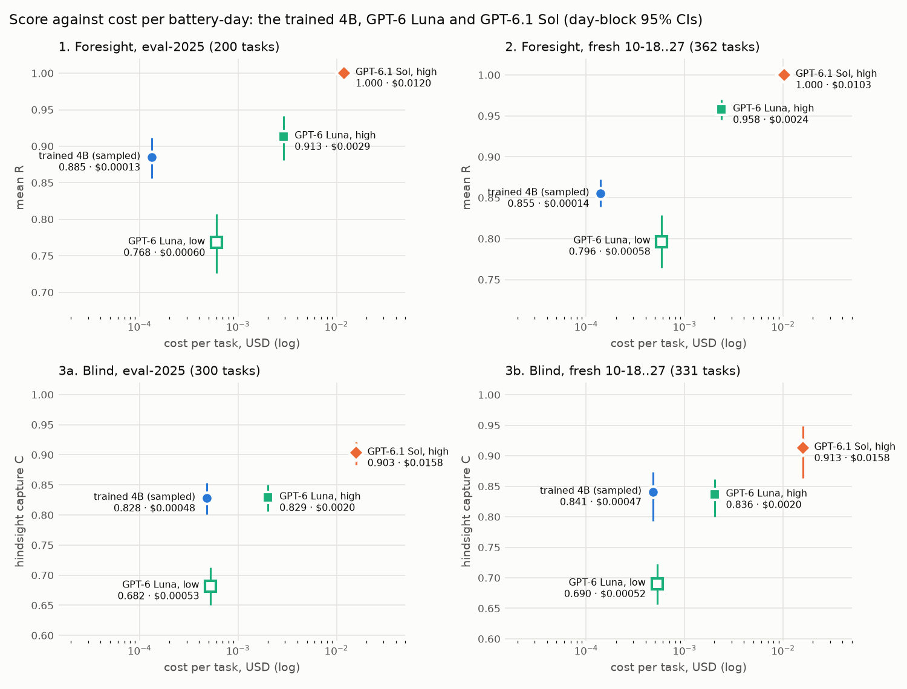

# The trained 4Bs against cost-matched GPT-6 Luna

**Pre-registered.** The plan is [`docs/prereg/v1-cost-matched.md`](../../docs/prereg/v1-cost-matched.md), pushed to
`main` (bed7423) before any GPT-6 Luna request. Amendment 1 (56f4541: a second stream for the secondary rows and one
shared spend cap, engineering only) was pushed before any effort-low request on a scored pack. The runs took place on
2026-10-27 UTC (FD-4420).

**The question.** Our trained Qwen3-4Bs trail GPT-6.1 Sol on both tiers, but Sol costs far more per battery-day.
GPT-6 Luna (`openai/gpt-6-luna`) is priced at $0.10 / $0.50 / $0.01 per million input / output / cached tokens, 1/20th
of Sol. Does the trained 4B earn more than Luna?

- **No GPU and no training.** The 4B's side of every comparison is its committed per-task results, re-graded.
- **Luna ran under exactly the harness the 4B and Sol already used.** `scripts/luna_eval.py` imports the committed Sol
  scripts and calls their own `request` and `score` functions; the request differs from Sol's in the `model` field
  alone (and the effort, on the secondary row).
- **Sol stays in every table as the ceiling reference.**

## Verdicts

The registered test, on each pack separately: the day-block 95% CI of **4B (sampled) − Luna (effort high)** lies
wholly above 0.

| contest | 4B | Luna, high | Sol | **4B − Luna high** [day-block 95% CI] | verdict | 4B earns more / level | cost per task: 4B · Luna high · Sol |
|---|---|---|---|---|---|---|---|
| **1. Foresight, eval-2025** (200 tasks; R) | 0.885 | 0.913 | 1.000 | **−0.028 [−0.067, +0.011]** | not separated | 30% / 20% | $0.00013 · $0.0029 · $0.0120 |
| **2. Foresight, fresh 10-18..27** (362; R) | 0.855 | 0.958 | 1.000 | **−0.102 [−0.123, −0.083]** | **Luna ahead** | 20% / 27% | $0.00014 · $0.0024 · $0.0103 |
| **3a. Blind, eval-2025** (300; C) | 0.828 | 0.829 | 0.903 | **−0.001 [−0.030, +0.028]** | not separated | 50% / 9% | $0.00048 · $0.0020 · $0.0158 |
| **3b. Blind, fresh 10-18..27** (331; C) | 0.841 | 0.836 | 0.913 | **+0.005 [−0.036, +0.044]** | not separated | 54% / 6% | $0.00047 · $0.0020 · $0.0158 |

**"The trained 4B earns more than cost-matched Luna" is not shown on any pack.** Luna at effort high is ahead on the
fresh foresight days and level on the other three packs.

**The secondary row, Luna at effort low,** ran on all four packs, because Luna-high cost more than 3× the 4B on each
(21.7×, 16.9×, 4.2×, 4.2×). It carries no verdict. Against it the 4B is ahead on every pack, each CI above 0:

| contest | Luna, low | 4B − Luna low | cost per task, Luna low (× the 4B) |
|---|---|---|---|
| 1. Foresight, eval-2025 | 0.768 | +0.117 [+0.072, +0.164] | $0.00060 (4.6×) |
| 2. Foresight, fresh | 0.796 | +0.059 [+0.035, +0.083] | $0.00058 (4.2×) |
| 3a. Blind, eval-2025 | 0.682 | +0.146 [+0.108, +0.184] | $0.00053 (1.1×) |
| 3b. Blind, fresh | 0.690 | +0.151 [+0.085, +0.197] | $0.00052 (1.1×) |

## What it says

- **Luna at high effort is not cost-matched.** It thinks for 3,600–5,600 output tokens per battery-day on average,
  3–5× Sol's 850–1,200. So its 1/20th price buys only a 4–8× lower cost per task than Sol: $0.0020–$0.0029. That
  is 17–22× the 4B on foresight and 4.2× on blind.
- **At that cost, Luna matches or beats the 4B.**
  - **Foresight:** Luna-high scores 0.913 / 0.958 against the 4B's 0.885 / 0.855. It is level on eval-2025 and ahead
    by 0.102 on the fresh days, where its day mean is higher on all 10 days. It is still below Sol (−0.087 and
    −0.042, both shown).
  - **Blind:** level. 0.829 against 0.828 on eval-2025 and 0.836 against 0.841 on the fresh days; each wins about half
    the tasks. **The 4B ties Luna-high at about a quarter of its cost.** Both trail Sol by about 0.075 C.
- **At low effort, Luna's cost comes down to the 4B's range, and the 4B wins clearly.**
  - Luna-low thinks for 600–1,000 tokens and costs $0.0005–$0.0006 per task: 1.1× the 4B on blind, 4–5× on
    foresight.
  - Its score drops by about 0.15 on every pack (Luna low − Luna high: −0.145, −0.161, −0.147, −0.146), mostly through
    broken schedules: overfill 6–12%, sell before charge 1–5%, end short 2–3%.
  - The 4B beats it by +0.06 to +0.15, with every CI above 0. On blind, where the two cost the same, the gap is +0.15 C.
- **Where Luna loses points (effort high):**
  - **Foresight eval-2025:** 7 of 200 replies (3.5%) ran out of the 16,384-token output budget while still thinking,
    so they score 0. Sol never used more than 3,600 output tokens on any of these packs.
  - **Fresh foresight:** 2 truncations, plus 4 rule breaks.
  - **Blind:** 3–4 replies per pack (1.0–1.2%) ended without calling `submit_schedule`, most of them right after
    writing a forecast and a plan. Otherwise 98% of its schedules are feasible, against the 4B's 90–92%.
  - **Where the 4B loses points:** the reverse. It almost always submits, but 8–10% of its schedules are infeasible.
- **Against the prior:**
  - Luna's scores landed inside the stated ranges: foresight 0.80–0.97, blind 0.80–0.90.
  - We gave the 4B about 25% / 20% to be shown ahead on foresight and about 15% on each blind pack. None was shown.
  - Cost was at or above the top of the predicted $0.0005–$0.002, because Luna reasons 3–5× longer than Sol.
  - The secondary was expected on contests 1 and 2. It ran on all four.

## Cost per task

| contest | 4B: GPU, logged pass | **4B** (busy GPU) | 4B, whole box (sensitivity) | **Luna high** | Luna low | **Sol** |
|---|---|---|---|---|---|---|
| 1. Foresight, eval-2025 | one A10G of a g5.12xlarge, 67.3 s for 200 | **$0.00013** | $0.00053 | **$0.0029** (883 in, 5,585 out) | $0.00060 (1,031 out) | **$0.0120** (1,021 out) |
| 2. Foresight, fresh | one A10G of a g5.12xlarge, 128.4 s for 362 | **$0.00014** | $0.00056 | **$0.0024** (882 in, 4,562 out) | $0.00058 (993 out) | **$0.0103** (851 out) |
| 3a. Blind, eval-2025 | g6e.8xlarge (1× L40S), 114.3 s for 300 | **$0.00048** | $0.00048 | **$0.0020** (1,846 in, 3,672 out) | $0.00053 (683 out) | **$0.0158** (1,211 out) |
| 3b. Blind, fresh | g6e.8xlarge (1× L40S), 124.8 s for 331 | **$0.00047** | $0.00047 | **$0.0020** (1,845 in, 3,656 out) | $0.00052 (678 out) | **$0.0158** (1,216 out) |

Token counts are means per task; reasoning tokens are output tokens (Luna-high: 3,578–5,521 of them per task).

- **Luna and Sol:** actual usage × the price table in `agents/gridsim-llm/agent.py` (Luna $0.10 / $0.50 / $0.01, Sol
  $2.00 / $10.00 / $0.10 per million input / output / cached tokens). No request used the cache.
- **The 4B:** the logged wall time of its evaluation pass (`wall_s` in the committed eval file: vLLM's batched
  `generate` over the whole pack) × the hourly price of the GPU it ran on ÷ the tasks.
  - **Assumption: a busy GPU.** It is billed only while generating, as a continuously used serving GPU would be.
    Engine start, model load and idle time are not charged.
  - **Prices:** on-demand Linux from the AWS price list (effective 2026-10-01). The g5.12xlarge (us-east-1) is $5.672/h
    for 4× A10G, so $1.418 per GPU-hour; each pass ran on one of its GPUs. The g6e.8xlarge (us-west-2) is $4.529/h for
    one L40S.
  - **Sensitivity:** billing the whole g5.12xlarge for a one-GPU pass multiplies contests 1 and 2 by 4. Even then
    Luna-high costs 5.4× and 4.2× the 4B, and Luna-low 1.1× and 1.0×.
- **The 4B's sampled and greedy passes cost the same** to within 1%.
- **Training is not in the per-task cost.** Run 3's GPU cost about $31 and run 4's about $40. Against Luna-high's
  per-task price, run 3's repays itself after about 11,000 battery-days and run 4's after about 26,000.

## Results

The 4B rows are the committed per-task results of registered run 3 final (contests 1 and 2: sampled T 0.7 / top_p
0.8 / top_k 20 / seed 0, and greedy decoding; 512 tokens, thinking off) and registered run 4 final (3a and 3b: the
same decoding, 768 tokens). Every schedule of every model is re-graded with `gridsim_core` and must match its record.
CIs are a day-block bootstrap: 10,000 resamples of the pack's days, seed 0, every task of a drawn day kept,
task-weighted; paired gaps resample the per-task difference the same way. "Shown" means the CI lies wholly on one
side of 0. Foresight reports R, the contract reward with the DP optimum as anchor, which on foresight is the repo's
hindsight capture `r_opt`. Per the cross-version rule it also gives x = (R − 0.2) / 0.8, a linear rescale with the
same verdicts. Blind reports C = `r_opt`, with R on the blind anchor's scale beside it. No valid `submit_schedule`
scores 0.

### 1. Foresight, eval-2025 (200 tasks, 157 days; the 4B is run 3 final)

| model | R | 95% CI | x = (R − 0.2)/0.8 | valid | feasible | cost per task | output tokens per task |
|---|---|---|---|---|---|---|---|
| **trained 4B, sampled** | **0.885** | [0.856, 0.911] | 0.856 | 99.5% | 89.5% | $0.00013 | 368 |
| trained 4B, greedy decoding | 0.886 | [0.856, 0.913] | 0.857 | 100.0% | 88.0% | $0.00013 | 369 |
| **GPT-6 Luna, effort high** | **0.913** | [0.881, 0.942] | 0.891 | 96.5% | 96.0% | $0.0029 | 5,585 |
| GPT-6 Luna, effort low | 0.768 | [0.726, 0.807] | 0.710 | 99.5% | 86.5% | $0.00060 | 1,031 |
| GPT-6.1 Sol, effort high | 1.000 | [1.000, 1.000] | 1.000 | 100.0% | 100.0% | $0.0120 | 1,021 |

| paired gap | mean [day-block 95% CI] | shown | 4B or first model ahead / level | days ahead |
|---|---|---|---|---|
| **trained 4B, sampled − GPT-6 Luna, effort high** | −0.028 [−0.067, +0.011] | not shown | 30% / 20% | 48/157 |
| trained 4B, greedy decoding − GPT-6 Luna, effort high | −0.027 [−0.070, +0.015] | not shown | 30% / 22% | 51/157 |
| trained 4B, sampled − GPT-6 Luna, effort low | +0.117 [+0.072, +0.164] | above 0 | 63% / 12% | 101/157 |
| trained 4B, greedy decoding − GPT-6 Luna, effort low | +0.118 [+0.074, +0.162] | above 0 | 65% / 12% | 106/157 |
| trained 4B, sampled − GPT-6.1 Sol, effort high | −0.115 [−0.144, −0.088] | below 0 | 0% / 37% | 0/157 |
| trained 4B, greedy decoding − GPT-6.1 Sol, effort high | −0.114 [−0.144, −0.087] | below 0 | 0% / 39% | 0/157 |
| GPT-6 Luna, effort high − GPT-6.1 Sol, effort high | −0.087 [−0.119, −0.058] | below 0 | 0% / 50% | 1/157 |
| GPT-6 Luna, effort low − GPT-6.1 Sol, effort high | −0.232 [−0.274, −0.193] | below 0 | 0% / 13% | 0/157 |
| GPT-6 Luna, effort low − GPT-6 Luna, effort high | −0.145 [−0.197, −0.095] | below 0 | 16% / 12% | 24/157 |

### 2. Foresight, fresh 10-18..27 (362 tasks, 10 days; the 4B is run 3 final)

| model | R | 95% CI | x = (R − 0.2)/0.8 | valid | feasible | cost per task | output tokens per task |
|---|---|---|---|---|---|---|---|
| **trained 4B, sampled** | **0.855** | [0.839, 0.872] | 0.819 | 99.5% | 90.3% | $0.00014 | 367 |
| trained 4B, greedy decoding | 0.860 | [0.825, 0.892] | 0.825 | 99.7% | 90.1% | $0.00014 | 368 |
| **GPT-6 Luna, effort high** | **0.958** | [0.945, 0.970] | 0.947 | 99.5% | 98.6% | $0.0024 | 4,562 |
| GPT-6 Luna, effort low | 0.796 | [0.764, 0.829] | 0.746 | 99.5% | 87.3% | $0.00058 | 993 |
| GPT-6.1 Sol, effort high | 1.000 | [1.000, 1.000] | 1.000 | 100.0% | 100.0% | $0.0103 | 851 |

| paired gap | mean [day-block 95% CI] | shown | 4B or first model ahead / level | days ahead |
|---|---|---|---|---|
| **trained 4B, sampled − GPT-6 Luna, effort high** | −0.102 [−0.123, −0.083] | below 0 | 20% / 27% | 0/10 |
| trained 4B, greedy decoding − GPT-6 Luna, effort high | −0.098 [−0.140, −0.059] | below 0 | 20% / 27% | 0/10 |
| trained 4B, sampled − GPT-6 Luna, effort low | +0.059 [+0.035, +0.083] | above 0 | 56% / 15% | 10/10 |
| trained 4B, greedy decoding − GPT-6 Luna, effort low | +0.063 [+0.021, +0.105] | above 0 | 58% / 14% | 9/10 |
| trained 4B, sampled − GPT-6.1 Sol, effort high | −0.145 [−0.161, −0.128] | below 0 | 0% / 33% | 0/10 |
| trained 4B, greedy decoding − GPT-6.1 Sol, effort high | −0.140 [−0.175, −0.108] | below 0 | 0% / 36% | 0/10 |
| GPT-6 Luna, effort high − GPT-6.1 Sol, effort high | −0.042 [−0.055, −0.030] | below 0 | 0% / 62% | 0/10 |
| GPT-6 Luna, effort low − GPT-6.1 Sol, effort high | −0.203 [−0.236, −0.171] | below 0 | 0% / 15% | 0/10 |
| GPT-6 Luna, effort low − GPT-6 Luna, effort high | −0.161 [−0.190, −0.132] | below 0 | 10% / 15% | 0/10 |

### 3a. Blind, eval-2025 (300 tasks, 191 days; the 4B is run 4 final)

| model | C | 95% CI | R (anchor scale) | valid | feasible | cost per task | output tokens per task |
|---|---|---|---|---|---|---|---|
| **trained 4B, sampled** | **0.828** | [0.801, 0.853] | 0.879 | 100.0% | 90.0% | $0.00048 | 420 |
| trained 4B, greedy decoding | 0.831 | [0.806, 0.854] | 0.882 | 100.0% | 90.3% | $0.00048 | 421 |
| **GPT-6 Luna, effort high** | **0.829** | [0.806, 0.850] | 0.882 | 99.0% | 98.0% | $0.0020 | 3,672 |
| GPT-6 Luna, effort low | 0.682 | [0.651, 0.713] | 0.729 | 99.7% | 85.0% | $0.00053 | 683 |
| GPT-6.1 Sol, effort high | 0.903 | [0.883, 0.921] | 0.960 | 99.0% | 99.0% | $0.0158 | 1,211 |

| paired gap | mean [day-block 95% CI] | shown | 4B or first model ahead / level | days ahead |
|---|---|---|---|---|
| **trained 4B, sampled − GPT-6 Luna, effort high** | −0.001 [−0.030, +0.028] | not shown | 50% / 9% | 102/191 |
| trained 4B, greedy decoding − GPT-6 Luna, effort high | +0.002 [−0.025, +0.028] | not shown | 48% / 9% | 98/191 |
| trained 4B, sampled − GPT-6 Luna, effort low | +0.146 [+0.108, +0.184] | above 0 | 69% / 4% | 145/191 |
| trained 4B, greedy decoding − GPT-6 Luna, effort low | +0.149 [+0.111, +0.186] | above 0 | 68% / 4% | 136/191 |
| trained 4B, sampled − GPT-6.1 Sol, effort high | −0.075 [−0.101, −0.050] | below 0 | 26% / 19% | 48/191 |
| trained 4B, greedy decoding − GPT-6.1 Sol, effort high | −0.072 [−0.097, −0.049] | below 0 | 24% / 20% | 39/191 |
| GPT-6 Luna, effort high − GPT-6.1 Sol, effort high | −0.074 [−0.095, −0.054] | below 0 | 20% / 19% | 33/191 |
| GPT-6 Luna, effort low − GPT-6.1 Sol, effort high | −0.221 [−0.252, −0.191] | below 0 | 10% / 7% | 17/191 |
| GPT-6 Luna, effort low − GPT-6 Luna, effort high | −0.147 [−0.179, −0.115] | below 0 | 22% / 8% | 37/191 |

### 3b. Blind, fresh 10-18..27 (331 tasks, 10 days; the 4B is run 4 final)

| model | C | 95% CI | R (anchor scale) | valid | feasible | cost per task | output tokens per task |
|---|---|---|---|---|---|---|---|
| **trained 4B, sampled** | **0.841** | [0.793, 0.873] | 0.898 | 100.0% | 91.8% | $0.00047 | 429 |
| trained 4B, greedy decoding | 0.840 | [0.792, 0.875] | 0.896 | 100.0% | 90.3% | $0.00048 | 430 |
| **GPT-6 Luna, effort high** | **0.836** | [0.800, 0.861] | 0.887 | 98.8% | 98.5% | $0.0020 | 3,656 |
| GPT-6 Luna, effort low | 0.690 | [0.657, 0.723] | 0.736 | 98.2% | 83.7% | $0.00052 | 678 |
| GPT-6.1 Sol, effort high | 0.913 | [0.864, 0.949] | 0.969 | 99.1% | 99.1% | $0.0158 | 1,216 |

| paired gap | mean [day-block 95% CI] | shown | 4B or first model ahead / level | days ahead |
|---|---|---|---|---|
| **trained 4B, sampled − GPT-6 Luna, effort high** | +0.005 [−0.036, +0.044] | not shown | 54% / 6% | 5/10 |
| trained 4B, greedy decoding − GPT-6 Luna, effort high | +0.004 [−0.036, +0.037] | not shown | 53% / 6% | 5/10 |
| trained 4B, sampled − GPT-6 Luna, effort low | +0.151 [+0.085, +0.197] | above 0 | 72% / 3% | 9/10 |
| trained 4B, greedy decoding − GPT-6 Luna, effort low | +0.150 [+0.081, +0.200] | above 0 | 71% / 2% | 9/10 |
| trained 4B, sampled − GPT-6.1 Sol, effort high | −0.072 [−0.090, −0.050] | below 0 | 26% / 9% | 0/10 |
| trained 4B, greedy decoding − GPT-6.1 Sol, effort high | −0.073 [−0.090, −0.057] | below 0 | 25% / 11% | 0/10 |
| GPT-6 Luna, effort high − GPT-6.1 Sol, effort high | −0.077 [−0.114, −0.036] | below 0 | 21% / 8% | 2/10 |
| GPT-6 Luna, effort low − GPT-6.1 Sol, effort high | −0.223 [−0.281, −0.150] | below 0 | 14% / 2% | 0/10 |
| GPT-6 Luna, effort low − GPT-6 Luna, effort high | −0.146 [−0.190, −0.099] | below 0 | 25% / 8% | 0/10 |

### Error mix (share of tasks)

| pack | model | invalid or no submit | overfill | sell before charge | end short | all idle | rate | cycle cap |
|---|---|---|---|---|---|---|---|---|
| 1. Foresight, eval-2025 | trained 4B, sampled | 0.5% | 6.0% | 2.5% | 2.5% | 0.0% | 0.5% | 1.0% |
| 1. Foresight, eval-2025 | GPT-6 Luna, effort high | 3.5% | 0.0% | 0.5% | 0.0% | 0.0% | 0.0% | 0.0% |
| 1. Foresight, eval-2025 | GPT-6 Luna, effort low | 0.5% | 7.5% | 5.0% | 2.5% | 0.5% | 0.0% | 0.5% |
| 1. Foresight, eval-2025 | GPT-6.1 Sol, effort high | 0.0% | 0.0% | 0.0% | 0.0% | 0.0% | 0.0% | 0.0% |
| 2. Foresight, fresh 10-18..27 | trained 4B, sampled | 0.5% | 6.1% | 1.9% | 1.4% | 0.0% | 0.3% | 0.8% |
| 2. Foresight, fresh 10-18..27 | GPT-6 Luna, effort high | 0.5% | 0.3% | 0.3% | 0.3% | 0.0% | 0.0% | 0.3% |
| 2. Foresight, fresh 10-18..27 | GPT-6 Luna, effort low | 0.5% | 6.3% | 4.1% | 2.2% | 0.3% | 0.3% | 1.4% |
| 2. Foresight, fresh 10-18..27 | GPT-6.1 Sol, effort high | 0.0% | 0.0% | 0.0% | 0.0% | 0.0% | 0.0% | 0.0% |
| 3a. Blind, eval-2025 | trained 4B, sampled | 0.0% | 2.3% | 5.7% | 1.7% | 0.0% | 1.3% | 0.7% |
| 3a. Blind, eval-2025 | GPT-6 Luna, effort high | 1.0% | 0.7% | 0.3% | 0.3% | 0.0% | 0.0% | 0.0% |
| 3a. Blind, eval-2025 | GPT-6 Luna, effort low | 0.3% | 11.7% | 2.0% | 1.7% | 0.0% | 0.7% | 0.3% |
| 3a. Blind, eval-2025 | GPT-6.1 Sol, effort high | 1.0% | 0.0% | 0.0% | 0.0% | 0.0% | 0.0% | 0.0% |
| 3b. Blind, fresh 10-18..27 | trained 4B, sampled | 0.0% | 0.9% | 3.6% | 1.8% | 0.0% | 0.3% | 3.3% |
| 3b. Blind, fresh 10-18..27 | GPT-6 Luna, effort high | 1.2% | 0.3% | 0.0% | 0.0% | 0.0% | 0.0% | 0.0% |
| 3b. Blind, fresh 10-18..27 | GPT-6 Luna, effort low | 1.8% | 12.1% | 0.9% | 2.7% | 0.0% | 0.6% | 0.9% |
| 3b. Blind, fresh 10-18..27 | GPT-6.1 Sol, effort high | 0.9% | 0.0% | 0.0% | 0.0% | 0.0% | 0.0% | 0.0% |

"Valid" is the share of tasks with a gradable schedule. "Invalid or no submit" counts a reply cut off at the output
budget (truncated), a reply with no `submit_schedule` call (malformed) and an infra error; Luna had no infra error.

**Luna's invalid replies (effort high):** 7 truncated at 16,384 output tokens on contest 1, 2 on contest 2; 3 and 4
replies on 3a and 3b that ended without a call. Six of those seven wrote a forecast (numbers or words) and a one-line
plan, then stopped; one returned no text.

## Setup

- **Luna** (`openai/gpt-6-luna`) through LiteLLM's Responses API: one request per task, one sample,
  `max_output_tokens` 16,384, streamed, `store` off, reasoning summary `auto`, effort `high` (primary) or `low`
  (secondary). Two streams of 8 concurrent requests, from a laptop. Request and scoring come from the committed Sol
  scripts, imported unchanged:
  - foresight: `results/fresh/2026-10/scripts/sol_eval.py` (the oneshot path-B prompt, `submit_schedule` only);
  - blind: `results/train/4b-blind/scripts/sol_blind.py` (the blind path-B prompt plus `gridsim_core.forecast`'s
    "you may write your forecast first" paragraph, the single-call prompt run 4 gave Sol and its 4B).
- **Sol (reference):**
  - contest 1: the board's `oneshot` column on these 200 tasks. It ran through the env (path A), which sends the same
    prompt, at effort high. One task, `dam-v1-2025-05-22-HB_BUSAVG-4h-v`, comes from the board's amendment run.
  - contest 2: `results/fresh/2026-10/eval_sol.jsonl.gz` (path B);
  - 3a and 3b: `results/train/4b-blind/sol/`.
- **Smoke** (not scored): 2 fixture tasks at effort high and 1 at low, $0.0055.
- **Secondary trigger:** Luna-high's mean cost per task over the 4B's (sampled) on the same pack, above 3. The values
  were 21.7, 16.9, 4.2 and 4.2, so effort low ran on all four packs, each right after its high run.

## Deviations from the pre-registration

1. **Amendment 1, engineering only** (56f4541, before any effort-low request on a scored pack):
   - the secondary runs went in a second stream alongside the remaining high runs, rather than after all of them;
   - the spend guard re-reads the lane's spend before each request, so the $10 cap held across both streams.
   Contest 1's high run started under the first guard, which was exact while it ran alone.
2. Nothing else. No task was left unrun, no projection stop fired and no response was retried.

## Spend, failures and time

- **Luna: $3.38 of the $10 cap.**
  - Effort high $2.71: $0.58, $0.86, $0.61 and $0.67 on contests 1, 2, 3a and 3b.
  - Effort low $0.66.
  - Smoke $0.0055.
  - 2,389 requests in all: 1,193 high, 1,193 low and the 3-task smoke.
- **Infra failures:** 5 gateway 503s (1 on contest 1 high, 3 on contest 1 low, 1 on 3a high), each recovered on its
  first retry and recorded in the task's `infra_errors`.
- **Time (UTC):**
  - prereg pushed 15:22:39;
  - high runs 15:24:18–17:05:36;
  - low runs 15:47:10–17:12:44.
  - Luna's median request took 31–43 s at high effort and 9–13 s at low.
- **GPU:** none. The 4B's results are committed.

## Files

- `summary.json`: every model's score with its day-block CI, x (foresight) or R on the anchor's scale (blind),
  valid, feasible, the error mix and kinds, cost per task, tokens and wall time; every paired gap with share ahead,
  level and days ahead; the headline verdicts; the secondary triggers; the prices, GPU rates and the busy-GPU
  assumption; Luna's spend by run.
- `tables.md`: the tables above, as generated.
- `score_vs_cost.png`: the chart.
- `luna/`:
  - `luna-<contest>-<effort>.jsonl.gz`: one record per task, with the reply text, the reasoning summary, the call,
    usage, cost, attempts and infra errors, the grade, and (blind) the parsed forecast and plan diagnostics;
  - `luna-<contest>-<effort>-episodes.jsonl.gz`: path-B `gridsim.episode/v1`;
  - `*-smoke*`: the smoke.
- **`scripts/`:**
  - `luna_eval.py`, the runner;
  - `report_cost.py`, which re-grades every schedule and builds `summary.json`, `tables.md` and the chart (it
    imports `report_blind.py`'s bootstrap and `pathb.py`'s error kinds).
