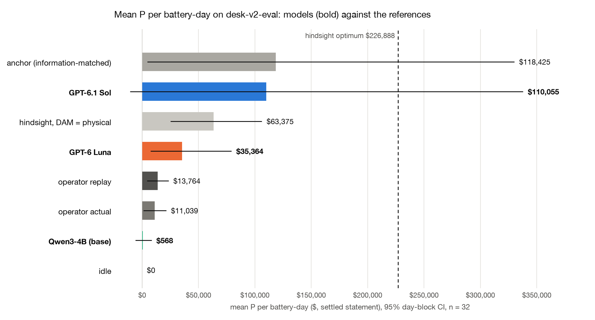
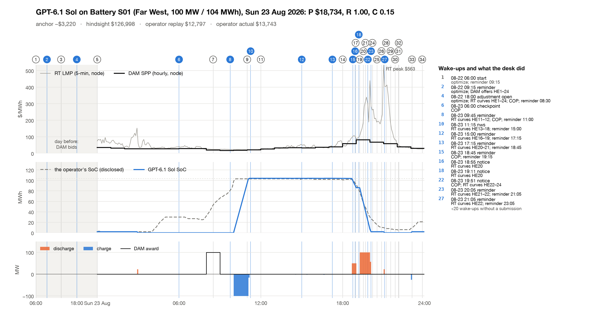

# GridSimEnv desk v2: results on `desk-v2-eval`

32 battery-days (8 operating days), 3 models. P is the settled ERCOT
statement in $ per battery-day; R the contract reward (anchor = 1.0, idle = 0.2); C the hindsight capture
(P − P_idle)/(P_hind − P_idle); C_phys the same against the hindsight optimum with its DAM position tied to dispatch.
"floored" counts tasks whose reward scale is floored at 10% of (P_hind_phys − P_idle) because the anchor
earns less (contract §9.1). Brackets are 95% day-block CIs.

| model | n | valid | floored | R | C (hindsight) | C_phys | mean P | P − anchor | beats anchor | P − operator replay | P − operator actual | $ / episode |
|---|---|---|---|---|---|---|---|---|---|---|---|---|
| GPT-6.1 Sol | 32 | 100% | 13 | 0.74 [0.54, 0.90] | 0.20 [0.03, 0.43] | 1.07 [0.11, 2.41] | $110,055 [−$10,891, $337,923] | −$8,370 [−$34,166, +$15,500] | 69% | +$96,290 [−$32,861, +$331,471] | +$99,016 [−$30,975, +$335,662] | $0.96 |
| GPT-6 Luna | 32 | 100% | 13 | 0.75 [0.61, 0.88] | 0.13 [0.10, 0.17] | 0.45 [0.28, 0.65] | $35,364 [$7,524, $79,300] | −$83,060 [−$254,596, +$10,265] | 59% | +$21,600 [−$4,480, +$68,346] | +$24,325 [−$3,380, +$73,230] | $0.19 |
| Qwen3-4B (base) | 32 | 91% | 13 | 0.38 [0.26, 0.52] | 0.01 [−0.04, 0.04] | 0.04 [−0.08, 0.15] | $568 [−$5,993, $8,470] | −$117,856 [−$323,418, −$6,383] | 31% | −$13,196 [−$27,547, +$1,959] | −$10,471 [−$25,672, +$6,455] | $0.00 |

### References (every task, the same clearing, physics and settlement)

| reference | n | mean P | C | C_phys |
|---|---|---|---|---|
| idle | 32 | $0 [$0, $0] | 0.00 | 0.00 |
| anchor (information-matched) | 32 | $118,425 [$4,450, $330,200] | 0.19 | 0.86 |
| hindsight optimum | 32 | $226,888 [$70,161, $455,120] | 1.00 | 3.85 |
| hindsight, DAM = physical | 32 | $63,375 [$25,049, $106,175] | 0.31 | 1.00 |
| operator replay | 32 | $13,764 [$4,288, $23,473] | 0.10 | 0.29 |
| operator actual | 32 | $11,039 [$1,101, $21,427] | 0.06 | 0.13 |

### Paired gaps (same tasks)

| paired gap | n | Δ P | Δ R | Δ C | ahead (tasks) | days ahead |
|---|---|---|---|---|---|---|
| GPT-6.1 Sol − GPT-6 Luna | 32 | +$74,690 [−$33,702, +$265,197] | −0.00 [−0.22, +0.23] | +0.07 [−0.10, +0.29] | 53% | 3/8 |
| GPT-6.1 Sol − Qwen3-4B (base) | 32 | +$109,486 [−$8,190, +$330,648] | +0.36 [+0.21, +0.52] | +0.19 [+0.04, +0.42] | 66% | 5/8 |
| GPT-6 Luna − Qwen3-4B (base) | 32 | +$34,796 [+$8,970, +$72,000] | +0.37 [+0.25, +0.49] | +0.13 [+0.08, +0.17] | 75% | 8/8 |
| GPT-6.1 Sol − operator replay | 32 | +$96,290 [−$32,861, +$331,471] | — | — | 53% | 4/8 |
| GPT-6 Luna − operator replay | 32 | +$21,600 [−$4,480, +$68,346] | — | — | 59% | 5/8 |
| Qwen3-4B (base) − operator replay | 32 | −$13,196 [−$27,547, +$1,959] | — | — | 31% | 1/8 |

### Statement lines (mean $ per battery-day)

| line | GPT-6.1 Sol | GPT-6 Luna | Qwen3-4B (base) |
|---|---|---|---|
| dam_energy | +$227,676 | +$40,185 | +$12,658 |
| rt_energy_imbalance | −$114,400 | −$2,833 | −$6,082 |
| deviation | +$0 | +$0 | +$0 |
| load_allocated | +$0 | +$0 | +$0 |
| degradation | −$1,718 | −$1,400 | −$1,084 |
| warranty_overage | −$79 | +$0 | −$378 |
| end_soc_shortfall | −$1,424 | −$587 | −$4,546 |
| **P** | **+$110,055** | **+$35,364** | **+$568** |

### Behaviour (mean per episode; codes are totals)

| model | turns | wakes | calls | top tools | submissions ok / rejected | rejection codes | reminders | cycles | COP late | input tok | output tok | cached tok |
|---|---|---|---|---|---|---|---|---|---|---|---|---|
| GPT-6.1 Sol | 30.53 | 30.53 | 134.25 | get_forecasts 27.2, get_prices 25.2, get_asset_status 21.5, set_reminder 17.9 | 16.22 / 0.0 | — | 17.91 | 1.005 | 0.0 | 2,001,468 | 15,430 | 1,681,587 |
| GPT-6 Luna | 22.03 | 22.03 | 135.91 | get_forecasts 26.6, get_prices 21.6, get_asset_status 18.0, get_position 16.7 | 15.09 / 0.0 | — | 9.91 | 0.822 | 0.0 | 4,656,318 | 76,471 | 3,524,741 |
| Qwen3-4B (base) | 16.84 | 16.84 | 75.16 | set_reminder 17.8, get_forecasts 9.9, get_position 9.1, get_asset_status 8.2 | 7.31 / 1.47 | EBOC-06 ×41, EBOC-01 ×6 | 10.06 | 0.681 | 0.0 | 1,614,683 | 12,483 | 0 |

## Sensitivity (post hoc, not pre-registered)

|  | GPT-6.1 Sol | GPT-6 Luna | Qwen3-4B (base) | anchor (information-matched) | operator replay | operator actual |
|---|---|---|---|---|---|---|
| median P | $8,539 | $7,453 | $233 | $3,959 | $3,526 | $2,491 |

Means without 2026-01-25 (28 tasks):

|  | n | mean P | R | C | C_phys |
|---|---|---|---|---|---|
| GPT-6.1 Sol | 28 | −$2,197 [−$14,171, $7,536] | 0.71 [0.50, 0.89] | 0.09 [0.01, 0.18] | 0.48 [0.04, 1.15] |
| GPT-6 Luna | 28 | $14,931 [$5,306, $27,542] | 0.80 [0.70, 0.91] | 0.13 [0.09, 0.17] | 0.36 [0.24, 0.48] |
| Qwen3-4B (base) | 28 | −$2,773 [−$7,639, $1,499] | 0.41 [0.29, 0.55] | 0.00 [−0.04, 0.04] | 0.02 [−0.10, 0.15] |
| anchor (information-matched) | 28 | $14,003 [$1,572, $29,598] | — | — | — |
| operator replay | 28 | $16,113 [$6,822, $25,943] | — | — | — |
| operator actual | 28 | $14,185 [$4,801, $24,008] | — | — | — |

Mean P per operating day:

| day | GPT-6.1 Sol | GPT-6 Luna | Qwen3-4B (base) | anchor (information-matched) | operator replay | operator actual |
|---|---|---|---|---|---|---|
| 2026-01-25 | $895,817 | $178,396 | $23,957 | $849,377 | −$2,677 | −$10,983 |
| 2026-02-24 | $5,656 | $2,820 | −$2,143 | $176 | $2,172 | $1,208 |
| 2026-03-23 | −$15,955 | $12,400 | −$8,068 | $55,957 | $24,454 | $28,431 |
| 2026-04-24 | −$33,059 | $48,879 | −$2,084 | $27,753 | $37,230 | $34,306 |
| 2026-05-03 | $11,441 | $2,484 | $1,727 | $4,501 | $2,241 | $1,201 |
| 2026-06-24 | $1,748 | $2,071 | $325 | $739 | $778 | −$1,477 |
| 2026-07-22 | $4,713 | $18,874 | $5,470 | $11,210 | $21,751 | $16,918 |
| 2026-08-23 | $10,076 | $16,992 | −$14,637 | −$2,315 | $24,164 | $18,709 |

| model | tasks with P < 0 | days with mean P < 0 | worst task | worst P |
|---|---|---|---|---|
| GPT-6.1 Sol | 8 | 2 | desk-v2-2026-04-24-S04 | −$134,864 |
| GPT-6 Luna | 2 | 0 | desk-v2-2026-04-24-S04 | −$10,738 |
| Qwen3-4B (base) | 13 | 4 | desk-v2-2026-01-25-S01 | −$68,293 |

## What the numbers say

- One day dominates the means: on 2026-01-25 the node DAM price ran about $250–1,300/MWh against an RT price of about $100–200, and day-ahead/real-time spread positions (allowed for an ESR under ERCOT's rules, since the DAM ignores state of charge) earned Sol $895,817, Luna $178,396 and the anchor $849,377 per battery-day on average.
- Without 2026-01-25 (28 tasks), Sol's mean P is −$2,197 [−$14,171, $7,536] and Luna's $14,931 [$5,306, $27,542], against the operator replay's $16,113 and the anchor's $14,003; the medians over all 32 tasks are Sol $8,539 and Luna $7,453.
- Sol takes larger spread positions than Luna: bigger wins on 2026-01-25 and 8 loss tasks against Luna's 2, worst −$134,864 (2026-04-24-S04) against Luna's −$10,738.
- ERCOT's DAM credit screening (the QSE's available credit limit) is not modelled, so DAM spread positions are bounded only by the ESR's MW limits; a known simplification that favours large spread positions.
- Qwen3-4B (base, thinking off) submits a valid offer on 29 of 32 tasks (91%); R 0.38 [0.26, 0.52], C 0.005 [−0.035, 0.044], mean P $568 [−$5,993, $8,470] (median $233), with 13 loss tasks (worst −$68,293 on 2026-01-25-S01); its most common rejection is EBOC-06, a submission outside its window (DAM closed, RT not yet open or hour ended; 41 times).

## Method

- Pack `desk-v2-eval`, layer v2: 32 tasks, 8 operating days,
  4 sites, era rtcb.
  Every model plays every task once (`scripts/desk_run.py`, path B', the in-process Session); every grade replayed from its Episode JSON against the frozen refs (`results/desk-refs/desk-v2-eval/refs.jsonl`; anchor risk 1.25, DAM position spread).
- Settings: GPT-6.1 Sol: kind model, model openai/gpt-6.1-sol, effort high; GPT-6 Luna: kind model, model openai/gpt-6-luna, effort high; Qwen3-4B (base): kind model, model qwen3-4b.
- Budgets per episode: max_turns 40, calls_per_turn 12, max_reminders 8.
- CIs: day-block bootstrap, 10,000 resamples of operating days, seed 0, task-weighted means (as
  `results/train/4b-blind`); paired gaps resample days over the tasks both sides played. "days ahead" counts days whose
  mean gap is positive.
- References are settled by the same clearing, physics and settlement code (contract §9.2): idle, the
  information-matched anchor, the hindsight optimum, the hindsight optimum with the DAM position tied to physical
  dispatch, the operator's disclosed curves replayed through our clearing, and the operator's disclosed awards and
  telemetry settled directly.
- Cost is the runner's metered API cost of the scored attempts; all attempts (count): GPT-6.1 Sol $30.79 (32), GPT-6 Luna $5.97 (32), Qwen3-4B (base) $0.00 (32).
- Raw outputs: `runs/<model>/results.jsonl.gz`, `episodes/<model>/*.json.gz` (Episode JSON
  `gridsim.desk.episode/v1`); per-call logs `runs/<model>/calls/*.jsonl.gz`. Core desk-2.1.
