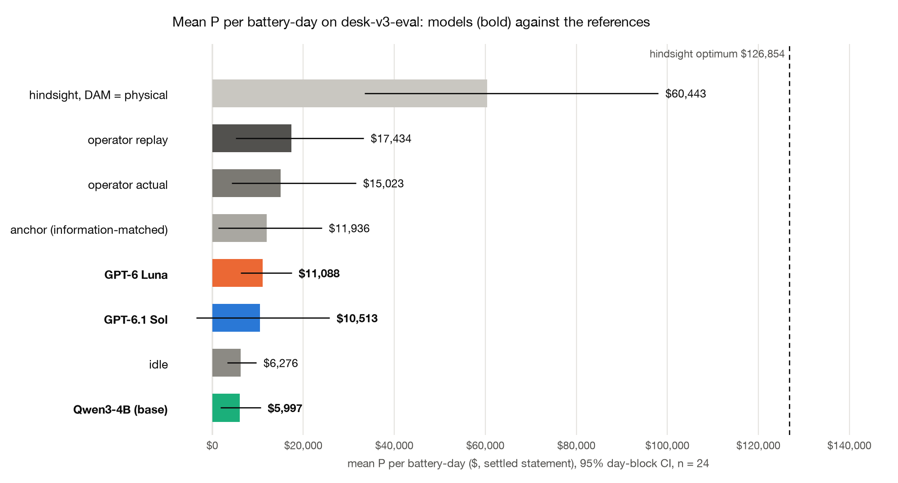
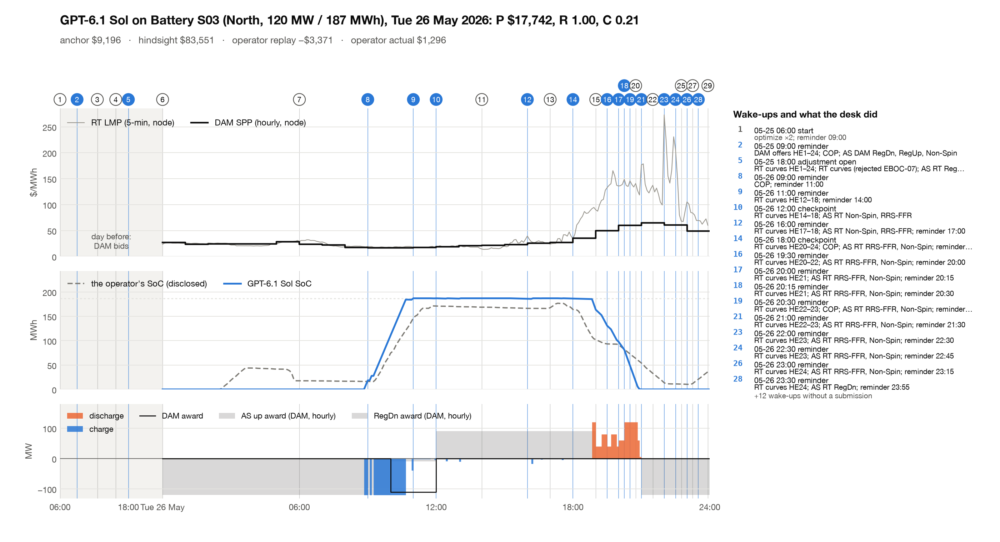

# GridSimEnv desk v3: results on `desk-v3-eval`

24 battery-days (6 operating days), 3 models. P is the settled ERCOT
statement in $ per battery-day; R the contract reward (anchor = 1.0, idle = 0.2); C the hindsight capture
(P − P_idle)/(P_hind − P_idle); C_phys the same against the hindsight optimum with its DAM position tied to dispatch.
"floored" counts tasks whose reward scale is floored at 10% of (P_hind_phys − P_idle) because the anchor
earns less (contract §9.1). Brackets are 95% day-block CIs.

| model | n | valid | floored | R | C (hindsight) | C_phys | mean P | P − anchor | beats anchor | P − operator replay | P − operator actual | $ / episode |
|---|---|---|---|---|---|---|---|---|---|---|---|---|
| GPT-6.1 Sol | 24 | 100% | 13 | 0.55 [0.36, 0.73] | 0.10 [−0.05, 0.27] | 1.45 [0.14, 3.01] | $10,513 [−$3,566, $25,808] | −$1,423 [−$19,580, +$12,202] | 62% | −$6,921 [−$29,498, +$9,953] | −$4,510 [−$29,849, +$15,051] | $1.74 |
| GPT-6 Luna | 24 | 100% | 13 | 0.60 [0.42, 0.77] | 0.07 [0.03, 0.13] | 0.10 [−0.05, 0.25] | $11,088 [$6,214, $17,463] | −$848 [−$14,307, +$8,396] | 58% | −$6,346 [−$24,451, +$4,446] | −$3,935 [−$23,386, +$8,362] | $0.15 |
| Qwen3-4B (base) | 24 | 54% | 13 | 0.20 [0.08, 0.31] | −0.01 [−0.04, 0.01] | −1.72 [−4.31, 0.04] | $5,997 [$1,757, $10,660] | −$5,940 [−$16,202, +$1,849] | 46% | −$11,437 [−$26,455, −$1,158] | −$9,026 [−$25,737, +$2,054] | $0.00 |

### References (every task, the same clearing, physics and settlement)

| reference | n | mean P | C | C_phys |
|---|---|---|---|---|
| idle | 24 | $6,276 [$3,303, $9,695] | 0.00 | 0.00 |
| anchor (information-matched) | 24 | $11,936 [$1,346, $24,068] | 0.03 | 0.33 |
| hindsight optimum | 24 | $126,854 [$77,221, $209,781] | 1.00 | 22.83 |
| hindsight, DAM = physical | 24 | $60,443 [$33,517, $98,015] | 0.44 | 1.00 |
| operator replay | 24 | $17,434 [$5,188, $33,264] | 0.07 | -0.44 |
| operator actual | 24 | $15,023 [$4,305, $31,590] | 0.03 | -0.06 |

### Paired gaps (same tasks)

| paired gap | n | Δ P | Δ R | Δ C | ahead (tasks) | days ahead |
|---|---|---|---|---|---|---|
| GPT-6.1 Sol − GPT-6 Luna | 24 | −$575 [−$10,087, +$8,917] | −0.05 [−0.19, +0.10] | +0.03 [−0.10, +0.15] | 58% | 3/6 |
| GPT-6.1 Sol − Qwen3-4B (base) | 24 | +$4,516 [−$7,114, +$16,458] | +0.35 [+0.22, +0.49] | +0.11 [−0.04, +0.27] | 58% | 3/6 |
| GPT-6 Luna − Qwen3-4B (base) | 24 | +$5,091 [+$1,525, +$8,102] | +0.40 [+0.29, +0.51] | +0.08 [+0.03, +0.13] | 83% | 5/6 |
| GPT-6.1 Sol − operator replay | 24 | −$6,921 [−$29,498, +$9,953] | — | — | 50% | 3/6 |
| GPT-6 Luna − operator replay | 24 | −$6,346 [−$24,451, +$4,446] | — | — | 54% | 4/6 |
| Qwen3-4B (base) − operator replay | 24 | −$11,437 [−$26,455, −$1,158] | — | — | 25% | 1/6 |

### Statement lines (mean $ per battery-day)

| line | GPT-6.1 Sol | GPT-6 Luna | Qwen3-4B (base) |
|---|---|---|---|
| dam_energy | +$46,812 | +$8,110 | +$2,392 |
| rt_energy_imbalance | −$42,933 | −$104 | −$1,538 |
| deviation | +$0 | +$0 | +$0 |
| load_allocated | +$0 | +$0 | +$0 |
| degradation | −$1,492 | −$1,236 | −$509 |
| warranty_overage | −$2 | +$0 | −$125 |
| end_soc_shortfall | −$395 | −$809 | −$342 |
| dam_as_capacity | +$1,948 | +$0 | +$1,604 |
| rt_as_imbalance | +$1,469 | +$21 | −$84 |
| failure_to_provide | +$0 | +$0 | +$0 |
| capacity_short | +$0 | +$0 | −$508 |
| pv_energy | +$5,106 | +$5,106 | +$5,106 |
| **P** | **+$10,513** | **+$11,088** | **+$5,997** |

### Behaviour (mean per episode; codes are totals)

| model | turns | wakes | calls | top tools | submissions ok / rejected | rejection codes | reminders | cycles | COP late | input tok | output tok | cached tok |
|---|---|---|---|---|---|---|---|---|---|---|---|---|
| GPT-6.1 Sol | 30.71 | 30.71 | 162.46 | get_prices 36.7, get_forecasts 31.8, get_asset_status 23.8, set_reminder 19.8 | 31.21 / 0.83 | EBOC-07 ×20 | 19.79 | 0.914 | 0.0 | 3,114,203 | 25,221 | 2,496,295 |
| GPT-6 Luna | 17.79 | 17.79 | 110.46 | get_forecasts 20.3, get_prices 18.8, get_asset_status 14.7, get_position 14.5 | 16.88 / 0.08 | EBOC-04 ×1, EBOC-07 ×1 | 6.92 | 0.762 | 0.0 | 3,601,515 | 69,300 | 2,758,225 |
| Qwen3-4B (base) | 14.17 | 14.17 | 72.21 | get_forecasts 23.6, get_prices 11.3, set_reminder 9.2, get_asset_status 7.7 | 2.62 / 1.75 | EBOC-06 ×37, EBOC-07 ×5 | 4.88 | 0.363 | 0.08 | 1,618,750 | 12,488 | 0 |

### Ancillary services (mean per episode)

| model | product | DAM submissions accepted | RT submissions accepted | DAM award MWh | RT award MWh |
|---|---|---|---|---|---|
| GPT-6.1 Sol | RegUp | 0.21 | 5.50 | 35.0 | 178.2 |
| GPT-6.1 Sol | RegDn | 0.58 | 4.04 | 663.6 | 229.6 |
| GPT-6.1 Sol | RRS-FFR | 0.29 | 4.04 | 202.9 | 135.0 |
| GPT-6.1 Sol | RRS-PFR | 0.00 | 0.58 | 0.0 | 0.0 |
| GPT-6.1 Sol | ECRS | 0.17 | 2.42 | 9.0 | 25.0 |
| GPT-6.1 Sol | Non-Spin | 0.21 | 3.88 | 43.9 | 54.6 |
| GPT-6.1 Sol | all |  |  |  | 24/24 episodes with an AS award; AS offers refused: ASO-02 ×24; empty `as_offers` list flagged (env defect, energy unaffected): 56 calls |
| GPT-6 Luna | RegUp | 0.12 | 1.12 | 0.0 | 0.0 |
| GPT-6 Luna | RegDn | 0.00 | 0.54 | 0.0 | 0.0 |
| GPT-6 Luna | RRS-FFR | 0.00 | 0.54 | 0.0 | 0.0 |
| GPT-6 Luna | RRS-PFR | 0.00 | 0.54 | 0.0 | 0.0 |
| GPT-6 Luna | ECRS | 0.00 | 0.54 | 0.0 | 0.1 |
| GPT-6 Luna | Non-Spin | 0.00 | 0.75 | 0.0 | 1.1 |
| GPT-6 Luna | all |  |  |  | 6/24 episodes with an AS award; AS offers refused: ASO-02 ×111; empty `as_offers` list flagged (env defect, energy unaffected): 97 calls |
| Qwen3-4B (base) | RegUp | 0.17 | 0.42 | 50.2 | 82.2 |
| Qwen3-4B (base) | RegDn | 0.33 | 0.42 | 768.7 | 312.9 |
| Qwen3-4B (base) | RRS-FFR | 0.08 | 0.33 | 60.5 | 20.2 |
| Qwen3-4B (base) | ECRS | 0.08 | 0.25 | 5.0 | 10.3 |
| Qwen3-4B (base) | Non-Spin | 0.29 | 0.25 | 40.3 | 20.6 |
| Qwen3-4B (base) | all |  |  |  | 17/24 episodes with an AS award; AS offers refused: ASO-06 ×15, ASO-02 ×4; empty `as_offers` list flagged (env defect, energy unaffected): 32 calls |

## Sensitivity (post hoc, not pre-registered)

|  | GPT-6.1 Sol | GPT-6 Luna | Qwen3-4B (base) | anchor (information-matched) | operator replay | operator actual |
|---|---|---|---|---|---|---|
| median P | $11,902 | $8,786 | $3,135 | $6,795 | $11,103 | $9,277 |

Mean P per operating day:

| day | GPT-6.1 Sol | GPT-6 Luna | Qwen3-4B (base) | anchor (information-matched) | operator replay | operator actual |
|---|---|---|---|---|---|---|
| 2026-04-11 | −$10,827 | $4,672 | −$2,570 | −$8,667 | $3,861 | $4,585 |
| 2026-04-24 | −$7,292 | $3,845 | $6,865 | $36,777 | $53,843 | $55,015 |
| 2026-05-26 | $16,717 | $9,401 | $2,351 | $8,824 | $5,380 | $6,457 |
| 2026-06-06 | $1,339 | $12,009 | $8,088 | $3,837 | $3,798 | $584 |
| 2026-07-21 | $41,142 | $25,749 | $15,552 | $21,416 | $27,293 | $14,477 |
| 2026-08-22 | $21,999 | $10,851 | $5,694 | $9,432 | $10,429 | $9,018 |

| model | tasks with P < 0 | days with mean P < 0 | worst task | worst P |
|---|---|---|---|---|
| GPT-6.1 Sol | 7 | 2 | desk-v3-2026-04-24-S04 | −$44,564 |
| GPT-6 Luna | 3 | 0 | desk-v3-2026-04-24-S03 | −$34,051 |
| Qwen3-4B (base) | 4 | 1 | desk-v3-2026-04-11-S03 | −$7,120 |

## What the numbers say

- Sol and Luna are level: mean P $10,513 [−$3,566, $25,808] and $11,088 [$6,214, $17,463] per battery-day (Sol − Luna −$575 [−$10,087, +$8,917]), against the anchor's $11,936, idle's $6,276 (idle earns through ERCOT's proxy AS offers and the PV option) and the operator replay's $17,434.
- One day weighs heavily on Sol: 2026-07-21 (day mean $41,142) is 65% of the sum of its six day means; without it Sol's mean P is $4,387, Luna's $8,156 and the anchor's $10,041. Sol has 7 loss tasks (worst −$44,564 on 2026-04-24-S04), Luna 3 (worst −$34,051), Qwen3-4B 4 (worst −$7,120).
- Sol trades reserves and spreads: AS awards in 24 of 24 episodes and $3,417 per battery-day from the AS lines (DAM capacity $1,948, RT imbalance $1,469), and DAM energy +$46,812 against RT imbalance −$42,933 (DA/RT spread positions; DAM credit screening is not modelled). Luna's AS offers fail the shape check 111 times (ASO-02: mw and price need one value per hour; Sol 24), with AS awards in 6 of 24 episodes and $21 of AS revenue.
- C_phys is ill-conditioned on this pack: where the physical hindsight optimum barely beats idle (2026-04-11-S04: $147 above idle) the ratio explodes, so its means swing widely; the medians are Sol 0.11, Luna 0.12, Qwen3-4B 0.00.
- Qwen3-4B (base, thinking off) submits a valid offer on 13 of 24 tasks (54%); R 0.20 [0.08, 0.31], C −0.013 [−0.044, 0.013], mean P $5,997, below idle, since its invalid episodes still earn through ERCOT's proxy AS offers and PV (mean $7,021); its most common rejection is EBOC-06, a submission outside its window (37 times).

## Pilot

The pilot pack, graded as the runner wrote it (not in the tables above).

| task | policy | R | C | P | anchor | operator replay | turns | $ |
|---|---|---|---|---|---|---|---|---|
| desk-v3-2026-04-20-S01 | gpt-6.1-sol | 0.00 | −0.10 | $4,820 | $7,673 | $10,549 | 27 | $1.40 |
| desk-v3-2026-08-14-S03 | gpt-6.1-sol | 1.00 | 0.19 | $4,477 | −$1,448 | −$194 | 25 | $1.42 |

## Method

- Pack `desk-v3-eval`, layer v3: 24 tasks, 6 operating days,
  4 sites, era rtcb.
  Every model plays every task once (`scripts/desk_run.py`, path B', the in-process Session); every grade replayed from its Episode JSON against the frozen refs (the pack task rows; anchor risk 1.5, DAM position spread).
- Settings: GPT-6.1 Sol: kind model, model openai/gpt-6.1-sol, effort high; GPT-6 Luna: kind model, model openai/gpt-6-luna, effort high; Qwen3-4B (base): kind model, model qwen3-4b.
- Budgets per episode: max_turns 48, calls_per_turn 14, max_reminders 8.
- CIs: day-block bootstrap, 10,000 resamples of operating days, seed 0, task-weighted means (as
  `results/train/4b-blind`); paired gaps resample days over the tasks both sides played. "days ahead" counts days whose
  mean gap is positive.
- References are settled by the same clearing, physics and settlement code (contract §9.2): idle, the
  information-matched anchor, the hindsight optimum, the hindsight optimum with the DAM position tied to physical
  dispatch, the operator's disclosed curves replayed through our clearing, and the operator's disclosed awards and
  telemetry settled directly.
- Cost is the runner's metered API cost of the scored attempts; all attempts (count): GPT-6.1 Sol $41.70 (24), GPT-6 Luna $3.52 (24), Qwen3-4B (base) $0.00 (24).
- Known env defects (frozen for this version): an empty `as_offers` list is answered with a spurious ASO-02 note ("as_offers is a list of objects"); energy curves in the same call are accepted; fixed after the v3/v5 freeze. The AS table counts these calls separately and leaves them out of the refusals.
- Raw outputs: `runs/<model>/results.jsonl.gz`, `episodes/<model>/*.json.gz` (Episode JSON
  `gridsim.desk.episode/v1`); per-call logs `runs/<model>/calls/*.jsonl.gz`. Core desk-2.1.
