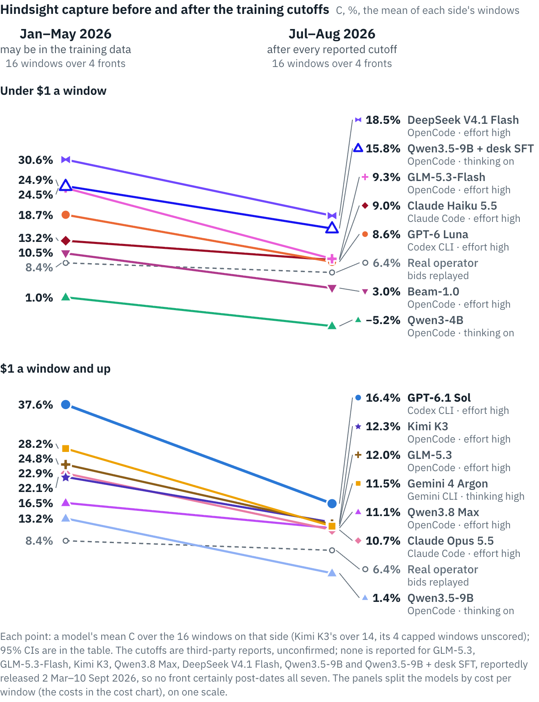
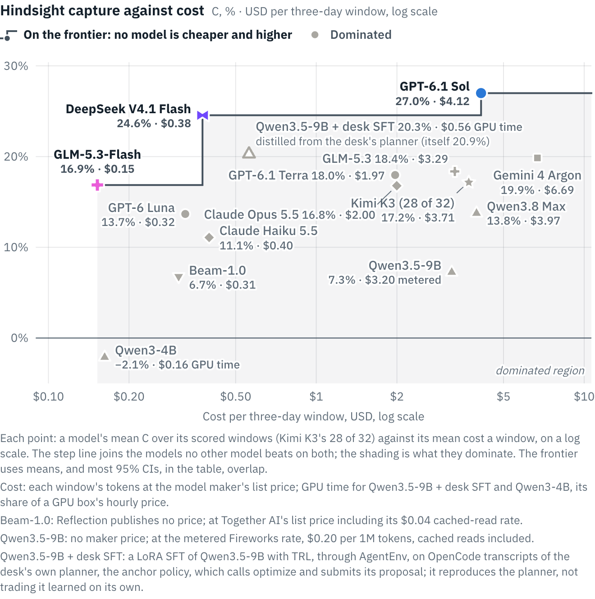

# GridSimEnv desk v4 benchmark: results on `desk-v4-bench`

32 three-day windows (8 real ERCOT weather fronts × 4 real batteries), 15 models in native agent harnesses at high effort. C, the headline, is hindsight capture (P − P_idle)/(P_hind − P_idle), the share of the hindsight optimum's profit over idle; R the contract reward (anchor 1.0, idle 0.2); P the settled ERCOT statement in $ per window. `pre_cutoff`: 16 windows, January to May 2026; `post_cutoff`: 16 windows, July and August 2026, after every reported training cutoff (none is reported for DeepSeek V4.1 Flash, Qwen3.5-9B + desk SFT, GLM-5.3, Kimi K3, GLM-5.3-Flash, Qwen3.8 Max and Qwen3.5-9B). Brackets: 95% CIs, a block bootstrap over the 8 fronts (each split's 4 within it).

<picture><source media="(prefers-color-scheme: dark)" srcset="figures/splits-dark.png"></picture>

| model | harness | n | C | C, pre_cutoff | C, post_cutoff | R | P | $ / window |
|---|---|---|---|---|---|---|---|---|
| **GPT-6.1 Sol** | Codex CLI · effort high | 32 | 27.0% [9.5, 43.8] | 37.6% [26.7, 55.0] | 16.4% [−9.7, 42.7] | 0.78 [0.53, 0.96] | $130,790 [−$6,520, $364,305] | $4.12 |
| **DeepSeek V4.1 Flash** | OpenCode · effort high | 32 | 24.6% [10.7, 41.7] | 30.6% [9.5, 58.8] | 18.5% [3.3, 33.7] | 0.73 [0.58, 0.88] | $148,269 [$13,841, $402,606] | $0.38 |
| **Qwen3.5-9B + desk SFT** | OpenCode · thinking on | 32 | 20.3% [6.9, 37.4] | 24.9% [3.0, 56.2] | 15.8% [1.6, 30.0] | 0.82 [0.65, 0.96] | $136,356 [$7,733, $381,359] | $0.56 |
| **Gemini 4 Argon** | Gemini CLI · thinking high | 32 | 19.9% [5.1, 33.5] | 28.2% [15.5, 41.4] | 11.5% [−10.1, 31.7] | 0.69 [0.44, 0.90] | $93,543 [−$11,197, $265,902] | $6.69 |
| **GLM-5.3** | OpenCode · effort high | 32 | 18.4% [4.5, 32.4] | 24.8% [11.7, 41.9] | 12.0% [−9.2, 33.1] | 0.70 [0.48, 0.86] | $102,446 [−$5,138, $292,367] | $3.29 |
| **GPT-6.1 Terra** | Codex CLI · effort high | 32 | 18.0% [6.6, 28.6] | 22.4% [15.4, 29.4] | 13.5% [−4.9, 32.3] | 0.72 [0.49, 0.89] | $70,735 [−$1,905, $190,490] | $1.97 |
| **Kimi K3** | OpenCode · effort high | 28 | 17.2% [7.7, 27.8] | 22.1% [12.1, 39.5] | 12.3% [−0.2, 21.8] | 0.62 [0.47, 0.72] | $106,085 [$10,275, $282,602] | $3.71 |
| **GLM-5.3-Flash** | OpenCode · effort high | 32 | 16.9% [7.2, 30.3] | 24.5% [10.6, 47.8] | 9.3% [1.2, 18.0] | 0.69 [0.52, 0.84] | $112,499 [$7,417, $313,659] | $0.15 |
| **Claude Opus 5.5** | Claude Code · effort high | 32 | 16.8% [8.6, 26.5] | 22.9% [12.7, 37.6] | 10.7% [1.6, 19.9] | 0.71 [0.61, 0.82] | $94,056 [$11,486, $251,436] | $2.00 |
| **Qwen3.8 Max** | OpenCode · effort high | 32 | 13.8% [5.3, 22.4] | 16.5% [5.5, 27.5] | 11.1% [−0.8, 23.0] | 0.62 [0.50, 0.75] | $65,682 [$3,286, $177,682] | $3.97 |
| **GPT-6 Luna** | Codex CLI · effort high | 32 | 13.7% [5.7, 22.3] | 18.7% [10.7, 28.6] | 8.6% [−0.7, 21.5] | 0.60 [0.46, 0.75] | $69,877 [$8,483, $181,600] | $0.32 |
| **Claude Haiku 5.5** | Claude Code · effort high | 32 | 11.1% [7.0, 15.0] | 13.2% [9.1, 17.2] | 9.0% [2.8, 15.3] | 0.64 [0.54, 0.76] | $40,466 [$9,899, $94,912] | $0.40 |
| **Qwen3.5-9B** | OpenCode · thinking on | 32 | 7.3% [−2.4, 19.3] | 13.2% [2.7, 32.1] | 1.4% [−9.0, 15.3] | 0.41 [0.26, 0.55] | $75,659 [−$2,218, $222,219] | $3.20 |
| **Beam-1.0** | OpenCode · effort high | 32 | 6.7% [0.5, 12.0] | 10.5% [5.6, 15.5] | 3.0% [−5.9, 10.9] | 0.53 [0.34, 0.71] | $21,528 [−$7,872, $63,778] | $0.31 |
| **Qwen3-4B** | OpenCode · thinking on | 32 | −2.1% [−5.9, 1.4] | 1.0% [−1.1, 4.9] | −5.2% [−10.8, −0.9] | 0.14 [0.06, 0.25] | −$3,525 [−$8,531, $1,232] | $0.16 |

<picture><source media="(prefers-color-scheme: dark)" srcset="figures/pareto-dark.png"></picture>

## What the numbers say

- **Before and after the cutoffs.** Every model scores lower on Jul–Aug than on Jan–May, and that includes Qwen3-4B, whose training predates every window. So the drop reflects harder windows (the Jan–May half includes winter storm Fern), not evidence of training-data contamination. No model the rule covers has a post − pre interval that excludes zero, so all 32 windows lead, by a rule set before any API result.
- **Cost against score.** The cost frontier, cheapest first: GLM-5.3-Flash ($0.15, C 16.9%), DeepSeek V4.1 Flash ($0.38, C 24.6%) and GPT-6.1 Sol ($4.12, C 27.0%). No other model is both cheaper and higher in C; the other 12 are dominated.
- **Qwen3.5-9B + desk SFT** is a LoRA SFT of Qwen3.5-9B with TRL, through AgentEnv, on OpenCode transcripts of the desk's own planner, the anchor policy, which calls optimize and submits its proposal; it reproduces the planner, not trading it learned on its own.
- **Valid submissions.** Qwen3-4B made no valid submission on 7 of its 32 windows (R = 0 there).
- **Reliability.** 621 attempts for 480 model-windows; 145 did not reach the grade (infrastructure ×141, episode spend cap, final ×4). Infrastructure failures were retried; attempts that failed before any model call (a port race in our launcher, $0), Gemini 4 Argon's ended by a transient provider 400 from 18:06 UTC and Beam-1.0's ended by the router's HTTP 402 when its account ran out of credits didn't count toward the two-retry limit (see Deviations). Windows not scored and not imputed: Kimi K3, episode spend cap, final ×4.

## Paired gaps (the windows both played)

| paired gap | n | Δ C, pts | Δ R | Δ P | ahead (windows) | fronts ahead |
|---|---|---|---|---|---|---|
| GPT-6.1 Sol − DeepSeek V4.1 Flash | 32 | +2.5 [−8.2, +12.8] | +0.05 [−0.17, +0.25] | −$17,479 [−$59,016, +$16,702] | 62% | 5/8 |
| GPT-6.1 Sol − Qwen3.5-9B + desk SFT | 32 | +6.7 [−4.2, +17.0] | −0.04 [−0.27, +0.21] | −$5,565 [−$39,195, +$23,030] | 66% | 6/8 |
| GPT-6.1 Sol − Gemini 4 Argon | 32 | +7.1 [+2.8, +11.7] | +0.09 [+0.01, +0.20] | +$37,247 [+$3,028, +$99,049] | 69% | 6/8 |
| GPT-6.1 Sol − GLM-5.3 | 32 | +8.6 [+2.0, +14.7] | +0.08 [−0.03, +0.20] | +$28,345 [−$2,099, +$72,453] | 62% | 6/8 |
| GPT-6.1 Sol − GPT-6.1 Terra | 32 | +9.0 [+1.8, +16.8] | +0.06 [−0.05, +0.16] | +$60,055 [−$4,774, +$174,207] | 75% | 6/8 |
| GPT-6.1 Sol − Kimi K3 | 28 | +13.0 [+3.1, +20.7] | +0.20 [+0.01, +0.35] | +$45,683 [−$10,658, +$120,547] | 86% | 7/8 |
| GPT-6.1 Sol − GLM-5.3-Flash | 32 | +10.1 [−0.6, +20.0] | +0.09 [−0.07, +0.25] | +$18,291 [−$16,189, +$50,417] | 69% | 6/8 |
| GPT-6.1 Sol − Claude Opus 5.5 | 32 | +10.2 [−0.9, +19.9] | +0.06 [−0.11, +0.21] | +$36,734 [−$20,263, +$113,999] | 72% | 7/8 |
| GPT-6.1 Sol − Qwen3.8 Max | 32 | +13.2 [+2.0, +23.9] | +0.16 [−0.04, +0.35] | +$65,108 [−$11,449, +$187,749] | 72% | 7/8 |
| GPT-6.1 Sol − GPT-6 Luna | 32 | +13.3 [+2.1, +22.4] | +0.18 [−0.04, +0.35] | +$60,913 [−$19,073, +$185,093] | 81% | 7/8 |
| GPT-6.1 Sol − Claude Haiku 5.5 | 32 | +15.9 [+1.3, +29.5] | +0.14 [−0.11, +0.34] | +$90,324 [−$21,187, +$272,145] | 78% | 7/8 |
| GPT-6.1 Sol − Qwen3.5-9B | 32 | +19.7 [+7.9, +27.6] | +0.37 [+0.16, +0.54] | +$55,132 [−$6,027, +$143,210] | 81% | 7/8 |
| GPT-6.1 Sol − Beam-1.0 | 32 | +20.3 [+7.1, +33.9] | +0.25 [+0.12, +0.37] | +$109,263 [+$350, +$300,881] | 81% | 7/8 |
| GPT-6.1 Sol − Qwen3-4B | 32 | +29.1 [+12.5, +44.6] | +0.64 [+0.40, +0.82] | +$134,316 [−$3,122, +$370,784] | 81% | 7/8 |
| DeepSeek V4.1 Flash − Qwen3.5-9B + desk SFT | 32 | +4.2 [−2.3, +12.9] | −0.09 [−0.30, +0.16] | +$11,914 [−$311, +$25,765] | 66% | 5/8 |
| DeepSeek V4.1 Flash − Gemini 4 Argon | 32 | +4.7 [−6.7, +15.0] | +0.04 [−0.18, +0.24] | +$54,726 [−$9,161, +$149,964] | 59% | 6/8 |
| DeepSeek V4.1 Flash − GLM-5.3 | 32 | +6.2 [−0.5, +13.1] | +0.03 [−0.15, +0.23] | +$45,823 [−$21, +$117,145] | 62% | 6/8 |
| DeepSeek V4.1 Flash − GPT-6.1 Terra | 32 | +6.6 [−2.6, +18.3] | +0.01 [−0.21, +0.24] | +$77,534 [−$3,433, +$219,102] | 56% | 4/8 |
| DeepSeek V4.1 Flash − Kimi K3 | 28 | +9.2 [+1.7, +16.8] | +0.11 [−0.06, +0.25] | +$60,759 [+$2,047, +$164,980] | 71% | 6/8 |
| DeepSeek V4.1 Flash − GLM-5.3-Flash | 32 | +7.7 [+0.8, +13.8] | +0.04 [−0.15, +0.21] | +$35,770 [+$3,014, +$89,879] | 62% | 6/8 |
| DeepSeek V4.1 Flash − Claude Opus 5.5 | 32 | +7.8 [+0.6, +15.6] | +0.01 [−0.15, +0.16] | +$54,213 [+$1,033, +$151,727] | 72% | 6/8 |
| DeepSeek V4.1 Flash − Qwen3.8 Max | 32 | +10.7 [+3.9, +20.4] | +0.11 [−0.00, +0.23] | +$82,587 [+$5,348, +$227,035] | 72% | 7/8 |
| DeepSeek V4.1 Flash − GPT-6 Luna | 32 | +10.9 [+2.5, +21.1] | +0.13 [−0.03, +0.29] | +$78,392 [+$2,007, +$222,516] | 62% | 7/8 |
| DeepSeek V4.1 Flash − Claude Haiku 5.5 | 32 | +13.5 [+3.0, +27.7] | +0.09 [−0.07, +0.28] | +$107,803 [+$3,221, +$308,291] | 69% | 6/8 |
| DeepSeek V4.1 Flash − Qwen3.5-9B | 32 | +17.2 [+10.0, +24.3] | +0.32 [+0.19, +0.43] | +$72,611 [+$13,362, +$181,412] | 75% | 8/8 |
| DeepSeek V4.1 Flash − Beam-1.0 | 32 | +17.8 [+5.0, +33.2] | +0.20 [−0.04, +0.43] | +$126,742 [+$7,654, +$344,784] | 72% | 5/8 |
| DeepSeek V4.1 Flash − Qwen3-4B | 32 | +26.6 [+14.0, +42.8] | +0.59 [+0.47, +0.72] | +$151,795 [+$16,900, +$409,571] | 84% | 8/8 |
| Qwen3.5-9B + desk SFT − Gemini 4 Argon | 32 | +0.5 [−9.8, +10.7] | +0.13 [−0.14, +0.36] | +$42,812 [−$14,037, +$127,222] | 44% | 4/8 |
| Qwen3.5-9B + desk SFT − GLM-5.3 | 32 | +2.0 [−7.9, +10.4] | +0.12 [−0.15, +0.35] | +$33,910 [−$8,010, +$97,399] | 56% | 4/8 |
| Qwen3.5-9B + desk SFT − GPT-6.1 Terra | 32 | +2.4 [−8.9, +14.6] | +0.10 [−0.17, +0.34] | +$65,620 [−$10,879, +$198,919] | 53% | 3/8 |
| Qwen3.5-9B + desk SFT − Kimi K3 | 28 | +4.9 [−2.3, +12.0] | +0.22 [+0.08, +0.32] | +$47,902 [−$5,922, +$140,529] | 57% | 6/8 |
| Qwen3.5-9B + desk SFT − GLM-5.3-Flash | 32 | +3.5 [−3.5, +9.7] | +0.13 [−0.13, +0.35] | +$23,857 [−$3,619, +$68,952] | 56% | 5/8 |
| Qwen3.5-9B + desk SFT − Claude Opus 5.5 | 32 | +3.5 [−5.3, +12.3] | +0.11 [−0.13, +0.28] | +$42,299 [−$7,907, +$131,604] | 56% | 4/8 |
| Qwen3.5-9B + desk SFT − Qwen3.8 Max | 32 | +6.5 [−4.5, +17.8] | +0.20 [−0.08, +0.42] | +$70,673 [−$4,429, +$207,210] | 72% | 6/8 |
| Qwen3.5-9B + desk SFT − GPT-6 Luna | 32 | +6.7 [−3.4, +17.3] | +0.22 [−0.06, +0.42] | +$66,479 [−$6,434, +$202,338] | 66% | 6/8 |
| Qwen3.5-9B + desk SFT − Claude Haiku 5.5 | 32 | +9.2 [−2.7, +23.9] | +0.18 [−0.09, +0.40] | +$95,889 [−$6,378, +$288,126] | 69% | 6/8 |
| Qwen3.5-9B + desk SFT − Qwen3.5-9B | 32 | +13.0 [+6.3, +19.6] | +0.41 [+0.17, +0.59] | +$60,697 [+$7,654, +$159,967] | 72% | 7/8 |
| Qwen3.5-9B + desk SFT − Beam-1.0 | 32 | +13.6 [+2.5, +28.7] | +0.29 [+0.05, +0.50] | +$114,828 [+$3,445, +$322,535] | 72% | 7/8 |
| Qwen3.5-9B + desk SFT − Qwen3-4B | 32 | +22.4 [+8.6, +39.3] | +0.68 [+0.41, +0.87] | +$139,881 [+$8,759, +$389,549] | 84% | 7/8 |
| Gemini 4 Argon − GLM-5.3 | 32 | +1.5 [−3.6, +7.5] | −0.01 [−0.13, +0.09] | −$8,903 [−$32,318, +$9,787] | 47% | 4/8 |
| Gemini 4 Argon − GPT-6.1 Terra | 32 | +1.9 [−3.6, +8.0] | −0.03 [−0.16, +0.07] | +$22,808 [−$10,466, +$76,443] | 38% | 3/8 |
| Gemini 4 Argon − Kimi K3 | 28 | +4.4 [−5.9, +12.2] | +0.10 [−0.09, +0.24] | −$253 [−$33,484, +$20,662] | 61% | 6/8 |
| Gemini 4 Argon − GLM-5.3-Flash | 32 | +3.0 [−5.5, +11.1] | +0.00 [−0.16, +0.15] | −$18,956 [−$62,555, +$14,641] | 59% | 5/8 |
| Gemini 4 Argon − Claude Opus 5.5 | 32 | +3.1 [−5.4, +10.8] | −0.02 [−0.19, +0.13] | −$513 [−$29,294, +$20,283] | 56% | 5/8 |
| Gemini 4 Argon − Qwen3.8 Max | 32 | +6.0 [−2.8, +15.2] | +0.07 [−0.12, +0.27] | +$27,861 [−$16,378, +$89,169] | 59% | 5/8 |
| Gemini 4 Argon − GPT-6 Luna | 32 | +6.2 [−2.6, +13.5] | +0.09 [−0.11, +0.28] | +$23,666 [−$23,702, +$86,381] | 66% | 6/8 |
| Gemini 4 Argon − Claude Haiku 5.5 | 32 | +8.8 [−3.2, +19.7] | +0.05 [−0.18, +0.25] | +$53,077 [−$26,321, +$173,735] | 59% | 6/8 |
| Gemini 4 Argon − Qwen3.5-9B | 32 | +12.6 [+2.9, +20.2] | +0.28 [+0.10, +0.45] | +$17,884 [−$12,206, +$45,064] | 72% | 7/8 |
| Gemini 4 Argon − Beam-1.0 | 32 | +13.1 [+2.5, +23.8] | +0.16 [−0.03, +0.33] | +$72,015 [−$4,362, +$202,754] | 69% | 5/8 |
| Gemini 4 Argon − Qwen3-4B | 32 | +21.9 [+7.9, +35.0] | +0.55 [+0.32, +0.74] | +$97,068 [−$8,349, +$273,933] | 81% | 7/8 |
| GLM-5.3 − GPT-6.1 Terra | 32 | +0.4 [−4.8, +6.7] | −0.02 [−0.09, +0.05] | +$31,711 [−$5,512, +$102,601] | 56% | 2/8 |
| GLM-5.3 − Kimi K3 | 28 | +3.4 [−2.6, +8.8] | +0.08 [−0.09, +0.24] | +$13,514 [−$10,357, +$42,436] | 54% | 5/8 |
| GLM-5.3 − GLM-5.3-Flash | 32 | +1.5 [−5.6, +9.1] | +0.01 [−0.08, +0.11] | −$10,053 [−$31,772, +$8,366] | 47% | 4/8 |
| GLM-5.3 − Claude Opus 5.5 | 32 | +1.6 [−4.9, +7.8] | −0.02 [−0.17, +0.11] | +$8,390 [−$19,401, +$41,792] | 59% | 5/8 |
| GLM-5.3 − Qwen3.8 Max | 32 | +4.6 [−1.7, +10.6] | +0.08 [−0.07, +0.21] | +$36,764 [−$9,803, +$115,309] | 72% | 5/8 |
| GLM-5.3 − GPT-6 Luna | 32 | +4.7 [−2.6, +12.3] | +0.10 [−0.10, +0.28] | +$32,569 [−$17,541, +$112,479] | 66% | 4/8 |
| GLM-5.3 − Claude Haiku 5.5 | 32 | +7.3 [−3.0, +18.0] | +0.06 [−0.16, +0.23] | +$61,980 [−$20,685, +$199,985] | 69% | 5/8 |
| GLM-5.3 − Qwen3.5-9B | 32 | +11.1 [+3.4, +18.7] | +0.29 [+0.10, +0.47] | +$26,787 [−$5,078, +$71,139] | 75% | 7/8 |
| GLM-5.3 − Beam-1.0 | 32 | +11.6 [+0.7, +23.0] | +0.17 [−0.01, +0.32] | +$80,918 [−$924, +$230,017] | 75% | 5/8 |
| GLM-5.3 − Qwen3-4B | 32 | +20.4 [+8.0, +33.6] | +0.56 [+0.35, +0.70] | +$105,971 [−$2,160, +$298,918] | 78% | 7/8 |
| GPT-6.1 Terra − Kimi K3 | 28 | +2.4 [−5.6, +9.7] | +0.11 [−0.07, +0.28] | −$25,814 [−$80,252, +$11,963] | 75% | 6/8 |
| GPT-6.1 Terra − GLM-5.3-Flash | 32 | +1.1 [−8.5, +9.5] | +0.03 [−0.09, +0.15] | −$41,764 [−$131,372, +$11,271] | 59% | 6/8 |
| GPT-6.1 Terra − Claude Opus 5.5 | 32 | +1.2 [−5.4, +7.8] | +0.00 [−0.15, +0.13] | −$23,321 [−$70,037, +$9,184] | 66% | 6/8 |
| GPT-6.1 Terra − Qwen3.8 Max | 32 | +4.2 [−0.9, +9.4] | +0.10 [−0.06, +0.26] | +$5,053 [−$7,927, +$15,223] | 72% | 7/8 |
| GPT-6.1 Terra − GPT-6 Luna | 32 | +4.3 [−1.3, +9.3] | +0.12 [−0.09, +0.30] | +$858 [−$16,025, +$11,664] | 72% | 7/8 |
| GPT-6.1 Terra − Claude Haiku 5.5 | 32 | +6.9 [−1.3, +14.1] | +0.08 [−0.14, +0.23] | +$30,269 [−$17,149, +$97,914] | 78% | 7/8 |
| GPT-6.1 Terra − Qwen3.5-9B | 32 | +10.7 [+1.8, +18.4] | +0.31 [+0.09, +0.51] | −$4,923 [−$39,741, +$20,775] | 78% | 6/8 |
| GPT-6.1 Terra − Beam-1.0 | 32 | +11.3 [+3.3, +19.5] | +0.19 [+0.05, +0.30] | +$49,208 [+$2,900, +$127,977] | 72% | 6/8 |
| GPT-6.1 Terra − Qwen3-4B | 32 | +20.0 [+9.8, +29.4] | +0.58 [+0.36, +0.74] | +$74,261 [+$1,521, +$197,154] | 84% | 7/8 |
| Kimi K3 − GLM-5.3-Flash | 28 | −1.3 [−6.1, +3.0] | −0.07 [−0.24, +0.08] | −$22,322 [−$68,211, +$3,413] | 50% | 4/8 |
| Kimi K3 − Claude Opus 5.5 | 28 | −1.0 [−3.8, +1.3] | −0.10 [−0.21, −0.01] | −$636 [−$4,705, +$3,420] | 43% | 2/8 |
| Kimi K3 − Qwen3.8 Max | 28 | +2.4 [−3.8, +8.0] | +0.02 [−0.16, +0.19] | +$33,427 [−$3,358, +$90,166] | 50% | 4/8 |
| Kimi K3 − GPT-6 Luna | 28 | +2.2 [−2.7, +7.2] | +0.02 [−0.11, +0.15] | +$27,329 [−$4,733, +$83,166] | 61% | 3/8 |
| Kimi K3 − Claude Haiku 5.5 | 28 | +5.2 [−1.4, +13.5] | −0.01 [−0.18, +0.13] | +$61,012 [−$3,146, +$178,707] | 57% | 5/8 |
| Kimi K3 − Qwen3.5-9B | 28 | +9.2 [+6.1, +12.8] | +0.23 [+0.12, +0.34] | +$20,713 [+$8,644, +$37,366] | 86% | 8/8 |
| Kimi K3 − Beam-1.0 | 28 | +9.9 [+2.1, +18.9] | +0.09 [−0.09, +0.25] | +$80,485 [+$3,571, +$216,684] | 75% | 6/8 |
| Kimi K3 − Qwen3-4B | 28 | +19.0 [+10.3, +29.3] | +0.47 [+0.29, +0.61] | +$108,768 [+$10,835, +$290,205] | 93% | 8/8 |
| GLM-5.3-Flash − Claude Opus 5.5 | 32 | +0.1 [−3.7, +4.5] | −0.03 [−0.12, +0.06] | +$18,443 [−$5,924, +$63,193] | 38% | 4/8 |
| GLM-5.3-Flash − Qwen3.8 Max | 32 | +3.1 [−3.7, +11.1] | +0.07 [−0.06, +0.22] | +$46,817 [−$2,942, +$138,861] | 53% | 5/8 |
| GLM-5.3-Flash − GPT-6 Luna | 32 | +3.2 [−2.0, +10.2] | +0.09 [−0.08, +0.25] | +$42,622 [−$5,229, +$133,990] | 50% | 4/8 |
| GLM-5.3-Flash − Claude Haiku 5.5 | 32 | +5.8 [−1.4, +16.9] | +0.05 [−0.12, +0.21] | +$72,033 [−$6,723, +$220,927] | 53% | 5/8 |
| GLM-5.3-Flash − Qwen3.5-9B | 32 | +9.6 [+5.4, +13.5] | +0.28 [+0.13, +0.45] | +$36,840 [+$6,898, +$92,720] | 81% | 8/8 |
| GLM-5.3-Flash − Beam-1.0 | 32 | +10.1 [+1.3, +22.3] | +0.15 [−0.02, +0.30] | +$90,971 [+$3,474, +$254,921] | 69% | 7/8 |
| GLM-5.3-Flash − Qwen3-4B | 32 | +18.9 [+9.7, +32.0] | +0.55 [+0.39, +0.68] | +$116,024 [+$10,141, +$320,785] | 88% | 8/8 |
| Claude Opus 5.5 − Qwen3.8 Max | 32 | +3.0 [−0.9, +7.2] | +0.09 [+0.00, +0.21] | +$28,374 [−$93, +$76,831] | 59% | 5/8 |
| Claude Opus 5.5 − GPT-6 Luna | 32 | +3.1 [−0.7, +6.9] | +0.11 [+0.01, +0.22] | +$24,179 [−$2,049, +$71,946] | 59% | 6/8 |
| Claude Opus 5.5 − Claude Haiku 5.5 | 32 | +5.7 [+1.0, +12.8] | +0.08 [−0.01, +0.16] | +$53,590 [−$1,263, +$157,952] | 75% | 7/8 |
| Claude Opus 5.5 − Qwen3.5-9B | 32 | +9.5 [+5.0, +14.0] | +0.31 [+0.18, +0.42] | +$18,398 [+$9,467, +$30,831] | 88% | 8/8 |
| Claude Opus 5.5 − Beam-1.0 | 32 | +10.1 [+2.7, +18.4] | +0.18 [+0.05, +0.30] | +$72,529 [+$5,245, +$193,422] | 72% | 7/8 |
| Claude Opus 5.5 − Qwen3-4B | 32 | +18.9 [+12.0, +28.0] | +0.57 [+0.49, +0.66] | +$97,581 [+$14,676, +$258,136] | 97% | 8/8 |
| Qwen3.8 Max − GPT-6 Luna | 32 | +0.1 [−4.0, +5.0] | +0.02 [−0.12, +0.17] | −$4,195 [−$11,006, +$2,050] | 53% | 3/8 |
| Qwen3.8 Max − Claude Haiku 5.5 | 32 | +2.7 [−2.3, +7.9] | −0.02 [−0.13, +0.09] | +$25,216 [−$10,824, +$84,463] | 53% | 5/8 |
| Qwen3.8 Max − Qwen3.5-9B | 32 | +6.5 [−0.6, +13.8] | +0.21 [+0.06, +0.37] | −$9,977 [−$47,243, +$12,675] | 78% | 5/8 |
| Qwen3.8 Max − Beam-1.0 | 32 | +7.1 [−0.4, +14.0] | +0.09 [−0.10, +0.25] | +$44,155 [+$1,491, +$117,890] | 56% | 6/8 |
| Qwen3.8 Max − Qwen3-4B | 32 | +15.9 [+8.5, +23.6] | +0.48 [+0.38, +0.58] | +$69,207 [+$6,558, +$184,312] | 88% | 7/8 |
| GPT-6 Luna − Claude Haiku 5.5 | 32 | +2.6 [−2.2, +8.0] | −0.04 [−0.15, +0.07] | +$29,411 [−$3,926, +$87,573] | 53% | 4/8 |
| GPT-6 Luna − Qwen3.5-9B | 32 | +6.4 [+1.4, +10.7] | +0.19 [+0.11, +0.26] | −$5,782 [−$42,323, +$14,712] | 78% | 7/8 |
| GPT-6 Luna − Beam-1.0 | 32 | +7.0 [−0.6, +14.2] | +0.07 [−0.13, +0.26] | +$48,349 [+$3,588, +$123,087] | 62% | 5/8 |
| GPT-6 Luna − Qwen3-4B | 32 | +15.7 [+9.3, +23.2] | +0.46 [+0.39, +0.53] | +$73,402 [+$11,209, +$188,446] | 88% | 8/8 |
| Claude Haiku 5.5 − Qwen3.5-9B | 32 | +3.8 [−5.8, +10.9] | +0.23 [+0.06, +0.37] | −$35,192 [−$128,821, +$15,849] | 78% | 6/8 |
| Claude Haiku 5.5 − Beam-1.0 | 32 | +4.4 [−0.8, +9.2] | +0.11 [−0.06, +0.29] | +$18,939 [+$1,110, +$40,558] | 69% | 5/8 |
| Claude Haiku 5.5 − Qwen3-4B | 32 | +13.2 [+10.5, +15.9] | +0.50 [+0.41, +0.57] | +$43,991 [+$12,048, +$101,879] | 97% | 8/8 |
| Qwen3.5-9B − Beam-1.0 | 32 | +0.6 [−8.6, +11.2] | −0.13 [−0.34, +0.09] | +$54,131 [−$6,505, +$163,788] | 47% | 3/8 |
| Qwen3.5-9B − Qwen3-4B | 32 | +9.4 [+1.0, +20.6] | +0.27 [+0.17, +0.36] | +$79,184 [+$51, +$228,963] | 69% | 5/8 |
| Beam-1.0 − Qwen3-4B | 32 | +8.8 [+2.5, +14.3] | +0.39 [+0.20, +0.58] | +$25,053 [−$4,694, +$70,797] | 81% | 6/8 |

## Against the real operator's bids, replayed through the same clearing and settlement

| model | n | P − operator, all | C − operator, all, pts | C − operator, pre_cutoff | C − operator, post_cutoff |
|---|---|---|---|---|---|
| GPT-6.1 Sol | 32 | +$106,427 [−$20,694, +$316,692] | +19.6 [+3.1, +35.1] | +29.2 [+16.2, +47.1] | +10.0 [−15.3, +34.4] |
| DeepSeek V4.1 Flash | 32 | +$123,906 [+$4,393, +$352,623] | +17.2 [+5.1, +33.1] | +22.2 [+1.1, +52.1] | +12.2 [+0.5, +23.8] |
| Qwen3.5-9B + desk SFT | 32 | +$111,992 [−$6,204, +$332,741] | +13.0 [−0.9, +29.7] | +16.5 [−9.8, +48.0] | +9.4 [−1.2, +21.0] |
| Gemini 4 Argon | 32 | +$69,180 [−$26,017, +$218,600] | +12.5 [−1.1, +25.0] | +19.8 [+6.7, +33.1] | +5.2 [−15.7, +22.7] |
| GLM-5.3 | 32 | +$78,083 [−$19,805, +$244,622] | +11.0 [−1.0, +23.4] | +16.4 [+7.4, +33.8] | +5.6 [−12.0, +23.2] |
| GPT-6.1 Terra | 32 | +$46,372 [−$16,609, +$142,870] | +10.6 [+0.8, +19.7] | +14.0 [+9.7, +20.9] | +7.2 [−10.4, +24.1] |
| Kimi K3 | 28 | +$80,429 [−$447, +$228,608] | +9.7 [+1.4, +19.6] | +13.6 [−0.8, +29.6] | +5.8 [−2.4, +11.9] |
| GLM-5.3-Flash | 32 | +$88,136 [−$6,372, +$265,601] | +9.5 [+0.7, +22.3] | +16.1 [+0.7, +39.6] | +2.9 [−3.9, +9.3] |
| Claude Opus 5.5 | 32 | +$69,693 [−$794, +$202,591] | +9.4 [+3.0, +18.3] | +14.5 [+5.4, +29.3] | +4.4 [−1.2, +10.0] |
| Qwen3.8 Max | 32 | +$41,319 [−$10,186, +$129,130] | +6.4 [−0.2, +13.4] | +8.1 [−1.2, +19.4] | +4.8 [−3.9, +13.1] |
| GPT-6 Luna | 32 | +$45,514 [−$3,440, +$132,285] | +6.3 [−0.1, +13.6] | +10.3 [+4.1, +20.4] | +2.3 [−4.7, +13.0] |
| Claude Haiku 5.5 | 32 | +$16,103 [+$58, +$44,777] | +3.7 [+1.5, +6.2] | +4.8 [+1.3, +8.2] | +2.7 [−0.1, +5.4] |
| Qwen3.5-9B | 32 | +$51,296 [−$15,677, +$173,553] | −0.1 [−8.9, +11.4] | +4.8 [−9.8, +24.5] | −4.9 [−12.0, +6.1] |
| Beam-1.0 | 32 | −$2,836 [−$24,312, +$15,963] | −0.7 [−6.9, +5.7] | +2.1 [−9.1, +13.0] | −3.4 [−11.5, +1.0] |
| Qwen3-4B | 32 | −$27,888 [−$58,094, −$9,218] | −9.4 [−11.8, −6.7] | −7.4 [−9.8, −3.5] | −11.5 [−13.8, −9.2] |

## Post-cutoff minus pre-cutoff, each model

The halves hold different windows, so each split's fronts are drawn apart (a stratified block bootstrap).

| model | Δ C, pts | Δ R | Δ P |
|---|---|---|---|
| GPT-6.1 Sol | −21.3 [−53.0, +9.7] | −0.35 [−0.75, −0.01] | −$253,420 [−$690,399, +$5,317] |
| DeepSeek V4.1 Flash | −12.0 [−43.6, +15.8] | −0.08 [−0.37, +0.22] | −$245,669 [−$750,227, +$22,983] |
| Qwen3.5-9B + desk SFT | −9.1 [−41.1, +18.4] | −0.01 [−0.27, +0.33] | −$234,676 [−$721,953, +$24,048] |
| Gemini 4 Argon | −16.7 [−43.2, +8.7] | −0.29 [−0.71, +0.11] | −$190,883 [−$507,173, +$4,732] |
| GLM-5.3 | −12.8 [−39.1, +12.3] | −0.18 [−0.59, +0.13] | −$196,684 [−$559,710, +$12,751] |
| GPT-6.1 Terra | −8.9 [−29.9, +12.3] | −0.19 [−0.62, +0.13] | −$127,109 [−$349,823, +$11,207] |
| Kimi K3 | −9.8 [−30.2, +7.4] | −0.17 [−0.45, +0.03] | −$178,722 [−$500,908, +$11,728] |
| GLM-5.3-Flash | −15.2 [−38.6, +3.3] | −0.27 [−0.54, −0.01] | −$204,292 [−$601,843, +$4,670] |
| Claude Opus 5.5 | −12.1 [−28.6, +2.6] | −0.22 [−0.37, −0.07] | −$159,799 [−$469,664, +$4,108] |
| Qwen3.8 Max | −5.4 [−21.8, +11.2] | −0.02 [−0.31, +0.22] | −$111,167 [−$328,382, +$12,593] |
| GPT-6 Luna | −10.1 [−24.1, +5.5] | −0.25 [−0.49, −0.03] | −$113,497 [−$330,963, +$7,950] |
| Claude Haiku 5.5 | −4.1 [−11.7, +3.4] | −0.08 [−0.31, +0.12] | −$51,880 [−$157,625, +$8,526] |
| Qwen3.5-9B | −11.8 [−32.3, +6.9] | −0.27 [−0.48, −0.04] | −$145,413 [−$434,202, +$9,218] |
| Beam-1.0 | −7.5 [−18.4, +2.0] | −0.28 [−0.59, +0.03] | −$50,757 [−$121,879, −$91] |
| Qwen3-4B | −6.2 [−12.4, −0.9] | −0.14 [−0.34, −0.00] | −$2,235 [−$11,480, +$7,871] |

## References (every window, from the frozen refs)

| reference | C | C, pre_cutoff | C, post_cutoff | P |
|---|---|---|---|---|
| Idle | 0.0% [0.0, 0.0] | 0.0% [0.0, 0.0] | 0.0% [0.0, 0.0] | $1,096 [$22, $3,025] |
| Anchor (the desk's optimiser, same information) | 20.9% [7.6, 37.7] | 25.0% [3.1, 56.3] | 16.9% [3.3, 30.5] | $136,784 [$8,318, $381,550] |
| Hindsight optimum | 100.0% [100.0, 100.0] | 100.0% [100.0, 100.0] | 100.0% [100.0, 100.0] | $309,831 [$104,156, $636,610] |
| Hindsight, DAM tied to dispatch | 45.2% [40.7, 49.2] | 44.9% [40.1, 49.6] | 45.5% [37.2, 51.3] | $148,797 [$43,070, $311,643] |
| Real operator's bids, replayed | 7.4% [4.1, 10.9] | 8.4% [2.8, 14.4] | 6.4% [2.8, 9.9] | $24,363 [$7,213, $51,061] |
| Real operator, as settled | 7.2% [3.3, 10.8] | 8.0% [4.8, 12.9] | 6.5% [0.4, 11.9] | $22,821 [$6,459, $42,558] |

## Cost, tokens and behaviour (mean per scored window)

| model | $ / window | basis | input tok | cached tok | cache write tok | output tok | reasoning tok | turns | wakes | desk calls | own-tool calls | shell | reminders | rejected |
|---|---|---|---|---|---|---|---|---|---|---|---|---|---|---|
| GPT-6.1 Sol | $4.12 | list price | 821 | 16,793,643 | 569,121 | 101,598 | 70,183 | 58.34 | 58.34 | 372.34 | 0 | 0 | 33.38 | 0 |
| DeepSeek V4.1 Flash | $0.38 | list price | 271,943 | 13,941,079 | 0 | 175,746 | 156,120 | 31.72 | 31.72 | 128.56 | 0.44 | 0.41 | 7.5 | 0.41 |
| Qwen3.5-9B + desk SFT | $0.56 | GPU time | 482,091 | 22,764,076 | 0 | 86,011 | 18,768 | 25.94 | 25.94 | 182 | 0 | 0 | 0 | 0 |
| Gemini 4 Argon | $6.69 | list price | 2,571,768 | 9,228,548 | 0 | 62,282 | 24,127 | 32.28 | 32.28 | 212.16 | 2 | 0 | 7.09 | 0.09 |
| GLM-5.3 | $3.29 | list price | 179,866 | 9,571,624 | 0 | 124,722 | 104,441 | 31.97 | 31.97 | 85.25 | 0.22 | 0.06 | 6.5 | 0.31 |
| GPT-6.1 Terra | $1.97 | list price | 589 | 21,212,917 | 527,688 | 49,607 | 25,102 | 66.22 | 66.22 | 395.72 | 0 | 0 | 40.59 | 0 |
| Kimi K3 | $3.71 | list price | 269,925 | 6,847,571 | 0 | 56,304 | 38,080 | 38.46 | 38.46 | 95 | 0 | 0 | 16.11 | 0.29 |
| GLM-5.3-Flash | $0.15 | list price | 81,890 | 3,990,517 | 0 | 40,819 | 27,108 | 32.22 | 32.22 | 58.22 | 0 | 0 | 8.38 | 0.78 |
| Claude Opus 5.5 | $2.00 | list price | 121 | 3,838,521 | 129,609 | 29,045 | 12,527 | 28.16 | 28.16 | 55.62 | 0 | 0 | 2.94 | 0.03 |
| Qwen3.8 Max | $3.97 | list price | 278,837 | 10,047,384 | 0 | 149,280 | 132,104 | 34.59 | 34.59 | 101.28 | 0.25 | 0.03 | 9.5 | 0.47 |
| GPT-6 Luna | $0.32 | list price | 392 | 11,225,479 | 803,829 | 223,202 | 201,661 | 33.91 | 33.91 | 229.88 | 0 | 0 | 8.28 | 0.09 |
| Claude Haiku 5.5 | $0.40 | list price | 126 | 6,258,942 | 209,619 | 88,975 | 72,503 | 29.06 | 29.06 | 59.56 | 0.25 | 0.22 | 3.84 | 0.06 |
| Qwen3.5-9B | $3.20 | metered rate, no maker price | 2,302,656 | 13,676,448 | 0 | 35,652 | 10,802 | 38 | 38 | 214.31 | 0.34 | 0 | 46.69 | 9.59 |
| Beam-1.0 | $0.31 | list price | 183,243 | 4,616,506 | 0 | 40,388 | 12,766 | 30.03 | 30.03 | 67.31 | 0.31 | 0.16 | 7.38 | 0.09 |
| Qwen3-4B | $0.16 | GPU time | 91,849 | 830,062 | 0 | 37,750 | 24,179 | 26.41 | 26.41 | 17.75 | 4.81 | 0.88 | 0.81 | 3.28 |

## Attempts, failures and retries

| model | attempts | scored | failed | extra | windows retried | windows missing | failures | spend, all attempts |
|---|---|---|---|---|---|---|---|---|
| GPT-6.1 Sol | 71 | 32 | 39 | 0 | 25 | 0 | infrastructure ×39 | $140 |
| DeepSeek V4.1 Flash | 34 | 32 | 2 | 0 | 2 | 0 | infrastructure ×2 | $12.16 |
| Qwen3.5-9B + desk SFT | 33 | 32 | 1 | 0 | 1 | 0 | infrastructure ×1 | $18.00 |
| Gemini 4 Argon | 52 | 32 | 20 | 0 | 16 | 0 | infrastructure ×20 | $306 |
| GLM-5.3 | 44 | 32 | 12 | 0 | 9 | 0 | infrastructure ×12 | $108 |
| GPT-6.1 Terra | 38 | 32 | 6 | 0 | 6 | 0 | infrastructure ×6 | $66.47 |
| Kimi K3 | 33 | 28 | 5 | 0 | 5 | 4 | infrastructure ×1, episode spend cap, final ×4 | $193 |
| GLM-5.3-Flash | 32 | 32 | 0 | 0 | 0 | 0 | — | $4.88 |
| Claude Opus 5.5 | 59 | 32 | 27 | 0 | 19 | 0 | infrastructure ×27 | $63.91 |
| Qwen3.8 Max | 35 | 32 | 3 | 0 | 2 | 0 | infrastructure ×3 | $129 |
| GPT-6 Luna | 54 | 32 | 22 | 0 | 16 | 0 | infrastructure ×22 | $10.99 |
| Claude Haiku 5.5 | 32 | 32 | 0 | 0 | 0 | 0 | — | $12.74 |
| Qwen3.5-9B | 36 | 32 | 4 | 0 | 4 | 0 | infrastructure ×4 | $106 |
| Beam-1.0 | 36 | 32 | 4 | 0 | 3 | 0 | infrastructure ×4 | $10.44 |
| Qwen3-4B | 32 | 32 | 0 | 0 | 0 | 0 | — | $5.19 |

| model | window | attempt | role | status | kind | error |
|---|---|---|---|---|---|---|
| Claude Opus 5.5 | desk-v4-2026-01-23-S01 | 1 | failed | failed | infrastructure | setup step deploy did not complete: "Script failed (exit 1):\nstdout: \nstderr: Container agent-env-local-374720bf-thx_y |
| Claude Opus 5.5 | desk-v4-2026-01-23-S01 | 2 | failed | failed | infrastructure | setup step deploy did not complete: "Script failed (exit 1):\nstdout: \nstderr: b-1 Creating \n Container agent-env-loca |
| Claude Opus 5.5 | desk-v4-2026-01-23-S02 | 1 | failed | failed | infrastructure | setup step deploy did not complete: "Script failed (exit 1):\nstdout: \nstderr: -1 Creating \n Container agent-env-local |
| Claude Opus 5.5 | desk-v4-2026-01-23-S02 | 2 | failed | failed | infrastructure | setup step deploy did not complete: "Script failed (exit 1):\nstdout: \nstderr: ng \n Container agent-env-local-98acc4e8 |
| Claude Opus 5.5 | desk-v4-2026-01-23-S03 | 1 | failed | failed | infrastructure | setup step deploy did not complete: "Script failed (exit 1):\nstdout: \nstderr: ontainer agent-env-local-5842345c-xtsbn3 |
| Claude Opus 5.5 | desk-v4-2026-01-23-S03 | 2 | failed | failed | infrastructure | setup step deploy did not complete: "Script failed (exit 1):\nstdout: \nstderr: 1 Creating \n Container agent-env-local- |
| Claude Opus 5.5 | desk-v4-2026-03-16-S01 | 1 | failed | failed | infrastructure | setup step deploy-agent did not complete: "Script failed (exit 1):\nstdout: \nstderr: Error response from daemon: failed |
| Claude Opus 5.5 | desk-v4-2026-03-16-S01 | 2 | failed | failed | infrastructure | setup step deploy did not complete: "Script failed (exit 1):\nstdout: \nstderr: ng \n Container agent-env-local-33c6becb |
| Claude Opus 5.5 | desk-v4-2026-03-16-S02 | 1 | failed | failed | infrastructure | setup step deploy did not complete: "Script failed (exit 1):\nstdout: \nstderr: ng \n Container agent-env-local-3b29266b |
| Claude Opus 5.5 | desk-v4-2026-03-16-S02 | 2 | failed | failed | infrastructure | setup step deploy did not complete: "Script failed (exit 1):\nstdout: \nstderr: ontainer agent-env-local-1ca5c16a-_4hscw |
| Claude Opus 5.5 | desk-v4-2026-03-16-S04 | 1 | failed | failed | infrastructure | setup step deploy did not complete: "Script failed (exit 1):\nstdout: \nstderr: ng \n Container agent-env-local-c0b1b26c |
| Claude Opus 5.5 | desk-v4-2026-03-16-S04 | 2 | failed | failed | infrastructure | setup step deploy-agent did not complete: "Script failed (exit 1):\nstdout: \nstderr: Error response from daemon: failed |
| Claude Opus 5.5 | desk-v4-2026-04-03-S04 | 1 | failed | failed | infrastructure | setup step deploy-agent did not complete: "Script failed (exit 1):\nstdout: \nstderr: Error response from daemon: failed |
| Claude Opus 5.5 | desk-v4-2026-04-17-S03 | 1 | failed | failed | infrastructure | setup step deploy did not complete: "Script failed (exit 1):\nstdout: \nstderr: ontainer agent-env-local-76d47efa-btxpgs |
| Claude Opus 5.5 | desk-v4-2026-04-17-S03 | 2 | failed | failed | infrastructure | setup step deploy did not complete: "Script failed (exit 1):\nstdout: \nstderr: Container agent-env-local-04f45e37-5kvj4 |
| Claude Opus 5.5 | desk-v4-2026-05-08-S01 | 1 | failed | failed | infrastructure | setup step deploy-agent did not complete: "Script failed (exit 1):\nstdout: \nstderr: Error response from daemon: failed |
| Claude Opus 5.5 | desk-v4-2026-05-08-S01 | 2 | failed | failed | infrastructure | setup step deploy did not complete: "Script failed (exit 1):\nstdout: \nstderr: g \n Container agent-env-local-c4c2b362- |
| Claude Opus 5.5 | desk-v4-2026-05-08-S02 | 1 | failed | failed | infrastructure | setup step deploy did not complete: "Script failed (exit 1):\nstdout: \nstderr: ntainer agent-env-local-c4078ea2-oj_5xfg |
| Claude Opus 5.5 | desk-v4-2026-05-08-S03 | 1 | failed | failed | infrastructure | setup step deploy did not complete: "Script failed (exit 1):\nstdout: \nstderr: ntainer agent-env-local-5f15017d-nppkutt |
| Claude Opus 5.5 | desk-v4-2026-05-08-S04 | 1 | failed | failed | infrastructure | setup step deploy did not complete: "Script failed (exit 1):\nstdout: \nstderr: ntainer agent-env-local-645a3997-gnpswun |
| Claude Opus 5.5 | desk-v4-2026-07-04-S01 | 1 | failed | failed | infrastructure | setup step deploy did not complete: "Script failed (exit 1):\nstdout: \nstderr: -1 Creating \n Container agent-env-local |
| Claude Opus 5.5 | desk-v4-2026-07-04-S02 | 1 | failed | failed | infrastructure | setup step deploy did not complete: "Script failed (exit 1):\nstdout: \nstderr: 1 Creating \n Container agent-env-local- |
| Claude Opus 5.5 | desk-v4-2026-07-04-S03 | 1 | failed | failed | infrastructure | setup step deploy-agent did not complete: "Script failed (exit 1):\nstdout: \nstderr: Error response from daemon: failed |
| Claude Opus 5.5 | desk-v4-2026-07-23-S01 | 1 | failed | failed | infrastructure | setup step deploy-agent did not complete: "Script failed (exit 1):\nstdout: \nstderr: Error response from daemon: failed |
| Claude Opus 5.5 | desk-v4-2026-07-23-S02 | 1 | failed | failed | infrastructure | setup step deploy did not complete: "Script failed (exit 1):\nstdout: \nstderr: ng \n Container agent-env-local-de1acec4 |
| Claude Opus 5.5 | desk-v4-2026-07-23-S04 | 1 | failed | failed | infrastructure | setup step deploy did not complete: "Script failed (exit 1):\nstdout: \nstderr:  \n Container agent-env-local-6d763551-5 |
| Claude Opus 5.5 | desk-v4-2026-08-18-S02 | 1 | failed | failed | infrastructure | setup step deploy did not complete: "Script failed (exit 1):\nstdout: \nstderr: ng \n Container agent-env-local-de15552d |
| GPT-6.1 Sol | desk-v4-2026-01-23-S01 | 1 | failed | failed | infrastructure | setup step deploy did not complete: "Script failed (exit 1):\nstdout: \nstderr:  \n Container agent-env-local-3f39efa5-q |
| GPT-6.1 Sol | desk-v4-2026-01-23-S01 | 2 | failed | failed | infrastructure | setup step deploy did not complete: "Script failed (exit 1):\nstdout: \nstderr: 4-1 Creating \n Container agent-env-loca |
| GPT-6.1 Sol | desk-v4-2026-01-23-S03 | 1 | failed | failed | infrastructure | setup step deploy did not complete: "Script failed (exit 1):\nstdout: \nstderr: ng \n Container agent-env-local-586017d7 |
| GPT-6.1 Sol | desk-v4-2026-01-23-S03 | 2 | failed | failed | infrastructure | setup step deploy did not complete: "Script failed (exit 1):\nstdout: \nstderr:  \n Container agent-env-local-e6781a96-g |
| GPT-6.1 Sol | desk-v4-2026-01-23-S04 | 1 | failed | failed | infrastructure | setup step deploy did not complete: "Script failed (exit 1):\nstdout: \nstderr: 1 Creating \n Container agent-env-local- |
| GPT-6.1 Sol | desk-v4-2026-01-23-S04 | 2 | failed | failed | infrastructure | setup step deploy did not complete: "Script failed (exit 1):\nstdout: \nstderr: \n Container agent-env-local-69dbc8db-ny |
| GPT-6.1 Sol | desk-v4-2026-03-16-S03 | 1 | failed | failed | infrastructure | setup step deploy did not complete: "Script failed (exit 1):\nstdout: \nstderr: g \n Container agent-env-local-06d3a763- |
| GPT-6.1 Sol | desk-v4-2026-03-16-S03 | 2 | failed | failed | infrastructure | setup step deploy did not complete: "Script failed (exit 1):\nstdout: \nstderr:  \n Container agent-env-local-f77e1105-1 |
| GPT-6.1 Sol | desk-v4-2026-03-16-S04 | 1 | failed | failed | infrastructure | setup step deploy did not complete: "Script failed (exit 1):\nstdout: \nstderr: -1 Creating \n Container agent-env-local |
| GPT-6.1 Sol | desk-v4-2026-03-16-S04 | 2 | failed | failed | infrastructure | setup step deploy did not complete: "Script failed (exit 1):\nstdout: \nstderr:  \n Container agent-env-local-475135bd-8 |
| GPT-6.1 Sol | desk-v4-2026-03-16-S04 | 3 | failed | failed | infrastructure | infra error: "A2A task failed (error_type=agent_error, error_code=cli_error, task_id=e1fb0aff-76f8-4eab-9dc4-04aa8c05441 |
| GPT-6.1 Sol | desk-v4-2026-04-03-S04 | 1 | failed | failed | infrastructure | setup step deploy did not complete: "Script failed (exit 1):\nstdout: \nstderr: ntainer agent-env-local-e790ad9b-7z4q_jl |
| GPT-6.1 Sol | desk-v4-2026-04-17-S01 | 1 | failed | failed | infrastructure | setup step deploy did not complete: "Script failed (exit 1):\nstdout: \nstderr: -1 Creating \n Container agent-env-local |
| GPT-6.1 Sol | desk-v4-2026-04-17-S01 | 2 | failed | failed | infrastructure | setup step deploy did not complete: "Script failed (exit 1):\nstdout: \nstderr: \n Container agent-env-local-2bd6cd70-n7 |
| GPT-6.1 Sol | desk-v4-2026-04-17-S02 | 1 | failed | failed | infrastructure | setup step deploy did not complete: "Script failed (exit 1):\nstdout: \nstderr: ontainer agent-env-local-f0045179-preyps |
| GPT-6.1 Sol | desk-v4-2026-04-17-S02 | 2 | failed | failed | infrastructure | setup step deploy did not complete: "Script failed (exit 1):\nstdout: \nstderr: Container agent-env-local-f6e3fb71-wwofo |
| GPT-6.1 Sol | desk-v4-2026-04-17-S02 | 3 | failed | failed | infrastructure | infra error: "A2A task failed (error_type=agent_error, error_code=cli_error, task_id=343b6d35-d774-4970-87e1-85692571eeb |
| GPT-6.1 Sol | desk-v4-2026-04-17-S03 | 1 | failed | failed | infrastructure | setup step deploy-agent did not complete: "Script failed (exit 1):\nstdout: \nstderr: Error response from daemon: failed |
| GPT-6.1 Sol | desk-v4-2026-04-17-S03 | 2 | failed | failed | infrastructure | setup step deploy did not complete: "Script failed (exit 1):\nstdout: \nstderr: 4-1 Creating \n Container agent-env-loca |
| GPT-6.1 Sol | desk-v4-2026-05-08-S01 | 1 | failed | failed | infrastructure | setup step deploy did not complete: "Script failed (exit 1):\nstdout: \nstderr: ntainer agent-env-local-13d05532-ug7u8t7 |
| GPT-6.1 Sol | desk-v4-2026-05-08-S01 | 2 | failed | failed | infrastructure | setup step deploy did not complete: "Script failed (exit 1):\nstdout: \nstderr:  \n Container agent-env-local-3169e45d-z |
| GPT-6.1 Sol | desk-v4-2026-05-08-S02 | 1 | failed | failed | infrastructure | setup step deploy-agent did not complete: "Script failed (exit 1):\nstdout: \nstderr: Error response from daemon: failed |
| GPT-6.1 Sol | desk-v4-2026-05-08-S02 | 2 | failed | failed | infrastructure | setup step deploy did not complete: "Script failed (exit 1):\nstdout: \nstderr: Container agent-env-local-aef2a632-l9y0l |
| GPT-6.1 Sol | desk-v4-2026-05-08-S03 | 1 | failed | failed | infrastructure | setup step deploy did not complete: "Script failed (exit 1):\nstdout: \nstderr: ontainer agent-env-local-422b32b9-dq5rdv |
| GPT-6.1 Sol | desk-v4-2026-05-08-S03 | 2 | failed | failed | infrastructure | setup step deploy did not complete: "Script failed (exit 1):\nstdout: \nstderr: Container agent-env-local-36720756-dx52z |
| GPT-6.1 Sol | desk-v4-2026-05-08-S04 | 1 | failed | failed | infrastructure | setup step deploy did not complete: "Script failed (exit 1):\nstdout: \nstderr: -1 Creating \n Container agent-env-local |
| GPT-6.1 Sol | desk-v4-2026-05-08-S04 | 2 | failed | failed | infrastructure | setup step deploy did not complete: "Script failed (exit 1):\nstdout: \nstderr: 4-1 Creating \n Container agent-env-loca |
| GPT-6.1 Sol | desk-v4-2026-07-04-S01 | 1 | failed | failed | infrastructure | setup step deploy did not complete: "Script failed (exit 1):\nstdout: \nstderr: -1 Creating \n Container agent-env-local |
| GPT-6.1 Sol | desk-v4-2026-07-04-S02 | 1 | failed | failed | infrastructure | setup step deploy-agent did not complete: "Script failed (exit 1):\nstdout: \nstderr: Error response from daemon: failed |
| GPT-6.1 Sol | desk-v4-2026-07-04-S03 | 1 | failed | failed | infrastructure | setup step deploy-agent did not complete: "Script failed (exit 1):\nstdout: \nstderr: Error response from daemon: failed |
| GPT-6.1 Sol | desk-v4-2026-07-04-S04 | 1 | failed | failed | infrastructure | setup step deploy did not complete: "Script failed (exit 1):\nstdout: \nstderr: ontainer agent-env-local-0ef5550a-3d9a8z |
| GPT-6.1 Sol | desk-v4-2026-07-23-S02 | 1 | failed | failed | infrastructure | setup step deploy-agent did not complete: "Script failed (exit 1):\nstdout: \nstderr: Error response from daemon: failed |
| GPT-6.1 Sol | desk-v4-2026-07-23-S03 | 1 | failed | failed | infrastructure | setup step deploy-agent did not complete: "Script failed (exit 1):\nstdout: \nstderr: Error response from daemon: failed |
| GPT-6.1 Sol | desk-v4-2026-07-23-S04 | 1 | failed | failed | infrastructure | setup step deploy did not complete: "Script failed (exit 1):\nstdout: \nstderr: ontainer agent-env-local-38ed8377-adxtkj |
| GPT-6.1 Sol | desk-v4-2026-08-18-S01 | 1 | failed | failed | infrastructure | setup step deploy did not complete: "Script failed (exit 1):\nstdout: \nstderr: g \n Container agent-env-local-f8ef39a2- |
| GPT-6.1 Sol | desk-v4-2026-08-18-S02 | 1 | failed | failed | infrastructure | setup step deploy-agent did not complete: "Script failed (exit 1):\nstdout: \nstderr: Error response from daemon: failed |
| GPT-6.1 Sol | desk-v4-2026-08-18-S03 | 1 | failed | failed | infrastructure | setup step deploy did not complete: "Script failed (exit 1):\nstdout: \nstderr: g \n Container agent-env-local-680c1cdc- |
| GPT-6.1 Sol | desk-v4-2026-08-26-S02 | 1 | failed | failed | infrastructure | infra error: "A2A task failed (error_type=agent_error, error_code=cli_error, task_id=4c5d7693-880d-4a9d-893b-26374b77a0c |
| GPT-6.1 Sol | desk-v4-2026-08-26-S04 | 1 | failed | failed | infrastructure | infra error: "A2A task failed (error_type=agent_error, error_code=cli_error, task_id=de7ab83c-319a-45b0-ae51-d2cdd7f2ea5 |
| GPT-6 Luna | desk-v4-2026-01-23-S01 | 1 | failed | failed | infrastructure | setup step deploy did not complete: "Script failed (exit 1):\nstdout: \nstderr: g \n Container agent-env-local-ef19ea60- |
| GPT-6 Luna | desk-v4-2026-01-23-S02 | 1 | failed | failed | infrastructure | setup step deploy did not complete: "Script failed (exit 1):\nstdout: \nstderr: ontainer agent-env-local-a82d5966-hb7wv0 |
| GPT-6 Luna | desk-v4-2026-01-23-S04 | 1 | failed | failed | infrastructure | setup step deploy did not complete: "Script failed (exit 1):\nstdout: \nstderr: ng \n Container agent-env-local-e6faf48a |
| GPT-6 Luna | desk-v4-2026-03-16-S01 | 1 | failed | failed | infrastructure | setup step deploy did not complete: "Script failed (exit 1):\nstdout: \nstderr: ontainer agent-env-local-092372a9-2b2rq5 |
| GPT-6 Luna | desk-v4-2026-03-16-S02 | 1 | failed | failed | infrastructure | setup step deploy did not complete: "Script failed (exit 1):\nstdout: \nstderr: g \n Container agent-env-local-ff58d489- |
| GPT-6 Luna | desk-v4-2026-03-16-S02 | 2 | failed | failed | infrastructure | infra error: "A2A task failed (error_type=agent_error, error_code=cli_error, task_id=23606831-aec4-41dc-b4fd-f262cf8265c |
| GPT-6 Luna | desk-v4-2026-03-16-S03 | 1 | failed | failed | infrastructure | setup step deploy did not complete: "Script failed (exit 1):\nstdout: \nstderr: 4-1 Creating \n Container agent-env-loca |
| GPT-6 Luna | desk-v4-2026-03-16-S03 | 2 | failed | failed | infrastructure | infra error: "A2A task failed (error_type=agent_error, error_code=cli_error, task_id=8fc96de5-b90b-4b68-a009-8508fef4b50 |
| GPT-6 Luna | desk-v4-2026-04-03-S04 | 1 | failed | failed | infrastructure | setup step deploy-agent did not complete: "Script failed (exit 1):\nstdout: \nstderr: Error response from daemon: failed |
| GPT-6 Luna | desk-v4-2026-04-17-S01 | 1 | failed | failed | infrastructure | setup step deploy did not complete: "Script failed (exit 1):\nstdout: \nstderr: ontainer agent-env-local-07047c6d-0zpunt |
| GPT-6 Luna | desk-v4-2026-04-17-S02 | 1 | failed | failed | infrastructure | setup step deploy did not complete: "Script failed (exit 1):\nstdout: \nstderr: -1 Creating \n Container agent-env-local |
| GPT-6 Luna | desk-v4-2026-04-17-S02 | 2 | failed | failed | infrastructure | setup step deploy-agent did not complete: "Script failed (exit 1):\nstdout: \nstderr: Error response from daemon: failed |
| GPT-6 Luna | desk-v4-2026-05-08-S01 | 1 | failed | failed | infrastructure | setup step deploy did not complete: "Script failed (exit 1):\nstdout: \nstderr: ntainer agent-env-local-b3947d2f-92vma2w |
| GPT-6 Luna | desk-v4-2026-07-04-S02 | 1 | failed | failed | infrastructure | "A2A task failed (error_type=agent_error, error_code=cli_error, task_id=ac2f52f1-01b9-4ea4-ab4c-df9307e79026, agent_sand |
| GPT-6 Luna | desk-v4-2026-07-04-S04 | 1 | failed | failed | infrastructure | setup step deploy did not complete: "Script failed (exit 1):\nstdout: \nstderr: ntainer agent-env-local-9c82fea6-alvciui |
| GPT-6 Luna | desk-v4-2026-07-04-S04 | 2 | failed | failed | infrastructure | setup step deploy-agent did not complete: "Script failed (exit 1):\nstdout: \nstderr: Error response from daemon: failed |
| GPT-6 Luna | desk-v4-2026-07-23-S01 | 1 | failed | failed | infrastructure | setup step deploy did not complete: "Script failed (exit 1):\nstdout: \nstderr: ntainer agent-env-local-63721a0c-3kdpmbm |
| GPT-6 Luna | desk-v4-2026-07-23-S01 | 2 | failed | failed | infrastructure | setup step deploy did not complete: "Script failed (exit 1):\nstdout: \nstderr: p-1 Creating \n Container agent-env-loca |
| GPT-6 Luna | desk-v4-2026-07-23-S03 | 1 | failed | failed | infrastructure | setup step deploy did not complete: "Script failed (exit 1):\nstdout: \nstderr: -1 Creating \n Container agent-env-local |
| GPT-6 Luna | desk-v4-2026-07-23-S03 | 2 | failed | failed | infrastructure | setup step deploy did not complete: "Script failed (exit 1):\nstdout: \nstderr: 4-1 Creating \n Container agent-env-loca |
| GPT-6 Luna | desk-v4-2026-07-23-S04 | 1 | failed | failed | infrastructure | setup step deploy-agent did not complete: "Script failed (exit 1):\nstdout: \nstderr: Error response from daemon: failed |
| GPT-6 Luna | desk-v4-2026-08-18-S01 | 1 | failed | failed | infrastructure | setup step deploy did not complete: "Script failed (exit 1):\nstdout: \nstderr: 1 Creating \n Container agent-env-local- |
| GPT-6.1 Terra | desk-v4-2026-01-23-S03 | 1 | failed | failed | infrastructure | provider HTTP 429 rate limit (not a failure): "A2A task failed (error_type=agent_error, error_code=cli_error, task_id=2f |
| GPT-6.1 Terra | desk-v4-2026-01-23-S04 | 1 | failed | failed | infrastructure | "A2A task failed (error_type=agent_error, error_code=cli_error, task_id=f5498f24-ea6e-46b3-9d0e-5435fdd5563a, agent_sand |
| GPT-6.1 Terra | desk-v4-2026-03-16-S03 | 1 | failed | failed | infrastructure | "A2A task failed (error_type=agent_error, error_code=cli_error, task_id=5c4b4e95-84ad-49b9-b3b8-0ca0f64489e7, agent_sand |
| GPT-6.1 Terra | desk-v4-2026-04-17-S02 | 1 | failed | failed | infrastructure | "A2A task failed (error_type=agent_error, error_code=cli_error, task_id=1ee1d0c1-83c0-48df-afff-98f524d24afe, agent_sand |
| GPT-6.1 Terra | desk-v4-2026-04-17-S03 | 1 | failed | failed | infrastructure | provider HTTP 429 rate limit (not a failure): "A2A task failed (error_type=agent_error, error_code=cli_error, task_id=fb |
| GPT-6.1 Terra | desk-v4-2026-05-08-S02 | 1 | failed | failed | infrastructure | provider HTTP 429 rate limit (not a failure): "A2A task failed (error_type=agent_error, error_code=cli_error, task_id=62 |
| Gemini 4 Argon | desk-v4-2026-01-23-S02 | 1 | failed | failed | infrastructure | "A2A task failed (error_type=agent_error, error_code=cli_error, task_id=0a4a3213-8c77-4877-9f17-12aff0858563, agent_sand |
| Gemini 4 Argon | desk-v4-2026-01-23-S04 | 1 | failed | failed | infrastructure | provider HTTP 400 INVALID_ARGUMENT (transient 4xx): "A2A task failed (error_type=agent_error, error_code=cli_error, task |
| Gemini 4 Argon | desk-v4-2026-03-16-S04 | 1 | failed | failed | infrastructure | "A2A task failed (error_type=agent_error, error_code=cli_error, task_id=e409165d-8266-4068-b613-ab61343902d4, agent_sand |
| Gemini 4 Argon | desk-v4-2026-04-03-S04 | 1 | failed | failed | infrastructure | "A2A task failed (error_type=agent_error, error_code=cli_error, task_id=00cc71a7-23c1-48ef-9ed1-9d2e832a5241, agent_sand |
| Gemini 4 Argon | desk-v4-2026-04-17-S01 | 1 | failed | failed | infrastructure | "A2A task failed (error_type=agent_error, error_code=cli_error, task_id=d649b638-acfd-490e-9963-c2288e7f05cc, agent_sand |
| Gemini 4 Argon | desk-v4-2026-05-08-S01 | 1 | failed | failed | infrastructure | provider HTTP 400 INVALID_ARGUMENT (transient 4xx): "A2A task failed (error_type=agent_error, error_code=cli_error, task |
| Gemini 4 Argon | desk-v4-2026-05-08-S03 | 1 | failed | failed | infrastructure | "A2A task failed (error_type=agent_error, error_code=cli_error, task_id=62513302-14e8-4566-9834-b0fe879dfe8a, agent_sand |
| Gemini 4 Argon | desk-v4-2026-07-04-S01 | 1 | failed | failed | infrastructure | "A2A task failed (error_type=agent_error, error_code=cli_error, task_id=1e3330fd-574c-42b0-ba29-e945699362e6, agent_sand |
| Gemini 4 Argon | desk-v4-2026-07-04-S02 | 1 | failed | failed | infrastructure | provider HTTP 400 INVALID_ARGUMENT (transient 4xx): "A2A task failed (error_type=agent_error, error_code=cli_error, task |
| Gemini 4 Argon | desk-v4-2026-07-04-S02 | 2 | failed | failed | infrastructure | provider HTTP 400 INVALID_ARGUMENT (transient 4xx): "A2A task failed (error_type=agent_error, error_code=cli_error, task |
| Gemini 4 Argon | desk-v4-2026-07-04-S02 | 3 | failed | failed | infrastructure | provider HTTP 400 INVALID_ARGUMENT (transient 4xx): "A2A task failed (error_type=agent_error, error_code=cli_error, task |
| Gemini 4 Argon | desk-v4-2026-07-04-S03 | 1 | failed | failed | infrastructure | provider HTTP 400 INVALID_ARGUMENT (transient 4xx): "A2A task failed (error_type=agent_error, error_code=cli_error, task |
| Gemini 4 Argon | desk-v4-2026-07-04-S04 | 1 | failed | failed | infrastructure | provider HTTP 400 INVALID_ARGUMENT (transient 4xx): "A2A task failed (error_type=agent_error, error_code=cli_error, task |
| Gemini 4 Argon | desk-v4-2026-07-04-S04 | 2 | failed | failed | infrastructure | provider HTTP 400 INVALID_ARGUMENT (transient 4xx): "A2A task failed (error_type=agent_error, error_code=cli_error, task |
| Gemini 4 Argon | desk-v4-2026-07-23-S02 | 1 | failed | failed | infrastructure | lane spend cap |
| Gemini 4 Argon | desk-v4-2026-08-18-S01 | 1 | failed | failed | infrastructure | provider HTTP 400 INVALID_ARGUMENT (transient 4xx): "A2A task failed (error_type=agent_error, error_code=cli_error, task |
| Gemini 4 Argon | desk-v4-2026-08-18-S01 | 2 | failed | failed | infrastructure | provider HTTP 400 INVALID_ARGUMENT (transient 4xx): "A2A task failed (error_type=agent_error, error_code=cli_error, task |
| Gemini 4 Argon | desk-v4-2026-08-18-S04 | 1 | failed | failed | infrastructure | provider HTTP 400 INVALID_ARGUMENT (transient 4xx): "A2A task failed (error_type=agent_error, error_code=cli_error, task |
| Gemini 4 Argon | desk-v4-2026-08-26-S02 | 1 | failed | failed | infrastructure | provider HTTP 400 INVALID_ARGUMENT (transient 4xx): "A2A task failed (error_type=agent_error, error_code=cli_error, task |
| Gemini 4 Argon | desk-v4-2026-08-26-S03 | 1 | failed | failed | infrastructure | provider HTTP 400 INVALID_ARGUMENT (transient 4xx): "A2A task failed (error_type=agent_error, error_code=cli_error, task |
| Beam-1.0 | desk-v4-2026-08-26-S02 | 1 | failed | failed | infrastructure | "A2A task failed (error_type=agent_error, error_code=402, task_id=e9589765-d722-4125-93ce-7b1fe2f866e8, agent_sandbox=lo |
| Beam-1.0 | desk-v4-2026-08-26-S03 | 1 | failed | failed | infrastructure | "A2A task failed (error_type=agent_error, error_code=402, task_id=834ff9a9-0322-45b0-8884-16c19e57149f, agent_sandbox=lo |
| Beam-1.0 | desk-v4-2026-08-26-S04 | 1 | failed | failed | infrastructure | play step before any call: "A2A task failed (error_type=agent_error, error_code=402, task_id=94aa2798-7979-4d13-9d4d-00a |
| Beam-1.0 | desk-v4-2026-08-26-S04 | 2 | failed | failed | infrastructure | play step before any call: "A2A task failed (error_type=agent_error, error_code=402, task_id=3c7f9afb-b83f-4c61-8238-220 |
| GLM-5.3 | desk-v4-2026-01-23-S01 | 1 | failed | failed | infrastructure | "A2A task failed (error_type=agent_error, error_code=opencode_cli_error, task_id=79484980-4f99-4865-92e3-9ee504db854d, a |
| GLM-5.3 | desk-v4-2026-03-16-S02 | 1 | failed | failed | infrastructure | harness output limit: the last call ended at OpenCode's output cap (finish length): "A2A task failed (error_type=agent_e |
| GLM-5.3 | desk-v4-2026-03-16-S03 | 1 | failed | failed | infrastructure | harness output limit: the last call ended at OpenCode's output cap (finish length): "A2A task failed (error_type=agent_e |
| GLM-5.3 | desk-v4-2026-03-16-S03 | 2 | failed | failed | infrastructure | harness output limit: the last call ended at OpenCode's output cap (finish length): "A2A task failed (error_type=agent_e |
| GLM-5.3 | desk-v4-2026-04-17-S03 | 1 | failed | failed | infrastructure | harness output limit: the last call ended at OpenCode's output cap (finish length): "A2A task failed (error_type=agent_e |
| GLM-5.3 | desk-v4-2026-04-17-S03 | 2 | failed | failed | infrastructure | harness output limit: the last call ended at OpenCode's output cap (finish length): "A2A task failed (error_type=agent_e |
| GLM-5.3 | desk-v4-2026-05-08-S02 | 1 | failed | failed | infrastructure | "A2A task failed (error_type=agent_error, error_code=opencode_cli_error, task_id=ed3d228f-eecd-446f-a964-9bcd14895d96, a |
| GLM-5.3 | desk-v4-2026-05-08-S04 | 1 | failed | failed | infrastructure | harness output limit: the last call ended at OpenCode's output cap (finish length): "A2A task failed (error_type=agent_e |
| GLM-5.3 | desk-v4-2026-05-08-S04 | 2 | failed | failed | infrastructure | harness output limit: the last call ended at OpenCode's output cap (finish length): "A2A task failed (error_type=agent_e |
| GLM-5.3 | desk-v4-2026-07-23-S01 | 1 | failed | failed | infrastructure | harness output limit: the last call ended at OpenCode's output cap (finish length): "A2A task failed (error_type=agent_e |
| GLM-5.3 | desk-v4-2026-07-23-S02 | 1 | failed | failed | infrastructure | harness output limit: the last call ended at OpenCode's output cap (finish length): "A2A task failed (error_type=agent_e |
| GLM-5.3 | desk-v4-2026-08-26-S01 | 1 | failed | failed | infrastructure | harness output limit: the last call ended at OpenCode's output cap (finish length): "A2A task failed (error_type=agent_e |
| Kimi K3 | desk-v4-2026-01-23-S01 | 1 | failed | failed | infrastructure | harness output limit: the last call ended at OpenCode's output cap (finish length): "A2A task failed (error_type=agent_e |
| Kimi K3 | desk-v4-2026-03-16-S04 | 1 | failed | failed | episode spend cap, final | lane spend cap |
| Kimi K3 | desk-v4-2026-05-08-S04 | 1 | failed | failed | episode spend cap, final | lane spend cap |
| Kimi K3 | desk-v4-2026-07-23-S04 | 1 | failed | failed | episode spend cap, final | lane spend cap |
| Kimi K3 | desk-v4-2026-08-26-S01 | 1 | failed | failed | episode spend cap, final | lane spend cap |
| Qwen3.8 Max | desk-v4-2026-03-16-S03 | 1 | failed | failed | infrastructure | harness output limit: the last call ended at OpenCode's output cap (finish length): "A2A task failed (error_type=agent_e |
| Qwen3.8 Max | desk-v4-2026-03-16-S03 | 2 | failed | failed | infrastructure | harness output limit: the last call ended at OpenCode's output cap (finish length): "A2A task failed (error_type=agent_e |
| Qwen3.8 Max | desk-v4-2026-05-08-S04 | 1 | failed | failed | infrastructure | harness output limit: the last call ended at OpenCode's output cap (finish length): "A2A task failed (error_type=agent_e |
| DeepSeek V4.1 Flash | desk-v4-2026-04-17-S01 | 1 | failed | failed | infrastructure | harness output limit: the last call ended at OpenCode's output cap (finish length): "A2A task failed (error_type=agent_e |
| DeepSeek V4.1 Flash | desk-v4-2026-08-26-S01 | 1 | failed | failed | infrastructure | harness output limit: the last call ended at OpenCode's output cap (finish length): "A2A task failed (error_type=agent_e |
| Qwen3.5-9B | desk-v4-2026-01-23-S03 | 1 | failed | failed | infrastructure | harness output limit: the last call ended at OpenCode's output cap (finish length): "A2A task failed (error_type=agent_e |
| Qwen3.5-9B | desk-v4-2026-03-16-S03 | 1 | failed | failed | infrastructure | harness output limit: the last call ended at OpenCode's output cap (finish length): "A2A task failed (error_type=agent_e |
| Qwen3.5-9B | desk-v4-2026-05-08-S03 | 1 | failed | failed | infrastructure | harness output limit: the last call ended at OpenCode's output cap (finish length): "A2A task failed (error_type=agent_e |
| Qwen3.5-9B | desk-v4-2026-07-23-S03 | 1 | failed | failed | infrastructure | harness output limit: the last call ended at OpenCode's output cap (finish length): "A2A task failed (error_type=agent_e |
| Qwen3.5-9B + desk SFT | desk-v4-2026-04-03-S04 | 1 | failed | failed | infrastructure | harness output limit: the last call ended at OpenCode's output cap (finish length): "A2A task failed (error_type=agent_e |

## Method

- Pack `desk-v4-bench`: 32 windows; references from the pack's task rows (anchor 1.5/spread, frozen at `desk-v4-freeze`).

| front | split | kind | what happened |
|---|---|---|---|
| 2026-01-23..25 | pre_cutoff | arctic front | Winter Storm Fern, 01-24 -23.8F; 202(c) orders, Transmission Emergency 01-25 |
| 2026-03-16..18 | pre_cutoff | cold front | 03-16 -24.4F with Freeze Warnings, +10.6F rebound 03-18; hub RT max $221 |
| 2026-04-17..19 | pre_cutoff | cold front | 04-18 -14F with 9 severe-thunderstorm warnings; S04 runs 04-03..05 (04-04 -9.4F) |
| 2026-05-08..10 | pre_cutoff | warm front, storms | 05-09 +8.7F, 27 severe-thunderstorm warnings 05-09..10, 7 ERCOT notices |
| 2026-07-04..06 | post_cutoff | severe-storm line | Independence Day storm complex: 24 severe-thunderstorm warnings 07-04..06 (18 on 07-05), heat dips -0.8F and -1.2F |
| 2026-07-23..25 | post_cutoff | tropical system | Tropical Storm Warning on the upper Texas coast 07-23 ends the July heat wave (90.6F and Extreme Heat Warnings 07-22, then -1.9F and -3.1F) |
| 2026-08-18..20 | post_cutoff | heat wave | Extreme Heat Warning for North Texas in force 08-17..22, 13 heat advisories, daily mean 88.9-89.4F; hub RT max $154 08-18 |
| 2026-08-26..28 | post_cutoff | heat-wave break, storm line | 08-26 scarcity (hub RT max $795, mean $120, 17 ERCOT notices), then 15 severe-thunderstorm warnings 08-27..28 and -2.2F 08-28 as the August heat breaks |

- Every episode is a plain `agent-env run` of the bench bundle (`scripts/desk_bench.py`) at `desk-v4-bench-run1` on EC2 boxes with local Docker (route C), agentenv-framework 0.9.1377 (Claude Opus 5.5, GPT-6.1 Sol and GPT-6 Luna), 0.9.1378 (Qwen3-4B), 0.9.1383 (Gemini 4 Argon) and 0.9.1396 (Beam-1.0, GLM-5.3, Kimi K3, Qwen3.8 Max, Qwen3.5-9B, Qwen3.5-9B + desk SFT, Claude Haiku 5.5, GLM-5.3-Flash, DeepSeek V4.1 Flash and GPT-6.1 Terra); harnesses: Claude Code 2.1.280, Codex CLI 0.147.0, Gemini CLI 0.38.2, OpenCode 1.17.18; budget: max_turns 100, calls_per_turn 14, max_reminders 12; core desk-2.1.
- Which half leads: The pre-registered rule that the post-cutoff half leads if the halves differ guards against training-data contamination, so, as read before any API-model result, only a model whose reported training cutoff comes after the first pre-cutoff window (GPT-6.1 Sol, Gemini 4 Argon, GPT-6.1 Terra, Claude Opus 5.5, GPT-6 Luna, Claude Haiku 5.5 and Beam-1.0) can trigger it, when its post − pre interval in C excludes zero; DeepSeek V4.1 Flash, Qwen3.5-9B + desk SFT, GLM-5.3, Kimi K3, GLM-5.3-Flash, Qwen3.8 Max and Qwen3.5-9B, with no reported cutoff, can trigger it too.
- A model's scored attempt on a window is its first that reached the grade; earlier attempts are retries (infrastructure failures), later ones extra and never scored; a window no attempt reached is missing and never imputed (each model's n says how many it has).
- Every grade replayed from its Episode JSON against the frozen refs; 0 differ from the run's own verifier grade.
- CIs: block bootstrap, the pack's weather fronts as blocks, task-weighted means; a split's CI draws its own fronts; post − pre draws each split's fronts apart; 10,000 resamples, seed 0.
- Cost: tokens from the harness trajectories at the model makers' list prices, $ per million tokens input/cached/cache write/output: `claude-opus-5-5` 4.0/0.2/5.0/20.0; `gpt-6.1-sol` 2.0/0.1/2.5/10.0; `gpt-6-luna` 0.1/0.01/0.125/0.5; `gemini-4-argon` 2.0/0.1/0.0/10.0; `beam-1.0-501b-a23b` 0.4/0.04/0.4/1.2; `glm-5.3` 1.4/0.26/1.4/4.4; `kimi-k3` 3.0/0.3/3.0/15.0; `qwen3.8-max` 2.0/0.25/2.0/6.0; `qwen3.5-9b` 0.2/0.2/0.2/0.2; `claude-haiku-5-5` 0.1/0.01/0.125/0.5; `glm-5.3-flash` 0.15/0.03/0.15/0.5; `deepseek-v4.1-flash` 0.3/0.006/0.3/1.2; `gpt-6.1-terra` 1.0/0.05/1.25/5.0. Qwen3.5-9B: no maker price; at the metered Fireworks rate, $0.20 per 1M tokens, cached reads included. Beam-1.0: Reflection publishes no price; at Together AI's list price including its $0.04 cached-read rate. Claude Haiku 5.5: 1,101 calls whose whole prompt passed 100K tokens are at its long-prompt rates, $8.47 more in all. Interrupted attempts are costed from the proxy meter, because their last turn never reaches the trajectory; a meter that ran at another price than the one used here is scaled by the two prices' ratio on the attempt's trajectory tokens. Qwen3.5-9B + desk SFT: GPU time: 4.00 box-hours on EC2 GPU boxes (g7e.8xlarge at $4.5013/h, the EC2 spot price paid, us-east-1), each run's share of its box's time while it ran. Qwen3-4B: GPU time: 4.64 box-hours on EC2 GPU boxes (g5.xlarge at $1.006/h, g5.2xlarge at $1.212/h, EC2 on-demand, us-west-2), each run's share of its box's time while it ran.
- Deviation: Route C: the episodes ran on EC2 boxes with local Docker rather than in Modal sandboxes; the internet was closed by a host rule and a per-run model proxy instead of Modal's network policy (the pre-registration gives the reasons).
- Deviation: agentenv-framework 0.9.1377 on the box that ran Claude Opus 5.5, GPT-6.1 Sol and GPT-6 Luna, and 0.9.1378 on the Qwen3-4B boxes; the agent images are identical by digest.
- Deviation: Infrastructure retries (GPT-6.1 Sol 39, DeepSeek V4.1 Flash 2, Qwen3.5-9B + desk SFT 1, Gemini 4 Argon 20, GLM-5.3 12, GPT-6.1 Terra 6, Kimi K3 1, GLM-5.3-Flash 0, Claude Opus 5.5 27, Qwen3.8 Max 3, GPT-6 Luna 22, Claude Haiku 5.5 0, Qwen3.5-9B 4, Beam-1.0 4, Qwen3-4B 0): every attempt is kept and its spend counted.
- Deviation: Retry rule, decided mid-run before the affected windows' results: an attempt that failed at env deploy for $0 because of our launcher's port race does not count toward the at-most-two-retries limit. All 81 such failures were port races (GPT-6.1 Sol 35, Claude Opus 5.5 27, GPT-6 Luna 19); only GPT-6.1 Sol's desk-v4-2026-03-16-S04 and desk-v4-2026-04-17-S02 were affected, both graded on attempt 4.
- Deviation: Stalls: Codex's 300 s inactivity watchdog at effort high stopped 4 GPT-6.1 Sol and 3 GPT-6 Luna attempts; they count as infrastructure and were retried, and their spend is included in the cost.
- Deviation: Cost basis: cost a window is the graded attempt's; the table also gives each model's total spend, retries and stalls included.
- Deviation: Gemini 4 Argon: first deferred for cost, it ran on 2026-10-29 from 16:41 to 19:45 UTC, after the others, by route C on its own box, on agentenv-framework 0.9.1383, whose Gemini harness no longer names its system-prompt file anew each turn (before, every turn start missed the prompt cache).
- Deviation: Provider HTTP 400s: 19 of Gemini 4 Argon's 1,488 wake starts (1.28%) drew HTTP 400 INVALID_ARGUMENT, all on a wake's first request from turn 12 on and more often at larger prompts; the identical request succeeded on replay, so they are transient and infrastructure under the pre-registered rule, and were retried. From 18:06 UTC they did not count toward the two-retry limit, with a safety stop at 6 attempts a window; no window used more than 4.
- Deviation: Caps: Gemini 4 Argon's per-episode cap rose from $15 to $30 after one attempt stopped at $15.02, which was retried as infrastructure, and its model cap from $300 to $330.
- Deviation: Selection, descriptive: Gemini 4 Argon's attempts that failed on a 400 ended at turn 21.4 on average, at a 172k-token prompt, against 32.3 turns and a 207k-token largest prompt for its graded attempts; its windows graded on the first try average C 17.0%, those graded after a retry 22.7%.
- Deviation: Prompt cache: 61% of Gemini 4 Argon's wake starts hit the cache fully and 32% only its first ~15k tokens, because Gemini CLI drops a thought signature when it resumes a session, a known harness issue.
- Deviation: Beam-1.0: added after the others for Reflection's Build with Beam contest and run after them, from 23:17 UTC on 2026-10-30 to 02:30 UTC on 2026-10-31, through the Hugging Face router to Baseten, in OpenCode 1.17.18 at effort high on agentenv-framework 0.9.1396, by route C on the Gemini box; its reported training cutoff, 2026-06-30, puts the post-cutoff windows after it.
- Deviation: Out of credits: the Hugging Face account ran out of prepaid credits at 01:55 UTC on 2026-10-31, after 29 of Beam-1.0's windows had been graded. The router's HTTP 402 then ended four attempts on the 2026-08-26 front, two mid-episode and two before any call; they were reclassified by hand as infrastructure, none counting toward the retry limit, and all four windows were graded once credits were added (the four 2026-08-26 windows all score below zero, S01 included, which ran before the halt).
- Deviation: Rate limits: of Beam-1.0's 4,457 requests through the proxy, 1,376 (30.9%) drew HTTP 429 and 617 (13.8%) HTTP 503; OpenCode retried both, and neither ended an attempt.
- Deviation: GLM-5.3, Kimi K3 and Qwen3.8 Max: added after the others to compare with Beam-1.0, by a selection rule stated before any result (the pre-registration's item 28), and run after them, from 07:17 to 16:24 UTC on 2026-10-31, served by Fireworks at its list prices per million input / cached input / output tokens (GLM-5.3 $1.40 / $0.26 / $4.40, Kimi K3 $3.00 / $0.30 / $15.00, Qwen3.8 Max $2.00 / $0.25 / $6.00), in OpenCode 1.17.18 at effort high like Beam-1.0, on agentenv-framework 0.9.1396, by route C on Beam-1.0's box; none of the three reports a training cutoff.
- Deviation: Output limit, decided during the runs: from 07:39 UTC on 2026-10-31 an OpenCode call that ends at its 32,000-token output limit with no content or tool call, which makes the harness exit, counts as infrastructure toward the two-retry limit. It ended 11 GLM-5.3 attempts on 8 windows, 1 Kimi K3 attempt and 3 Qwen3.8 Max attempts on 2 windows; no window used its three attempts on it. C on the windows graded after a retry against those graded at once: GLM-5.3 10.9% (9) against 21.3% (23), Kimi K3 82.1% (1) against 14.8% (27), Qwen3.8 Max 17.4% (2) against 13.6% (30).
- Deviation: Window cap: Kimi K3's 2026-03-16 S04, 2026-05-08 S04, 2026-07-23 S04 and 2026-08-26 S01 stopped at the pre-registered $20 window cap after 34 to 60 turns and 396 to 449 model calls, as it polled the desk tools over a long cached context; they are final and unscored, never imputed, so Kimi K3's C is over its other 28 windows.
- Deviation: Budget and errors: GLM-5.3, Kimi K3 and Qwen3.8 Max shared one budget, raised from $390 to $480 during a pause in admissions from 08:56 to 14:07 UTC in which nothing was retried or rerun; the proxy metered $437.45, smokes and network checks included. None drew an HTTP 429; OpenCode retried the HTTP 503s (2 for GLM-5.3, 4 for Kimi K3) within the turn. Two GLM-5.3 attempts were reclassified by hand as infrastructure: the first output-limit stop, before that rule, and one ended by a provider connection that closed mid-stream.
- Deviation: Cost basis, decided after every run (2026-11-01): a model's cost is its tokens at its maker's list price, which every price here already was but Beam-1.0's. Reflection publishes no price for Beam-1.0 (its API is a free beta); it was costed at the Hugging Face router's $0.40 / $1.20 per million input / output tokens with cached input at the full input price, an upper bound of $1.97 a window, and the router's actual bill to Baseten for the run was about $32. It is now at Together AI's list price, $0.40 / $0.04 / $1.20 per million input / cached input / output tokens: $0.31 a window, one figure everywhere.
- Deviation: Qwen3.5-9B: added after the others (the pre-registration's items 40 to 46) and run from 23:55 UTC on 2026-10-31 to 01:20 UTC on 2026-11-01 through a Fireworks dedicated deployment, in OpenCode 1.17.18 with thinking on, by route C. It has no maker price: Alibaba sells Qwen3.5 by the token only from 27B up and Qwen3.5-9B only as fine-tuning and dedicated deployment by the hour. So its cost is the metered Fireworks rate, $0.20 per million tokens with cached reads included: $3.20 a window.
- Deviation: Qwen3.5-9B + desk SFT: added after the others as the secondary comparison of the desk-distill pre-registration (docs/prereg/desk-distill.md); on that pre-registration's primary test, 18 held-out windows, it missed the bar (+3.8 points [−3.4, +10.6] over base). Served by our own vLLM 0.29.0 on two g7e.8xlarge boxes, not by Fireworks as base Qwen3.5-9B was, so the two 9B rows are served differently; it ran from 03:51 to 06:31 UTC on 2026-11-01, and its cost is GPU time at the $4.50 an hour spot price paid, $0.56 a window.
- Deviation: Both Qwen3.5-9B harnesses differ from Qwen3-4B's: a 262k-token context (262,144 for the SFT, 262,143 for base, the Fireworks deployment's maximum) where Qwen3-4B's had 32,768, and a cap of 20 OpenCode steps a turn where it had none; the output limit is 8,192 tokens for all three. That output limit ended 4 attempts of base Qwen3.5-9B and 1 of the SFT, each retried as infrastructure.
- Deviation: Training data and these windows: the SFT's training windows read D-7 to D2 of their dates, and only the 2026-05-08 front's operating days (05-08 to 05-10, its four windows) fall inside any of those spans, as the DAM and MCPC price history of the 16 training windows that start 2026-05-14 to 05-17. The training transcripts never name those days, and on those four windows the SFT's C is within 1.7 points of the planner's. The training pack, data/desk/desk-v4-win, is on the plugin's desk-distill branch at 13d53f9 and can be rebuilt with scripts/desk_data_build.py.
- Deviation: Claude Haiku 5.5, GLM-5.3-Flash and DeepSeek V4.1 Flash: added after the others at Edgar's request, for more models between $0.2 and $0.5 a window, by the pre-registration's items 52 to 55, committed before their first scored call, and run at once on 2026-11-01 from 16:02 to 17:16 UTC by route C on agentenv-framework 0.9.1396: Claude Haiku 5.5 in Claude Code 2.1.280 as Claude Opus 5.5's row, GLM-5.3-Flash and DeepSeek V4.1 Flash served by Fireworks in OpenCode 1.17.18 as GLM-5.3's row. Each is costed at its maker's list price per million input / cached / output tokens: Claude Haiku 5.5 $0.10 / $0.01 / $0.50 with cache writes at $0.125, and $0.50 / $0.05 / $2.50 with writes at $0.625 on each call whose whole prompt passed 100K tokens, 1,101 of its calls; GLM-5.3-Flash $0.15 / $0.03 / $0.50; DeepSeek V4.1 Flash $0.30 / $0.006 / $1.20, its peak rate throughout. Claude Haiku 5.5 and GLM-5.3-Flash graded every window on the first attempt; OpenCode's 32,768-token output limit ended two DeepSeek V4.1 Flash attempts, which were retried as infrastructure and graded on the second.
- Deviation: GPT-6.1 Terra: added beside the three small models at Edgar's request, by the pre-registration's item 56, committed before its first scored call, and run on 2026-11-01 from 16:16 to 19:01 UTC by route C on agentenv-framework 0.9.1396, served through Azure in Codex CLI 0.147.0 as GPT-6.1 Sol and GPT-6 Luna, with an entry for Terra copied from Sol's in OpenAI's Codex catalog. It is costed at OpenAI's list price per million input / cached / output tokens, $1.00 / $0.05 / $5.00 with cache writes at $1.25, and $2.00 / $0.10 / $7.50 with writes at $2.50 above a 272K-token prompt, which no call reached. The provider's token rate limit ended six attempts after Codex's own retries; they count as infrastructure and were retried, and each of those windows was graded on its second attempt.
- Deviations as appended to the pre-registration: [docs/prereg/v4-bench.md#deviations](https://github.com/earakely-scale/agentenv-gridsim-plugin/blob/desk-v4-bench-results-7/docs/prereg/v4-bench.md#deviations).
- Files: `summary.json`, `grades.jsonl.gz` (one row per model and window), `episodes/<model>/*.json.gz` (Episode JSON with the run's own grade), `figures/`.
