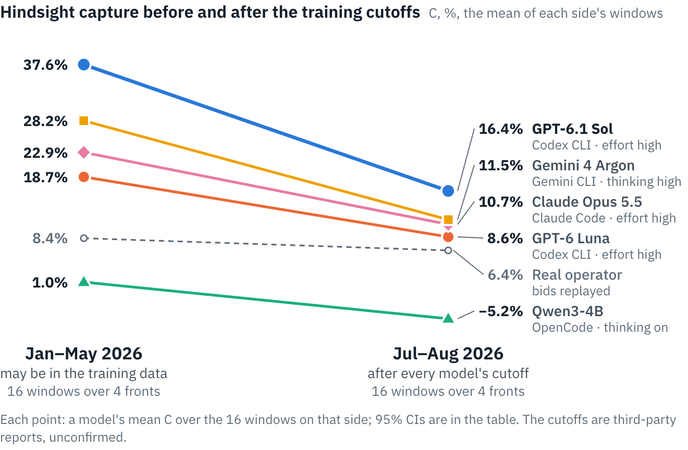

# GridSimEnv desk v4 benchmark: results on `desk-v4-bench`

32 three-day windows (8 real ERCOT weather fronts × 4 real batteries), 5 models in native agent harnesses at high effort. C, the headline, is hindsight capture (P − P_idle)/(P_hind − P_idle), the share of the hindsight optimum's profit over idle; R the contract reward (anchor 1.0, idle 0.2); P the settled ERCOT statement in $ per window. `pre_cutoff`: 16 windows, January to May 2026; `post_cutoff`: 16 windows, July and August 2026, after every model's reported training cutoff. Brackets: 95% CIs, a block bootstrap over the 8 fronts (each split's 4 within it).

<picture><source media="(prefers-color-scheme: dark)" srcset="figures/splits-dark.png"></picture>

| model | harness | n | C | C, pre_cutoff | C, post_cutoff | R | P | $ / window |
|---|---|---|---|---|---|---|---|---|
| **GPT-6.1 Sol** | Codex CLI · effort high | 32 | 27.0% [9.5, 43.8] | 37.6% [26.7, 55.0] | 16.4% [−9.7, 42.7] | 0.78 [0.53, 0.96] | $130,790 [−$6,520, $364,305] | $4.12 |
| **Gemini 4 Argon** | Gemini CLI · thinking high | 32 | 19.9% [5.1, 33.5] | 28.2% [15.5, 41.4] | 11.5% [−10.1, 31.7] | 0.69 [0.44, 0.90] | $93,543 [−$11,197, $265,902] | $6.69 |
| **Claude Opus 5.5** | Claude Code · effort high | 32 | 16.8% [8.6, 26.5] | 22.9% [12.7, 37.6] | 10.7% [1.6, 19.9] | 0.71 [0.61, 0.82] | $94,056 [$11,486, $251,436] | $2.00 |
| **GPT-6 Luna** | Codex CLI · effort high | 32 | 13.7% [5.7, 22.3] | 18.7% [10.7, 28.6] | 8.6% [−0.7, 21.5] | 0.60 [0.46, 0.75] | $69,877 [$8,483, $181,600] | $0.32 |
| **Qwen3-4B** | OpenCode · thinking on | 32 | −2.1% [−5.9, 1.4] | 1.0% [−1.1, 4.9] | −5.2% [−10.8, −0.9] | 0.14 [0.06, 0.25] | −$3,525 [−$8,531, $1,232] | $0.16 |

## What the numbers say

- **Before and after the cutoffs.** Every model scores lower on Jul–Aug than on Jan–May, and that includes Qwen3-4B, whose training predates every window. So the drop reflects harder windows (the Jan–May half includes winter storm Fern), not evidence of training-data contamination. No API model's post − pre interval excludes zero, so all 32 windows lead, by a rule set before any API result.
- **Valid submissions.** Qwen3-4B made no valid submission on 7 of its 32 windows (R = 0 there).
- **Reliability.** 268 attempts for 160 model-windows; 108 did not reach the grade (infrastructure ×108). Infrastructure failures were retried; attempts that failed before any model call (a port race in our launcher, $0), and from 18:06 UTC Gemini 4 Argon's attempts ended by a transient provider 400, didn't count toward the two-retry limit (see Deviations). No window is missing.

## Paired gaps (the windows both played)

| paired gap | n | Δ C, pts | Δ R | Δ P | ahead (windows) | fronts ahead |
|---|---|---|---|---|---|---|
| GPT-6.1 Sol − Gemini 4 Argon | 32 | +7.1 [+2.8, +11.7] | +0.09 [+0.01, +0.20] | +$37,247 [+$3,028, +$99,049] | 69% | 6/8 |
| GPT-6.1 Sol − Claude Opus 5.5 | 32 | +10.2 [−0.9, +19.9] | +0.06 [−0.11, +0.21] | +$36,734 [−$20,263, +$113,999] | 72% | 7/8 |
| GPT-6.1 Sol − GPT-6 Luna | 32 | +13.3 [+2.1, +22.4] | +0.18 [−0.04, +0.35] | +$60,913 [−$19,073, +$185,093] | 81% | 7/8 |
| GPT-6.1 Sol − Qwen3-4B | 32 | +29.1 [+12.5, +44.6] | +0.64 [+0.40, +0.82] | +$134,316 [−$3,122, +$370,784] | 81% | 7/8 |
| Gemini 4 Argon − Claude Opus 5.5 | 32 | +3.1 [−5.4, +10.8] | −0.02 [−0.19, +0.13] | −$513 [−$29,294, +$20,283] | 56% | 5/8 |
| Gemini 4 Argon − GPT-6 Luna | 32 | +6.2 [−2.6, +13.5] | +0.09 [−0.11, +0.28] | +$23,666 [−$23,702, +$86,381] | 66% | 6/8 |
| Gemini 4 Argon − Qwen3-4B | 32 | +21.9 [+7.9, +35.0] | +0.55 [+0.32, +0.74] | +$97,068 [−$8,349, +$273,933] | 81% | 7/8 |
| Claude Opus 5.5 − GPT-6 Luna | 32 | +3.1 [−0.7, +6.9] | +0.11 [+0.01, +0.22] | +$24,179 [−$2,049, +$71,946] | 59% | 6/8 |
| Claude Opus 5.5 − Qwen3-4B | 32 | +18.9 [+12.0, +28.0] | +0.57 [+0.49, +0.66] | +$97,581 [+$14,676, +$258,136] | 97% | 8/8 |
| GPT-6 Luna − Qwen3-4B | 32 | +15.7 [+9.3, +23.2] | +0.46 [+0.39, +0.53] | +$73,402 [+$11,209, +$188,446] | 88% | 8/8 |

## Against the real operator's bids, replayed through the same clearing and settlement

| model | n | P − operator, all | C − operator, all, pts | C − operator, pre_cutoff | C − operator, post_cutoff |
|---|---|---|---|---|---|
| GPT-6.1 Sol | 32 | +$106,427 [−$20,694, +$316,692] | +19.6 [+3.1, +35.1] | +29.2 [+16.2, +47.1] | +10.0 [−15.3, +34.4] |
| Gemini 4 Argon | 32 | +$69,180 [−$26,017, +$218,600] | +12.5 [−1.1, +25.0] | +19.8 [+6.7, +33.1] | +5.2 [−15.7, +22.7] |
| Claude Opus 5.5 | 32 | +$69,693 [−$794, +$202,591] | +9.4 [+3.0, +18.3] | +14.5 [+5.4, +29.3] | +4.4 [−1.2, +10.0] |
| GPT-6 Luna | 32 | +$45,514 [−$3,440, +$132,285] | +6.3 [−0.1, +13.6] | +10.3 [+4.1, +20.4] | +2.3 [−4.7, +13.0] |
| Qwen3-4B | 32 | −$27,888 [−$58,094, −$9,218] | −9.4 [−11.8, −6.7] | −7.4 [−9.8, −3.5] | −11.5 [−13.8, −9.2] |

## Post-cutoff minus pre-cutoff, each model

The halves hold different windows, so each split's fronts are drawn apart (a stratified block bootstrap).

| model | Δ C, pts | Δ R | Δ P |
|---|---|---|---|
| GPT-6.1 Sol | −21.3 [−53.0, +9.7] | −0.35 [−0.75, −0.01] | −$253,420 [−$690,399, +$5,317] |
| Gemini 4 Argon | −16.7 [−43.2, +8.7] | −0.29 [−0.71, +0.11] | −$190,883 [−$507,173, +$4,732] |
| Claude Opus 5.5 | −12.1 [−28.6, +2.6] | −0.22 [−0.37, −0.07] | −$159,799 [−$469,664, +$4,108] |
| GPT-6 Luna | −10.1 [−24.1, +5.5] | −0.25 [−0.49, −0.03] | −$113,497 [−$330,963, +$7,950] |
| Qwen3-4B | −6.2 [−12.4, −0.9] | −0.14 [−0.34, −0.00] | −$2,235 [−$11,480, +$7,871] |

## References (every window, from the frozen refs)

| reference | C | C, pre_cutoff | C, post_cutoff | P |
|---|---|---|---|---|
| Idle | 0.0% [0.0, 0.0] | 0.0% [0.0, 0.0] | 0.0% [0.0, 0.0] | $1,096 [$22, $3,025] |
| Anchor (the desk's optimiser, same information) | 20.9% [7.6, 37.7] | 25.0% [3.1, 56.3] | 16.9% [3.3, 30.5] | $136,784 [$8,318, $381,550] |
| Hindsight optimum | 100.0% [100.0, 100.0] | 100.0% [100.0, 100.0] | 100.0% [100.0, 100.0] | $309,831 [$104,156, $636,610] |
| Hindsight, DAM tied to dispatch | 45.2% [40.7, 49.2] | 44.9% [40.1, 49.6] | 45.5% [37.2, 51.3] | $148,797 [$43,070, $311,643] |
| Real operator's bids, replayed | 7.4% [4.1, 10.9] | 8.4% [2.8, 14.4] | 6.4% [2.8, 9.9] | $24,363 [$7,213, $51,061] |
| Real operator, as settled | 7.2% [3.3, 10.8] | 8.0% [4.8, 12.9] | 6.5% [0.4, 11.9] | $22,821 [$6,459, $42,558] |

## Cost, tokens and behaviour (mean per scored window)

| model | $ / window | basis | input tok | cached tok | cache write tok | output tok | reasoning tok | turns | wakes | desk calls | own-tool calls | shell | reminders | rejected |
|---|---|---|---|---|---|---|---|---|---|---|---|---|---|---|
| GPT-6.1 Sol | $4.12 | list price | 821 | 16,793,643 | 569,121 | 101,598 | 70,183 | 58.34 | 58.34 | 372.34 | 0 | 0 | 33.38 | 0 |
| Gemini 4 Argon | $6.69 | list price | 2,571,768 | 9,228,548 | 0 | 62,282 | 24,127 | 32.28 | 32.28 | 212.16 | 2 | 0 | 7.09 | 0.09 |
| Claude Opus 5.5 | $2.00 | list price | 121 | 3,838,521 | 129,609 | 29,045 | 12,527 | 28.16 | 28.16 | 55.62 | 0 | 0 | 2.94 | 0.03 |
| GPT-6 Luna | $0.32 | list price | 392 | 11,225,479 | 803,829 | 223,202 | 201,661 | 33.91 | 33.91 | 229.88 | 0 | 0 | 8.28 | 0.09 |
| Qwen3-4B | $0.16 | GPU time | 91,849 | 830,062 | 0 | 37,750 | 24,179 | 26.41 | 26.41 | 17.75 | 4.81 | 0.88 | 0.81 | 3.28 |

## Attempts, failures and retries

| model | attempts | scored | failed | extra | windows retried | windows missing | failures | spend, all attempts |
|---|---|---|---|---|---|---|---|---|
| GPT-6.1 Sol | 71 | 32 | 39 | 0 | 25 | 0 | infrastructure ×39 | $140 |
| Gemini 4 Argon | 52 | 32 | 20 | 0 | 16 | 0 | infrastructure ×20 | $306 |
| Claude Opus 5.5 | 59 | 32 | 27 | 0 | 19 | 0 | infrastructure ×27 | $63.91 |
| GPT-6 Luna | 54 | 32 | 22 | 0 | 16 | 0 | infrastructure ×22 | $10.99 |
| Qwen3-4B | 32 | 32 | 0 | 0 | 0 | 0 | — | $5.19 |

| model | window | attempt | role | status | kind | error |
|---|---|---|---|---|---|---|
| Claude Opus 5.5 | desk-v4-2026-01-23-S01 | 1 | failed | failed | infrastructure | setup step deploy did not complete: "Script failed (exit 1):\nstdout: \nstderr: Container agent-env-local-374720bf-thx_y |
| Claude Opus 5.5 | desk-v4-2026-01-23-S01 | 2 | failed | failed | infrastructure | setup step deploy did not complete: "Script failed (exit 1):\nstdout: \nstderr: b-1 Creating \n Container agent-env-loca |
| Claude Opus 5.5 | desk-v4-2026-01-23-S02 | 1 | failed | failed | infrastructure | setup step deploy did not complete: "Script failed (exit 1):\nstdout: \nstderr: -1 Creating \n Container agent-env-local |
| Claude Opus 5.5 | desk-v4-2026-01-23-S02 | 2 | failed | failed | infrastructure | setup step deploy did not complete: "Script failed (exit 1):\nstdout: \nstderr: ng \n Container agent-env-local-98acc4e8 |
| Claude Opus 5.5 | desk-v4-2026-01-23-S03 | 1 | failed | failed | infrastructure | setup step deploy did not complete: "Script failed (exit 1):\nstdout: \nstderr: ontainer agent-env-local-5842345c-xtsbn3 |
| Claude Opus 5.5 | desk-v4-2026-01-23-S03 | 2 | failed | failed | infrastructure | setup step deploy did not complete: "Script failed (exit 1):\nstdout: \nstderr: 1 Creating \n Container agent-env-local- |
| Claude Opus 5.5 | desk-v4-2026-03-16-S01 | 1 | failed | failed | infrastructure | setup step deploy-agent did not complete: "Script failed (exit 1):\nstdout: \nstderr: Error response from daemon: failed |
| Claude Opus 5.5 | desk-v4-2026-03-16-S01 | 2 | failed | failed | infrastructure | setup step deploy did not complete: "Script failed (exit 1):\nstdout: \nstderr: ng \n Container agent-env-local-33c6becb |
| Claude Opus 5.5 | desk-v4-2026-03-16-S02 | 1 | failed | failed | infrastructure | setup step deploy did not complete: "Script failed (exit 1):\nstdout: \nstderr: ng \n Container agent-env-local-3b29266b |
| Claude Opus 5.5 | desk-v4-2026-03-16-S02 | 2 | failed | failed | infrastructure | setup step deploy did not complete: "Script failed (exit 1):\nstdout: \nstderr: ontainer agent-env-local-1ca5c16a-_4hscw |
| Claude Opus 5.5 | desk-v4-2026-03-16-S04 | 1 | failed | failed | infrastructure | setup step deploy did not complete: "Script failed (exit 1):\nstdout: \nstderr: ng \n Container agent-env-local-c0b1b26c |
| Claude Opus 5.5 | desk-v4-2026-03-16-S04 | 2 | failed | failed | infrastructure | setup step deploy-agent did not complete: "Script failed (exit 1):\nstdout: \nstderr: Error response from daemon: failed |
| Claude Opus 5.5 | desk-v4-2026-04-03-S04 | 1 | failed | failed | infrastructure | setup step deploy-agent did not complete: "Script failed (exit 1):\nstdout: \nstderr: Error response from daemon: failed |
| Claude Opus 5.5 | desk-v4-2026-04-17-S03 | 1 | failed | failed | infrastructure | setup step deploy did not complete: "Script failed (exit 1):\nstdout: \nstderr: ontainer agent-env-local-76d47efa-btxpgs |
| Claude Opus 5.5 | desk-v4-2026-04-17-S03 | 2 | failed | failed | infrastructure | setup step deploy did not complete: "Script failed (exit 1):\nstdout: \nstderr: Container agent-env-local-04f45e37-5kvj4 |
| Claude Opus 5.5 | desk-v4-2026-05-08-S01 | 1 | failed | failed | infrastructure | setup step deploy-agent did not complete: "Script failed (exit 1):\nstdout: \nstderr: Error response from daemon: failed |
| Claude Opus 5.5 | desk-v4-2026-05-08-S01 | 2 | failed | failed | infrastructure | setup step deploy did not complete: "Script failed (exit 1):\nstdout: \nstderr: g \n Container agent-env-local-c4c2b362- |
| Claude Opus 5.5 | desk-v4-2026-05-08-S02 | 1 | failed | failed | infrastructure | setup step deploy did not complete: "Script failed (exit 1):\nstdout: \nstderr: ntainer agent-env-local-c4078ea2-oj_5xfg |
| Claude Opus 5.5 | desk-v4-2026-05-08-S03 | 1 | failed | failed | infrastructure | setup step deploy did not complete: "Script failed (exit 1):\nstdout: \nstderr: ntainer agent-env-local-5f15017d-nppkutt |
| Claude Opus 5.5 | desk-v4-2026-05-08-S04 | 1 | failed | failed | infrastructure | setup step deploy did not complete: "Script failed (exit 1):\nstdout: \nstderr: ntainer agent-env-local-645a3997-gnpswun |
| Claude Opus 5.5 | desk-v4-2026-07-04-S01 | 1 | failed | failed | infrastructure | setup step deploy did not complete: "Script failed (exit 1):\nstdout: \nstderr: -1 Creating \n Container agent-env-local |
| Claude Opus 5.5 | desk-v4-2026-07-04-S02 | 1 | failed | failed | infrastructure | setup step deploy did not complete: "Script failed (exit 1):\nstdout: \nstderr: 1 Creating \n Container agent-env-local- |
| Claude Opus 5.5 | desk-v4-2026-07-04-S03 | 1 | failed | failed | infrastructure | setup step deploy-agent did not complete: "Script failed (exit 1):\nstdout: \nstderr: Error response from daemon: failed |
| Claude Opus 5.5 | desk-v4-2026-07-23-S01 | 1 | failed | failed | infrastructure | setup step deploy-agent did not complete: "Script failed (exit 1):\nstdout: \nstderr: Error response from daemon: failed |
| Claude Opus 5.5 | desk-v4-2026-07-23-S02 | 1 | failed | failed | infrastructure | setup step deploy did not complete: "Script failed (exit 1):\nstdout: \nstderr: ng \n Container agent-env-local-de1acec4 |
| Claude Opus 5.5 | desk-v4-2026-07-23-S04 | 1 | failed | failed | infrastructure | setup step deploy did not complete: "Script failed (exit 1):\nstdout: \nstderr:  \n Container agent-env-local-6d763551-5 |
| Claude Opus 5.5 | desk-v4-2026-08-18-S02 | 1 | failed | failed | infrastructure | setup step deploy did not complete: "Script failed (exit 1):\nstdout: \nstderr: ng \n Container agent-env-local-de15552d |
| GPT-6.1 Sol | desk-v4-2026-01-23-S01 | 1 | failed | failed | infrastructure | setup step deploy did not complete: "Script failed (exit 1):\nstdout: \nstderr:  \n Container agent-env-local-3f39efa5-q |
| GPT-6.1 Sol | desk-v4-2026-01-23-S01 | 2 | failed | failed | infrastructure | setup step deploy did not complete: "Script failed (exit 1):\nstdout: \nstderr: 4-1 Creating \n Container agent-env-loca |
| GPT-6.1 Sol | desk-v4-2026-01-23-S03 | 1 | failed | failed | infrastructure | setup step deploy did not complete: "Script failed (exit 1):\nstdout: \nstderr: ng \n Container agent-env-local-586017d7 |
| GPT-6.1 Sol | desk-v4-2026-01-23-S03 | 2 | failed | failed | infrastructure | setup step deploy did not complete: "Script failed (exit 1):\nstdout: \nstderr:  \n Container agent-env-local-e6781a96-g |
| GPT-6.1 Sol | desk-v4-2026-01-23-S04 | 1 | failed | failed | infrastructure | setup step deploy did not complete: "Script failed (exit 1):\nstdout: \nstderr: 1 Creating \n Container agent-env-local- |
| GPT-6.1 Sol | desk-v4-2026-01-23-S04 | 2 | failed | failed | infrastructure | setup step deploy did not complete: "Script failed (exit 1):\nstdout: \nstderr: \n Container agent-env-local-69dbc8db-ny |
| GPT-6.1 Sol | desk-v4-2026-03-16-S03 | 1 | failed | failed | infrastructure | setup step deploy did not complete: "Script failed (exit 1):\nstdout: \nstderr: g \n Container agent-env-local-06d3a763- |
| GPT-6.1 Sol | desk-v4-2026-03-16-S03 | 2 | failed | failed | infrastructure | setup step deploy did not complete: "Script failed (exit 1):\nstdout: \nstderr:  \n Container agent-env-local-f77e1105-1 |
| GPT-6.1 Sol | desk-v4-2026-03-16-S04 | 1 | failed | failed | infrastructure | setup step deploy did not complete: "Script failed (exit 1):\nstdout: \nstderr: -1 Creating \n Container agent-env-local |
| GPT-6.1 Sol | desk-v4-2026-03-16-S04 | 2 | failed | failed | infrastructure | setup step deploy did not complete: "Script failed (exit 1):\nstdout: \nstderr:  \n Container agent-env-local-475135bd-8 |
| GPT-6.1 Sol | desk-v4-2026-03-16-S04 | 3 | failed | failed | infrastructure | infra error: "A2A task failed (error_type=agent_error, error_code=cli_error, task_id=e1fb0aff-76f8-4eab-9dc4-04aa8c05441 |
| GPT-6.1 Sol | desk-v4-2026-04-03-S04 | 1 | failed | failed | infrastructure | setup step deploy did not complete: "Script failed (exit 1):\nstdout: \nstderr: ntainer agent-env-local-e790ad9b-7z4q_jl |
| GPT-6.1 Sol | desk-v4-2026-04-17-S01 | 1 | failed | failed | infrastructure | setup step deploy did not complete: "Script failed (exit 1):\nstdout: \nstderr: -1 Creating \n Container agent-env-local |
| GPT-6.1 Sol | desk-v4-2026-04-17-S01 | 2 | failed | failed | infrastructure | setup step deploy did not complete: "Script failed (exit 1):\nstdout: \nstderr: \n Container agent-env-local-2bd6cd70-n7 |
| GPT-6.1 Sol | desk-v4-2026-04-17-S02 | 1 | failed | failed | infrastructure | setup step deploy did not complete: "Script failed (exit 1):\nstdout: \nstderr: ontainer agent-env-local-f0045179-preyps |
| GPT-6.1 Sol | desk-v4-2026-04-17-S02 | 2 | failed | failed | infrastructure | setup step deploy did not complete: "Script failed (exit 1):\nstdout: \nstderr: Container agent-env-local-f6e3fb71-wwofo |
| GPT-6.1 Sol | desk-v4-2026-04-17-S02 | 3 | failed | failed | infrastructure | infra error: "A2A task failed (error_type=agent_error, error_code=cli_error, task_id=343b6d35-d774-4970-87e1-85692571eeb |
| GPT-6.1 Sol | desk-v4-2026-04-17-S03 | 1 | failed | failed | infrastructure | setup step deploy-agent did not complete: "Script failed (exit 1):\nstdout: \nstderr: Error response from daemon: failed |
| GPT-6.1 Sol | desk-v4-2026-04-17-S03 | 2 | failed | failed | infrastructure | setup step deploy did not complete: "Script failed (exit 1):\nstdout: \nstderr: 4-1 Creating \n Container agent-env-loca |
| GPT-6.1 Sol | desk-v4-2026-05-08-S01 | 1 | failed | failed | infrastructure | setup step deploy did not complete: "Script failed (exit 1):\nstdout: \nstderr: ntainer agent-env-local-13d05532-ug7u8t7 |
| GPT-6.1 Sol | desk-v4-2026-05-08-S01 | 2 | failed | failed | infrastructure | setup step deploy did not complete: "Script failed (exit 1):\nstdout: \nstderr:  \n Container agent-env-local-3169e45d-z |
| GPT-6.1 Sol | desk-v4-2026-05-08-S02 | 1 | failed | failed | infrastructure | setup step deploy-agent did not complete: "Script failed (exit 1):\nstdout: \nstderr: Error response from daemon: failed |
| GPT-6.1 Sol | desk-v4-2026-05-08-S02 | 2 | failed | failed | infrastructure | setup step deploy did not complete: "Script failed (exit 1):\nstdout: \nstderr: Container agent-env-local-aef2a632-l9y0l |
| GPT-6.1 Sol | desk-v4-2026-05-08-S03 | 1 | failed | failed | infrastructure | setup step deploy did not complete: "Script failed (exit 1):\nstdout: \nstderr: ontainer agent-env-local-422b32b9-dq5rdv |
| GPT-6.1 Sol | desk-v4-2026-05-08-S03 | 2 | failed | failed | infrastructure | setup step deploy did not complete: "Script failed (exit 1):\nstdout: \nstderr: Container agent-env-local-36720756-dx52z |
| GPT-6.1 Sol | desk-v4-2026-05-08-S04 | 1 | failed | failed | infrastructure | setup step deploy did not complete: "Script failed (exit 1):\nstdout: \nstderr: -1 Creating \n Container agent-env-local |
| GPT-6.1 Sol | desk-v4-2026-05-08-S04 | 2 | failed | failed | infrastructure | setup step deploy did not complete: "Script failed (exit 1):\nstdout: \nstderr: 4-1 Creating \n Container agent-env-loca |
| GPT-6.1 Sol | desk-v4-2026-07-04-S01 | 1 | failed | failed | infrastructure | setup step deploy did not complete: "Script failed (exit 1):\nstdout: \nstderr: -1 Creating \n Container agent-env-local |
| GPT-6.1 Sol | desk-v4-2026-07-04-S02 | 1 | failed | failed | infrastructure | setup step deploy-agent did not complete: "Script failed (exit 1):\nstdout: \nstderr: Error response from daemon: failed |
| GPT-6.1 Sol | desk-v4-2026-07-04-S03 | 1 | failed | failed | infrastructure | setup step deploy-agent did not complete: "Script failed (exit 1):\nstdout: \nstderr: Error response from daemon: failed |
| GPT-6.1 Sol | desk-v4-2026-07-04-S04 | 1 | failed | failed | infrastructure | setup step deploy did not complete: "Script failed (exit 1):\nstdout: \nstderr: ontainer agent-env-local-0ef5550a-3d9a8z |
| GPT-6.1 Sol | desk-v4-2026-07-23-S02 | 1 | failed | failed | infrastructure | setup step deploy-agent did not complete: "Script failed (exit 1):\nstdout: \nstderr: Error response from daemon: failed |
| GPT-6.1 Sol | desk-v4-2026-07-23-S03 | 1 | failed | failed | infrastructure | setup step deploy-agent did not complete: "Script failed (exit 1):\nstdout: \nstderr: Error response from daemon: failed |
| GPT-6.1 Sol | desk-v4-2026-07-23-S04 | 1 | failed | failed | infrastructure | setup step deploy did not complete: "Script failed (exit 1):\nstdout: \nstderr: ontainer agent-env-local-38ed8377-adxtkj |
| GPT-6.1 Sol | desk-v4-2026-08-18-S01 | 1 | failed | failed | infrastructure | setup step deploy did not complete: "Script failed (exit 1):\nstdout: \nstderr: g \n Container agent-env-local-f8ef39a2- |
| GPT-6.1 Sol | desk-v4-2026-08-18-S02 | 1 | failed | failed | infrastructure | setup step deploy-agent did not complete: "Script failed (exit 1):\nstdout: \nstderr: Error response from daemon: failed |
| GPT-6.1 Sol | desk-v4-2026-08-18-S03 | 1 | failed | failed | infrastructure | setup step deploy did not complete: "Script failed (exit 1):\nstdout: \nstderr: g \n Container agent-env-local-680c1cdc- |
| GPT-6.1 Sol | desk-v4-2026-08-26-S02 | 1 | failed | failed | infrastructure | infra error: "A2A task failed (error_type=agent_error, error_code=cli_error, task_id=4c5d7693-880d-4a9d-893b-26374b77a0c |
| GPT-6.1 Sol | desk-v4-2026-08-26-S04 | 1 | failed | failed | infrastructure | infra error: "A2A task failed (error_type=agent_error, error_code=cli_error, task_id=de7ab83c-319a-45b0-ae51-d2cdd7f2ea5 |
| GPT-6 Luna | desk-v4-2026-01-23-S01 | 1 | failed | failed | infrastructure | setup step deploy did not complete: "Script failed (exit 1):\nstdout: \nstderr: g \n Container agent-env-local-ef19ea60- |
| GPT-6 Luna | desk-v4-2026-01-23-S02 | 1 | failed | failed | infrastructure | setup step deploy did not complete: "Script failed (exit 1):\nstdout: \nstderr: ontainer agent-env-local-a82d5966-hb7wv0 |
| GPT-6 Luna | desk-v4-2026-01-23-S04 | 1 | failed | failed | infrastructure | setup step deploy did not complete: "Script failed (exit 1):\nstdout: \nstderr: ng \n Container agent-env-local-e6faf48a |
| GPT-6 Luna | desk-v4-2026-03-16-S01 | 1 | failed | failed | infrastructure | setup step deploy did not complete: "Script failed (exit 1):\nstdout: \nstderr: ontainer agent-env-local-092372a9-2b2rq5 |
| GPT-6 Luna | desk-v4-2026-03-16-S02 | 1 | failed | failed | infrastructure | setup step deploy did not complete: "Script failed (exit 1):\nstdout: \nstderr: g \n Container agent-env-local-ff58d489- |
| GPT-6 Luna | desk-v4-2026-03-16-S02 | 2 | failed | failed | infrastructure | infra error: "A2A task failed (error_type=agent_error, error_code=cli_error, task_id=23606831-aec4-41dc-b4fd-f262cf8265c |
| GPT-6 Luna | desk-v4-2026-03-16-S03 | 1 | failed | failed | infrastructure | setup step deploy did not complete: "Script failed (exit 1):\nstdout: \nstderr: 4-1 Creating \n Container agent-env-loca |
| GPT-6 Luna | desk-v4-2026-03-16-S03 | 2 | failed | failed | infrastructure | infra error: "A2A task failed (error_type=agent_error, error_code=cli_error, task_id=8fc96de5-b90b-4b68-a009-8508fef4b50 |
| GPT-6 Luna | desk-v4-2026-04-03-S04 | 1 | failed | failed | infrastructure | setup step deploy-agent did not complete: "Script failed (exit 1):\nstdout: \nstderr: Error response from daemon: failed |
| GPT-6 Luna | desk-v4-2026-04-17-S01 | 1 | failed | failed | infrastructure | setup step deploy did not complete: "Script failed (exit 1):\nstdout: \nstderr: ontainer agent-env-local-07047c6d-0zpunt |
| GPT-6 Luna | desk-v4-2026-04-17-S02 | 1 | failed | failed | infrastructure | setup step deploy did not complete: "Script failed (exit 1):\nstdout: \nstderr: -1 Creating \n Container agent-env-local |
| GPT-6 Luna | desk-v4-2026-04-17-S02 | 2 | failed | failed | infrastructure | setup step deploy-agent did not complete: "Script failed (exit 1):\nstdout: \nstderr: Error response from daemon: failed |
| GPT-6 Luna | desk-v4-2026-05-08-S01 | 1 | failed | failed | infrastructure | setup step deploy did not complete: "Script failed (exit 1):\nstdout: \nstderr: ntainer agent-env-local-b3947d2f-92vma2w |
| GPT-6 Luna | desk-v4-2026-07-04-S02 | 1 | failed | failed | infrastructure | "A2A task failed (error_type=agent_error, error_code=cli_error, task_id=ac2f52f1-01b9-4ea4-ab4c-df9307e79026, agent_sand |
| GPT-6 Luna | desk-v4-2026-07-04-S04 | 1 | failed | failed | infrastructure | setup step deploy did not complete: "Script failed (exit 1):\nstdout: \nstderr: ntainer agent-env-local-9c82fea6-alvciui |
| GPT-6 Luna | desk-v4-2026-07-04-S04 | 2 | failed | failed | infrastructure | setup step deploy-agent did not complete: "Script failed (exit 1):\nstdout: \nstderr: Error response from daemon: failed |
| GPT-6 Luna | desk-v4-2026-07-23-S01 | 1 | failed | failed | infrastructure | setup step deploy did not complete: "Script failed (exit 1):\nstdout: \nstderr: ntainer agent-env-local-63721a0c-3kdpmbm |
| GPT-6 Luna | desk-v4-2026-07-23-S01 | 2 | failed | failed | infrastructure | setup step deploy did not complete: "Script failed (exit 1):\nstdout: \nstderr: p-1 Creating \n Container agent-env-loca |
| GPT-6 Luna | desk-v4-2026-07-23-S03 | 1 | failed | failed | infrastructure | setup step deploy did not complete: "Script failed (exit 1):\nstdout: \nstderr: -1 Creating \n Container agent-env-local |
| GPT-6 Luna | desk-v4-2026-07-23-S03 | 2 | failed | failed | infrastructure | setup step deploy did not complete: "Script failed (exit 1):\nstdout: \nstderr: 4-1 Creating \n Container agent-env-loca |
| GPT-6 Luna | desk-v4-2026-07-23-S04 | 1 | failed | failed | infrastructure | setup step deploy-agent did not complete: "Script failed (exit 1):\nstdout: \nstderr: Error response from daemon: failed |
| GPT-6 Luna | desk-v4-2026-08-18-S01 | 1 | failed | failed | infrastructure | setup step deploy did not complete: "Script failed (exit 1):\nstdout: \nstderr: 1 Creating \n Container agent-env-local- |
| Gemini 4 Argon | desk-v4-2026-01-23-S02 | 1 | failed | failed | infrastructure | "A2A task failed (error_type=agent_error, error_code=cli_error, task_id=0a4a3213-8c77-4877-9f17-12aff0858563, agent_sand |
| Gemini 4 Argon | desk-v4-2026-01-23-S04 | 1 | failed | failed | infrastructure | provider HTTP 400 INVALID_ARGUMENT (transient 4xx): "A2A task failed (error_type=agent_error, error_code=cli_error, task |
| Gemini 4 Argon | desk-v4-2026-03-16-S04 | 1 | failed | failed | infrastructure | "A2A task failed (error_type=agent_error, error_code=cli_error, task_id=e409165d-8266-4068-b613-ab61343902d4, agent_sand |
| Gemini 4 Argon | desk-v4-2026-04-03-S04 | 1 | failed | failed | infrastructure | "A2A task failed (error_type=agent_error, error_code=cli_error, task_id=00cc71a7-23c1-48ef-9ed1-9d2e832a5241, agent_sand |
| Gemini 4 Argon | desk-v4-2026-04-17-S01 | 1 | failed | failed | infrastructure | "A2A task failed (error_type=agent_error, error_code=cli_error, task_id=d649b638-acfd-490e-9963-c2288e7f05cc, agent_sand |
| Gemini 4 Argon | desk-v4-2026-05-08-S01 | 1 | failed | failed | infrastructure | provider HTTP 400 INVALID_ARGUMENT (transient 4xx): "A2A task failed (error_type=agent_error, error_code=cli_error, task |
| Gemini 4 Argon | desk-v4-2026-05-08-S03 | 1 | failed | failed | infrastructure | "A2A task failed (error_type=agent_error, error_code=cli_error, task_id=62513302-14e8-4566-9834-b0fe879dfe8a, agent_sand |
| Gemini 4 Argon | desk-v4-2026-07-04-S01 | 1 | failed | failed | infrastructure | "A2A task failed (error_type=agent_error, error_code=cli_error, task_id=1e3330fd-574c-42b0-ba29-e945699362e6, agent_sand |
| Gemini 4 Argon | desk-v4-2026-07-04-S02 | 1 | failed | failed | infrastructure | provider HTTP 400 INVALID_ARGUMENT (transient 4xx): "A2A task failed (error_type=agent_error, error_code=cli_error, task |
| Gemini 4 Argon | desk-v4-2026-07-04-S02 | 2 | failed | failed | infrastructure | provider HTTP 400 INVALID_ARGUMENT (transient 4xx): "A2A task failed (error_type=agent_error, error_code=cli_error, task |
| Gemini 4 Argon | desk-v4-2026-07-04-S02 | 3 | failed | failed | infrastructure | provider HTTP 400 INVALID_ARGUMENT (transient 4xx): "A2A task failed (error_type=agent_error, error_code=cli_error, task |
| Gemini 4 Argon | desk-v4-2026-07-04-S03 | 1 | failed | failed | infrastructure | provider HTTP 400 INVALID_ARGUMENT (transient 4xx): "A2A task failed (error_type=agent_error, error_code=cli_error, task |
| Gemini 4 Argon | desk-v4-2026-07-04-S04 | 1 | failed | failed | infrastructure | provider HTTP 400 INVALID_ARGUMENT (transient 4xx): "A2A task failed (error_type=agent_error, error_code=cli_error, task |
| Gemini 4 Argon | desk-v4-2026-07-04-S04 | 2 | failed | failed | infrastructure | provider HTTP 400 INVALID_ARGUMENT (transient 4xx): "A2A task failed (error_type=agent_error, error_code=cli_error, task |
| Gemini 4 Argon | desk-v4-2026-07-23-S02 | 1 | failed | failed | infrastructure | lane spend cap |
| Gemini 4 Argon | desk-v4-2026-08-18-S01 | 1 | failed | failed | infrastructure | provider HTTP 400 INVALID_ARGUMENT (transient 4xx): "A2A task failed (error_type=agent_error, error_code=cli_error, task |
| Gemini 4 Argon | desk-v4-2026-08-18-S01 | 2 | failed | failed | infrastructure | provider HTTP 400 INVALID_ARGUMENT (transient 4xx): "A2A task failed (error_type=agent_error, error_code=cli_error, task |
| Gemini 4 Argon | desk-v4-2026-08-18-S04 | 1 | failed | failed | infrastructure | provider HTTP 400 INVALID_ARGUMENT (transient 4xx): "A2A task failed (error_type=agent_error, error_code=cli_error, task |
| Gemini 4 Argon | desk-v4-2026-08-26-S02 | 1 | failed | failed | infrastructure | provider HTTP 400 INVALID_ARGUMENT (transient 4xx): "A2A task failed (error_type=agent_error, error_code=cli_error, task |
| Gemini 4 Argon | desk-v4-2026-08-26-S03 | 1 | failed | failed | infrastructure | provider HTTP 400 INVALID_ARGUMENT (transient 4xx): "A2A task failed (error_type=agent_error, error_code=cli_error, task |

## Method

- Pack `desk-v4-bench`: 32 windows; references from the pack's task rows (anchor 1.5/spread, frozen at `desk-v4-freeze`).

| front | split | kind | what happened |
|---|---|---|---|
| 2026-01-23..25 | pre_cutoff | arctic front | Winter Storm Fern, 01-24 -23.8F; 202(c) orders, Transmission Emergency 01-25 |
| 2026-03-16..18 | pre_cutoff | cold front | 03-16 -24.4F with Freeze Warnings, +10.6F rebound 03-18; hub RT max $221 |
| 2026-04-17..19 | pre_cutoff | cold front | 04-18 -14F with 9 severe-thunderstorm warnings; S04 runs 04-03..05 (04-04 -9.4F) |
| 2026-05-08..10 | pre_cutoff | warm front, storms | 05-09 +8.7F, 27 severe-thunderstorm warnings 05-09..10, 7 ERCOT notices |
| 2026-07-04..06 | post_cutoff | severe-storm line | Independence Day storm complex: 24 severe-thunderstorm warnings 07-04..06 (18 on 07-05), heat dips -0.8F and -1.2F |
| 2026-07-23..25 | post_cutoff | tropical system | Tropical Storm Warning on the upper Texas coast 07-23 ends the July heat wave (90.6F and Extreme Heat Warnings 07-22, then -1.9F and -3.1F) |
| 2026-08-18..20 | post_cutoff | heat wave | Extreme Heat Warning for North Texas in force 08-17..22, 13 heat advisories, daily mean 88.9-89.4F; hub RT max $154 08-18 |
| 2026-08-26..28 | post_cutoff | heat-wave break, storm line | 08-26 scarcity (hub RT max $795, mean $120, 17 ERCOT notices), then 15 severe-thunderstorm warnings 08-27..28 and -2.2F 08-28 as the August heat breaks |

- Every episode is a plain `agent-env run` of the bench bundle (`scripts/desk_bench.py`) at `desk-v4-bench-run1` on EC2 boxes with local Docker (route C), agentenv-framework 0.9.1377 (Claude Opus 5.5, GPT-6.1 Sol and GPT-6 Luna), 0.9.1378 (Qwen3-4B) and 0.9.1383 (Gemini 4 Argon); harnesses: Claude Code 2.1.280, Codex CLI 0.147.0, Gemini CLI 0.38.2, OpenCode 1.17.18; budget: max_turns 100, calls_per_turn 14, max_reminders 12; core desk-2.1.
- Which half leads: The pre-registered rule that the post-cutoff half leads if the halves differ guards against training-data contamination, so, as read before any API-model result, only a model whose reported training cutoff comes after the first pre-cutoff window (GPT-6.1 Sol, Gemini 4 Argon, Claude Opus 5.5 and GPT-6 Luna) can trigger it, when its post − pre interval in C excludes zero.
- A model's scored attempt on a window is its first that reached the grade; earlier attempts are retries (infrastructure failures), later ones extra and never scored; a window no attempt reached is missing and never imputed (each model's n says how many it has).
- Every grade replayed from its Episode JSON against the frozen refs; 0 differ from the run's own verifier grade.
- CIs: block bootstrap, the pack's weather fronts as blocks, task-weighted means; a split's CI draws its own fronts; post − pre draws each split's fronts apart; 10,000 resamples, seed 0.
- Cost: tokens from the harness trajectories at public list prices, $ per million tokens input/cached/cache write/output: `claude-opus-5-5` 4.0/0.2/5.0/20.0; `gpt-6.1-sol` 2.0/0.1/2.5/10.0; `gpt-6-luna` 0.1/0.01/0.125/0.5; `gemini-4-argon` 2.0/0.1/0.0/10.0. Interrupted attempts are costed from the proxy meter, because their last turn never reaches the trajectory. Open weights: GPU time: 4.64 box-hours on EC2 GPU boxes (g5.xlarge at $1.006/h, g5.2xlarge at $1.212/h, EC2 on-demand, us-west-2), each run's share of its box's time while it ran.
- Deviation: Route C: the episodes ran on EC2 boxes with local Docker rather than in Modal sandboxes; the internet was closed by a host rule and a per-run model proxy instead of Modal's network policy (the pre-registration gives the reasons).
- Deviation: agentenv-framework 0.9.1377 on the box that ran Claude Opus 5.5, GPT-6.1 Sol and GPT-6 Luna, and 0.9.1378 on the Qwen3-4B boxes; the agent images are identical by digest.
- Deviation: Infrastructure retries (GPT-6.1 Sol 39, Gemini 4 Argon 20, Claude Opus 5.5 27, GPT-6 Luna 22, Qwen3-4B 0): every attempt is kept and its spend counted.
- Deviation: Retry rule, decided mid-run before the affected windows' results: an attempt that failed at env deploy for $0 because of our launcher's port race does not count toward the at-most-two-retries limit. All 81 such failures were port races (GPT-6.1 Sol 35, Claude Opus 5.5 27, GPT-6 Luna 19); only GPT-6.1 Sol's desk-v4-2026-03-16-S04 and desk-v4-2026-04-17-S02 were affected, both graded on attempt 4.
- Deviation: Stalls: Codex's 300 s inactivity watchdog at effort high stopped 4 GPT-6.1 Sol and 3 GPT-6 Luna attempts; they count as infrastructure and were retried, and their spend is included in the cost.
- Deviation: Cost basis: cost a window is the graded attempt's; the table also gives each model's total spend, retries and stalls included.
- Deviation: Gemini 4 Argon: first deferred for cost, it ran on 2026-10-29 from 16:41 to 19:45 UTC, after the others, by route C on its own box, on agentenv-framework 0.9.1383, whose Gemini harness no longer names its system-prompt file anew each turn (before, every turn start missed the prompt cache).
- Deviation: Provider HTTP 400s: 19 of Gemini 4 Argon's 1,488 wake starts (1.28%) drew HTTP 400 INVALID_ARGUMENT, all on a wake's first request from turn 12 on and more often at larger prompts; the identical request succeeded on replay, so they are transient and infrastructure under the pre-registered rule, and were retried. From 18:06 UTC they did not count toward the two-retry limit, with a safety stop at 6 attempts a window; no window used more than 4.
- Deviation: Caps: Gemini 4 Argon's per-episode cap rose from $15 to $30 after one attempt stopped at $15.02, which was retried as infrastructure, and its model cap from $300 to $330.
- Deviation: Selection, descriptive: Gemini 4 Argon's attempts that failed on a 400 ended at turn 21.4 on average, at a 172k-token prompt, against 32.3 turns and a 207k-token largest prompt for its graded attempts; its windows graded on the first try average C 17.0%, those graded after a retry 22.7%.
- Deviation: Prompt cache: 61% of Gemini 4 Argon's wake starts hit the cache fully and 32% only its first ~15k tokens, because Gemini CLI drops a thought signature when it resumes a session, a known harness issue.
- Deviations as appended to the pre-registration: [docs/prereg/v4-bench.md#deviations](https://github.com/earakely-scale/agentenv-gridsim-plugin/blob/desk-v4-bench-results-2/docs/prereg/v4-bench.md#deviations).
- Files: `summary.json`, `grades.jsonl.gz` (one row per model and window), `episodes/<model>/*.json.gz` (Episode JSON with the run's own grade), `figures/`.
