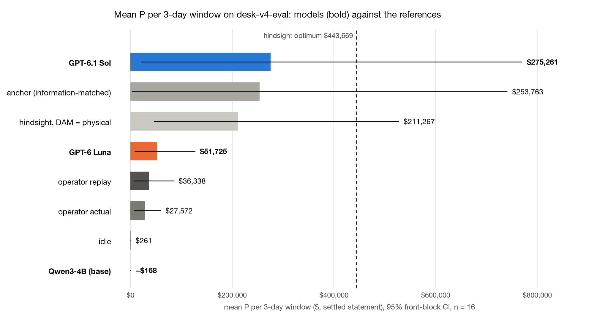
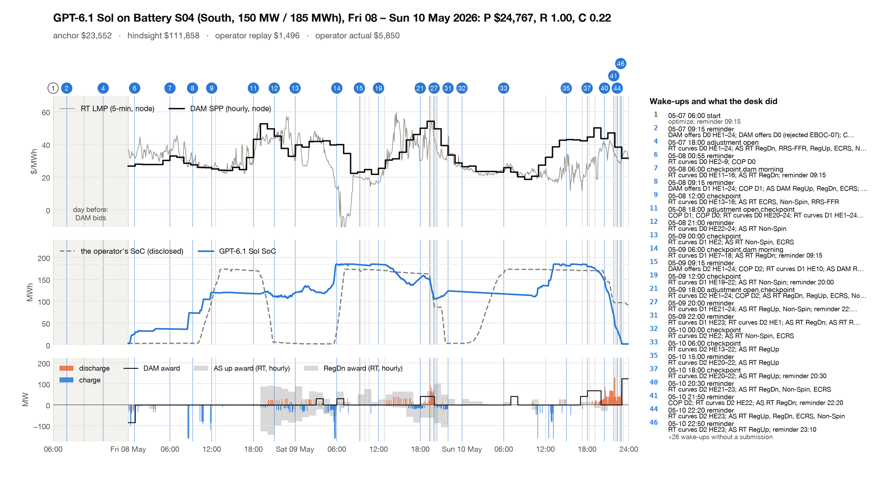

# GridSimEnv desk v4: results on `desk-v4-eval`

16 3-day windows (4 fronts), 3 models. P is the settled ERCOT
statement in $ per 3-day window (summed over its days); R the contract reward (anchor = 1.0, idle = 0.2); C the hindsight capture
(P − P_idle)/(P_hind − P_idle); C_phys the same against the hindsight optimum with its DAM position tied to dispatch.
"floored" counts tasks whose reward scale is floored at 10% of (P_hind_phys − P_idle) because the anchor
earns less (contract §9.1). Brackets are 95% front-block CIs.

| model | n | valid | floored | R | C (hindsight) | C_phys | mean P | P − anchor | beats anchor | P − operator replay | P − operator actual | $ / episode |
|---|---|---|---|---|---|---|---|---|---|---|---|---|
| GPT-6.1 Sol | 16 | 100% | 4 | 0.93 [0.84, 0.99] | 0.35 [0.18, 0.59] | 0.74 [0.43, 1.24] | $275,261 [$19,975, $770,317] | +$21,498 [+$2,618, +$40,379] | 81% | +$238,923 [+$13,192, +$686,143] | +$247,690 [+$13,554, +$710,715] | $3.21 |
| GPT-6 Luna | 16 | 100% | 4 | 0.62 [0.41, 0.88] | 0.12 [0.07, 0.17] | 0.24 [0.17, 0.34] | $51,725 [$7,972, $127,306] | −$202,038 [−$614,500, +$17,772] | 25% | +$15,387 [+$969, +$42,284] | +$24,154 [+$1,551, +$67,501] | $0.54 |
| Qwen3-4B (base) | 16 | 50% | 4 | 0.10 [0.03, 0.17] | −0.01 [−0.02, 0.00] | −0.02 [−0.05, 0.00] | −$168 [−$1,643, $1,156] | −$253,931 [−$740,476, −$2,888] | 12% | −$36,506 [−$84,233, −$7,055] | −$27,739 [−$58,604, −$7,491] | $0.00 |

### References (every task, the same clearing, physics and settlement)

| reference | n | mean P | C | C_phys |
|---|---|---|---|---|
| idle | 16 | $261 [$8, $642] | 0.00 | 0.00 |
| anchor (information-matched) | 16 | $253,763 [$2,827, $741,105] | 0.25 | 0.54 |
| hindsight optimum | 16 | $443,669 [$111,816, $1,079,502] | 1.00 | 2.32 |
| hindsight, DAM = physical | 16 | $211,267 [$45,814, $527,818] | 0.45 | 1.00 |
| operator replay | 16 | $36,338 [$5,983, $85,434] | 0.08 | 0.19 |
| operator actual | 16 | $27,572 [$6,420, $59,804] | 0.08 | 0.18 |

### Paired gaps (same tasks)

| paired gap | n | Δ P | Δ R | Δ C | ahead (tasks) | days ahead |
|---|---|---|---|---|---|---|
| GPT-6.1 Sol − GPT-6 Luna | 16 | +$223,536 [+$12,003, +$643,350] | +0.31 [+0.07, +0.55] | +0.23 [+0.09, +0.48] | 94% | 4/4 |
| GPT-6.1 Sol − Qwen3-4B (base) | 16 | +$275,429 [+$21,046, +$769,116] | +0.83 [+0.76, +0.94] | +0.35 [+0.19, +0.60] | 94% | 4/4 |
| GPT-6 Luna − Qwen3-4B (base) | 16 | +$51,893 [+$9,043, +$126,105] | +0.52 [+0.29, +0.73] | +0.12 [+0.09, +0.17] | 100% | 4/4 |
| GPT-6.1 Sol − operator replay | 16 | +$238,923 [+$13,192, +$686,143] | — | — | 88% | 4/4 |
| GPT-6 Luna − operator replay | 16 | +$15,387 [+$969, +$42,284] | — | — | 56% | 4/4 |
| Qwen3-4B (base) − operator replay | 16 | −$36,506 [−$84,233, −$7,055] | — | — | 0% | 0/4 |

### Statement lines (mean $ per 3-day window)

| line | GPT-6.1 Sol | GPT-6 Luna | Qwen3-4B (base) |
|---|---|---|---|
| dam_energy | +$469,569 | +$67,004 | +$281 |
| rt_energy_imbalance | −$200,892 | −$11,924 | −$1,554 |
| deviation | +$0 | +$0 | +$0 |
| load_allocated | +$0 | +$0 | +$0 |
| degradation | −$4,585 | −$3,381 | −$150 |
| warranty_overage | −$170 | +$0 | +$0 |
| end_soc_shortfall | −$180 | −$308 | −$9 |
| dam_as_capacity | +$19,385 | +$0 | +$957 |
| rt_as_imbalance | −$7,844 | +$335 | +$402 |
| failure_to_provide | +$0 | +$0 | +$0 |
| capacity_short | −$22 | +$0 | −$95 |
| pv_energy | +$0 | +$0 | +$0 |
| **P** | **+$275,261** | **+$51,725** | **−$168** |

### Behaviour (mean per episode; codes are totals)

| model | turns | wakes | calls | top tools | submissions ok / rejected | rejection codes | reminders | cycles | COP late | input tok | output tok | cached tok |
|---|---|---|---|---|---|---|---|---|---|---|---|---|
| GPT-6.1 Sol | 44.5 | 44.5 | 219.06 | get_forecasts 58.6, get_prices 37.5, get_asset_status 32.5, submit_rt_offers 20.9 | 53.75 / 1.38 | EBOC-07 ×22 | 20.81 | 2.761 | 0.0 | 5,250,675 | 38,340 | 4,039,524 |
| GPT-6 Luna | 34.62 | 34.62 | 236.38 | get_forecasts 57.2, get_prices 34.9, get_position 31.0, get_asset_status 29.8 | 34.0 / 0.19 | EBOC-07 ×3 | 12.25 | 2.029 | 0.0 | 13,778,829 | 185,430 | 10,335,208 |
| Qwen3-4B (base) | 25.56 | 25.56 | 93.75 | get_forecasts 25.2, get_prices 20.6, set_reminder 11.6, get_asset_status 9.1 | 3.44 / 4.75 | EBOC-06 ×65, EBOC-07 ×8, EBOC-01 ×3, EBOC-04 ×1 | 5.38 | 0.081 | 0.0 | 2,144,772 | 15,971 | 0 |

### By operating day of the window (mean per window)

Accepted energy submissions per window, by the day they are for:

| model | DAM D0 | DAM D1 | DAM D2 | RT D0 | RT D1 | RT D2 |
|---|---|---|---|---|---|---|
| GPT-6.1 Sol | 1.38 | 1.25 | 1.38 | 5.69 | 5.12 | 9.56 |
| GPT-6 Luna | 1.31 | 1.56 | 1.62 | 3.19 | 4.25 | 5.94 |
| Qwen3-4B (base) | 0.12 | 0.31 | 0.12 | 1.25 | 0.06 | 0.06 |

Statement lines by day:

| line | GPT-6.1 Sol D0 | GPT-6.1 Sol D1 | GPT-6.1 Sol D2 | GPT-6 Luna D0 | GPT-6 Luna D1 | GPT-6 Luna D2 | Qwen3-4B (base) D0 | Qwen3-4B (base) D1 | Qwen3-4B (base) D2 |
|---|---|---|---|---|---|---|---|---|---|
| dam_energy | +$10,701 | +$79,805 | +$379,063 | +$6,560 | +$9,028 | +$51,416 | +$127 | +$2 | +$152 |
| rt_energy_imbalance | −$14 | −$51,990 | −$148,888 | −$795 | −$275 | −$10,855 | −$1,518 | +$148 | −$184 |
| degradation | −$1,273 | −$1,345 | −$1,968 | −$854 | −$1,027 | −$1,499 | −$66 | −$39 | −$45 |
| warranty_overage | −$5 | +$0 | −$165 | +$0 | +$0 | +$0 | +$0 | +$0 | +$0 |
| end_soc_shortfall | +$0 | +$0 | −$180 | +$0 | +$0 | −$308 | +$0 | +$0 | −$9 |
| dam_as_capacity | +$2,398 | +$5,945 | +$11,043 | +$0 | +$0 | +$0 | +$719 | +$0 | +$237 |
| rt_as_imbalance | −$419 | −$3,665 | −$3,760 | +$80 | +$4 | +$250 | +$59 | +$126 | +$217 |
| capacity_short | +$0 | −$12 | −$11 | +$0 | +$0 | +$0 | −$76 | +$0 | −$19 |
| **P** | **+$11,388** | **+$28,738** | **+$235,135** | **+$4,991** | **+$7,730** | **+$39,004** | **−$756** | **+$238** | **+$350** |

### Ancillary services (mean per episode)

| model | product | DAM submissions accepted | RT submissions accepted | DAM award MWh | RT award MWh |
|---|---|---|---|---|---|
| GPT-6.1 Sol | RegUp | 1.62 | 7.31 | 855.9 | 349.1 |
| GPT-6.1 Sol | RegDn | 2.31 | 5.81 | 3,172.7 | 666.8 |
| GPT-6.1 Sol | RRS-FFR | 2.00 | 5.62 | 1,409.5 | 230.8 |
| GPT-6.1 Sol | RRS-PFR | 0.00 | 0.06 | 0.0 | 0.0 |
| GPT-6.1 Sol | ECRS | 0.75 | 2.56 | 97.4 | 6.1 |
| GPT-6.1 Sol | Non-Spin | 1.19 | 3.44 | 118.4 | 108.9 |
| GPT-6.1 Sol | all |  |  |  | 15/16 episodes with an AS award; AS offers refused: ASO-02 ×26, ASO-06 ×2; empty `as_offers` list flagged (env defect, energy unaffected): 121 calls |
| GPT-6 Luna | RegUp | 0.00 | 0.38 | 0.0 | 0.0 |
| GPT-6 Luna | RegDn | 0.00 | 0.38 | 0.0 | 0.0 |
| GPT-6 Luna | RRS-FFR | 0.00 | 0.38 | 0.0 | 0.0 |
| GPT-6 Luna | RRS-PFR | 0.00 | 0.38 | 0.0 | 0.0 |
| GPT-6 Luna | ECRS | 0.00 | 0.38 | 0.0 | 0.0 |
| GPT-6 Luna | Non-Spin | 0.00 | 0.94 | 0.0 | 21.4 |
| GPT-6 Luna | all |  |  |  | 8/16 episodes with an AS award; AS offers refused: ASO-02 ×39; empty `as_offers` list flagged (env defect, energy unaffected): 234 calls |
| Qwen3-4B (base) | RegUp | 0.12 | 0.00 | 138.9 | 61.8 |
| Qwen3-4B (base) | RegDn | 0.12 | 0.19 | 208.3 | 122.0 |
| Qwen3-4B (base) | RRS-FFR | 0.19 | 0.00 | 62.8 | 48.0 |
| Qwen3-4B (base) | RRS-PFR | 0.12 | 0.00 | 25.0 | 15.8 |
| Qwen3-4B (base) | ECRS | 0.06 | 0.00 | 7.5 | 0.0 |
| Qwen3-4B (base) | Non-Spin | 0.19 | 0.00 | 64.3 | 53.8 |
| Qwen3-4B (base) | all |  |  |  | 13/16 episodes with an AS award; AS offers refused: ASO-06 ×49, ASO-01 ×10, ASO-02 ×3; empty `as_offers` list flagged (env defect, energy unaffected): 39 calls |

## Sensitivity (post hoc, not pre-registered)

|  | GPT-6.1 Sol | GPT-6 Luna | Qwen3-4B (base) | anchor (information-matched) | operator replay | operator actual |
|---|---|---|---|---|---|---|
| median P | $33,042 | $15,984 | $71 | $16,450 | $12,106 | $13,647 |

Mean P per front:

| front | GPT-6.1 Sol | GPT-6 Luna | Qwen3-4B (base) | anchor (information-matched) | operator replay | operator actual |
|---|---|---|---|---|---|---|
| 2026-01-23 | $1,019,998 | $166,425 | $1,577 | $982,822 | $110,644 | $77,031 |
| 2026-03-16 | $41,098 | $24,532 | −$106 | −$2,484 | $22,741 | $20,415 |
| 2026-04-17 | $21,274 | $9,949 | $73 | $18,759 | $9,803 | $8,124 |
| 2026-05-08 | $18,675 | $5,994 | −$2,215 | $15,954 | $2,164 | $4,716 |

| model | tasks with P < 0 | fronts with mean P < 0 | worst task | worst P |
|---|---|---|---|---|
| GPT-6.1 Sol | 1 | 0 | desk-v4-2026-04-17-S03 | −$1,303 |
| GPT-6 Luna | 0 | 0 | desk-v4-2026-05-08-S03 | $5,541 |
| Qwen3-4B (base) | 3 | 2 | desk-v4-2026-05-08-S04 | −$5,518 |

## What the numbers say

- Winter storm Fern (2026-01-23..25) dominates P for every policy: on its four windows the anchor makes $0.74–1.15M and the hindsight optimum $1.21–1.60M per window; Sol's Fern windows average $1,019,998 against the anchor's $982,822, Luna's $166,425 and the operator replay's $110,644. Without Fern the per-front means are Sol $18,675–41,098, Luna $5,994–24,532, operator replay $2,164–22,741.
- Both GPT models submit a DAM for every day of every window and rebid as vintages move: Sol makes 2 or more accepted DAM submissions for D0 in 6 windows, for D1 in 3 and for D2 in 5; Luna in 4, 5 and 7 (mean accepted DAM submissions per window D0/D1/D2: Sol 1.38/1.25/1.38, Luna 1.31/1.56/1.63).
- Sol leads on every pre-registered metric: R 0.93 [0.84, 0.99] vs Luna 0.62 [0.41, 0.88], C 0.35 [0.18, 0.59] vs 0.12 [0.07, 0.17] (Sol − Luna C +0.23 [+0.09, +0.48]); its median window P is $33,042 against Luna's $15,984 and the operator replay's $12,106.
- Qwen3-4B (base, thinking off) submits no DAM offer at all in 14 of 16 windows and a valid action in 8 of 16; R 0.10 [0.03, 0.17], mean P −$168, and on Fern it makes $475–4,490 per window while the anchor makes $0.74–1.15M.
- Loss windows are rare: Sol 1 (2026-04-17-S03, −$1,303), Luna none (lowest $5,541), Qwen3-4B 3 (worst −$5,518 on 2026-05-08-S04).

## Pilot

The v4 pilot (GPT-6.1 Sol, 2026-02-03..05 S01) ran at 3b7a4de, before the v4 polish and the desk-v4-freeze; graded as the runner wrote it, not in the tables above.

| task | policy | R | C | P | anchor | operator replay | turns | $ |
|---|---|---|---|---|---|---|---|---|
| desk-v4-2026-02-03-S01 | gpt-6.1-sol | 1.00 | 0.21 | $25,389 | $19,122 | $11,885 | 44 | $4.95 |

## Method

- Pack `desk-v4-eval`, layer v4: 16 tasks, 4 fronts,
  4 sites, era rtcb.
  Every model plays every task once (`scripts/desk_run.py`, path B', the in-process Session); every grade replayed from its Episode JSON against the frozen refs (the pack task rows; anchor risk 1.5, DAM position spread).
- Settings: GPT-6.1 Sol: kind model, model openai/gpt-6.1-sol, effort high; GPT-6 Luna: kind model, model openai/gpt-6-luna, effort high; Qwen3-4B (base): kind model, model qwen3-4b.
- Budgets per episode: max_turns 100, calls_per_turn 14, max_reminders 12.
- CIs: front-block bootstrap, 10,000 resamples of fronts, seed 0, task-weighted means (as
  `results/train/4b-blind`); paired gaps resample days over the tasks both sides played. "days ahead" counts days whose
  mean gap is positive.
- References are settled by the same clearing, physics and settlement code (contract §9.2): idle, the
  information-matched anchor, the hindsight optimum, the hindsight optimum with the DAM position tied to physical
  dispatch, the operator's disclosed curves replayed through our clearing, and the operator's disclosed awards and
  telemetry settled directly.
- Cost is the runner's metered API cost of the scored attempts; all attempts (count): GPT-6.1 Sol $51.35 (16), GPT-6 Luna $8.65 (16), Qwen3-4B (base) $0.00 (16).
- Known env defects (frozen for this version): K1 (contract §10.4): an empty `as_offers` list is answered with a spurious ASO-02 note ("as_offers is a list of objects"); energy curves in the same call are accepted; fixed after the v3/v5 freeze. The AS table counts these calls separately and leaves them out of the refusals.
- Deviation: Qwen3-4B sharding: the coordinator set the Qwen task lists wrong. The four 2026-01-23 (Fern) windows first ran at 13:07 UTC as a fill-in, on the same frozen code and identical vLLM hosts. The 2026-05-08 S02–S04 and 2026-04-03 S04 windows ran twice: their runs on the planned host are scored, and the duplicates are excluded under a rule set before any duplicate was read. The excluded copies are kept outside this folder and are not scored or reported beyond this line.
- Bootstrap blocks: windows starting 2026-04-03 count in block 2026-04-17.
- Raw outputs: `runs/<model>/results.jsonl.gz`, `episodes/<model>/*.json.gz` (Episode JSON
  `gridsim.desk.episode/v1`); per-call logs `runs/<model>/calls/*.jsonl.gz`. Core desk-2.1.
