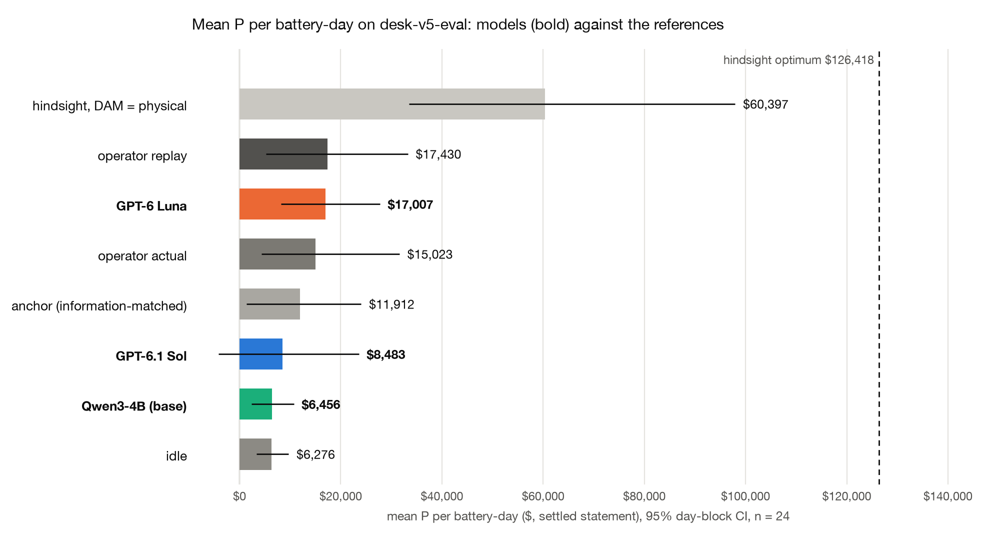
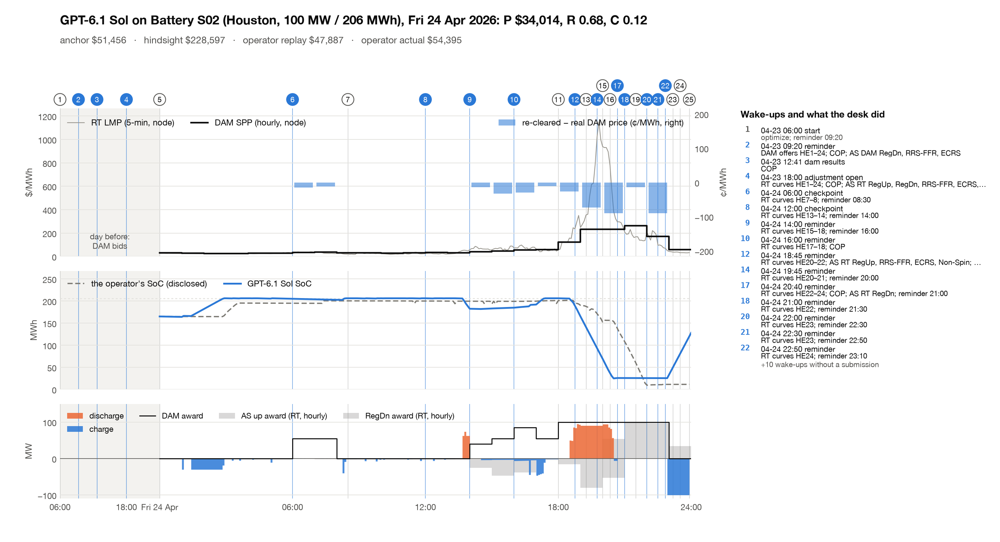

# GridSimEnv desk v5: results on `desk-v5-eval`

24 battery-days (6 operating days), 3 models. P is the settled ERCOT
statement in $ per battery-day; R the contract reward (anchor = 1.0, idle = 0.2); C the hindsight capture
(P − P_idle)/(P_hind − P_idle); C_phys the same against the hindsight optimum with its DAM position tied to dispatch.
"floored" counts tasks whose reward scale is floored at 10% of (P_hind_phys − P_idle) because the anchor
earns less (contract §9.1). Brackets are 95% day-block CIs.

| model | n | valid | floored | R | C (hindsight) | C_phys | mean P | P − anchor | beats anchor | P − operator replay | P − operator actual | $ / episode |
|---|---|---|---|---|---|---|---|---|---|---|---|---|
| GPT-6.1 Sol | 24 | 100% | 13 | 0.50 [0.23, 0.77] | 0.08 [−0.06, 0.23] | −0.64 [−4.11, 1.99] | $8,483 [−$4,198, $23,582] | −$3,429 [−$22,180, +$10,297] | 54% | −$8,947 [−$32,584, +$7,904] | −$6,540 [−$31,965, +$13,073] | $1.66 |
| GPT-6 Luna | 24 | 100% | 13 | 0.73 [0.58, 0.87] | 0.09 [0.04, 0.15] | 0.16 [−0.01, 0.32] | $17,007 [$8,177, $27,740] | +$5,095 [+$2,405, +$8,589] | 67% | −$423 [−$6,328, +$3,303] | +$1,984 [−$5,928, +$8,264] | $0.14 |
| Qwen3-4B (base) | 24 | 42% | 13 | 0.11 [0.04, 0.20] | −0.00 [−0.02, 0.01] | −0.00 [−0.03, 0.02] | $6,456 [$2,356, $10,732] | −$5,456 [−$13,809, +$2,229] | 46% | −$10,974 [−$24,019, −$1,374] | −$8,567 [−$22,903, +$1,204] | $0.00 |

### References (every task, the same clearing, physics and settlement)

| reference | n | mean P | C | C_phys |
|---|---|---|---|---|
| idle | 24 | $6,276 [$3,303, $9,695] | 0.00 | 0.00 |
| anchor (information-matched) | 24 | $11,912 [$1,330, $24,027] | 0.03 | 0.33 |
| hindsight optimum | 24 | $126,418 [$76,967, $208,996] | 1.00 | 22.72 |
| hindsight, DAM = physical | 24 | $60,397 [$33,498, $97,942] | 0.44 | 1.00 |
| operator replay | 24 | $17,430 [$5,187, $33,257] | 0.07 | -0.44 |
| operator actual | 24 | $15,023 [$4,305, $31,590] | 0.03 | -0.06 |

### Paired gaps (same tasks)

| paired gap | n | Δ P | Δ R | Δ C | ahead (tasks) | days ahead |
|---|---|---|---|---|---|---|
| GPT-6.1 Sol − GPT-6 Luna | 24 | −$8,524 [−$26,450, +$5,482] | −0.23 [−0.47, +0.09] | −0.01 [−0.12, +0.11] | 33% | 2/6 |
| GPT-6.1 Sol − Qwen3-4B (base) | 24 | +$2,027 [−$11,503, +$15,035] | +0.39 [+0.11, +0.68] | +0.08 [−0.06, +0.24] | 58% | 3/6 |
| GPT-6 Luna − Qwen3-4B (base) | 24 | +$10,551 [+$4,442, +$17,977] | +0.62 [+0.46, +0.77] | +0.09 [+0.05, +0.15] | 79% | 6/6 |
| GPT-6.1 Sol − operator replay | 24 | −$8,947 [−$32,584, +$7,904] | — | — | 46% | 3/6 |
| GPT-6 Luna − operator replay | 24 | −$423 [−$6,328, +$3,303] | — | — | 54% | 5/6 |
| Qwen3-4B (base) − operator replay | 24 | −$10,974 [−$24,019, −$1,374] | — | — | 29% | 1/6 |

### Statement lines (mean $ per battery-day)

| line | GPT-6.1 Sol | GPT-6 Luna | Qwen3-4B (base) |
|---|---|---|---|
| dam_energy | +$41,213 | +$6,794 | +$944 |
| rt_energy_imbalance | −$39,542 | +$6,679 | −$1,923 |
| deviation | +$0 | −$1 | +$0 |
| load_allocated | +$0 | +$0 | +$0 |
| degradation | −$1,482 | −$1,218 | −$362 |
| warranty_overage | −$0 | −$3 | −$73 |
| end_soc_shortfall | −$275 | −$426 | −$138 |
| dam_as_capacity | +$2,579 | +$0 | +$1,913 |
| rt_as_imbalance | +$885 | +$76 | +$1,045 |
| failure_to_provide | +$0 | +$0 | +$0 |
| capacity_short | +$0 | +$0 | −$56 |
| pv_energy | +$5,106 | +$5,106 | +$5,106 |
| **P** | **+$8,483** | **+$17,007** | **+$6,456** |

### Behaviour (mean per episode; codes are totals)

| model | turns | wakes | calls | top tools | submissions ok / rejected | rejection codes | reminders | cycles | COP late | input tok | output tok | cached tok |
|---|---|---|---|---|---|---|---|---|---|---|---|---|
| GPT-6.1 Sol | 30.29 | 30.29 | 157.5 | get_prices 34.7, get_forecasts 30.7, get_asset_status 24.0, set_reminder 19.1 | 29.25 / 0.75 | EBOC-07 ×18 | 19.12 | 0.896 | 0.0 | 3,024,352 | 23,540 | 2,432,031 |
| GPT-6 Luna | 17.5 | 17.5 | 107.21 | get_forecasts 18.9, get_prices 16.3, get_asset_status 14.4, get_position 13.8 | 17.12 / 0.12 | EBOC-07 ×3 | 6.79 | 0.756 | 0.0 | 3,422,148 | 69,137 | 2,643,952 |
| Qwen3-4B (base) | 13.21 | 13.21 | 72.92 | get_forecasts 28.2, get_prices 11.8, set_reminder 8.2, get_position 7.1 | 2.83 / 1.33 | EBOC-06 ×26, EBOC-01 ×4, EBOC-07 ×4 | 3.46 | 0.25 | 0.04 | 1,612,843 | 12,176 | 0 |

### Paired v5 − v3 (same battery-days, same model)

| model | n | Δ P | Δ R | Δ C | v5 ahead (tasks) |
|---|---|---|---|---|---|
| GPT-6.1 Sol | 24 | −$2,030 [−$6,009, +$1,606] | −0.05 [−0.25, +0.12] | −0.02 [−0.07, +0.02] | 42% |
| GPT-6 Luna | 24 | +$5,919 [−$1,366, +$18,125] | +0.13 [−0.05, +0.36] | +0.02 [−0.01, +0.06] | 62% |
| Qwen3-4B (base) | 24 | +$459 [−$2,427, +$3,356] | −0.08 [−0.18, +0.01] | +0.01 [−0.02, +0.04] | 29% |

### DAM price impact (re-cleared minus real node DAM price, awarded hours)

| policy | sales MWh / episode | price move on sales ($/MWh, MWh-weighted) | purchases MWh / episode | price move on purchases | largest |move| | revenue effect $ / episode | awarded hours moved > 1¢ |
|---|---|---|---|---|---|---|---|
| GPT-6.1 Sol | 622.0 | −16.92¢ | 70.6 | +7.41¢ | 135.07¢ | −$110 | 219/262 |
| GPT-6 Luna | 70.6 | −23.18¢ | 124.0 | +4.13¢ | 79.31¢ | −$21 | 66/154 |
| Qwen3-4B (base) | 16.8 | −6.49¢ | 0.2 | +0.41¢ | 13.90¢ | −$1 | 8/15 |
| anchor (information-matched) | 225.9 | −12.90¢ | 131.0 | +2.43¢ | 107.62¢ | −$32 | 123/169 |

### Ancillary services (mean per episode)

| model | product | DAM submissions accepted | RT submissions accepted | DAM award MWh | RT award MWh |
|---|---|---|---|---|---|
| GPT-6.1 Sol | RegUp | 0.04 | 4.71 | 0.0 | 177.5 |
| GPT-6.1 Sol | RegDn | 0.67 | 4.17 | 865.0 | 337.7 |
| GPT-6.1 Sol | RRS-FFR | 0.29 | 2.42 | 201.9 | 108.2 |
| GPT-6.1 Sol | RRS-PFR | 0.00 | 0.83 | 0.0 | 0.0 |
| GPT-6.1 Sol | ECRS | 0.12 | 1.71 | 40.4 | 13.0 |
| GPT-6.1 Sol | Non-Spin | 0.38 | 2.83 | 72.5 | 30.4 |
| GPT-6.1 Sol | all |  |  |  | 24/24 episodes with an AS award; AS offers refused: ASO-02 ×20; empty `as_offers` list flagged (env defect, energy unaffected): 111 calls |
| GPT-6 Luna | RegUp | 0.04 | 0.83 | 0.0 | 0.0 |
| GPT-6 Luna | RegDn | 0.00 | 0.38 | 0.0 | 0.0 |
| GPT-6 Luna | RRS-FFR | 0.00 | 0.38 | 0.0 | 0.0 |
| GPT-6 Luna | RRS-PFR | 0.00 | 0.38 | 0.0 | 0.0 |
| GPT-6 Luna | ECRS | 0.00 | 0.38 | 0.0 | 0.1 |
| GPT-6 Luna | Non-Spin | 0.00 | 0.62 | 0.0 | 4.8 |
| GPT-6 Luna | all |  |  |  | 6/24 episodes with an AS award; AS offers refused: ASO-02 ×123, ASO-06 ×9; empty `as_offers` list flagged (env defect, energy unaffected): 110 calls |
| Qwen3-4B (base) | RegUp | 0.08 | 0.38 | 20.3 | 81.6 |
| Qwen3-4B (base) | RegDn | 0.17 | 0.46 | 325.9 | 163.4 |
| Qwen3-4B (base) | RRS-FFR | 0.08 | 0.38 | 10.3 | 27.0 |
| Qwen3-4B (base) | ECRS | 0.08 | 0.29 | 16.5 | 13.6 |
| Qwen3-4B (base) | Non-Spin | 0.12 | 0.38 | 10.4 | 28.7 |
| Qwen3-4B (base) | all |  |  |  | 16/24 episodes with an AS award; AS offers refused: ASO-06 ×17, ASO-02 ×12; empty `as_offers` list flagged (env defect, energy unaffected): 30 calls |

## Sensitivity (post hoc, not pre-registered)

|  | GPT-6.1 Sol | GPT-6 Luna | Qwen3-4B (base) | anchor (information-matched) | operator replay | operator actual |
|---|---|---|---|---|---|---|
| median P | $7,726 | $10,637 | $1,520 | $6,792 | $11,103 | $9,277 |

Mean P per operating day:

| day | GPT-6.1 Sol | GPT-6 Luna | Qwen3-4B (base) | anchor (information-matched) | operator replay | operator actual |
|---|---|---|---|---|---|---|
| 2026-04-11 | −$7,215 | $4,587 | $339 | −$8,695 | $3,860 | $4,585 |
| 2026-04-24 | −$9,451 | $39,410 | $12,661 | $36,700 | $53,833 | $55,015 |
| 2026-05-26 | $19,731 | $9,523 | $4,824 | $8,822 | $5,379 | $6,457 |
| 2026-06-06 | −$3,184 | $7,978 | $6,850 | $3,834 | $3,797 | $584 |
| 2026-07-21 | $39,685 | $27,677 | $13,353 | $21,407 | $27,285 | $14,477 |
| 2026-08-22 | $11,330 | $12,867 | $707 | $9,401 | $10,426 | $9,018 |

| model | tasks with P < 0 | days with mean P < 0 | worst task | worst P |
|---|---|---|---|---|
| GPT-6.1 Sol | 7 | 3 | desk-v5-2026-04-24-S04 | −$104,164 |
| GPT-6 Luna | 2 | 0 | desk-v5-2026-06-06-S02 | −$151 |
| Qwen3-4B (base) | 3 | 0 | desk-v5-2026-08-22-S04 | −$18,614 |

## What the numbers say

- One 100–150 MW ESR moves ERCOT's DAM price by cents: re-cleared minus real node price over awarded hours is −17¢/MWh on Sol's DAM sales (MWh-weighted; Luna −23¢, Qwen3-4B −6¢, the anchor −13¢), the largest single move $1.35/MWh, worth about −$110 per battery-day to Sol (Luna −$21, anchor −$32). So v5 ≈ v3 by construction of the market, as pre-registered.
- Paired v5 − v3 on the same 24 battery-days: Sol ΔP −$2,030 [−$6,009, +$1,606], Luna +$5,919 [−$1,366, +$18,125], Qwen3-4B +$459 [−$2,427, +$3,356]; every ΔP, ΔR and ΔC CI includes zero. The gaps are sampling noise between two runs of the same model (its decisions differ run to run), not price impact, which is about $100 a day.
- In this run Luna leads Sol: R 0.73 [0.58, 0.87] vs 0.50 [0.23, 0.77], mean P $17,007 vs $8,483 (Sol − Luna ΔP −$8,524 [−$26,450, +$5,482], ΔR −0.23 [−0.47, +0.09]). Sol has 7 loss tasks (worst −$104,164 on 2026-04-24-S04), Luna 2 (worst −$151), Qwen3-4B 3 (worst −$18,614).
- Qwen3-4B (base, thinking off) submits a valid offer on 10 of 24 tasks (42%); R 0.11 [0.04, 0.20], C −0.004, mean P $6,456, about idle's $6,276 (ERCOT's proxy AS offers and PV earn it).
- For price impact to matter, the natural next step is a portfolio desk: a QSE bidding its whole ESR fleet into the DAM at once.

## Pilot

The v5 pilot (GPT-6.1 Sol, desk-v5-pilot; passed, outcome in docs/prereg/v5-desk-pilot.md), graded as the runner wrote it, not in the tables above.

| task | policy | R | C | P | anchor | operator replay | turns | $ |
|---|---|---|---|---|---|---|---|---|
| desk-v5-2026-08-14-S03 | gpt-6.1-sol | 1.00 | 0.45 | $10,416 | −$1,454 | −$195 | 28 | $1.40 |
| desk-v5-2026-04-20-S01 | gpt-6.1-sol | 0.00 | −0.21 | −$6,983 | $7,673 | $10,549 | 45 | $3.33 |

## Method

- Pack `desk-v5-eval`, layer v5: 24 tasks, 6 operating days,
  4 sites, era rtcb.
  Every model plays every task once (`scripts/desk_run.py`, path B', the in-process Session); every grade replayed from its Episode JSON against the frozen refs (the pack task rows; anchor risk 1.5, DAM position spread).
- Settings: GPT-6.1 Sol: kind model, model openai/gpt-6.1-sol, effort high; GPT-6 Luna: kind model, model openai/gpt-6-luna, effort high; Qwen3-4B (base): kind model, model qwen3-4b.
- Budgets per episode: max_turns 48, calls_per_turn 14, max_reminders 8.
- CIs: day-block bootstrap, 10,000 resamples of operating days, seed 0, task-weighted means (as
  `results/train/4b-blind`); paired gaps resample days over the tasks both sides played. "days ahead" counts days whose
  mean gap is positive.
- References are settled by the same clearing, physics and settlement code (contract §9.2): idle, the
  information-matched anchor, the hindsight optimum, the hindsight optimum with the DAM position tied to physical
  dispatch, the operator's disclosed curves replayed through our clearing, and the operator's disclosed awards and
  telemetry settled directly.
- Cost is the runner's metered API cost of the scored attempts; all attempts (count): GPT-6.1 Sol $39.92 (24), GPT-6 Luna $3.33 (24), Qwen3-4B (base) $0.00 (24).
- Known env defects (frozen for this version): K1 (contract §10.4): an empty `as_offers` list is answered with a spurious ASO-02 note ("as_offers is a list of objects"); energy curves in the same call are accepted; fixed after the v3/v5 freeze. The AS table counts these calls separately and leaves them out of the refusals.
- Deviation: Qwen3-4B's v5 tasks were queued after each host's v4 tasks and so began before the v5 pilot was checked; the pilot passed.
- Deviation: The same task-list error as v4: 2026-04-11 S01–S04 and 2026-04-24 S01–S02 were not queued and ran at 13:07 UTC as a fill-in on the same frozen code; 2026-07-21 S03–S04 and 2026-08-22 S01–S04 ran on two hosts, and the planned host's runs are scored, the duplicates excluded under a rule set before any duplicate was read.
- Raw outputs: `runs/<model>/results.jsonl.gz`, `episodes/<model>/*.json.gz` (Episode JSON
  `gridsim.desk.episode/v1`); per-call logs `runs/<model>/calls/*.jsonl.gz`. Core desk-2.1.
