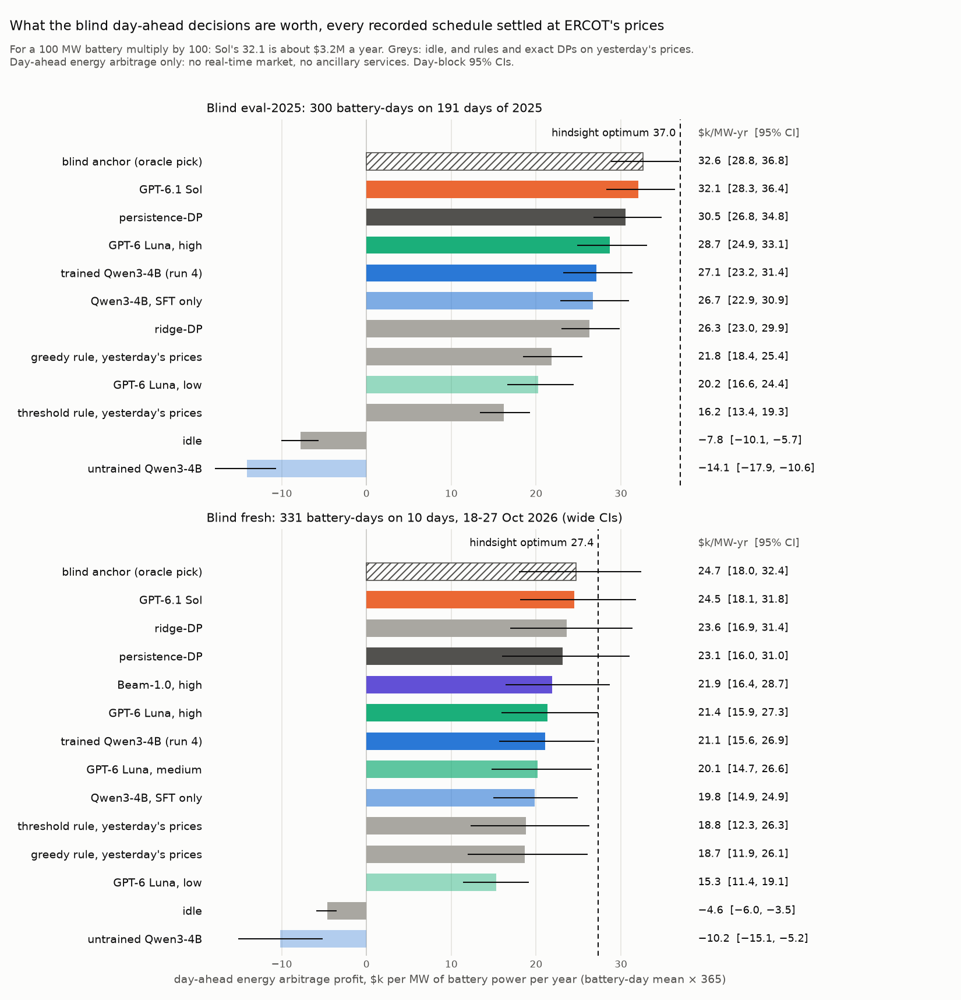

# What the blind-tier decisions are worth in dollars

**A descriptive re-analysis, not pre-registered.** It was computed on 2026-10-27, after every result below was in,
from schedules already recorded: no new model calls and no GPU. Each schedule is settled again by
`gridsim_core.grade(task, actions, "blind")` at the day's real ERCOT day-ahead prices, and its profit is divided by the
battery's discharge power. That gives **$ per MW of battery power per battery-day ($/MW-day)**. Multiply by 365 for
$/MW-year, and by 100 MW for a 100 MW battery. Every CI is a day-block bootstrap (10,000 resamples of days, seed 0,
task-weighted), with [`report_blind.py`](../train/4b-blind/scripts/report_blind.py)'s own `boot` and `paired`.

## The plain claims

- **GPT-6.1 Sol beats persistence-DP, the standard heuristic, by about $1.5k per MW-year ($1.6k on eval-2025, $1.4k
  on the fresh days), with the CI above 0 on both packs.**
  - Persistence-DP is the exact optimum on yesterday's prices.
  - On blind eval-2025 (300 battery-days on 191 days of 2025) Sol is **+$4.3 per MW-day [+2.1, +6.6]**: +$1.6k per
    MW-year [+0.8, +2.4].
  - On the fresh days (331 battery-days, 18–27 October 2026) it is +$3.8 per MW-day [+0.9, +7.3]: +$1.4k per MW-year
    [+0.3, +2.7].
- **For a 100 MW battery, that is about $156k a year on eval-2025 [$77k, $243k].**
  - Sol's schedules earn $3.21M a year per 100 MW, persistence-DP's $3.05M and the hindsight optimum's $3.70M.
  - Sol closes 24% of the gap between persistence-DP and the hindsight optimum on eval-2025, and 33% on the fresh
    days.
- **The trained Qwen3-4B (run 4, sampled) is below persistence-DP.**
  - On eval-2025 it is −$9.3 per MW-day [−15.2, −4.0]: −$3.4k per MW-year, or −$341k a year per 100 MW.
  - On the fresh days it is −$5.7 [−12.0, +0.7], so not separated from persistence-DP.
  - Training is worth +$113 per MW-day over the untrained Qwen3-4B, which loses money (−$38.6 per MW-day, below
    idle). It still leaves the 4B short of the DP on yesterday's prices.
- **Sol − the trained 4B is +$13.6 per MW-day [+8.6, +19.1] on eval-2025: about $497k a year per 100 MW.**
  Sol's extra inference cost is $5.59 a year per battery, whatever the battery's size.
- **GPT-6 Luna (high) is below persistence-DP on eval-2025**, at −$5.0 per MW-day [−7.8, −2.1].
  - On the fresh days, Luna-high and Beam-1.0 (high, fresh only) are behind it but not separated: −$4.9 [−11.0, +2.2]
    and −$3.4 [−8.6, +2.4].
- **The models win or lose money on different kinds of day.**
  - On days whose price shape repeats yesterday's, persistence-DP is nearly optimal. Sol matches it there, while Luna
    and the 4B lose money.
  - Sol's edge comes from the days when the shape changes.



## Tables

Every number here is from [`summary.json`](summary.json), written by [`scripts/econ.py`](scripts/econ.py);
[`tables.md`](tables.md) has each pack's full table, the per-100-MW column, the validity of each model and the by-day
tables.

| row | eval-2025 $/MW-day [95% CI] | $k/MW-yr | fresh $/MW-day [95% CI] | $k/MW-yr | inference $ per battery-day |
|---|---|---:|---|---:|---:|
| hindsight optimum (DP on the day's own prices) | 101.4 [89.8, 114.7] | 37.0 | 74.9 [58.1, 94.3] | 27.4 | – |
| blind anchor: max(persistence-DP, ridge-DP) per task, an oracle pick | 89.2 [78.9, 100.9] | 32.6 | 67.6 [49.3, 88.7] | 24.7 | – |
| GPT-6.1 Sol, effort high | 87.9 [77.5, 99.6] | 32.1 | 67.2 [49.6, 87.1] | 24.5 | $0.01580 |
| Beam-1.0, effort high | – | – | 59.9 [44.9, 78.5] | 21.9 | $0.02032 |
| GPT-6 Luna, effort high | 78.6 [68.1, 90.6] | 28.7 | 58.5 [43.7, 74.9] | 21.4 | $0.00202 |
| GPT-6 Luna, effort medium | – | – | 55.2 [40.4, 72.7] | 20.1 | $0.00119 |
| GPT-6 Luna, effort low | 55.5 [45.5, 66.9] | 20.2 | 42.0 [31.2, 52.5] | 15.3 | $0.00053 |
| trained Qwen3-4B, run 4 final, sampled | 74.3 [63.6, 86.0] | 27.1 | 57.7 [42.8, 73.7] | 21.1 | $0.00048 |
| trained Qwen3-4B, run 4 final, greedy | 75.7 [64.5, 87.9] | 27.6 | 58.4 [42.2, 75.9] | 21.3 | $0.00047 |
| Qwen3-4B SFT start of run 4 (RL step 0), sampled | 73.1 [62.7, 84.8] | 26.7 | 54.3 [40.9, 68.3] | 19.8 | $0.00047 |
| untrained Qwen3-4B, sampled | −38.6 [−48.9, −29.2] | −14.1 | −27.8 [−41.4, −14.2] | −10.2 | $0.00037 |
| persistence-DP: exact DP on yesterday's prices | 83.6 [73.4, 95.4] | 30.5 | 63.4 [43.9, 84.9] | 23.1 | – |
| ridge-DP: exact DP on ridge-v1 | 72.0 [63.0, 81.9] | 26.3 | 64.6 [46.3, 86.0] | 23.6 | – |
| greedy rule on yesterday's prices | 59.7 [50.5, 69.7] | 21.8 | 51.1 [32.7, 71.5] | 18.7 | – |
| threshold rule on yesterday's prices | 44.4 [36.6, 52.8] | 16.2 | 51.4 [33.6, 71.9] | 18.8 | – |
| greedy rule on the day's own prices (sees the day) | 67.9 [58.3, 78.2] | 24.8 | 48.8 [27.9, 71.8] | 17.8 | – |
| threshold rule on the day's own prices (sees the day) | 53.9 [46.0, 62.5] | 19.7 | 52.4 [37.6, 66.8] | 19.1 | – |
| idle (the battery does nothing) | −21.4 [−27.6, −15.5] | −7.8 | −12.6 [−16.3, −9.6] | −4.6 | – |

| paired gap | eval-2025 $/MW-day [95% CI] | $k/MW-yr [95% CI] | fresh $/MW-day [95% CI] | $k/MW-yr [95% CI] |
|---|---|---|---|---|
| GPT-6.1 Sol − persistence-DP | +4.3 [+2.1, +6.6] | +1.6 [+0.8, +2.4] | +3.8 [+0.9, +7.3] | +1.4 [+0.3, +2.7] |
| GPT-6.1 Sol − ridge-DP | +15.9 [+9.3, +24.6] | +5.8 [+3.4, +9.0] | +2.6 [+0.0, +4.7] | +0.9 [+0.0, +1.7] |
| trained Qwen3-4B (run 4) − persistence-DP | −9.3 [−15.2, −4.0] | −3.4 [−5.6, −1.5] | −5.7 [−12.0, +0.7] | −2.1 [−4.4, +0.2] |
| GPT-6.1 Sol − trained Qwen3-4B (run 4) | +13.6 [+8.6, +19.1] | +5.0 [+3.1, +7.0] | +9.5 [+5.3, +14.1] | +3.5 [+1.9, +5.1] |
| GPT-6 Luna, high − persistence-DP | −5.0 [−7.8, −2.1] | −1.8 [−2.9, −0.8] | −4.9 [−11.0, +2.2] | −1.8 [−4.0, +0.8] |
| trained Qwen3-4B (run 4) − untrained Qwen3-4B | +112.9 [+100.1, +126.4] | +41.2 [+36.6, +46.1] | +85.5 [+60.4, +112.1] | +31.2 [+22.0, +40.9] |
| Beam-1.0, high (best effort) − persistence-DP | – | – | −3.4 [−8.6, +2.4] | −1.3 [−3.2, +0.9] |

**What the rows are:**

- **Sol, Luna and Beam:** the blind-tier runs with the forecast-then-plan prompt.
  - Sol: [`../train/4b-blind/sol/`](../train/4b-blind/sol/).
  - Luna: [`../cost-matched/luna/`](../cost-matched/luna/). Luna-medium is fresh only: cost-matched amendment 2's
    descriptive row ([`docs/prereg/v1-cost-matched.md`](../../docs/prereg/v1-cost-matched.md)), now
    `luna-blind-fresh-medium.jsonl.gz` there.
  - Beam-1.0 is fresh only ([`docs/prereg/v1-beam-agent.md`](../../docs/prereg/v1-beam-agent.md)). When this was
    computed, effort high had all 331 battery-days. Effort low was paused at 112 of 331, and medium and max had not
    run.
  - `econ.py` reads Beam's records from `results/beam-agent/` (or `--beam DIR`) and includes each effort once all 331
    of its battery-days are there. The best complete effort is the "best effort" gap.
- **The Qwen3-4B rows:** run 4's committed evals in [`../train/4b-blind/`](../train/4b-blind/): the final model
  (`eval_final.json`, sampled and greedy), its SFT start (`eval_rl-0000.json`) and the untrained model
  (`eval_step0_base.json`).
- **The baselines:** from `gridsim_core.baselines`.
  - The two DPs plan exactly on a price guess and settle on the real day.
  - The greedy and threshold rules run twice. On yesterday's prices they are a fair blind baseline. On the day's own
    prices they see the day, so they are not a blind policy. Those are the rows the foresight tables use.
- **The blind anchor:** for each battery-day, the better of persistence-DP and ridge-DP, picked after the fact. It is
  an oracle pick, not a policy.
- **A reply with no valid schedule settles as idle.** The battery does nothing, and an end-of-day state-of-charge
  shortfall is charged as for any schedule. That is why idle is negative.
  - Counting such a reply as $0 instead moves a row by at most $0.6 per MW-day (Luna-high on fresh, 58.5 → 59.1).
  - It moves Sol − persistence-DP on fresh to +3.9 [+0.9, +7.6] and changes no gap's sign. `summary.json` has both
    (`usd_per_mw_day_invalid_as_0`, `gaps_invalid_as_0`).

## Inference cost against what the decisions earn

One model call per battery-day, whatever the battery's size, so the bill does not grow with MW; the value does.

- **Costs per battery-day** are from the cost-matched contest's [`summary.json`](../cost-matched/summary.json) for Sol,
  Luna and the 4B.
  - Sol and Luna are at their token prices; Beam is at Baseten's price on the Hugging Face router, from its records.
  - The 4Bs are priced as busy L40S time: a g6e.8xlarge on demand, the wall time of the batched eval only.
- **Persistence-DP costs nothing worth counting:** an exact DP over 24 hours, under a millisecond of CPU.

| model | inference per battery-day | per battery-year | eval-2025: earns per day, 100 MW | vs persistence-DP per day, 100 MW |
|---|---:|---:|---:|---:|
| GPT-6.1 Sol | $0.01580 | $5.77 | $8,787 | +$427 |
| GPT-6 Luna, high | $0.00202 | $0.74 | $7,860 | −$500 |
| GPT-6 Luna, low | $0.00053 | $0.19 | $5,548 | −$2,812 |
| trained Qwen3-4B (run 4) | $0.00048 | $0.17 | $7,425 | −$935 |
| Beam-1.0, high (fresh) | $0.02032 | $7.42 | fresh: $5,993 | fresh: −$344 |

- **Sol over persistence-DP:** $5.77 of inference a year buys $156k a year per 100 MW on eval-2025, about 27,000 times
  its bill. It would pay for itself on a battery of 3.7 kW. On the fresh days the figures are $139k and 24,000 times.
- **Sol over the trained 4B:** Sol's extra inference cost is $5.59 per battery-year. The decision-quality gap is $497k
  a year per 100 MW on eval-2025 ($346k on fresh), a ratio near 89,000 to 1; the break-even battery is 1.1 kW.
  **At grid scale, inference cost does not decide which model to run: decision quality does.** What a cheaper model
  saves on inference is under $6 a battery-year. What it loses in decisions is $100k-scale per 100 MW.
- **Beam-1.0 at effort high costs more per battery-day than Sol** ($0.0203 against $0.0158) and earns less on the same
  days.

## Where the dollars are

- **A few days carry the year.** Take each day's mean over its battery-days, the average battery's day.
  - On eval-2025, **30.3% of the hindsight profit is in the top 10% of days** (19 of 191). The largest is 2025-02-20:
    $921 per MW for the day.
  - On the fresh days, **20.4% is in the best day of the ten** (2026-10-21).
- **Sol's edge is concentrated the same way.** 85% of its net day-level gain over persistence-DP on eval-2025 comes
  from its best 19 days. It is ahead of persistence-DP on 101 days, level on 52 and behind on 38.
- **It is the regime-change days.**
  - The measure is how much the day's price shape moved from yesterday's: 1 − the Pearson correlation of D's 24 hourly
    prices with D−1's, averaged over the day's battery-days.
  - It depends on prices alone, not on any model.

| eval-2025, price-shape change quartile | days | persistence-DP short of optimum, $/MW-day | Sol − persistence-DP | Luna high − persistence-DP | trained 4B − persistence-DP |
|---|---:|---|---|---|---|
| Q1, shape repeats (1 − r 0.007–0.045) | 48 | 3.7 [2.4, 5.2] | +0.2 [−2.0, +2.0] | −9.5 [−15.1, −5.3] | −13.0 [−22.8, −5.6] |
| Q2 (0.046–0.107) | 47 | 10.5 [6.9, 14.8] | +0.9 [−2.9, +4.2] | −10.4 [−15.5, −5.7] | −22.6 [−39.9, −9.1] |
| Q3 (0.107–0.248) | 48 | 16.7 [12.2, 21.3] | +3.7 [+0.4, +7.2] | −3.1 [−8.2, +2.0] | −1.4 [−6.4, +3.9] |
| Q4, shape changes (0.256–0.895) | 48 | 41.6 [29.4, 54.5] | **+12.7 [+6.5, +20.1]** | +3.4 [−3.4, +11.5] | +0.0 [−11.3, +10.6] |

- **When yesterday repeats (Q1–Q2), the DP on yesterday's prices is within $3.7–10.5 per MW-day of the optimum.**
  - Sol is level with it.
  - Luna-high and the 4B lose $9.5–22.6 per MW-day: they move away from a schedule that was already close to the
    optimum.
- **When the shape changes (Q4), persistence-DP falls $41.6 per MW-day short.** Sol recovers $12.7 of it; Luna and the
  4B only draw level.
- **The 4B's single worst day was 2025-08-20, a spike day.** It is the pack's second-largest day by the optimum, $430
  per MW, and the 4B was $243 per MW behind persistence-DP. The dollar metric weights such days far more than the
  capture score C does.
- **On the fresh days:**
  - Sol is ahead of persistence-DP on 9 of 10 days. Its largest gains are on 2026-10-18 and 10-19 (+$11.7 and +$12.2
    per MW-day), the two shape-change days (1 − r 0.34 and 0.40).
  - On 10-20 and 10-21 yesterday was a good guide (1 − r 0.02 and 0.08). On those days Luna-high, the 4B and Beam each
    lost $8.5–23.6 per MW-day while Sol stayed level. The per-day table is in [`tables.md`](tables.md).

## What these dollars are and aren't

- **Day-ahead energy arbitrage only.** Each schedule is 24 hourly buy and sell quantities settled at ERCOT's hourly
  day-ahead settlement point prices, at the 7 trading hubs and 8 load zones. It does not settle at a battery's own
  resource node, whose price carries local congestion.
- **No real-time market and no ancillary services.** These are where real ERCOT batteries earn much of their revenue:
  regulation, responsive reserve, ECRS, non-spin, and real-time price spikes. So **this is the value of the day-ahead
  decisions, not a battery's total revenue**, and it is not comparable to published per-kW revenue figures for ERCOT
  storage.
- **Price-taker and perfect execution.** Every MWh clears at the published price, and the schedule moves no price. The
  battery then runs it exactly: no offer that fails to clear, no outage, no real-time deviation or imbalance charge.
- **Simplified battery economics.**
  - The batteries are archetypes sized from the ERCOT fleet in EIA-860: 7.5–225 MW, 1, 2 or 4 hours.
  - Each has a round-trip efficiency of 0.85, at most one full cycle a day and an end-of-day state-of-charge
    obligation.
  - Degradation is only a flat throughput cost per MWh discharged: $4 or $8 on 178 of the 300 eval-2025 battery-days
    and 201 of the 331 fresh ones, $0 on the rest.
  - There is no capacity fade, O&M, fees or capital cost. These are gross trading margins, not project returns.
- **Per MW depends on the mix.** A 4-hour battery earns more per MW than a 1-hour one. The means are over each pack's
  mix: on eval-2025, 102 one-hour, 105 two-hour and 93 four-hour battery-days.
- **× 365 is a unit, not a forecast.**
  - Eval-2025's 191 days are sampled from 6 January to 30 November 2025.
  - The fresh pack is 10 days of late October 2026, so its per-year figures restate a 10-day mean.
- **After the fact.** This re-analysis was computed after the results, on recorded schedules, and was not
  pre-registered.
  - The registered verdicts are in [`../train/4b-blind/`](../train/4b-blind/) and
    [`../cost-matched/`](../cost-matched/), on the capture score C.
  - The live sealed board (`live/`, running from 2026-10-29) will add out-of-sample days scored the same way.

## Reproduce

```bash
PYTHONPATH=src python results/economics/scripts/econ.py              # summary.json, tables.md, value_ladder.png
PYTHONPATH=src python results/economics/scripts/econ.py --beam DIR   # Beam's records from DIR instead of results/beam-agent/
```

It reads only committed files: the packs, `data/ridge-v1.json`, the per-task records of every model and the
cost-matched summary. Every grade is checked against the capture C each record carries.
