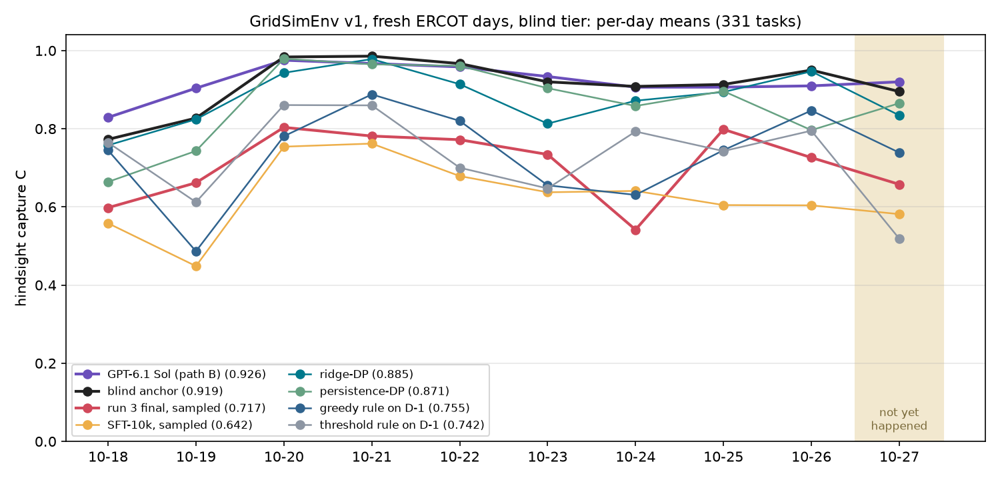

# Blind-tier baseline on ERCOT's newest days, 2026-10-18 to 2026-10-27

**A diagnostic baseline, not a claim, pre-registered.** The plan is
[`docs/prereg/v1-fresh-2026-10-blind.md`](../../../docs/prereg/v1-fresh-2026-10-blind.md), pushed to `main` (77d567a)
before any blind-tier generation. The tasks are the 331 blind-tier tasks of the fresh-2026-10 pack.
- **What the agent sees:** the battery, plus D-1's and D-7..D-1's DAM prices at its point.
- **What it does not see:** day D's prices. The schedule is graded on them.

This is where FD-4420's target claim would be tested: a trained 4B out-earning GPT-6.1 Sol bidding blind. No model here
was trained for it. The two 4Bs were trained only on the foresight prompt, so they run **zero-shot and out of
distribution**. Ten days is a small sample. The runs took place on 2026-10-26 UTC, alongside the foresight lane
(`../2026-10/`).

## Results (331 tasks; headline = hindsight capture C)

C = clip(0.2 + 0.8 (P − P_idle) / (P_opt − P_idle), 0, 1) is the share of the hindsight optimum captured. R puts the
blind anchor at 1.0; the anchor is the better of persistence-DP and ridge-DP.

| model | C | day-block 95% CI | naive task CI | Δ C vs anchor (day-block CI) | R (anchor scale) | beats anchor | 2026-10-27 C (26 tasks) | valid |
|---|---|---|---|---|---|---|---|---|
| **GPT-6.1 Sol (path B)** | **0.926** | [0.890, 0.952] | [0.916, 0.936] | **+0.007 [−0.012, +0.032]** | 0.980 | 39.9% | 0.920 | 100% |
| **blind anchor** | **0.919** | [0.862, 0.960] | [0.908, 0.930] | – | 1.000 | – | 0.895 | 100% |
| ridge-DP | 0.885 | [0.832, 0.929] | [0.872, 0.898] | −0.034 [−0.054, −0.017] | 0.962 | – | 0.834 | 100% |
| persistence-DP | 0.871 | [0.787, 0.935] | [0.853, 0.888] | −0.048 [−0.086, −0.019] | 0.941 | – | 0.865 | 100% |
| greedy rule on D-1 | 0.755 | [0.675, 0.813] | [0.732, 0.776] | −0.165 [−0.224, −0.112] | 0.800 | 7.2% | 0.739 | 100% |
| threshold rule on D-1 | 0.742 | [0.671, 0.804] | [0.718, 0.765] | −0.177 [−0.241, −0.113] | 0.790 | 9.4% | 0.519 | 100% |
| **run 3 final, sampled (OOD)** | **0.717** | [0.659, 0.762] | [0.685, 0.746] | **−0.202 [−0.231, −0.182]** | 0.762 | 13.9% | 0.658 | 99.7% |
| run 3 final, greedy decoding (OOD) | 0.729 | [0.673, 0.771] | [0.698, 0.758] | −0.191 [−0.205, −0.178] | 0.775 | 16.0% | 0.739 | 99.7% |
| SFT-10k, sampled (OOD) | 0.642 | [0.575, 0.699] | [0.605, 0.678] | −0.277 [−0.314, −0.245] | 0.685 | 13.6% | 0.582 | 99.1% |
| SFT-10k, greedy decoding (OOD) | 0.681 | [0.612, 0.737] | [0.643, 0.717] | −0.238 [−0.269, −0.212] | 0.723 | 15.7% | 0.646 | 98.2% |

**Key gaps (C, paired, day-block 95% CI).** "Shown" means the CI lies wholly on one side of 0.

| gap | mean | day-block CI | shown? | naive task CI | days ahead | 2026-10-27 |
|---|---|---|---|---|---|---|
| **Sol − blind anchor** | **+0.007** | [−0.012, +0.032] | not shown | [−0.001, +0.016] | 4/10 | +0.025 |
| **run 3 − Sol** (sampled) | **−0.209** | [−0.241, −0.186] | below 0 | [−0.240, −0.180] | 0/10 | −0.262 |
| SFT-10k − Sol (sampled) | −0.284 | [−0.332, −0.247] | below 0 | [−0.321, −0.248] | 0/10 | −0.338 |
| run 3 − SFT-10k (sampled) | +0.075 | [+0.036, +0.117] | above 0 | [+0.041, +0.109] | 9/10 | +0.076 |
| run 3 − Sol (greedy decoding) | −0.198 | [−0.225, −0.175] | below 0 | [−0.228, −0.169] | 0/10 | −0.181 |
| SFT-10k − Sol (greedy decoding) | −0.246 | [−0.293, −0.210] | below 0 | [−0.283, −0.210] | 0/10 | −0.274 |
| run 3 − SFT-10k (greedy decoding) | +0.048 | [+0.023, +0.075] | above 0 | [+0.018, +0.079] | 8/10 | +0.094 |

**What it says:**
- **Sol is level with the blind anchor, not ahead of it.**
  - Sol's C is 0.926 against the anchor's 0.919, a +0.007 gap whose CI includes 0. That is what eval-2025's blind
    column showed (0.9165 vs 0.9204).
  - Sol out-earns the anchor on 40% of tasks. By C it is ahead on 34%, level on 20% and behind on 46%.
  - Its lead is concentrated in two days, 10-18 (+0.056) and 10-19 (+0.077), the two where persistence-DP does worst
    (0.66 and 0.74). On the other eight days it sits within −0.04 to +0.03 of the anchor.
  - Reading seven days of history in a prompt, Sol is a good forecaster-planner, but no better than a ridge model and
    a DP.
- **The current 4Bs are far from the claim.**
  - Zero-shot, run 3 captures 0.717: 0.21 below Sol and 0.20 below the anchor, behind both on every day.
  - It is also below persistence-DP (−0.154, day-block CI [−0.194, −0.112]; reported, not registered).
  - It roughly ties the greedy rule run on D-1 (−0.038 [−0.092, +0.026]) and the threshold rule on D-1 (−0.025
    [−0.093, +0.040]).
  - The completions show why. The model plans on "prev days" prices as if they were today's, with its foresight-tier
    rationale. That is a persistence heuristic, but with the 4B's own planning errors on top: overfill 8.5%, and only
    85.5% of schedules feasible, against the DP's 100%.
- **Run 3's training still helps out of distribution.** Run 3 − SFT-10k is +0.075 sampled and +0.048 greedy, both
  shown, ahead on 8–9 of 10 days. Fewer broken schedules again: feasible 85.5% vs 69.8% sampled, overfill 8.5% vs
  18.4%.
- **For the target claim, a 4B would have to gain about +0.21 C to draw level with Sol on these days.** The blind
  training design (forecast-then-plan, FD-4420) has to supply that.
  - Sol's level is the anchor's level.
  - A 4B that ran a DP on a ridge-quality forecast would already reach 0.885. Getting the planning right is worth
    about 0.17 C of the gap, before any forecasting skill.

## 2026-10-27 alone (26 tasks, descriptive; bid on history through 10-26)

| model | C | R (anchor scale) | within-day task CI (C) |
|---|---|---|---|
| GPT-6.1 Sol | 0.920 | 0.984 | [0.891, 0.946] |
| blind anchor | 0.895 | 1.000 | [0.855, 0.930] |
| persistence-DP / ridge-DP | 0.865 / 0.834 | | |
| greedy / threshold rule on D-1 | 0.739 / 0.519 | | |
| run 3, sampled / greedy | 0.658 / 0.739 | 0.719 / 0.823 | [0.538, 0.769] / – |
| SFT-10k, sampled / greedy | 0.582 / 0.646 | 0.627 / 0.709 | [0.440, 0.719] / – |

Sol edges the anchor on 10-27 (+0.025), and run 3 trails both by 0.24–0.26 sampled. One day is a demonstration, not
evidence.

## Error mix (share of the 331 tasks)

| model | valid | feasible | overfill | sell before charge | end short | cycle cap | rate | truncated |
|---|---|---|---|---|---|---|---|---|
| GPT-6.1 Sol | 100% | 100% | 0% | 0% | 0% | 0% | 0% | 0% |
| run 3 final, sampled | 99.7% | 85.5% | 8.5% | 3.9% | 1.8% | 0.3% | 1.5% | 0.3% |
| run 3 final, greedy decoding | 99.7% | 85.8% | 10.6% | 2.1% | 3.0% | 0.6% | 0.6% | 0.3% |
| SFT-10k, sampled | 99.1% | 69.8% | 18.4% | 5.4% | 0.3% | 1.5% | 3.9% | 0.9% |
| SFT-10k, greedy decoding | 98.2% | 75.5% | 14.5% | 3.0% | 1.8% | 3.0% | 2.1% | 1.8% |

There were no all-idle and no malformed schedules. The references are feasible by construction.

## Against the prior
- **Sol:** expected Δ between −0.03 and +0.01, not shown. It came in at +0.007, not shown.
- **The 4Bs zero-shot:** expected C 0.70–0.85, below Sol and the anchor with shown gaps, and more invalid schedules
  than on foresight.
  - Run 3 (0.717) landed in the range, and SFT-10k (0.642) below it.
  - Both gaps were shown.
  - Valid stayed at 98–100%, but feasible fell: run 3 90.3% → 85.5%, SFT-10k 82.6% → 69.8%.

## Setup and deviations
- **Pack:** `data/ercot-dam-v1-fresh-2026-10-blind` (`scripts/build_fresh_blind_pack.py`).
  - These are the fresh-2026-10 rows whose `tags.blind_eval` is set (build_pack's blind rule; 31 of 362 fail it).
  - It adds `refs.blind.rules`: the greedy and threshold rules on D-1's prices settled on D, persistence-DP, ridge-DP
    (`data/ridge-v1.json`), hindsight-DP and idle, each with its C and anchor-scale R.
  - **History:** the NP4-180-ER file through 2026-10-17, then the API pull. The two agree exactly where they overlap.
- **4B:**
  - The same models, merge, decoding (T 0.7 / top_p 0.8 / top_k 20 / seed 0, plus greedy decoding, max_tokens 512)
    and box as the foresight lane, on GPU 2.
  - The eval code is `scripts/evaluate.py` and `pathb.py`, with the two registered changes: `TIER=blind` from the
    environment, and `max_model_len` 4,096.
  - The blind prompt measured 2,241–2,306 tokens. The pre-registration estimated "about 2,000"; at 2,048 the prompt
    would not have fit at all.
  - About 4.3 min per pass.
- **Sol:**
  - `../2026-10/scripts/sol_eval.py`, tier `blind`: one Responses request per task, reasoning effort high,
    `max_output_tokens` 16,384.
  - All 331 completed on the first request. Median output was 1,477 tokens and the longest 3,658.
- **Report:** `../2026-10/scripts/report_fresh.py blind …` re-grades every schedule with `gridsim_core`.
- **Deviations:** none from the pre-registration. Two numbers here are reported but were not registered:
  - run 3 against persistence-DP and against the two D-1 rules (paired, day-block);
  - "about 0.17 C of the gap", read off the reference means.

## Cost
- **Sol:** $6.29 for 331 requests (cap $15). The median request cost $0.018 and the dearest $0.040. Usage was 589k input
  and 512k output tokens, 490k of them reasoning.
- **GPU:** about 17 GPU-minutes on the shared g5.12xlarge.

## Files
- `summary.json`: the C and R means, CIs, per-day values, the 10-27 values, the paired gaps (`paired`, and `vs_anchor`
  for every model and reference), the error mix, by start state and Sol's usage. `tables.md` holds the generated
  tables.
- `eval_run3.json`, `eval_sft10k.json`: evaluate.py's output. Its `reward` is R on the anchor scale; C is re-derived
  from the actions.
- `eval_sol.jsonl.gz`: one row per task, with the call, grade, usage and cost.
- `episodes/*.jsonl.gz`: path-B `gridsim.episode/v1` at the blind tier, for every model and decoding.
- `per_day.png`, `pip_freeze.txt`, `gpu.csv`.
- `scripts/`: `evaluate.py`, `pathb.py`, `eval_unit.sh`. Sol and the report use `../2026-10/scripts/`.
