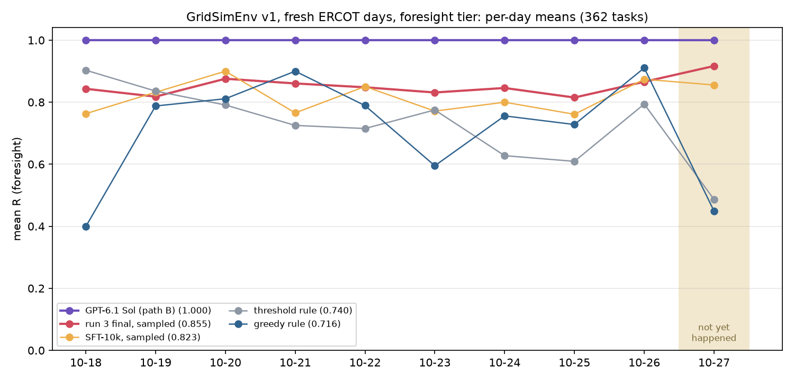

# Live foresight eval on ERCOT's newest days, 2026-10-18 to 2026-10-27

**The first entry of a running scoreboard (FD-4420), pre-registered.** The plan is
[`docs/prereg/v1-fresh-2026-10.md`](../../../docs/prereg/v1-fresh-2026-10.md), pushed to `main` (fc523b3) before any
generation. The pack (252327b) holds 362 tasks on the ten operating days after rtcb's last day. No model in this repo
was trained on any of them, and **2026-10-27 had not happened yet** when the models planned it: ERCOT posted its
day-ahead prices on 10-26. Ten days is a small sample, so read every gap with its day-block CI. The runs took place on
2026-10-26 UTC.

## Results (362 tasks, foresight tier, oneshot prompt, path B)

| model | mean R | day-block 95% CI | naive task CI | 2026-10-27 (35 tasks) | valid |
|---|---|---|---|---|---|
| **GPT-6.1 Sol (path B)** | **1.000** | [1.000, 1.000] | [1.000, 1.000] | **1.000** | 100% |
| **run 3 final, sampled** | **0.855** | [0.839, 0.872] | [0.832, 0.877] | **0.917** | 99.5% |
| run 3 final, greedy decoding | 0.860 | [0.825, 0.892] | [0.836, 0.883] | 0.936 | 99.7% |
| SFT-10k, sampled | 0.823 | [0.789, 0.854] | [0.793, 0.852] | 0.855 | 99.7% |
| SFT-10k, greedy decoding | 0.835 | [0.789, 0.871] | [0.805, 0.863] | 0.887 | 99.7% |
| threshold rule | 0.740 | [0.664, 0.805] | [0.716, 0.763] | 0.486 | 100% |
| greedy rule | 0.716 | [0.591, 0.821] | [0.690, 0.742] | 0.449 | 100% |
| clock rule | 0.527 | [0.395, 0.652] | [0.498, 0.557] | 0.495 | 100% |

The day-block CI resamples the 10 days (10,000 times) and keeps every task of a drawn day. The naive CI resamples the
362 tasks as if they were independent, and it is too narrow.

**Paired gaps** (same tasks). "Shown" means the day-block CI lies wholly on one side of 0.

| gap | mean | day-block 95% CI | shown? | naive task CI | days ahead | 2026-10-27 |
|---|---|---|---|---|---|---|
| **run 3 − greedy rule** (sampled) | **+0.139** | [+0.032, +0.267] | above 0 | [+0.105, +0.173] | 8/10 | +0.467 |
| **run 3 − SFT-10k** (sampled) | **+0.032** | [+0.005, +0.062] | above 0 | [+0.007, +0.058] | 6/10 | +0.061 |
| **run 3 − Sol** (sampled) | **−0.145** | [−0.161, −0.128] | below 0 | [−0.168, −0.123] | 0/10 | −0.083 |
| **SFT-10k − greedy rule** (sampled) | **+0.107** | [+0.004, +0.221] | above 0 | [+0.069, +0.144] | 8/10 | +0.406 |
| run 3 − greedy rule (greedy decoding) | +0.144 | [+0.049, +0.260] | above 0 | [+0.112, +0.175] | 9/10 | +0.487 |
| run 3 − SFT-10k (greedy decoding) | +0.025 | [−0.010, +0.055] | not shown | [+0.000, +0.051] | 9/10 | +0.049 |
| run 3 − Sol (greedy decoding) | −0.140 | [−0.175, −0.108] | below 0 | [−0.164, −0.117] | 0/10 | −0.064 |
| SFT-10k − greedy rule (greedy decoding) | +0.119 | [+0.025, +0.225] | above 0 | [+0.080, +0.156] | 7/10 | +0.438 |
| run 3 − threshold rule (sampled, reported) | +0.115 | [+0.042, +0.205] | above 0 | [+0.081, +0.148] | 8/10 | +0.430 |

**What it says:**
- **Sol solves the foresight tier.** All 362 schedules score R ≥ 0.998, with no rule broken. That matches the board (0.9999
  on eval-2025, 1.0000 on rtcb). Foresight is a calculation, and a frontier model with reasoning gets it right.
- **The trained 4B beats both heuristics on days no model has seen.** Run 3 is ahead of the greedy rule by +0.139 and of
  the threshold rule by +0.115, and both day-block CIs clear 0. The heuristics swing from day to day (greedy 0.40–0.91),
  while run 3 stays between 0.815 and 0.917 on every day.
- **Run 3's training gain carries over to the fresh days.** Run 3 − SFT-10k is +0.032 sampled, and the day-block CI
  clears 0. Under greedy decoding it is +0.025, but that CI touches 0.
  - The source is the same as on eval-2025: fewer broken schedules. Overfill falls from 9.7% to 6.1%, and feasible
    rises from 82.6% to 90.3%.
  - Empty-start days gain the most: 0.801 → 0.861, where half and full starts barely move.
- **"Beats the best heuristic every day" does not hold.** The fallback claim fails on 4 of 10 days. The threshold rule
  wins 10-18 (0.903 vs 0.843) and 10-19, and the greedy rule wins 10-21 (0.900 vs 0.860) and 10-26 (0.910 vs 0.866).
  Against either rule alone, run 3 is ahead on 8 of 10 days.
- **The 4B is far behind Sol: −0.145, shown, and behind on every day.** The foresight tier can't carry a "4B beats
  Sol" claim, as FD-4420's target claim already says.

## 2026-10-27, the day that hadn't happened (35 tasks, descriptive)

| model | mean R | within-day task CI |
|---|---|---|
| GPT-6.1 Sol | 1.000 | [1.000, 1.000] |
| run 3 final, sampled / greedy | 0.917 / 0.936 | [0.873, 0.955] / – |
| SFT-10k, sampled / greedy | 0.855 / 0.887 | [0.765, 0.933] / – |
| clock / threshold / greedy rule | 0.495 / 0.486 / 0.449 | |

- **Prices:** a cheap autumn day with two small peaks. HB_HOUSTON runs $22.89–$43.03: a morning bump at HE06–07, a
  midday trough, the evening peak at HE19, and the cheapest hour last, at HE24.
- **The rules collapse.** The greedy rule pairs each cheap hour only with a dearer later one, so it idles on 16 of the
  35 tasks; many of them start full and must end full. The optimum sells the morning bump, refills at midday, sells the
  evening peak and refills at HE24. The threshold rule trades on 34 of 35 tasks, but 8 of them end at or below idle.
- **Both 4Bs hold up.** Run 3 has its best day of the ten (0.917). This is one day, so it is a demonstration, not
  evidence.

## Error mix (share of the 362 tasks)

| model | valid | feasible | overfill | sell before charge | end short | cycle cap | rate | truncated |
|---|---|---|---|---|---|---|---|---|
| run 3 final, sampled | 99.5% | 90.3% | 6.1% | 1.9% | 1.4% | 0.8% | 0.3% | 0.5% |
| run 3 final, greedy decoding | 99.7% | 90.1% | 6.9% | 2.2% | 1.7% | 0.5% | 0% | 0.3% |
| SFT-10k, sampled | 99.7% | 82.6% | 9.7% | 3.6% | 2.2% | 1.9% | 1.9% | 0.3% |
| SFT-10k, greedy decoding | 99.7% | 80.9% | 10.5% | 5.2% | 1.9% | 2.2% | 0.8% | 0.3% |
| GPT-6.1 Sol | 100% | 100% | 0% | 0% | 0% | 0% | 0% | 0% |

There were no all-idle schedules and no malformed calls. The rules' schedules are feasible by construction.

## Also reported (from the pre-registration)
- **Draw-1 subset:** the 98 tasks with rtcb's own archetype draw.

  | model | mean R |
  |---|---|
  | Sol | 1.000 |
  | run 3, sampled | 0.881 |
  | SFT-10k, sampled | 0.819 |
  | threshold rule | 0.717 |
  | greedy rule | 0.708 |
  | clock rule | 0.539 |

  The extra draws do not change the order.
- **By start state** (mean R, sampled):

  | model | empty (133) | half (113) | full (116) |
  |---|---|---|---|
  | run 3 | 0.861 | 0.842 | 0.862 |
  | SFT-10k | 0.801 | 0.826 | 0.845 |
  | greedy rule | 0.786 | 0.726 | 0.627 |
  | threshold rule | 0.727 | 0.762 | 0.734 |

- **Per day:** see `summary.json` (`models.*.per_day`) and the chart.
- **Pipeline check (passed, before any fresh generation):** on run 3's 200 eval-2025 tasks, sampled.
  - SFT-10k scored 0.858. That is inside [0.805, 0.881]; run 3's step 0 on the same box type was 0.844.
  - Run 3 final scored 0.885, equal to the committed 0.885.
  - Valid was 99.5% and 100%.
- **Against the prior:**
  - Sol (0.99–1.00) landed as expected.
  - SFT-10k (0.76–0.82) and run 3 (0.79–0.85) each landed just above their range.
  - Run 3 − greedy rule was shown, as expected (~70%).
  - Run 3 − SFT-10k was shown on sampled decoding, which is the surprise: we put "not shown" at ~75%.
  - Run 3 − Sol was shown below 0, as expected.
  - SFT-10k − greedy rule was shown (~55%).

## Data and setup
- **Prices:**
  - Pulled through the ERCOT public API's DAM Settlement Point Prices (NP4-190-CD) for the 15 v1 points, 2026-10-15
    to 10-27 (15 requests).
  - On 10-15 to 10-17 they equal the NP4-180-ER file the other packs use: 1,080 hours, max abs diff $0.00.
  - The raw rows are in `data/ercot-dam-v1-fresh-2026-10/dam_spp_api.csv.gz`; `scripts/ercot_pull.py` is the pull.
- **Pack:** `scripts/build_fresh_pack.py` (build_pack.py's functions).
  - 150 point-days → 132 after the within-date dedup.
  - Four archetype draws each; draw 1 is rtcb's. That gives 512 candidates.
  - −66 low-spread, −84 greedy-easy, so **362 kept** and no subsample. Every day keeps 15–53 tasks.
- **4B:**
  - Run 2's SFT-10k LoRA (sha256 `69c5f4a6…6e33f`, matching) merged into Qwen3-4B @ `1cfa9a72` in bf16.
  - Run 3's step-300 `dpa-lora` (sha256 `05c1dcb2…46525e3`) as a vLLM LoRA on it.
  - The eval code is `scripts/evaluate.py` and `pathb.py`, copied unchanged from `results/train/4b-dpa/scripts/`.
  - Sampling is T 0.7 / top_p 0.8 / top_k 20 / seed 0, plus greedy decoding, with max_tokens 512.
  - Packages are identical to `results/train/pip_freeze.txt` (`pip_freeze.txt` here).
  - It ran on one A10G per model (g5.12xlarge, GPUs 0–1): about 2 min per pass.
- **Sol:** `scripts/sol_eval.py`.
  - One Responses-API request per task through LiteLLM, reasoning effort high, `max_output_tokens` 16,384.
  - The same system prompt, situation text and `submit_schedule` schema as the 4B (`gridsim_core.prompt`).
  - Graded by `gridsim_core.trl.extract_actions`, then `grade`.
  - All 362 completed on the first request. Median output was 781 tokens and the longest 2,460, so none came near the
    cap.
- **Report:** `scripts/report_fresh.py` re-grades every schedule with `gridsim_core` and builds `summary.json`, the
  tables and the chart.

## Deviations from the pre-registration
None. The blind-tier baseline (`../2026-10-blind/`) ran on GPU 2 at the same time, under its own pre-registration.

## Cost
- **Sol:** $3.72 for 362 requests (cap $20). The median request cost $0.0096 and the dearest $0.032. Usage was 319k
  input and 308k output tokens, 284k of them reasoning.
- **GPU:** about 20 GPU-minutes on the shared g5.12xlarge (~$5.7/h for the whole box).

## Files
- `summary.json`: every model's mean, CIs, per-day means, the 10-27 values, the error mix, the paired gaps, by start
  state, the draw-1 subset and Sol's usage. `tables.md` holds the generated tables.
- **Per-task results:**
  - `eval_run3.json` and `eval_sft10k.json` (evaluate.py's output, sampled and greedy);
  - `eval_sol.jsonl.gz`: one row per task, with the call, grade, usage and cost;
  - `check_eval2025_*.json`: the pipeline check.
- `episodes/*.jsonl.gz`: path-B `gridsim.episode/v1` for every model and decoding.
- `per_day.png`, `pip_freeze.txt`, `gpu.csv`.
- `scripts/`: `ercot_pull.py`, `evaluate.py`, `pathb.py`, `merge.py`, `gate.py`, `eval_unit.sh`, `sol_eval.py`,
  `report_fresh.py`.
