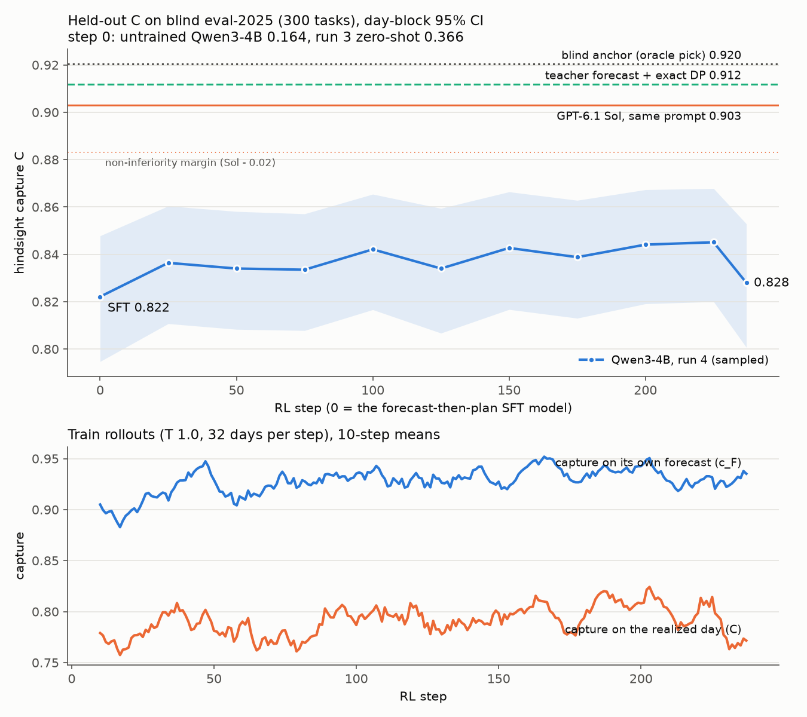

# Qwen3-4B, registered run 4 (blind): forecast-then-plan against GPT-6.1 Sol under one harness

**This is registered run 4 (blind).** The plan is
[`docs/prereg/v1-train-4b-blind.md`](../../../docs/prereg/v1-train-4b-blind.md). It was pushed to `main` (a50dcca,
with the core change in d63f8ef) before any generation, training step or Sol request. Amendment 1 (d0022a6: the
pilot's start choice and N) was pushed before the main SFT, and amendment 2 (ced0daf: the smoke and STEPS) before the
main RL. The run took place on 2026-10-27 UTC (FD-4420).

**The claim tested:** a Qwen3-4B trained on the blind tier matches GPT-6.1 Sol's hindsight capture C on blind
eval-2025, with both models given the identical single-call prompt (the blind path-B prompt plus one paragraph that
lets the agent write its forecast first).

## Verdicts

| bar | result | verdict |
|---|---|---|
| **PRIMARY:** final 4B − Sol on blind eval-2025 (300 tasks, 191 days), sampled, paired day-block 95% CI lower bound above −0.02 | **−0.075 [−0.101, −0.050]**; ahead on 26% of tasks, level on 19% | **NOT MET** (the CI lies wholly below the margin) |
| superiority bonus (lower bound above 0) | | not met |
| **SECONDARY 1:** final − untrained Qwen3-4B, and final − run 3 zero-shot, on eval-2025, CIs above 0 | **+0.664 [+0.637, +0.689]** and **+0.462 [+0.417, +0.507]** | **MET** |
| **SECONDARY 2:** the PRIMARY test on the fresh days (331 tasks, 2026-10-18..27) | **−0.072 [−0.090, −0.050]**; behind Sol on all 10 days | **NOT MET** |
| **SECONDARY 3:** slope of held-out C across RL checkpoints (11 points, steps 0–237), CI above 0 | **+0.004 per 100 steps [−0.003, +0.011]**; 88% of resamples above 0 | **NOT MET** |
| **SECONDARY 4:** the final 4B's written forecast beats persistence on all-hours MAE (eval-2025), CI below 0 | **−2.25 $/MWh [−3.47, −1.15]** (9.79 against 12.05) | **MET** |
| SECONDARY 5 (diagnostic): the final's own schedule − the DP plan on its own written forecast, eval-2025 | **−0.079 [−0.102, −0.058]** | (no bar) |

## What the run says

- **The 4B learned to forecast like the teacher. It did not learn to plan like the DP.**
  - Its written forecasts have an all-hours MAE of 9.79 $/MWh on eval-2025, against the teacher's 9.53 and
    persistence's 12.05. On the fresh days it is 7.41, against the teacher's 7.66.
  - **Planned with the exact DP, its own forecasts would score C 0.907 on eval-2025.** That is level with Sol:
    +0.004 [−0.012, +0.020], which would pass the registered non-inferiority test. On fresh it is 0.911, −0.002
    [−0.017, +0.015] against Sol. These comparisons are reported, not registered claims.
  - **Its own schedules score 0.828.** The 0.079 C between the two is planning loss: 10% of schedules break a rule
    (sell before charge 5.7%, overfill 2.3%, rate 1.3%, cycle cap 0.7%), 1.7% end short, and only 46% are the DP plan
    on the forecast written just above them.
- **RL on the plan half barely moved held-out C.**
  - The registered final (step 237, stopped by the 10:50 deadline) scores 0.828 against the SFT model's 0.822:
    +0.006 [−0.015, +0.026]. On fresh, +0.023 [+0.007, +0.038].
  - The curve is flat at 0.833–0.845 from step 25 to step 225. The last checkpoint dips to 0.828; the slope's CI
    includes 0.
  - On the training rollouts, the capture on their own forecasts (c_F) rose from 0.914 (steps 1–50) to 0.940 (steps
    151–200), and feasible plans from 91% to 95%. Held-out c_F went from 0.903 to 0.912. As in run 3, exact credit
    fixes some broken plans; it does not turn a plan into the DP's.
- **The gap to Sol is planning, not forecasting.** Sol plans almost exactly on what it believes: on the 22 eval-2025
  tasks where it wrote a forecast line, its schedule is the DP plan on that line 73% of the time (c_F 1.00).
- **Implication for FD-4420's target claim.** On these inputs a 4B forecast is good enough to tie Sol. A model that
  writes the forecast and hands it to an exact planner would get there, but that is a harness change (a planning tool
  for both models), not this registered harness. Within one call, the 4B still trails Sol by 0.07 C.

**Against the prior.**
- **Step 0:** the untrained 4B scored 0.164 (prior 0.1–0.4). **Run 3 zero-shot scored 0.37 against a prior of
  0.68–0.76.** The forecast paragraph makes it write a forecast and then break its plan (54% overfill).
- **SFT model:** 0.822 (prior 0.80–0.87).
- **Final:** 0.828, inside the prior's 0.82–0.89 but at its bottom.
- **Sol** with the new paragraph scored 0.903, under the prior's 0.90–0.93 (3 of 300 replies ended without a call).
- **PRIMARY** (prior about 15%): not met. **SECONDARY 1** (very likely): met. **SECONDARY 3** (about 40%): not met.
  **SECONDARY 4** (likely): met.

## Results

C, day-block 95% CI. "DP on own forecast" is the DP plan on the model's written forecast, graded on the day.

**Blind eval-2025 (300 tasks, 191 days):**

| model | C sampled | 95% CI | C greedy | valid | feasible | wrote a forecast | DP on own forecast | exact DP plans |
|---|---|---|---|---|---|---|---|---|
| untrained Qwen3-4B (step 0) | 0.164 | [0.154, 0.174] | 0.169 | 100% | 61% (all-idle) | 95% | 0.511 | 4% |
| run 3 zero-shot | 0.366 | [0.330, 0.402] | 0.363 | 100% | 23% | 100% | 0.825 | 2% |
| SFT model (RL step 0) | 0.822 | [0.795, 0.848] | 0.809 | 100% | 89% | 100% | 0.906 | 43% |
| **run 4 final (RL step 237)** | **0.828** | **[0.801, 0.853]** | 0.831 | 100% | 90% | 100% | 0.907 | 46% |
| **GPT-6.1 Sol, same prompt** | **0.903** | **[0.883, 0.921]** | – | 99% | 99% | 7% | – | – |
| teacher forecast + exact DP | 0.912 | [0.895, 0.927] | | | | | | |
| blind anchor (oracle pick) | 0.920 | [0.906, 0.934] | | | | | | |

**Fresh days, 2026-10-18..27 (331 tasks, 10 days):**

| model | C sampled | 95% CI | C greedy | DP on own forecast | 2026-10-27 alone |
|---|---|---|---|---|---|
| untrained Qwen3-4B | 0.171 | [0.149, 0.193] | 0.173 | 0.395 | 0.234 |
| run 3 zero-shot | 0.330 | [0.306, 0.347] | 0.361 | 0.814 | 0.291 |
| SFT model | 0.818 | [0.774, 0.850] | 0.827 | 0.912 | 0.801 |
| **run 4 final** | **0.841** | **[0.793, 0.873]** | 0.840 | 0.911 | 0.863 |
| **GPT-6.1 Sol** | **0.913** | **[0.864, 0.949]** | – | – | 0.874 |
| teacher + DP | 0.920 | [0.893, 0.944] | | | 0.855 |
| blind anchor | 0.919 | [0.862, 0.960] | | | 0.895 |

**Paired gaps (C, day-block 95% CI):**

| gap | eval-2025 | fresh |
|---|---|---|
| **final − Sol** (sampled; the PRIMARY and SECONDARY 2) | **−0.075 [−0.101, −0.050]** | **−0.072 [−0.090, −0.050]** |
| final − Sol (greedy) | −0.072 [−0.097, −0.049] | −0.073 [−0.090, −0.057] |
| SFT model − Sol | −0.081 [−0.107, −0.055] | −0.095 [−0.116, −0.073] |
| final − SFT model (what RL added) | +0.006 [−0.015, +0.026] | +0.023 [+0.007, +0.038] |
| final − untrained Qwen3-4B | +0.664 [+0.637, +0.689] | +0.670 [+0.608, +0.716] |
| final − run 3 zero-shot | +0.462 [+0.417, +0.507] | +0.511 [+0.468, +0.545] |
| final − teacher + DP | −0.084 [−0.107, −0.063] | −0.079 [−0.117, −0.047] |
| *DP on the final's own forecast − Sol* (reported) | *+0.004 [−0.012, +0.020]* | *−0.002 [−0.017, +0.015]* |
| Sol − teacher + DP | −0.009 [−0.024, +0.006] | −0.007 [−0.041, +0.020] |
| Sol − blind anchor | −0.017 [−0.035, −0.002] | −0.006 [−0.027, +0.015] |

## Held-out curve (all 300 eval-2025 tasks at every checkpoint, sampled)

| RL step | 0 (SFT) | 25 | 50 | 75 | 100 | 125 | 150 | 175 | 200 | 225 | 237 (final) |
|---|---|---|---|---|---|---|---|---|---|---|---|
| C | 0.822 | 0.836 | 0.834 | 0.834 | 0.842 | 0.834 | 0.843 | 0.839 | 0.844 | 0.845 | 0.828 |

## Forecast error ($/MWh MAE: all hours / the day's 4 dearest / 4 cheapest realized hours; unique point-days)

| forecaster | eval-2025 (300) | fresh (121) |
|---|---|---|
| persistence (D-1) | 12.05 / 27.99 / 6.68 | 10.06 / 18.79 / 5.60 |
| ridge-v1 | 11.13 / 22.20 / 7.82 | 9.08 / 16.14 / 5.49 |
| teacher (full fit) | 9.53 / 21.00 / 5.80 | 7.66 / 15.93 / 4.47 |
| **run 4 final, written forecast** | **9.79 / 21.90 / 6.04** | **7.41 / 14.04 / 4.95** |
| SFT model | 9.81 / 22.00 / 5.99 | 7.41 / 14.10 / 4.93 |
| run 3 zero-shot | 16.92 / 29.78 / 8.28 | 11.58 / 18.41 / 6.69 |
| untrained Qwen3-4B | 19.56 / 32.86 / 16.60 | 16.15 / 23.65 / 15.49 |
| Sol, where it wrote a line (22 / 10 point-days) | 10.45 / 23.11 / 8.03 | 8.75 / 18.94 / 5.07 |

The final minus the teacher: +0.27 [−0.00, +0.54] on eval-2025 and −0.25 [−0.97, +0.62] on fresh. The forecast tokens
had no RL credit (frozen to the SFT model through the KL), and their MAE did not move.

## Before training and the start choice

| model | eval-2025 C sampled / greedy | fresh C sampled / greedy | what goes wrong |
|---|---|---|---|
| untrained Qwen3-4B | 0.164 / 0.169 | 0.171 / 0.173 | 95% write a forecast; 61–68% then submit all-idle and 28–34% sell before charging |
| run 3 zero-shot | 0.366 / 0.363 | 0.330 / 0.361 | every reply writes a forecast; 54% then overfill |

- **Run 3 with the forecast paragraph** does much worse than with the plain blind prompt (0.717 on the fresh days,
  `../../fresh/2026-10-blind/`). It writes a fair forecast (the DP on it would score 0.82) and then breaks its own plan.
- **Start choice (pilot, 1,000 rows each, 2024 holdout of 187 tasks, sampled):** the untrained base scored 0.520
  [0.476, 0.564] and run 3 0.819 [0.788, 0.847]. Both pilots wrote forecasts that the DP would turn into 0.905–0.909,
  but run 3's start planned on them far better (overfill 5.9% against 15.5%). The main SFT started from run 3.

## Train diagnostics

**SFT:** 12,500 rows, 1,563 steps in 8,675 s (5.55 s/step, 4,003 tokens/s, peak 33.2 GB allocated, no gradient
checkpointing). Loss went from 0.34 to 0.085 (mean of the last 50 steps).

**RL** (`rl_main_train_log.jsonl`; 32 train days per step at T 1.0; "C" is graded on the realized day, a diagnostic
the credit never reads):

| steps | 1–50 | 51–100 | 101–150 | 151–200 | 201–237 |
|---|---|---|---|---|---|
| c_F (capture on own forecast) | 0.914 | 0.926 | 0.929 | 0.940 | 0.929 |
| C on the realized day | 0.781 | 0.782 | 0.794 | 0.803 | 0.789 |
| feasible | 91.0% | 92.9% | 92.9% | 94.9% | 93.3% |
| exact DP plan on own forecast | 54.8% | 55.5% | 55.8% | 58.0% | 58.6% |
| overfill | 2.6% | 2.6% | 2.4% | 2.1% | 1.8% |
| hours with A_t < 0 | 4.5% | 4.6% | 4.1% | 4.1% | 4.1% |
| KL to the SFT model (k3, per token) | 0.0003 | 0.0005 | 0.0009 | 0.0010 | 0.0007 |
| entropy (per token) | 0.085 | 0.085 | 0.084 | 0.083 | 0.085 |

- Valid stayed at 99.9–100% and no rollout hit 768 tokens. The 24 integers were mapped on 99.97% of rollouts.
- The PPO clip fraction was about 0.01% of tokens and gradient norms were 0.006–0.010. The collapse guard never came
  close: the lowest 10-step c_F was 0.883.
- 58.6 s per step, with vLLM (40% of the GPU) and the trainer (gradient checkpointing) sharing the L40S; peak 31.3 GB.

## Setup (as registered)

- **The harness, identical for every model:** the blind path-B oneshot prompt (system prompt, the situation JSON with
  D-1 and D-7..D-1 DAM prices at the point, the `submit_schedule` tool, no checks) plus one closing paragraph,
  `gridsim_core.forecast.FORECAST_NOTE`. It says the agent may write `Forecast: p1, ..., p24` and a brief plan before
  it calls `submit_schedule`. One call. The grader reads only the schedule; the forecast line is parsed for the
  diagnostics and the RL credit.
  - **4B:** thinking off, max_tokens 768, max_model_len 4096, vLLM 0.29, engine seed 0. Sampled decoding (T 0.7,
    top_p 0.8, top_k 20, seed 0) is the registered one; greedy is reported.
  - **Sol:** `openai/gpt-6.1-sol`, one Responses request per task, effort high, max_output_tokens 16,384, with the same
    instructions, situation text and tool schema (`scripts/sol_blind.py`).
- **Teacher** (`scripts/teacher.py`, CPU): the ceiling check's registered ensemble (0.1 ridge + 0.5 LightGBM + 0.4 MLP,
  with its tuned settings), cross-fitted by year over the 33,363 train-split point-days of 2014–2024.
  - The full fit reproduces the ceiling check exactly (DP on it: 0.9119 eval-2025, 0.9194 fresh), and the 2024 fold
    reproduces its 2024 holdout (0.9051).
  - `data/teacher.json.gz` holds every forecast.
- **Rows** (`scripts/sft_data.py`, CPU): the 18,028 train-pack tasks (2014–2024) outside 100 seeded 2024 holdout dates.
  - Each completion is the written teacher forecast (whole $/MWh), then run 2's rule rationale computed on that
    forecast (without the cheapest/dearest lists), then the call with the exact DP plan on the written forecast.
  - Completions run 409 tokens at the median and 650 at most; prompts run 2,361–2,422.
  - The order is a seeded round-robin over the 9 (curriculum × start) cells (`data/sft_meta.json`).
- **SFT** (`scripts/sft_blind.py`): a LoRA r 32 / α 64 on every attention and MLP projection of run 3 (SFT-10k + run
  3's `dpa-lora`, merged). One epoch over the first 12,500 rows; lr 1e-4, cosine with 10% warmup; 8 rows per step,
  micro-batch 1 without padding; loss on the completion only. Merged into the start: the SFT model.
- **RL** (`scripts/rl_blind.py`, `credit_blind.py`, `rollout.py`): run 3's trainer on the SFT model.
  - A fresh LoRA r 32 / α 64. Per token, −min(ρA, clip(ρ, 0.8, 1.2)A) + 0.04 · KL_k3(π ‖ SFT model), summed and
    divided by 32 × 768. AdamW, lr 1e-5 constant after 5 warmup steps, gradient clip 1.0.
  - 32 days per step, one rollout each at T 1.0 with max 768 tokens, from the 18,028 rows' tasks, drawn by uniform
    (curriculum × start) cell.
  - **Credit:** `gridsim_core.advantage` computed on the completion's own written forecast. Each integer's sign and
    digit tokens get the DP-exact Q\* − V\* split. The forecast line gets 0: it is frozen, and only the KL acts on it.
    Every other token gets the plan's total Σ A_t. A completion without a parseable forecast or a valid schedule gets
    −1. Every value is clipped to [−1, 0].
- **Statistics:** C = r_opt, with 0 for no valid schedule. Every CI is a day-block bootstrap (10,000 resamples of
  days, seed 0, task-weighted), and gaps are paired by task (`scripts/report_blind.py`). The slope's CI applies one
  day resample to every checkpoint and refits.
- **Packages:** `pip_freeze.txt` (torch 2.13.0, vllm 0.29.0, transformers 5.17.0, peft 0.21.2, as in runs 1–3).
- **Box:** one g6e.8xlarge (1× L40S 48 GB, 32 vCPU) in us-west-2, up at 02:59 UTC.

## Deviations from the pre-registration

1. **Step-0 order (amendment 1, engineering).** Step 0 was meant to run beside pilot (a), but the two did not fit in
   GPU memory together, so the vLLM engine failed at load and wrote nothing. Step 0 then ran alone after pilot (a) and
   before pilot (b). No training touches the step-0 models.
2. **The first main-SFT launch** (03:56) died before its first step, because of an environment-variable clash in the
   unit script. It was relaunched unchanged at 04:02 (amendment 2).
3. **The first RL smoke** (06:36) hung before step 1: vLLM sized its cache while the trainer was loading. The unit now
   starts the trainer once the engine is ready. This is engineering only (amendment 2).
4. **STEPS = 250 by the registered smoke rule, but the 10:50 wall-clock stop ended RL at step 237** (58.6 s per step
   against the rule's 52.6 s; amendment 2 anticipated a stop near step 230). Step 237 is the registered final.
5. **Reported, not registered:** the comparison of "DP on own forecast" against Sol, and the Sol-plans-its-own-line
   share.

## Time and cost

| step | UTC (2026-10-27) | duration |
|---|---|---|
| teacher cross-fit, rows, code, tests (local CPU) | 02:47–03:10 | |
| box setup (venv, Qwen3-4B, adapters, merges) | 03:00–03:04 | 4 min |
| pre-registration pushed | 03:11 | |
| pilot (a), step 0, pilot (b), pilot evals | 03:12–03:56 | 44 min |
| main SFT (12,500 rows) | 04:02–06:27 | 2 h 25 min |
| SFT-model evals, RL smoke | 06:27–06:57 | 30 min |
| RL, 237 steps | 06:58–10:50 | 3 h 52 min |
| checkpoint and final evals | 10:51–11:17 | 26 min |
| adapters uploaded, report | to about 11:45 | |

- **Box:** about 8.8 h × $4.5/h ≈ **$40**. It is left idle for the main session to terminate.
- **Sol:** **$9.99** (cap $15) for 631 requests, the 2-task smoke included. Eval-2025 cost $4.74 and fresh $5.25.
  Usage was 1.16M input and 0.77M output tokens, 0.70M of them reasoning; the median request cost $0.015.

## Files

- `summary.json`: the verdicts, every model's C with its CI per pack, the paired gaps, the curve and slope, forecast
  errors, planning diagnostics, the error mix, and per-day C on fresh.
- `curves.png`: the chart above.
- **Eval files:**
  - `eval_step0_base.json` and `eval_step0_run3.json`: step 0;
  - `eval_pilot-{a,b}.json`: the 2024 holdout;
  - `eval_rl-0000.json`: the SFT model;
  - `eval_ckpt-*.json` and `eval_final.json`: the RL checkpoints and the final.
  - Per task they hold C, R, the schedule, the written forecast and the plan diagnostics.
- `sol/`: Sol's records (`sol-*.jsonl.gz`: call, grade, usage, cost, parsed forecast) and episodes.
- `episodes/*.jsonl.gz`: path-B `gridsim.episode/v1` at the blind tier for every 4B evaluation.
- **Train logs:** `sft_train_log.jsonl`, `sft_done.json`, `pilot_{a,b}_train_log.jsonl`, `rl_main_train_log.jsonl`,
  `rl_smoke_train_log.jsonl`, and `rl_samples.jsonl.gz` (the best and worst rollout of each step).
- `gpu_*.csv` and `pip_freeze.txt`.
- **`data/`:**
  - `teacher.json.gz`: the cross-fitted and full-fit teacher forecasts;
  - `holdout2024.json`;
  - `sft_meta.json`.
  - The rows themselves are rebuilt by `scripts/sft_data.py` from the parsed DAM cache.
- **`scripts/`:**
  - `teacher.py`, `sft_data.py`, `pathb_blind.py`, `evaluate_blind.py`, `sft_blind.py`, `credit_blind.py`,
    `rl_blind.py`, `rollout.py`, `merge.py`, `sol_blind.py` and `report_blind.py`;
  - `box/`: the systemd unit scripts that ran.
- **Core:** `src/gridsim_core/forecast.py`, `gridsim_core.prompt`'s `forecast=True`, and
  `tests/core/test_forecast.py`.

## Adapters

Both are in Scale-internal object storage:
- **`gridsim/adapters/qwen3-4b-gridsim-v1-reg4-blind-seed0.tgz`** (490 MB, sha256 677547ef…): `adapter/sft-lora`
  is the blind SFT LoRA, applied on top of run 3 merged (SFT-10k, then run 3's `dpa-lora`). `adapter/rl-lora` is the
  step-237 RL LoRA, applied on top of the merged SFT model. Together they are the registered final.
- **`…-checkpoints.tgz`** (2.4 GB): `adapter/checkpoints/ckpt-{0025,…,0225,0237}/`.

## What this leaves open

None of these were run or registered:
- **A planner in the loop.** The 4B's forecasts plus the exact DP draw level with Sol. Giving both models a planning
  tool would turn the comparison into a forecasting contest that the 4B can enter at teacher quality.
- **Longer or different RL on the plan half,** for example a DAgger term toward the DP action a\*_t on the model's
  own forecast. The DP action is computed at every hour and is not trained on.
- **One seed** only; the variance between seeds is unmeasured.
- **Informed blind** (ERCOT's as-issued forecasts), which the ceiling check found opens headroom over Sol.
