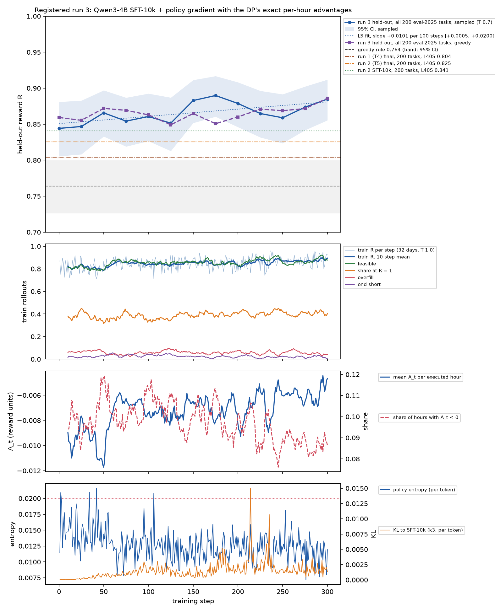

# Qwen3-4B, registered run 3: SFT-10k + policy gradient with the DP's exact per-hour advantages

**This is registered run 3.** The plan is [`docs/prereg/v1-train-4b-dpa.md`](../../../docs/prereg/v1-train-4b-dpa.md). It was committed to `main` (3181acc, with the core change in 6e1d938) before any training step. Its two amendments, the GPU split and the step count, were committed (e1f3a90) before the main run started. The run took place on 2026-10-26 UTC.

GRPO stalled on top of the SFT-10k warm start in run 2 (`../4b-v2/`). The policy is near-deterministic, so about half of the days gave 8 rollouts with the same reward and no gradient. Run 3 replaces GRPO's group-relative advantage with the foresight DP's exact one:
- **Per hour:** A_t = Q\*(t, s_t, d_t, a_t) − V\*(t, s_t, d_t), along each rollout's own SoC path, with `grade`'s rules (a rule-breaking hour truncates the day). It is in reward units, so the hours of a schedule sum to R − 1.
- **Where it goes:** onto the tokens of the 24 submitted integers. The rationale and all other tokens get R − 1.
- **Loss:** PPO-clipped, with a KL anchor to SFT-10k (β 0.04), and no group baseline.
- **Why it can work where GRPO stalled:** every suboptimal hour of even a single rollout has a non-zero signal, whether or not the other rollouts agree.

## Verdicts (all on the registered tasks and decoding)

| bar | result | verdict |
|---|---|---|
| **PRIMARY (a):** the final (step 300) beats step 0. 200 eval-2025 tasks, sampled, paired 95% CI wholly above 0 | **+0.041 [+0.011, +0.072]**; wins 20.5%, ties 64.5%, losses 15% | **MET** |
| **PRIMARY (b):** the least-squares slope of held-out R against step (13 points, steps 0–300) is above 0; task-bootstrap 95% CI wholly above 0 | **+0.0101 per 100 steps [+0.0005, +0.0200]**; 98.0% of resamples above 0 | **MET** |
| **PRIMARY** = (a) and (b), with ≥ 5 checkpoints after step 0 (there were 12) | | **MET** |
| **SECONDARY 1:** greedy decoding does not fall. Final − step 0, greedy, paired 95% CI lower bound ≥ −0.01 | **+0.027 [−0.001, +0.057]** | **MET** |
| **SECONDARY 2:** the final beats the greedy rule. Its 95% CI wholly above the rule's [0.726, 0.800], and ≥ 98% valid | **0.885 [0.855, 0.912]**, valid 99.5%; paired against the rule +0.121 [+0.077, +0.165] | **MET** |
| **SECONDARY 3:** on eval-iid (500), final − SFT-10k, sampled, paired 95% CI wholly above 0 | **+0.039 [+0.022, +0.057]**; 0.879 → **0.918** | **MET** |

**What the run says:**
- **This is the first registered run in which training on top of SFT-10k moved held-out reward up.**
  - Run 2's GRPO on the same warm start gave −0.015 on eval-2025 and +0.004 on eval-iid. Run 3 gives **+0.041** and **+0.039**.
  - Greedy decoding rose too (+0.027 on eval-2025, +0.020 [+0.004, +0.037] on eval-iid), where run 2's GRPO had cut it by 0.046.
- **The rise is a trend, but a weak and noisy one.**
  - The slope clears 0 by a small margin (lower bound +0.0005 per 100 steps).
  - The curve is not monotone. Sampled R peaks at 0.890 at step 175, dips to 0.859 at step 250, and ends at 0.885.
  - Greedy is flat at 0.85–0.87 until step 275 and ends at 0.886. Its own slope is +0.005 per 100 steps [−0.004, +0.014], so it is not shown.
- **The gain is fewer broken schedules, not more exact optima.**
  - Feasible schedules went from 83.0% to 89.5% (sampled), overfill from 10.5% to 6.0%, and end-short from 5.0% to 2.5%.
  - Days at R ≥ 0.99 went from 92 to 90.
  - 24 days went from an error to a clean schedule and 6 went the other way. 17 days rose by more than 0.3, and 5 fell by that much.
- **The policy stayed close to SFT-10k.** KL to it stayed below 0.003 per token, and entropy held at about 0.012 throughout (296 of 300 steps below 0.02, as it already was at step 0). The rollouts did not need spread: on average 10% of executed hours had A_t < 0 at every step, so every batch carried signal.

**Against the prior:** we put the primary at about 40% and expected a final of 0.86–0.89. The final scored 0.885. Secondary 1 (greedy not down) we called more likely than not, and it held.

## Results (200 eval-2025 tasks, foresight, oneshot prompt, path B; A10G)

| model | decoding | mean R | 95% CI | valid | feasible | overfill | sell before charge | end short | rate | cycle cap | truncated |
|---|---|---|---|---|---|---|---|---|---|---|---|
| step 0 = SFT-10k (this box) | sampled | 0.844 | [0.805, 0.881] | 99.5% | 83.0% | 10.5% | 3.0% | 5.0% | 1.5% | 1.5% | 0.5% |
| step 0 = SFT-10k (this box) | greedy | 0.859 | [0.824, 0.893] | 100% | 83.5% | 8.0% | 5.0% | 4.5% | 1.0% | 2.5% | 0% |
| **run 3 final (step 300)** | **sampled** | **0.885** | **[0.855, 0.912]** | 99.5% | 89.5% | 6.0% | 2.5% | 2.5% | 0.5% | 1.0% | 0.5% |
| run 3 final (step 300) | greedy | 0.886 | [0.856, 0.914] | 100% | 88.0% | 5.5% | 4.0% | 2.5% | 1.0% | 1.5% | 0% |
| greedy rule | – | 0.764 | [0.726, 0.800] | 100% | | | | | | | |
| threshold rule | – | 0.637 | | | | | | | | | |

**eval-iid** (500 unseen days of 2014–2024, the confirm lane's pack):

| model | sampled | greedy |
|---|---|---|
| step 0 | 0.879 [0.857, 0.899] | 0.897 [0.877, 0.916] |
| final | **0.918 [0.903, 0.932]** | 0.917 |
| paired gap | **+0.039 [+0.022, +0.057]** | +0.020 [+0.004, +0.037] |

**Reported gaps to the earlier runs.** These are paired on the same 200 tasks. Runs 1–2 were evaluated on an L40S, so the gaps are context, not bars.

| run 3 final minus | sampled | greedy |
|---|---|---|
| run 1 final (0.804) | +0.081 [+0.048, +0.113] | +0.078 [+0.047, +0.110] |
| run 2 final (0.825) | +0.059 [+0.021, +0.098] | +0.062 [+0.023, +0.102] |
| run 2 SFT-10k on the L40S (0.841) | +0.044 [+0.014, +0.076] | +0.016 [−0.010, +0.043] |

The same model on the two boxes, step 0 here minus run 2's SFT-10k: +0.004 [−0.003, +0.013] sampled.

## Held-out curve (all 200 tasks at every checkpoint)

| step | 0 | 25 | 50 | 75 | 100 | 125 | 150 | 175 | 200 | 225 | 250 | 275 | 300 |
|---|---|---|---|---|---|---|---|---|---|---|---|---|---|
| sampled | 0.844 | 0.847 | 0.866 | 0.854 | 0.861 | 0.851 | 0.883 | **0.890** | 0.879 | 0.865 | 0.859 | 0.874 | **0.885** |
| greedy | 0.859 | 0.855 | 0.872 | 0.869 | 0.863 | 0.849 | 0.865 | 0.851 | 0.860 | 0.871 | 0.869 | 0.872 | **0.886** |
| feasible (sampled) | 83.0% | 84.5% | 89.5% | 85.5% | 87.0% | 85.0% | 89.0% | 89.0% | 88.0% | 86.0% | 87.5% | 88.0% | 89.5% |

## Train diagnostics (`train_log.jsonl`; 32 fresh train days per step at T 1.0)

| steps | 1–50 | 51–100 | 101–150 | 151–200 | 201–250 | 251–300 |
|---|---|---|---|---|---|---|
| train R | 0.811 | 0.850 | 0.844 | 0.848 | 0.863 | 0.874 |
| feasible | 0.804 | 0.866 | 0.855 | 0.849 | 0.880 | 0.869 |
| share at R = 1 | 0.374 | 0.376 | 0.374 | 0.401 | 0.412 | 0.403 |
| mean A_t per executed hour | −0.0096 | −0.0068 | −0.0073 | −0.0072 | −0.0065 | −0.0058 |
| share of hours with A_t < 0 | 10.1% | 10.2% | 10.2% | 9.9% | 9.2% | 8.7% |
| overfill | 6.8% | 4.5% | 6.8% | 5.8% | 5.3% | 5.4% |
| entropy (per token) | 0.0148 | 0.0127 | 0.0121 | 0.0122 | 0.0120 | 0.0119 |
| KL to SFT-10k (k3, per token) | 0.0003 | 0.0011 | 0.0013 | 0.0018 | 0.0027 | 0.0016 |

- **Train R rose from 0.811 to 0.874.** The 9,600 draws covered 7,591 distinct days of the 10,000 train days outside SFT-10k's set.
  - Small (curriculum × start) cells were spent and reshuffled, as registered, so 1,378 days were drawn 2–5 times.
  - 18 of the 9,600 rollouts hit the 512-token limit.
- **Per-hour signal:** 218,802 executed hours were scored. The mean A_t moved from −0.0096 to −0.0058, toward 0.
- **Token mapping:** the 24 integers were found in the call on 99.8% of rollouts (`mapped_rate`). The rest fell back to R − 1 on every token, as registered.
- **The update stayed on-policy:**
  - the PPO clip fraction was about 0.02% of tokens;
  - the mean ratio was 1.00;
  - gradient norms were 0.003–0.09 (5th–95th percentile 0.007–0.033), far under the clip of 1.0.
- **No stop rule fired.** The collapse guard never came close (the lowest 10-step means were about R 0.79 and valid 0.99), and the run finished all 300 steps before the 21:00 stop.
- **LEVEL UP** (`levelup/`, the same 12 days as runs 1–2):
  - 10 of 12 days are already at R ≥ 0.93 at step 0 and stay there.
  - `dam-v1-2025-06-08-LZ_SOUTH-2h-g` falls from 1.00 to 0.35 at step 225 and stays there.
  - `dam-v1-2025-10-26-LZ_LCRA-1h-q` goes from 1.00 to 0.86 at step 50; run 2's GRPO lost it too.
  - `dam-v1-2025-01-14-LZ_HOUSTON-4h-x` touches 0.97 at steps 125–150 and ends at 0.80.

## Setup (as registered)

- **Start:** `Qwen/Qwen3-4B` @ `1cfa9a7208912126459214e8b04321603b3df60c`, bf16, thinking off, with run 2's SFT-10k LoRA merged in (`scripts/merge.py`: bf16 on the GPU, `merge_and_unload`). A fresh LoRA r=32 / α=64 sits on top, on all attention and MLP projections. Its B = 0 start makes step 0 identical to SFT-10k.
- **Advantage:** `gridsim_core.advantage`, property-tested in `tests/core/test_advantage.py`:
  - zero on the DP optimum;
  - the hours sum to P − P_opt on any plan;
  - non-positive everywhere.
- **Token credit (`scripts/credit.py`):**
  - **The sign token** (`' '`, `' -'`, `' ['` or `' [-'`, the token right before an integer's first digit) gets Q\*(best action of that sign class) − V\*.
  - **The digit token** gets Q\*(a) − Q\*(sign class).
  - **Every other token** gets R − 1, and **an unparseable completion** gets −1 on every token.
  - Every value is clipped to [−1, 0].
- **Rollouts (`scripts/rollout.py`):** vLLM 0.29 on GPU 0 with the current LoRA loaded from disk.
  - T 1.0, top_p 1, no top_k, one rollout per day, 32 days per step.
  - Each draw takes a uniform (curriculum × start) cell, then an unused day of it.
  - Batch k is sampled with the adapter after k − 1 updates.
- **Loss (`scripts/dpa_train.py`):** per token, −min(ρA, clip(ρ, 0.8, 1.2)A) + 0.04 · KL_k3(π ‖ SFT-10k).
  - ρ is taken against the engine's sampled-token logprobs.
  - The loss is summed and divided by 32 × 512.
  - One AdamW step per batch: lr 1e-5, constant after 5 warmup steps, gradient clip 1.0.
  - Micro-batch 1 with gradient checkpointing on GPU 1: 54.3 s per step, with the 16–18 s of generation hidden behind training.
- **Eval:** runs 1–2's `scripts/evaluate.py` and `pathb.py`, unchanged, on GPU 2 as each checkpoint landed. The CIs use 10,000 resamples.
  - **The slope's CI** draws 200 tasks with replacement, applies the same draw to every checkpoint, and refits (`scripts/report_dpa.py`).
- **Packages:** `pip_freeze.txt`, identical to `results/train/pip_freeze.txt` apart from the plugin itself: torch 2.13.0, vllm 0.29.0, transformers 5.17.0, peft 0.21.2.
- **Box:** g5.12xlarge (4× A10G 24 GB) in us-east-1. GPU 0 rollouts, GPU 1 training, GPU 2 evaluation. GPU 3 went to another lane (amendment 1).

## Deviations from the pre-registration

None in the recipe, the eval or the bars. Four small ones in setup and labels:
1. **Amendment 1, committed before the main run.** GPU 3 was handed to another lane at 15:42, so training ran on one GPU (world size 1) instead of two. The per-batch gradient is the same: the sum over the same 32 rollouts divided by 32 × 512.
   - The 2-GPU smoke ran at 27.7 s per step and the 1-GPU smoke at 54.5 s per step.
   - The step count (300) was computed from the 1-GPU smoke, as the rule says.
2. **A step-0 eval on GPU 3 was stopped** at 15:42, before it wrote any output. Step 0 was then evaluated once, on GPU 2. No eval was run twice.
3. **The main run started at 15:53**, not "about 15:56" as the amendment estimated. 300 steps were kept, and training ended at 20:26, well before the 21:00 stop.
4. **Episode labels:** the unchanged `evaluate.py` labels adapter episodes `trained: "grpo"`. Those episodes are this run's DP-advantage adapters.

## Time and cost

| step | UTC (2026-10-26) | duration |
|---|---|---|
| box up, setup (venv, Qwen3-4B, SFT-10k merge) | 15:18–15:24 | 6 min |
| advantage code + tests, trainer, CPU dry run (local) | 15:24–15:36 | |
| pre-registration pushed | 15:37 | |
| smoke 1 (2 GPUs), then smoke 2 (1 GPU), both discarded | 15:38–15:52 | 14 min |
| step-0 evals (eval-2025 200 × 2, eval-iid 500 × 2) | 15:45–15:55 | 10 min |
| amendments pushed | 15:52 | |
| training, 300 steps | 15:53–20:26 | 4 h 33 min, 54.3 s/step |
| checkpoint evals (in parallel on GPU 2), final eval-iid | to 20:38 | |
| pack, adapter upload, report | 20:33–20:50 | |

- **Box:** g5.12xlarge at about $5.7/h, from 15:18 to about 20:50. That is about 5.5 h, or **about $32**, and from 15:42 GPU 3 was used by another lane. The box is left idle for the main session to terminate.
- **API spend:** none.

## Files

- `summary.json`:
  - `primary` and `secondary`, with the verdicts;
  - `reported`: the gaps to runs 1–2 and the greedy slope;
  - `curve`: every checkpoint, sampled and greedy, with the error mix;
  - `eval_iid`;
  - `diagnostics`: 50-step windows of the train log.
- **Eval files:**
  - `eval_step0.json`, `eval_checkpoints.json` (steps 25–300) and `eval_trained.json` (step 300) on eval-2025;
  - `eval_iid_step0.json` and `eval_iid_final.json`.
- **Train logs:**
  - `train_log.jsonl`: one row per step, with every registered diagnostic;
  - `samples.jsonl`: the best and worst rollout of each step, the worst with its hour advantages;
  - `smoke_2gpu_train_log.jsonl` and `smoke_1gpu_train_log.jsonl`.
- **Episodes:** `episodes/*.jsonl.gz`, gzipped path-B `gridsim.episode/v1`.
  - `step-0000-*` and `ckpt-XXXX-*` (sampled and greedy, 200 tasks each);
  - `iid-sft-*` and `iid-final-*` (500 tasks each).
- **LEVEL UP:** `levelup/<task_id>/<frame>.json` and `levelup/index.json`. The frames are `base` (run 1's base episodes), `0000` (SFT-10k) and every checkpoint.
- `curves.png`, `gpu.csv`, `gpu_main.csv` and `pip_freeze.txt`.
- **`scripts/`:**
  - the code that ran: `dpa_train.py`, `rollout.py`, `credit.py`, `train_unit.sh`, `eval_unit.sh`, `merge.py`, and the unchanged `evaluate.py` and `pathb.py`;
  - `report_dpa.py`, which builds this folder.
- **Core:** `src/gridsim_core/advantage.py` and `tests/core/test_advantage.py`.

## Adapter

Both are in Scale-internal object storage:
- **`gridsim/adapters/qwen3-4b-gridsim-v1-reg3-dpa-seed0.tgz` (245 MB):** `adapter/dpa-lora/` is the step-300 LoRA, which is the claim. Apply it on top of SFT-10k, which is run 2's `adapter/sft-lora` from `qwen3-4b-gridsim-v1-reg2-seed0.tgz` merged into the base.
- **`gridsim/adapters/qwen3-4b-gridsim-v1-reg3-dpa-seed0-checkpoints.tgz` (2.9 GB):** `adapter/checkpoints/ckpt-{0025,…,0300}/`.

## What this leaves open

These are not run and not registered:
- **One seed.** Seed variance is unmeasured, and the slope's lower bound is only just above 0.
- **More steps.** The curve's last two points rise, but it also dipped after step 175. Whether R keeps rising past 300 steps is untested.
- **The design choices are not isolated:**
  - R − 1 on the rationale versus 0;
  - β 0.04;
  - the sign/digit split;
  - T 1.0;
  - a DAgger term toward a\*_t, which is logged but was not trained on.
- **Exact optima did not grow** (92 → 90 days). The method removed broken schedules, but did not sharpen near-optimal ones.
- **rtcb** (the post-RTC+B pack) was not part of this registration.
