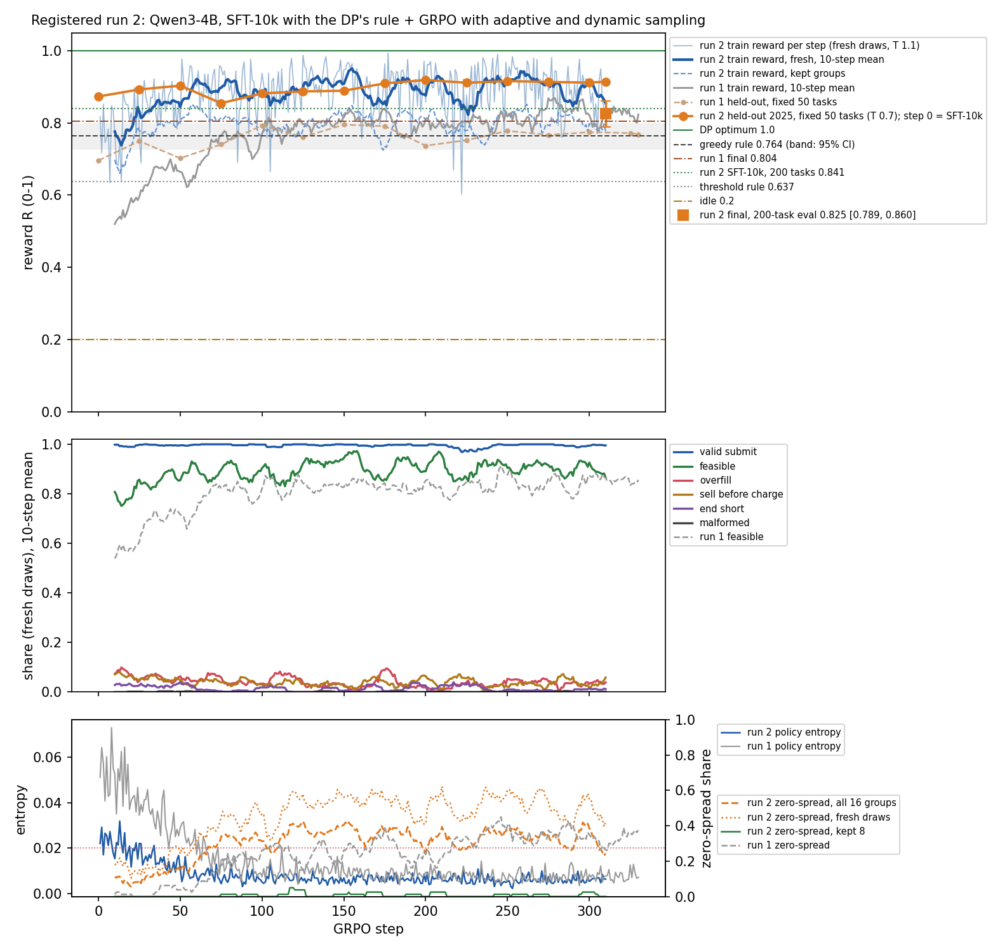

# Qwen3-4B, registered run 2: SFT-10k with the DP's rule + GRPO with adaptive and dynamic sampling

**This is registered run 2.** The plan is [`docs/prereg/v1-train-4b-v2.md`](../../../docs/prereg/v1-train-4b-v2.md). It was committed to `main` (39fb80f) before any training step of this run. The smoke result and the step-count amendment (f4da520) were committed before the main GRPO run started.

Registered run 1 (`../4b/`) scored 0.804 [0.773, 0.834] and missed its primary bar by 0.027. Run 2 tested two changes together:
1. **A bigger warm start that states the DP's rule:** 10,000 DP-optimal schedules (run 1 used 1,500). The rationale adds the buy/sell pairing, the check "(sell − c_deg) × η > buy" and an end-of-day check.
2. **No wasted GRPO groups:**
   - adaptive day sampling: replay seen days weighted by their last group's reward std;
   - DAPO-style dynamic sampling: 16 candidate prompts per step, training on the first 8 whose 8 rollouts do not all score the same.

Everything else is held at run 1's values: the prompt and tools, the reward, LoRA r=32/α=64, 8 × 8 rollouts at T 1.1, `dr_grpo`, β 0, ε 0.2/0.28, lr 1e-5 cosine, and the same 200 eval-2025 tasks and decoding. GRPO ran 310 steps rather than 330 under the registered smoke rule. It ran on 2026-10-25/26 UTC.

## Verdicts

| bar (the same as run 1's) | result | verdict |
|---|---|---|
| **PRIMARY:** the run-2 final adapter (sampled) beats the greedy rule with non-overlapping 95% CIs, and is ≥ 98% valid | run 2 **0.825 [0.789, 0.860]**; greedy rule 0.764 [0.726, 0.800]; valid 99.5% | **NOT MET.** The CIs overlap: 0.789 < 0.800, short by 0.011. The valid condition is met. |
| **SECONDARY:** the paired difference (run 2 sampled minus greedy rule) has its 95% CI above 0 | **+0.061 [+0.013, +0.110]**; wins 52%, ties 17% | **MET** |

**Registered comparisons** (paired on the 200 tasks, 10,000 resamples; "shown" means the 95% CI lies wholly above 0):

| comparison | sampled (registered) | greedy decoding | shown? |
|---|---|---|---|
| 1. run 2 final minus run 1 final (0.804) | **+0.021 [−0.015, +0.057]**; wins 56%, ties 22% | +0.016 [−0.021, +0.052] | no |
| 2. **change 1:** run-2 SFT-10k minus run-1 SFT-1500 (0.666) | **+0.174 [+0.121, +0.228]**; wins 67% | +0.222 [+0.172, +0.274] | **yes** |
| 3. **GRPO in run 2:** final minus SFT-10k | **−0.015 [−0.061, +0.030]**; wins 25%, ties 43% | **−0.046 [−0.090, −0.003]** | no |
| for reference: GRPO in run 1, final minus SFT-1500 | +0.138 [+0.092, +0.185] | +0.161 [+0.115, +0.207] | |

**What the run says:**
- **The new warm start did almost all the work.** SFT-10k alone scores **0.841 [0.802, 0.877]** sampled and 0.870 [0.835, 0.902] greedy. That is +0.174 over run 1's SFT and above run 1's final adapter.
- **GRPO with change 2 did not add to it:**
  - −0.015 sampled (CI includes 0);
  - −0.046 greedy (CI below 0);
  - fewer exact optima (89 → 73 days at R ≥ 0.99), but fewer infeasible schedules (feasible 82.5% → 86%).
- **The two changes together beat run 1 by +0.021**, a CI that includes 0, so the improvement over run 1 is not shown.
- **The design cannot isolate change 2.** There is no arm with run 1's SFT and change 2, or with SFT-10k and run 1's GRPO.

**Post-hoc, not a claim:** the SFT-10k checkpoint's own CI (lower bound 0.802) lies above the greedy rule's (0.800), with a paired gap of +0.076 [+0.024, +0.131] against greedy. The registration names the final adapter as the claim, so this is reported, not claimed. Claiming it would need a new registration.

**Against the prior:** we expected 0.68–0.76 for SFT-10k and got 0.841. We expected 0.80–0.86 for the final and got 0.825. The primary bar was put at about even odds and was missed; the secondary was put at more likely than not, and was met.

## Results (200 eval-2025 tasks, foresight, oneshot prompt, path B)

| model | decoding | mean R | 95% CI | valid | feasible | overfill | sell before charge | rate | cycle cap | end short | truncated | R empty / half / full start | R C0 / C1 / C2 |
|---|---|---|---|---|---|---|---|---|---|---|---|---|---|
| Qwen3-4B base (zero-shot; run 1's eval) | sampled | 0.060 | [0.048, 0.073] | 35.5% | 26.5% | 0% | 9.0% | 0% | 0% | 0% | 48% | 0.068 / 0.055 / 0.061 | 0.057 / 0.057 / 0.066 |
| run 1: SFT-1500 (step 0) | sampled | 0.666 | [0.620, 0.712] | 99.0% | 70.0% | 14.0% | 5.5% | 3.0% | 6.5% | 5.5% | 0.5% | 0.688 / 0.626 / 0.689 | 0.641 / 0.567 / 0.746 |
| run 1: SFT-1500 + GRPO 330 | sampled | 0.804 | [0.773, 0.834] | 100% | 90.5% | 2.5% | 4.0% | 1.5% | 1.5% | 4.5% | 0% | 0.826 / 0.803 / 0.788 | 0.875 / 0.685 / 0.789 |
| **run 2: SFT-10k (step 0)** | sampled | **0.841** | [0.802, 0.877] | 99.5% | 82.5% | 11.0% | 2.5% | 1.5% | 2.0% | 4.5% | 0.5% | 0.841 / 0.804 / 0.876 | 0.842 / 0.805 / 0.858 |
| run 2: SFT-10k (step 0) | greedy | 0.870 | [0.835, 0.902] | 100% | 84.5% | 8.0% | 4.0% | 1.0% | 2.5% | 3.0% | 0% | 0.886 / 0.863 / 0.864 | 0.880 / 0.822 / 0.884 |
| **run 2: SFT-10k + GRPO 310 (final)** | **sampled** | **0.825** | **[0.789, 0.860]** | 99.5% | 86.0% | 7.5% | 4.5% | 0% | 1.5% | 3.0% | 0.5% | 0.841 / 0.800 / 0.839 | 0.860 / 0.761 / 0.821 |
| run 2: SFT-10k + GRPO 310 (final) | greedy | 0.824 | [0.787, 0.858] | 99.0% | 85.5% | 6.5% | 4.5% | 0% | 2.5% | 3.5% | 1.0% | 0.854 / 0.745 / 0.878 | 0.868 / 0.753 / 0.813 |
| 1.7B arm 2c (step 330) | sampled | 0.720 | [0.681, 0.756] | 100% | 92.5% | 3.0% | 2.5% | 2.0% | 0% | 9.0% | 0% | 0.734 / 0.753 / 0.675 | 0.764 / 0.625 / 0.720 |
| greedy rule | – | 0.764 | [0.726, 0.800] | 100% | | | | | | | | 0.781 / 0.796 / 0.720 | |
| threshold rule | – | 0.637 | [0.601, 0.673] | 100% | | | | | | | | 0.590 / 0.696 / 0.616 | |

- **Start states:** 56 empty, 71 half and 73 full. Error rates are each completion's first failure, as a share of all 200 tasks.
- **Other paired gaps for the run-2 final** (sampled / greedy):
  - threshold rule +0.188 [0.135, 0.240] / +0.187;
  - 1.7B arm 2c +0.106 [0.064, 0.148] / +0.104;
  - base 4B +0.765 / +0.795.
- **Exact optima** (R ≥ 0.99, sampled) by model:

  | model | days at R ≥ 0.99 | days at R ≥ 0.95 |
  |---|---|---|
  | greedy rule | 25 | |
  | run 1 SFT | 44 | 59 |
  | run 1 final | 36 | 58 |
  | run 2 SFT-10k | **89** | 114 |
  | run 2 final | 73 | 98 |

- **Against the greedy rule** (sampled): the run-2 final wins 104 days, ties 34 and loses 62. Run 1's final won 60, tied 52 and lost 88.
- **Change 1 helped most where run 1 was weakest:** C1 days (0.567 → 0.805 at SFT) and full-start days (0.689 → 0.876).
- **What GRPO did in run 2** (final against SFT-10k, sampled):
  - It moved 50 days up and 64 down, and left 86 the same. 22 days rose by more than 0.3 and 24 fell by more than 0.3.
  - It fixed 18 overfills and 6 end-shorts, but broke 11 correct days into overfill and 6 into sell-before-charge.
  - Half-start days fell under greedy decoding (0.863 → 0.745).
  - Sampled and greedy decoding give the same schedule on 168 of 200 tasks, up from 114 for SFT-10k. The policy became near-deterministic.

## Training curve



**Held-out checkpoints** (the fixed 50-task subset, sampled; diagnostics only, not the claim):

| step | 0 (SFT-10k) | 25 | 50 | 75 | 100 | 125 | 150 | 175 | 200 | 225 | 250 | 275 | 300 | 310 (final) |
|---|---|---|---|---|---|---|---|---|---|---|---|---|---|---|
| R | 0.873 | 0.893 | 0.903 | 0.855 | 0.882 | 0.887 | 0.889 | 0.910 | 0.919 | 0.911 | 0.916 | 0.914 | 0.912 | 0.914 |

- **The 50-task subset misled in this run.**
  - On the first 50 tasks GRPO rose from 0.873 to 0.914.
  - On the other 150 it fell from 0.830 to 0.796, so the 200-task result is below SFT.
  - Run 1's subset tracked its 200-task result.
- **Train reward** (fresh draws, 64 rollouts per step on average at T 1.1, 10-step mean):
  - It rose from 0.78 to about 0.90 by step 60, then stayed between 0.84 and 0.94.
  - Run 1 went from 0.52 to 0.80 by step ~120.
  - The kept groups average about 0.80: they are the days that still have spread.
- **Cliff guard:** it armed at step 10, when both 10-step means first reached 0.45 / 0.60 on fresh draws, and never fired. The lowest 10-step means after step 20 were R 0.784 and feasibility 0.781.
- **Rollouts:** 80 of 20,064 fresh-draw rollouts hit the 512-token limit. Completion length held at about 370 tokens (run 1: about 250).

## Registered diagnostics: zero-spread share and entropy

Window means of the per-step values (`summary.json` → `diagnostics`):

| steps | 1–50 | 51–100 | 101–150 | 151–200 | 201–250 | 251–300 | 301–310 / 301–330 |
|---|---|---|---|---|---|---|---|
| run 1 zero-spread (all groups, all trained) | 2.5% | 17.5% | 24.5% | 26.3% | 32.5% | 34.5% | 32.5% |
| run 2 zero-spread, fresh draws (run 1's population) | 17.9% | 41.0% | 52.0% | 51.2% | 53.6% | 50.8% | 42.5% |
| run 2 zero-spread, all 16 candidates | 11.4% | 29.4% | 36.5% | 33.6% | 34.0% | 33.8% | 24.4% |
| **run 2 zero-spread, the 8 trained groups** | **0%** | **0.5%** | **1.3%** | **1.0%** | **0.8%** | **1.0%** | **0%** |
| run 1 entropy | 0.041 | 0.016 | 0.010 | 0.008 | 0.008 | 0.008 | 0.008 |
| run 2 entropy | 0.018 | 0.008 | 0.006 | 0.006 | 0.006 | 0.006 | 0.006 |

- **Dynamic sampling did its job.**
  - The trained groups had zero spread 0.7% of the time: 18 top-up groups on 14 of 310 steps.
  - Run 1 trained on zero-spread groups 23.8% of the time, and 31.3% after step 150.
- **The policy itself saturated faster than run 1's.**
  - Fresh draws had zero spread about half the time from step 100, against run 1's 25–35%, because SFT-10k already solves more days deterministically.
  - Entropy started at 0.022 (run 1: 0.051) and was below 0.02 from step 3 (run 1: step 43). It stayed there on 293 of 310 steps (run 1: 268 of 330) and ended at 0.006 (run 1: 0.007).
- **Adaptive sampling:**
  - Replays were 49% of candidates, and 2,508 distinct train days were seen.
  - Replayed groups had zero spread 3–19% of the time, against 18–54% for fresh draws. The std-weighted replay found days that still had signal.

## Setup (as registered)

- **Model:** `Qwen/Qwen3-4B` @ `1cfa9a7208912126459214e8b04321603b3df60c`, bf16, thinking off.
- **SFT-10k:** `scripts/sft.py`, with `RATIONALE=rule STRATIFY=start N_SFT=10000 EPOCHS=1 MAX_TOKENS=448 SEED=0`.
  - **Data:** 10,000 DP-optimal schedules from `ercot-dam-v1-train` (2014–2024), 1,111–1,112 per (C0–C2 × start) cell. The pack shares no task id or date with eval, eval-iid, rtcb or showcase.
  - **Completion tokens:** p50 365, p99 446, max 448 (`sft_meta.json`). 1,155 completions dropped the cheapest/dearest lists to fit the 448 cap, and 788 cycle-heavy days were left out of the SFT pool.
  - **Training:** LoRA r=32 / α=64 on all attention and MLP projections; lr 1e-4, cosine with 10% warmup; batch 8 (4 × 2); 1 epoch = 1,250 steps. It took 2 h 02 min at 5.8 s per step, and the loss went from 1.38 to about 0.01. The adapter is merged into the base.
  - **Example completion** (abridged):

    ```
    Starts full (8/8), so the first trade must be a sell. Must end at >= 0/8; cycle cap 12 units sold. Cheapest hours: HE16 $31, HE15 $33, HE17 $35. Dearest: HE08 $113, HE07 $91, HE09 $89.
    Rule: a buy at b and a sell at s pay if s x 0.85 > b. Pairs: buy HE15-HE16 -> sell HE18-HE19 x4: $47 x 0.85 = $40 > $31; sell HE06-HE09 x8 from stock above the end level.
    Plan: sell HE06-HE09 (8 units, $81-$113) -> 0/8; buy HE15-HE16 (4 units, $31-$33) -> 4/8; sell HE18-HE19 (4 units, $45-$48) -> 0/8.
    End check: ends at 0/8 vs >= 0/8 required, ok; sold 12 of 12 cap.
    <tool_call> ... </tool_call>
    ```

- **GRPO:** `scripts/train.py` with `CURRICULUM=adaptive CANDIDATES=16 REPLAY_P=0.5 VISIT_CAP=4`. This is TRL 1.15 `GRPOTrainer` with colocated vLLM 0.29 and a fresh LoRA r=32 / α=64 on the merged SFT model.
  - **Dynamic sampling:** a subclass overrides `_generate_and_score_completions`. It draws 16 candidates, scores 128 rollouts through the parent, then slices every per-rollout tensor to the first 8 groups with spread.
  - **Settings:** 8 kept prompts × 8 generations at T 1.1; `dr_grpo`, β 0, ε 0.2 / 0.28, `scale_rewards="group"`, `max_completion_length` 512.
  - **Schedule:** 310 steps (the smoke amendment), lr 1e-5, cosine with 5 warmup, seed 0, checkpoints every 25 and the final.
  - **Engineering:** per-device 4 × accumulation 16, vLLM `gpu_memory_utilization` 0.4, peak GPU memory 38.4 of 46 GB. GRPO took 7 h 52 min at 91.4 s per step: 128 rollouts generated and 64 trained per step, against run 1's 60 s.
- **Eval:** `scripts/evaluate.py` (vLLM, max_tokens 512).
  - Sampled: T 0.7, top_p 0.8, top_k 20, seed 0. Greedy: T 0.
  - Statistics: 10,000-resample bootstrap and paired-bootstrap CIs (`scripts/report4b2.py`).
  - Run 1's and arm 2c's paired numbers use their committed per-task rewards. The base row is run 1's eval, reused as registered.
- **Packages:** run 1's environment: torch 2.13.0, trl 1.15.0, vllm 0.29.0, transformers 5.17.0, peft 0.21.2 (`pip_freeze.txt`).

## Deviations from the pre-registration

None in the recipe, eval or bars. Four small ones in timing and outputs:
1. **The main run started slightly early.** The amendment computed 310 steps from a main-run start "at about 01:35". The run was launched at 01:31, when 315 steps would just have fit, with about 2 minutes to spare. 310 was kept as committed. GRPO ended at 09:23, 37 minutes before the 10:00 stop.
2. **SFT-10k took 2.0 h,** not the 1.7 h estimated. Nothing else changed.
3. **The checkpoints are under a second key** (`…-checkpoints.tgz`), to keep each upload under the 5 GB single-PUT limit, as in run 1.
4. **TRL also saved `checkpoint-310`.** It is identical to the final adapter and is not evaluated separately.

## Time and cost

| step | UTC (2026-10-25/26) | duration |
|---|---|---|
| setup (venv, model download) | 22:56–22:57 | 1 min |
| pre-registration pushed | 23:08 | |
| code check (2 steps, base model, discarded) | 23:09–23:14 | 5 min |
| SFT-10k | 23:14–01:16 | 2 h 02 min |
| SFT-10k eval (200 × 2) | 01:16–01:20 | 4 min |
| smoke (5 steps) | 01:20–01:29 | 9 min |
| amendment pushed | 01:30 | |
| GRPO 310 steps | 01:30:49–09:23 | 7 h 52 min, 91.4 s/step |
| checkpoint + final evals | 09:23–09:27 | 4 min |
| pack + upload | 09:27–09:32 | 5 min |

- **Box:** g6e.8xlarge (1× L40S 48 GB) in us-east-1 at about $4.5/h. It booted at 22:52, and the work took about 10.7 h, or about **$48**. The box then sits idle until it is terminated.
- **API spend:** none.

## Files

- `summary.json`:
  - `bars.sampled` is the registered bar; `bars.greedy` is reported;
  - `comparisons` holds the three registered comparisons with a `shown` flag, per decoding;
  - `contributions` holds the SFT-only and GRPO contributions of both runs;
  - `diagnostics` holds the zero-spread and entropy windows for both runs, top-ups, the replay share and the guard;
  - also every row with CIs, and all paired gaps.
- `eval_sft.json`, `eval_trained.json` and `eval_checkpoints.json`. The base eval is run 1's (`../4b/eval_base.json`).
- `train_log.jsonl`: one row per GRPO step.
  - R, valid, feasible and the error taxonomy on the fresh draws (the guard's population);
  - `reward_mean_kept` / `_replay` / `_all`;
  - `frac_zero_spread_groups` (all 16 candidates), `_fresh`, `_replay` and `_kept`, with `groups_*`;
  - `seen_days`, `replayable_days`, TRL's metrics (entropy, clip ratios, importance-sampling ratios), `guard_armed` and notes.
- `smoke_train_log.jsonl`, plus `gpu_sft.csv`, `gpu_main.csv` and `gpu.csv`.
- `curves.png`: run 1's train reward, held-out subset, feasibility, entropy and zero-spread are drawn as grey or tan reference lines.
- `episodes/*.jsonl`: path-B `gridsim.episode/v1`. `sft-*` and `trained-*` cover 200 tasks; `ckpt-0025 … ckpt-0300-sampled` cover the 50-task subset.
- **LEVEL UP:** `levelup/<task_id>/<frame>.json` covers the same 12 days as the earlier arms, with frames `base` (run 1's base episodes), `0000` (SFT-10k), `0025` … `0300` and `0310` (final). `levelup/index.json` lists each day's per-frame reward.
  - `dam-v1-2025-01-14-LZ_HOUSTON-4h-x` (half start) goes 0.80 at SFT → 0.58 at step 200 → 0.95 at the final.
  - `dam-v1-2025-01-14-HB_HOUSTON-2h-q`, which run 1 needed GRPO to solve (0.32 → 0.98), is already 1.00 at SFT-10k.
  - `dam-v1-2025-10-26-LZ_LCRA-1h-q` loses ground under GRPO in both runs: here 1.00 → 0.57.
- `sft_task_ids.json`, `sft_meta.json` and `pip_freeze.txt`.
- `scripts/`:
  - the code that ran: `pathb.py`, `sft.py` (`RATIONALE=rule`), `train.py` (`CURRICULUM=adaptive`), `evaluate.py` and `report4b2.py`;
  - the unit scripts: `setup_unit.sh`, `codecheck_unit.sh`, `phaseA_unit.sh` (SFT-10k and its eval), `smoke_unit.sh` and `main_unit.sh` (GRPO, evals, packing).

## Adapter

Both tarballs are in Scale-internal object storage:

- **`gridsim/adapters/qwen3-4b-gridsim-v1-reg2-seed0.tgz` (491 MB):**
  - `adapter/sft-lora/`: apply it to `Qwen/Qwen3-4B` and merge it to get SFT-10k;
  - `adapter/grpo-lora/`: the final step-310 adapter on top, which is the claim.
- **`gridsim/adapters/qwen3-4b-gridsim-v1-reg2-seed0-checkpoints.tgz` (3.2 GB):** `adapter/checkpoints/checkpoint-{25,…,300,310}/`.

## What this leaves open

These are not run and not registered:
- **One seed:** seed variance is unmeasured.
- **Change 2 on its own:** neither run 1's SFT with change 2 nor SFT-10k with run 1's GRPO was run.
- **GRPO on a strong warm start:**
  - From SFT-10k, GRPO traded exact optima for feasibility and ended level with SFT on sampled decoding and below it on greedy.
  - The registrable next steps are SFT-10k itself as the claim, or GRPO that keeps close to it: a KL anchor (β > 0), a lower lr or fewer steps, or a higher rollout temperature.
- **A checkpoint subset that tracks the 200 tasks:** the fixed 50-task subset favoured GRPO here, and the full set did not.
