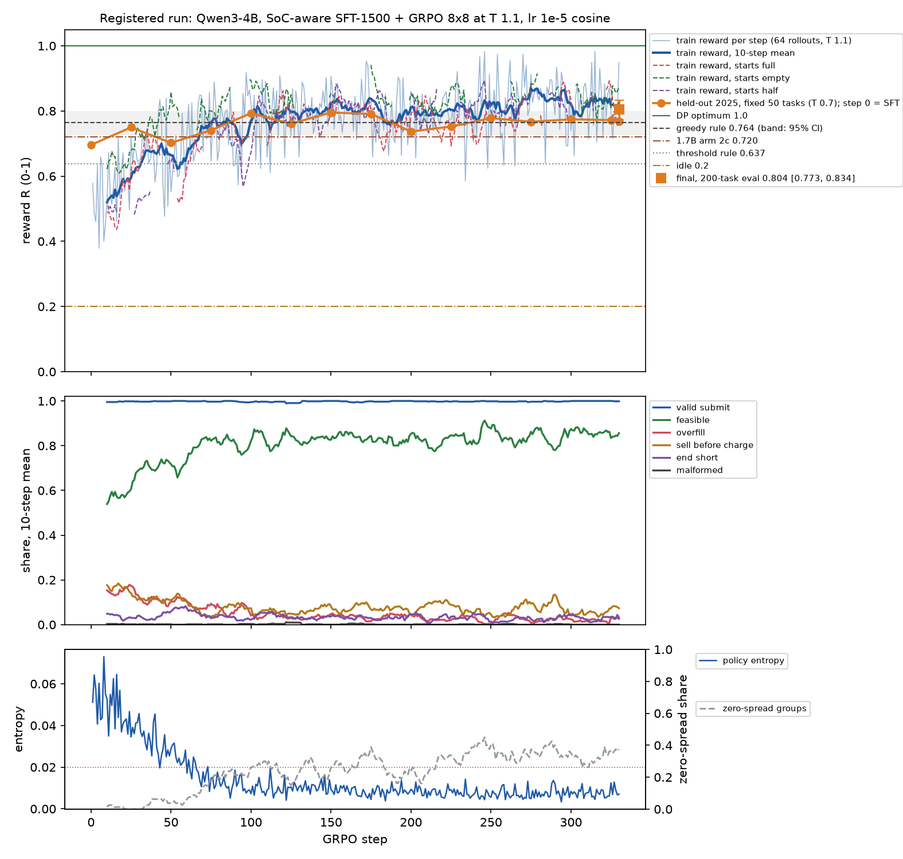

# Qwen3-4B, registered run: SoC-aware SFT-1500 + GRPO 330, on one L40S

**This is a registered run.** The plan is [`docs/prereg/v1-train-4b.md`](../../../docs/prereg/v1-train-4b.md). It was committed to `main` (e372a1c) before any 4B training step or 4B eval, and the smoke result (14cbe3f) was committed before the main run started.

It is the first pre-registered training claim on GridSimEnv. The 1.7B arms (`../README.md`, `../arm2/`, `../arm2b/`, `../arm2c/`) were exploratory; this run takes their recipe as one fixed schedule.

It ran on 2026-10-25 UTC. Everything else is as for the 1.7B arms: the prompt and tools (path A equals path B), the reward (`gridsim_core.trl.reward_fn`), and the same 200 eval-2025 tasks and decoding.

## Verdicts

| bar (from the pre-registration) | result | verdict |
|---|---|---|
| **PRIMARY:** the trained 4B (sampled) beats the greedy rule with non-overlapping 95% CIs, and is ≥ 98% valid | 4B **0.804 [0.773, 0.834]**; greedy rule 0.764 [0.726, 0.800]; valid 100% | **NOT MET.** The CIs overlap, since 0.773 < 0.800. The valid condition is met. |
| **SECONDARY:** the paired difference (4B sampled minus greedy rule) has its 95% CI above 0 | **+0.040 [−0.002, +0.082]** | **NOT MET**, by 0.002 at the lower bound. |

**Reported, no bar** (paired, 10,000 resamples):

| trained 4B minus | sampled | greedy decoding | 4B wins on (sampled) |
|---|---|---|---|
| greedy rule | +0.040 [−0.002, +0.082] | +0.044 [+0.003, +0.085] | 30% of tasks (ties 26%, losses 44%) |
| threshold rule | +0.167 [0.119, 0.215] | +0.171 [0.123, 0.218] | 69% |
| 1.7B arm 2c (step 330) | **+0.084 [0.052, 0.118]** | +0.088 [0.055, 0.122] | 65% |
| 4B SFT only (step 0) | **+0.138 [0.092, 0.185]** | +0.161 [0.115, 0.207] | 53% |
| 4B base (zero-shot) | +0.744 [0.710, 0.776] | +0.779 [0.746, 0.811] | 98% |

- **Greedy decoding:** the same adapter's paired gap against greedy clears 0, at +0.044 [+0.003, +0.085]. The registered bar is on sampled decoding, so this is reported, not claimed.
- **Against the prior:** we predicted 0.72–0.84 and noted that the primary bar needed a mean near 0.84. The result is 0.804.

## Results (200 eval-2025 tasks, foresight, oneshot prompt, path B)

| model | decoding | mean R | 95% CI | valid | feasible | overfill | sell before charge | rate | cycle cap | end short | malformed + truncated | R empty / half / full start | R C0 / C1 / C2 |
|---|---|---|---|---|---|---|---|---|---|---|---|---|---|
| Qwen3-4B base (zero-shot) | sampled | 0.060 | [0.048, 0.073] | 35.5% | 26.5% | 0% | 9.0% | 0% | 0% | 0% | 64.5% | 0.068 / 0.055 / 0.061 | 0.057 / 0.057 / 0.066 |
| Qwen3-4B base (zero-shot) | greedy | 0.029 | [0.020, 0.039] | 15.5% | 13.5% | 0% | 2.0% | 0% | 0% | 0% | 84.5% | 0.025 / 0.022 / 0.038 | 0.021 / 0.020 / 0.042 |
| 4B SFT-1500 (step 0) | sampled | 0.666 | [0.620, 0.712] | 99.0% | 70.0% | 14.0% | 5.5% | 3.0% | 6.5% | 5.5% | 1.0% | 0.688 / 0.626 / 0.689 | 0.641 / 0.567 / 0.746 |
| 4B SFT-1500 (step 0) | greedy | 0.647 | [0.599, 0.695] | 100% | 66.0% | 18.0% | 7.5% | 4.0% | 4.5% | 4.5% | 0% | 0.661 / 0.611 / 0.672 | 0.638 / 0.543 / 0.712 |
| **4B SFT + GRPO 330 (final)** | **sampled** | **0.804** | **[0.773, 0.834]** | 100% | 90.5% | 2.5% | 4.0% | 1.5% | 1.5% | 4.5% | 0% | 0.826 / 0.803 / 0.788 | 0.875 / 0.685 / 0.789 |
| **4B SFT + GRPO 330 (final)** | greedy | **0.808** | [0.778, 0.836] | 100% | 91.0% | 2.0% | 3.0% | 2.0% | 2.0% | 4.0% | 0% | 0.820 / 0.818 / 0.789 | 0.871 / 0.688 / 0.802 |
| 1.7B arm 2c (step 330) | sampled | 0.720 | [0.681, 0.756] | 100% | 92.5% | 3.0% | 2.5% | 2.0% | 0% | 9.0% | 0% | 0.734 / 0.753 / 0.675 | 0.764 / 0.625 / 0.720 |
| greedy rule | – | 0.764 | [0.726, 0.800] | 100% | | | | | | | | 0.781 / 0.796 / 0.720 | |
| threshold rule | – | 0.637 | [0.601, 0.673] | 100% | | | | | | | | 0.590 / 0.696 / 0.616 | |
| clock rule | – | 0.498 | [0.460, 0.536] | 100% | | | | | | | | 0.465 / 0.527 / 0.495 | |

- **Start states:** 56 empty, 71 half and 73 full. Error rates are each completion's first failure, as a share of all 200 tasks.
- **Base 4B:**
  - Thinking off, it often runs past 512 tokens: 48% of sampled and 79% of greedy completions are truncated.
  - Of those that submit, most are all-idle.
- **SFT alone takes the 4B to 0.666,** level with threshold (+0.029 [−0.033, +0.091]). The 1.7B's SoC-aware SFT reached 0.542.
- **What GRPO fixed:**
  - Overfill fell from 14% to 2.5% and cycle cap from 6.5% to 1.5%; feasibility rose from 70% to 90.5%.
  - It also cost some exact optima: 36 of 200 days hit the DP optimum (R ≥ 0.99), against 44 for SFT and 25 for the greedy rule. 58 days score ≥ 0.95.
- **Against the greedy rule:**
  - By start state, the 4B leads greedy on empty-start days (0.826 vs 0.781) and full-start days (0.788 vs 0.720), and is level on half-start days (0.803 vs 0.796).
  - Against greedy it wins 60 days, ties 52 and loses 88 (sampled). It loses more often, but by less than it wins.
- **Sampled and greedy decoding** give the identical schedule on 169 of 200 tasks.

## Training curve

**Held-out checkpoints** (the fixed 50-task subset, sampled; diagnostics only, not the claim):

| step | 0 (SFT) | 25 | 50 | 75 | 100 | 125 | 150 | 175 | 200 | 225 | 250 | 275 | 300 | 325 | 330 (final) |
|---|---|---|---|---|---|---|---|---|---|---|---|---|---|---|---|
| R | 0.696 | 0.750 | 0.702 | 0.741 | 0.793 | 0.761 | 0.795 | 0.791 | 0.737 | 0.752 | 0.778 | 0.767 | 0.774 | 0.772 | 0.769 |

- **The gains came in the first ~100 steps.**
  - Train reward (64 rollouts at T 1.1, 10-step mean) went 0.52 → 0.77 by step 100. It then held between 0.74 and 0.87 and ended at 0.823.
  - The held-out checkpoints peaked at steps 100–175 and were flat after that.
- **Entropy collapsed early.**
  - It fell from 0.051 to under 0.02 from step 43, and stayed there on 268 of 330 steps (final 0.007, minimum 0.003).
  - The zero-spread share (groups whose 8 rollouts all score the same) rose from 0% to a 10-step mean of 16–45% after step 150, so the gradient signal thinned.
  - Per the pre-registration this was a logged note, not a stop.
- **Cliff guard:** it armed at step 25, when both 10-step means first reached 0.45 / 0.60, and never fired. The lowest 10-step means after arming were R 0.611 and feasibility 0.639.
- **Rollouts:** 18 of 21,120 hit the 512-token limit. Completion length held at about 250 tokens.

## Setup (as registered)

- **Model:** `Qwen/Qwen3-4B` @ `1cfa9a7208912126459214e8b04321603b3df60c`, bf16, thinking off.
- **SFT-1500 (SoC-aware):** `scripts/sft.py`, `RATIONALE=soc STRATIFY=start SEED=0`.
  - Data: 1,500 DP-optimal train schedules, 166–167 per (C0–C2 × start) cell; completion tokens p50 253, max 351.
  - Training: LoRA r=32 / α=64 on all attention and MLP projections; lr 1e-4 with cosine decay and 10% warmup; batch 8; 1 epoch (188 steps). Loss went from 1.19 to about 0.04. The adapter is merged into the base.
- **GRPO:** `scripts/train.py` (TRL 1.15 `GRPOTrainer`, colocated vLLM 0.29), from the merged SFT model with a fresh LoRA r=32 / α=64.
  - Batch: 8 prompts × 8 generations = 64 rollouts per step (per-device 4, accumulation 16), at temperature 1.1.
  - Loss: `dr_grpo`, β 0, ε 0.2 / 0.28, `scale_rewards="group"`, `max_completion_length` 512.
  - Mixed curriculum: each prompt draws a (curriculum × start) cell uniformly.
  - **330 steps, lr 1e-5, cosine with 5 warmup steps, seed 0**; checkpoints every 25.
  - vLLM `gpu_memory_utilization` 0.4, with peak GPU memory 40.5 of 46 GB.
- **Eval:** `scripts/evaluate.py` (vLLM, max_tokens 512).
  - Sampled: T 0.7, top_p 0.8, top_k 20, seed 0, one sample per task. Greedy: T 0.
  - Statistics: 95% bootstrap CIs and paired-bootstrap CIs, 10,000 resamples (`scripts/report4b.py`).
  - Arm 2c's paired numbers use its committed per-task rewards (`../arm2c/eval_trained.json`).
- **Smoke:** 5 steps before the main run, at 62 s per step with peak 38.3 GB (`smoke_train_log.jsonl`). 330 steps fit, so there was no amendment.
- **Packages:** torch 2.13.0 (CUDA 13.0), trl 1.15.0, vllm 0.29.0, transformers 5.17.0, peft 0.21.2, from lane T's freeze (`pip_freeze.txt`).

## Deviations from the pre-registration

None in the recipe, eval or bars. Three small ones in the code and the outputs:

1. **The checkpoints are under a second key.** They went to `…-checkpoints.tgz` rather than inside the adapter tarball, to keep each upload under the 5 GB single-PUT limit.
2. **`evaluate.py` takes the model id from `MODEL_ID`.** This only changes the `model` field of the Episode JSON. The code is otherwise arm 2c's.
3. **TRL also saved `checkpoint-330`.** It is identical to the final adapter and is not evaluated separately.

## Time and cost

| step | UTC (2026-10-25) | duration |
|---|---|---|
| setup (venv, model download) | 00:20–00:23 | 3 min |
| pre-registration pushed | 00:22 | |
| base eval (200 × 2) | 00:23–00:27 | 4 min with vLLM start |
| SFT-1500 | 00:28–00:44 | 16 min |
| SFT eval (200 × 2) | 00:44–00:46 | 2 min |
| smoke (5 steps) | 00:47–00:54 | 7 min |
| GRPO 330 steps | 00:55:24–06:26:21 | 5 h 31 min, 60.0 s/step |
| checkpoint + final evals | 06:26–06:29 | 3 min |
| pack + upload | 06:29–06:37 | 8 min |

- **Box:** g6e.4xlarge (1× L40S 48 GB) at $3.004/h. The work took about 6.4 h from launch at 00:13, about **$19**. The box then sits idle until it is terminated.
- **API spend:** none.

## Files

- `summary.json`: the bar verdicts (`bars.sampled` is the registered one; `bars.greedy` is reported), every row with CIs, R by start state and curriculum, and all paired gaps.
- `eval_base.json`, `eval_sft.json`, `eval_trained.json` and `eval_checkpoints.json`: per decoding, the summary and per-task reward, kind and actions.
- `train_log.jsonl`: one row per GRPO step, with TRL's metrics plus R overall and by start state, valid and feasible rates, the error taxonomy, zero-spread share, `guard_armed` and notes.
- `smoke_train_log.jsonl`, `gpu_main.csv` (GPU memory and utilisation every 30 s) and `gpu.csv`.
- `curves.png`:
  - top: train reward, overall and by start state, the held-out checkpoints, the final 200-task eval with its CI, and the rule lines with greedy's CI band;
  - middle: valid, feasible and errors;
  - bottom: entropy and the zero-spread share.
- `episodes/*.jsonl`: path-B `gridsim.episode/v1`.
  - `base-*`, `sft-*` and `trained-*` cover 200 tasks.
  - `ckpt-0025 … ckpt-0325-sampled` cover the 50-task subset.
- **LEVEL UP:** `levelup/<task_id>/<frame>.json` covers the same 12 days as the 1.7B arms, with frames `base`, `0000` (SFT), `0025` … `0325` and `0330` (final). `levelup/index.json` lists each day's per-frame reward.
  - **Good montage day:** `dam-v1-2025-01-14-HB_HOUSTON-2h-q` (full start) goes 0.20 → 0.32 at SFT → 0.98 from step 50.
  - **Some days lose ground after SFT,** for example `dam-v1-2025-10-26-LZ_LCRA-1h-q` (0.86 → 0.70).
- `sft_task_ids.json`, `sft_meta.json` and `pip_freeze.txt`.
- `scripts/`:
  - the code that ran: `pathb.py`, `sft.py`, `train.py`, `evaluate.py` and `report4b.py`;
  - the unit scripts: `setup_unit.sh`, `phaseA_unit.sh` (base eval, SFT, SFT eval), `smoke_unit.sh`, `main_unit.sh` (GRPO, evals, packing) and `repack.sh`.

## Adapter

Both tarballs are in Scale-internal object storage:

- **`gridsim/adapters/qwen3-4b-gridsim-v1-reg-seed0.tgz` (490 MB):**
  - `adapter/sft-lora/`: apply it to `Qwen/Qwen3-4B` and merge it to get the GRPO base;
  - `adapter/grpo-lora/`: the final step-330 adapter, which is the claim.
- **`gridsim/adapters/qwen3-4b-gridsim-v1-reg-seed0-checkpoints.tgz` (3.4 GB):** `adapter/checkpoints/checkpoint-{25,…,325,330}/`.

## What this leaves open

These are not run and not registered:

- **One seed:** seed variance is unmeasured.
- **The last 200 steps added little** while entropy sat near 0.01. A schedule that keeps exploration alive (a higher rollout temperature, or an entropy floor) is the obvious next registered variant.
- **A larger model** is the other lever: the 4B gained +0.084 over the 1.7B with the same recipe and step count.
