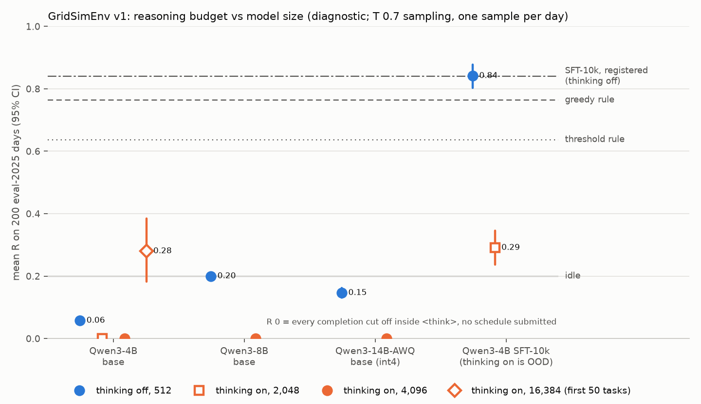

# Reasoning budget vs model size on GridSimEnv v1 (diagnostic)

**This is a diagnostic, pre-registered, with no training.** The plan is [`docs/prereg/v1-diag-reasoning-size.md`](../../../docs/prereg/v1-diag-reasoning-size.md), committed to `main` (a6d8d0b) before any generation. Amendment 1 (74ab9ce, timestamp fixed in f73a05b) was pushed after the first thinking-on row and before any row it added. It ran on 2026-10-26 UTC on one NVIDIA A10G 24 GB (GPU 3 of a g5.12xlarge shared with another lane). Nothing here replaces a registered result.

**The question.** Every trained Qwen number on v1 was decoded with thinking off and 512 tokens. Is the gap to 1.0 about room to reason, or about model size?
- Qwen3-4B base scored 0.061, mostly cut off at 512 tokens.
- Qwen3-4B SFT-10k scored 0.841, confirmed at 0.880 on eval-iid.
- The greedy rule scores 0.764, and GPT-6.1 Sol scores about 1.0 at high reasoning effort.

The sweep runs base Qwen3-4B, 8B and 14B (AWQ int4) with thinking off and on, and the SFT-10k model with thinking on, all on run 2's 200 eval-2025 tasks.

## Verdicts (the registered decision rule)

| rule | registered pairs (paired on 200 tasks) | verdict |
|---|---|---|
| **"Reasoning helps":** a 4B or 8B thinking-on row (4,096 tokens) beats its thinking-off row (512) with the paired 95% CI above 0 | 4B: **−0.058 [−0.071, −0.044]**; 8B: **−0.200 [−0.200, −0.200]** | **NOT MET.** At 4,096 tokens, all 400 thinking-on completions were cut off inside `<think>`, so none submitted a schedule. This is a verdict about a 4,096-token budget. |
| **"Size helps":** 8B beats 4B at the same setting with the paired 95% CI above 0 | thinking off: **+0.142 [+0.129, +0.156]**; thinking on: +0.000 (both 0) | **MET, through the thinking-off pair, but by format, not planning.** All 200 of 8B's answers are the same 90-token call with 24 zeros (all idle, R = 0.2 exactly). 4B fails to submit on 68% of days. |

**What the sweep shows:**
- **No base model plans with thinking off.** 8B and 14B-AWQ answer in 90 tokens with an immediate `submit_schedule` call and no reasoning:
  - 8B submits all idle on every day;
  - 14B-AWQ submits all idle on 30.5% of days and sells before charging on 62.5%, for 0.146.
  - **Size moves format compliance, not planning.** 14B-AWQ scores below 8B (−0.054 [−0.069, −0.038]), and no base row with thinking off has a single exact optimum.
- **Qwen3's thinking mode needs far more than 4,096 tokens on a battery-day.** At 2,048 and 4,096, 0 of 800 base completions (4B at both budgets, 8B, 14B-AWQ) closed `<think>`.
  - The episodes show coherent reasoning, not loops. Duplicate lines make up 0–11% of a row on average, and only 3 of the 800 completions are mostly repeats. The models restate the rules, list the prices and work through units and SoC by hand.
- **The amendment's 16,384-token probe (first 50 tasks; reported only, no verdict):**
  - **4B:** R **0.280 [0.183, 0.384]**. Only 52% of completions closed `<think>`, after a mean of 13,182 thinking tokens.
    - Against the 4B's own thinking-off answers on the same 50 days: **+0.195 [+0.093, +0.302]**. So with about 16k tokens of room, thinking does help the base 4B.
    - It stays far below the bar: on the 25 days it submitted, it scored 0.560, against 0.711 for the greedy rule and 0.868 for SFT-10k on the same days.
  - **8B: not completed.** It was stopped at 22:50 UTC, after 2 h 54 min of generation, at the coordinator's request to free the box. vLLM's batched call returns nothing until all 50 completions finish, so there are no partial counts. On one A10G, bf16 8B leaves about 4 GB for the KV cache, so 16k-token completions run only a few at a time.
- **SFT-10k with thinking on (out of distribution) is much worse:** **0.291 [0.237, 0.346]** against 0.842 with thinking off, paired −0.550 [−0.612, −0.488].
  - 51.5% of its completions are cut off inside `<think>` at 2,048 tokens.
  - On the 91 days it did submit, it scored 0.640 against 0.879 for its own thinking-off answers on the same days.
  - Its trained format, a compact visible rationale of about 378 tokens, is the reasoning that works. Thinking mode replaces it with a long untrained one.

**Against the prior:**

| row | prior | result |
|---|---|---|
| 4B thinking on, 4,096 | 0.25–0.45; reasoning helps at 4B about 85% | 0.000; not met |
| 8B thinking off | 0.05–0.20 | 0.200, all idle |
| 8B thinking on, 4,096 | 0.30–0.55; size helps (on) about 55%, (off) about 50% | 0.000; met off by format, not on |
| 14B-AWQ thinking on, 4,096 | 0.35–0.60 | 0.000 |
| SFT-10k thinking on, 2,048 | 0.70–0.85, no better than thinking off (about 70%) | 0.291, far worse |

The prior badly underestimated how long Qwen3's thinking runs on this task.

## What it implies for the next training run
- **Stay with thinking off and a short visible rationale.** Thinking mode is not a cheap lever here:
  - at 4,096 tokens no base model finishes;
  - at 16,384 tokens the 4B finishes about half the time and still plans worse than the greedy rule when it does;
  - GRPO with 8 × 8 rollouts of ~15k tokens would cost about 40× run 2's ~380-token rollouts.
- **Do not switch to a bigger base for its own sake.** Thinking off, 8B and 14B-AWQ only reach the all-idle floor or below. The one thing size bought, a well-formed call, the 4B SFT already has (99.5% valid).
- **The ceiling of the trained 4B (0.84–0.88) is not shown to be budget or size.** The lever left is the training signal on the 4B with its compact rationale: registered run 3's DP-exact per-hour advantages.
  - A longer *visible* rationale is the budget experiment worth running next, for example the DP rule worked hour by hour in 1–2k tokens, taught by SFT. That is not Qwen's thinking mode.
- **Caveats:**
  - Base rows measure zero-shot ability, not what training could reach.
  - The probe has 50 tasks.
  - 14B is int4 AWQ.
  - One sample per day, at the registered T 0.7 / top_p 0.8 rather than Qwen's thinking-mode T 0.6 / top_p 0.95. The `-t06` rows that would check this were not run.

## Results (200 eval-2025 tasks unless stated, foresight, oneshot prompt, path B, T 0.7 / top_p 0.8 / top_k 20, seed 0)

| row | tasks | mean R | 95% CI | valid | feasible | all idle | overfill | sell before charge | rate | cycle cap | end short | malformed | truncated (in thinking) | R ≥ 0.99 | tokens mean / p90 | hit cap | closed </think>, thinking tokens when closed | wall (s) |
|---|---|---|---|---|---|---|---|---|---|---|---|---|---|---|---|---|---|---|
| Qwen3-4B base, thinking off, 512 | 200 | 0.058 | [0.044, 0.071] | 32% | 22% | 22% | 0% | 9.5% | 0.5% | 0% | 0% | 17.5% | 50.5% (0%) | 0 | 415 / 512 | 52.5% | – | 79 |
| Qwen3-4B base, thinking on, 2,048 | 200 | 0.000 | [0.000, 0.000] | 0% | 0% | 0% | 0% | 0% | 0% | 0% | 0% | 0% | 100% (100%) | 0 | 2048 / 2048 | 100% | 0% | 452 |
| Qwen3-4B base, thinking on, 4,096 | 200 | 0.000 | [0.000, 0.000] | 0% | 0% | 0% | 0% | 0% | 0% | 0% | 0% | 0% | 100% (100%) | 0 | 4096 / 4096 | 100% | 0% | 1443 |
| Qwen3-8B base, thinking off, 512 | 200 | 0.200 | [0.200, 0.200] | 100% | 100% | 100% | 0% | 0% | 0% | 0% | 0% | 0% | 0% (0%) | 0 | 90 / 90 | 0% | – | 54 |
| Qwen3-8B base, thinking on, 4,096 | 200 | 0.000 | [0.000, 0.000] | 0% | 0% | 0% | 0% | 0% | 0% | 0% | 0% | 0% | 100% (100%) | 0 | 4096 / 4096 | 100% | 0% | 4763 |
| Qwen3-14B-AWQ base, thinking off, 512 | 200 | 0.146 | [0.131, 0.162] | 93% | 30.5% | 30.5% | 0% | 62.5% | 0% | 0% | 0% | 7% | 0% (0%) | 0 | 90 / 90 | 0% | – | 63 |
| Qwen3-14B-AWQ base, thinking on, 4,096 | 200 | 0.000 | [0.000, 0.000] | 0% | 0% | 0% | 0% | 0% | 0% | 0% | 0% | 0% | 100% (100%) | 0 | 4096 / 4096 | 100% | 0% | 2050 |
| Qwen3-4B SFT-10k, thinking off, 512 | 200 | 0.842 | [0.803, 0.878] | 99.5% | 82% | 0% | 11.5% | 3% | 1.5% | 1.5% | 4.5% | 0% | 0.5% (0%) | 90 | 378 / 435 | 0.5% | – | 70 |
| Qwen3-4B SFT-10k, thinking on, 2,048 (OOD) | 200 | 0.291 | [0.237, 0.346] | 45.5% | 29.5% | 0% | 14% | 2% | 0% | 0% | 1.5% | 0% | 54.5% (51.5%) | 17 | 1707 / 2048 | 54.5% | 48.5%, 1255 | 362 |
| Qwen3-4B base, thinking on, 16,384 (first 50 tasks) | 50 | 0.280 | [0.183, 0.384] | 50% | 40% | 0% | 6% | 0% | 0% | 4% | 4% | 2% | 48% (48%) | 1 | 14766 / 16384 | 48% | 52%, 13182 | 4000 |
| greedy rule | 200 | 0.764 | [0.726, 0.800] | 100% | | | | | | | | | | | | | | |
| threshold rule | 200 | 0.637 | [0.601, 0.673] | 100% | | | | | | | | | | | | | | |

- **Error rates** are each completion's first failure, as a share of all tasks. "Truncated" means no schedule was submitted before `max_tokens`, and the bracket gives the share cut off inside `<think>`.
- **Tokens** are completion tokens, thinking included.
- **Wall** is one vLLM pass over all the row's tasks on one A10G (vLLM 0.29, `max_model_len` 6,144, or 17,664 for the probe).
  - Throughput: about 570 tok/s for 4B bf16, 172 tok/s for 8B bf16 (about 4 GB left for the KV cache) and 400 tok/s for 14B-AWQ.
- **Prompts are byte-identical across models.** With thinking off, every row has prompt sha256 `ab66035a…`, the same as `pathb.prompt_text`. With thinking on, every 200-task row has `59114373…`. The prompt is 1,078 tokens with thinking off and 1,074 with it on.

**Paired gaps** (95% paired bootstrap, 10,000 resamples, seed 0). "When on submits" is the thinking-on row's mean R on the days it submitted a valid schedule, next to the other row's mean on those same days.

| reasoning: pair | tasks | paired gap | wins / ties | registered | CI > 0 | when on submits |
|---|---|---|---|---|---|---|
| q4b-on4096 − q4b-off512 | 200 | -0.058 [-0.071, -0.044] | 0% / 72% | yes | no | none |
| q8b-on4096 − q8b-off512 | 200 | -0.200 [-0.200, -0.200] | 0% / 0% | yes | no | none |
| q4b-on2048 − q4b-off512 | 200 | -0.058 [-0.071, -0.044] | 0% / 72% | no | no | none |
| q14awq-on4096 − q14awq-off512 | 200 | -0.146 [-0.162, -0.131] | 0% / 30% | no | no | none |
| sft-on2048 − sft-off512 | 200 | -0.550 [-0.612, -0.488] | 8.5% / 11.5% | no | no | 91 days: 0.640 vs 0.879 |
| q4b-on16384-n50 − q4b-off512 | 50 | +0.195 [+0.093, +0.302] | 44% / 32% | no | **yes** | 25 days: 0.560 vs 0.078 |

| size: pair | tasks | paired gap | wins / ties | registered | CI > 0 | when on submits |
|---|---|---|---|---|---|---|
| q8b-off512 − q4b-off512 | 200 | +0.142 [+0.129, +0.156] | 72.5% / 25.5% | yes | **yes** | – |
| q8b-on4096 − q4b-on4096 | 200 | +0.000 [+0.000, +0.000] | 0% / 100% | yes | no | – |
| q14awq-off512 − q8b-off512 | 200 | -0.054 [-0.069, -0.038] | 4.5% / 64% | no | no | – |
| q14awq-on4096 − q8b-on4096 | 200 | +0.000 [+0.000, +0.000] | 0% / 100% | no | no | – |

### Not run
- **The `-t06` rows** (Qwen's thinking-mode sampling, T 0.6 / top_p 0.95 / top_k 20) were registered "only if time allows" and were skipped at the coordinator's request, to free the box.
  - At 4,096 tokens they could not have changed the picture: no base model's thinking ends inside that budget at T 0.7.

## Pipeline check (passed before any thinking-on generation)
- **`sft-off512`: 0.842 [0.803, 0.878], valid 99.5%.** That is inside run 2's CI [0.802, 0.877]. Paired against run 2's per-task `eval_sft.json`: +0.001 [−0.008, +0.011], with 96.5% of days tied.
- **`q4b-off512`: 0.058 [0.044, 0.071].** That is inside the sanity band [0.03, 0.09]. Paired against run 1's `../4b/eval_base.json`: −0.003 [−0.017, +0.011].

## Setup
- **Models (pinned):**
  - `Qwen/Qwen3-4B` @ `1cfa9a7208912126459214e8b04321603b3df60c`, bf16.
  - `Qwen/Qwen3-8B` @ `b968826d9c46dd6066d109eabc6255188de91218`, bf16.
  - `Qwen/Qwen3-14B-AWQ` @ `31c69efc29464b6bb0aee1398b5a7b50a99340c3`, Qwen's official AWQ, 4-bit, group size 128. bf16 14B does not fit one A10G.
  - SFT-10k is run 2's SFT LoRA merged into the 4B base (`scripts/merge.py` as in `../confirm-sft10k/`). Its archive `qwen3-4b-gridsim-v1-reg2-seed0.tgz` has sha256 `69c5f4a6…e33f`, the same as the confirm lane's.
- **Packages:** `pip_freeze.txt`, identical to `../pip_freeze.txt` apart from the editable plugin: torch 2.13, vllm 0.29.0, transformers 5.17.0.
- **Grading:** `pathb.score`, which is `gridsim_core.trl.extract_actions` and then `grade`.
  - `<think>…</think>` blocks are dropped, and an unclosed `<think>` is dropped to the end of the text. So only a `submit_schedule` call after the thinking counts, and no valid call scores 0.
  - This was tested locally before the run: a call inside `<think>` is ignored, the one after it is graded, and a completion cut off in its thinking scores 0.

## Files
- `summary.json`: every row's numbers, the paired gaps, the probe context, the pipeline check and both verdicts.
- `eval_<row>.json`: per-task reward, validity, error kind, tokens, `</think>` closure, thinking tokens and actions.
- `episodes/<row>.jsonl.gz`: full completions, thinking included.
- `r_by_model.png`: the chart above.
- `gpu.csv`, `gpu_eval.csv` and `pip_freeze.txt`.
- **`scripts/`:**
  - `diag_eval.py`, which imports run 2's `evaluate.py` and `pathb.py` unchanged;
  - `gate_diag.py`, the pipeline check;
  - `run_unit.sh`, `run_unit2.sh` (amendment 1's order) and `finish_unit.sh`, which stopped the run at 22:50 UTC;
  - `merge.py`;
  - `report_diag.py`, which builds the tables, `summary.json` and the chart.
- **Cost:** about 7.5 h of one A10G, and no API spend:
  - 3.7 h of completed generation;
  - 2.9 h on the stopped 8B probe;
  - the rest on engine loads and setup.
